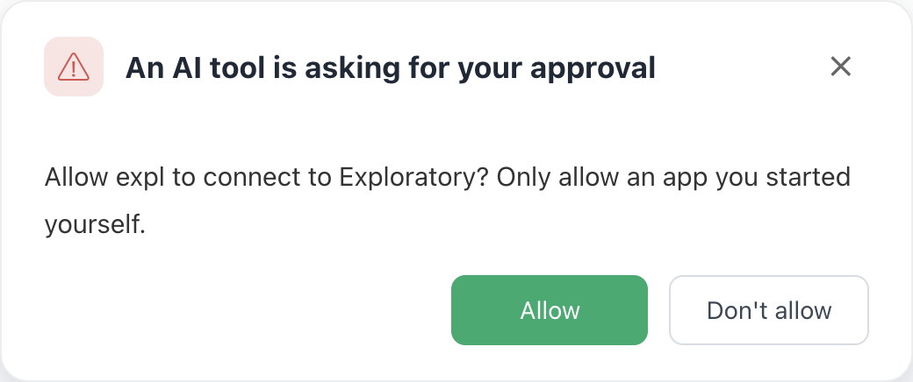

# Get started

Turn on the CLI in Exploratory Desktop, connect expl, and look at the data in your project. Do the steps below in order and you get your first result on this one page.

<a id="steps"></a>

## Steps

### 1. Turn on the CLI

expl comes with Exploratory Desktop. The CLI is off by default, and Desktop refuses its commands until you turn it on.

In Exploratory Desktop, choose your name at the bottom left of the screen, then choose System Settings in the menu that opens. In the menu on the left, choose MCP / CLI, turn on the switch on the CLI card, and choose Save. To create, change or delete content with expl, also check Allow create, edit and delete. The pictures are on the [Installation](install.md#enable) page.

### 2. Sign in to Desktop

Start Exploratory Desktop and sign in. expl reads the connection details and token that Desktop writes, so expl has no sign-in of its own.

Open a new terminal and check that expl works.

```sh
expl --version
```

### 3. Check the state

```sh
expl status
```

It shows the Desktop version and the signed-in user.

### 4. Allow the connection the first time

The first time you use it, Exploratory Desktop shows a screen that asks whether to allow expl to connect to Exploratory. Check that it is the expl you started yourself, and allow it.



expl waits up to 2 minutes for your answer and prints "Waiting for you to approve expl in Exploratory (a request is shown there)..." to standard error. When you allow it, the command continues. If no answer comes within 2 minutes, it stops with PAIRING_PENDING (exit code 1). Answer the request in Desktop and run the command again. If the command stopped before you answered, run expl status again.

### 5. Choose a project

```sh
expl project list
```

Lists the projects.

```sh
expl project use "Sales Analysis"
```

Replace Sales Analysis with the name of your project. Later commands work on this project.

### 6. Look at the data

```sh
expl dataframe list
```

Lists the data frames of the project. Choose the id of one.

```sh
expl dataframe get-schema <dataframe_id>
```

Shows the column names and types. Replace \<dataframe_id\> with the id you chose. To see rows, run expl dataframe preview \<dataframe_id\>.

### 7. Get a dashboard (optional)

```sh
expl dashboard list
```

Choose the id of a dashboard from the list. If the list is empty, the project has no dashboard yet.

```sh
expl dashboard get d123 --json
```

Replace d123 with the id you chose.

<a id="trouble"></a>

## If something does not work

- A command is refused: check that the CLI switch is on and saved (step 1).
- The command stops with PAIRING_PENDING: you did not answer within 2 minutes. Answer the request in Desktop and run the command again (step 4).
- expl tools list exits with code 0 but nothing works: that does not mean Desktop is connected. Run expl status.
- The dashboard list is empty: the project has no dashboard yet.

See [Troubleshooting](troubleshooting.md) for more.

<a id="next"></a>

## Next

- [Choose a project](guides/projects.md) - The order in which the project is decided.
- [Use](use.md) - Find the command for what you want to do.
- [All commands](commands.md) - Find a command by purpose.
- [Troubleshooting](troubleshooting.md) - Find a fix by symptom.
