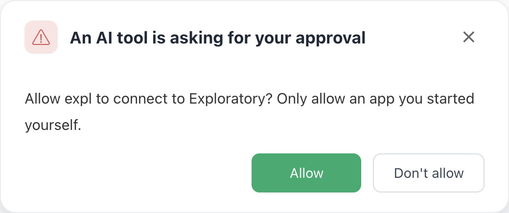

# Try it

Start Desktop, then check its state with expl, choose a project and get a dashboard.

<a id="steps"></a>

## Eight steps

### 1. Start Desktop and check that the CLI is on

Start Exploratory Desktop. The CLI must be turned on and saved by the steps on the [Installation](install.md#enable) page. If you have not done so yet, do it first.

### 2. Sign in to Desktop

Sign in to Exploratory Desktop. expl reads the connection details and token that Desktop writes, so expl has no sign-in of its own.

### 3. Check the state

```sh
expl status
```

It shows the Desktop version and the signed-in user.

### 4. Allow the connection the first time

The first time you use it, Exploratory Desktop shows a screen that asks whether to allow expl to connect to Exploratory. Check that it is the expl you started yourself, and allow it.



expl waits up to 2 minutes for your answer and prints "Waiting for you to approve expl in Exploratory (a request is shown there)..." to standard error. When you allow it, the command continues. If no answer comes within 2 minutes, it stops with PAIRING_PENDING (exit code 1). Answer the request in Desktop and run the command again.

### 5. Check the state again

If the command stopped before you answered, run expl status again.

### 6. List the projects

```sh
expl project list
```

### 7. Choose a project

```sh
expl project use "Sales Analysis"
```

Replace Sales Analysis with the name of your project.

### 8. Get a dashboard

```sh
expl dashboard list
```

Choose the id of a dashboard from the list. If the list is empty, the project has no dashboard yet.

```sh
expl dashboard get d123 --json
```

Replace d123 with the id you chose.

If something fails, see the troubleshooting page.

<a id="next"></a>

## Next

- [Choose a project](guides/projects.md) - The order in which the project is decided.
- [All commands](commands.md) - Find a command by purpose.
- [Troubleshooting](troubleshooting.md) - Find a fix by symptom.
