The AI Prompt feature lets you enter what you want to do for data wrangling (processing, formatting), such as formatting, calculating, aggregating, joining, and processing text, in natural language, and AI suggests R code to do it. It was added in v12.

## What You Can Do

You no longer need to manipulate various UIs or master complex functions for data wrangling. You can freely and quickly process data by simply entering what you want to do, such as:

- “Extract only the company names”
- “Convert date-related columns to the correct data type”
- “Join with the ‘prefecture information’ data”
- “Calculate the retention rate”
- “Filter the data to the last 7 days”
- “Calculate the customer lifetime value”

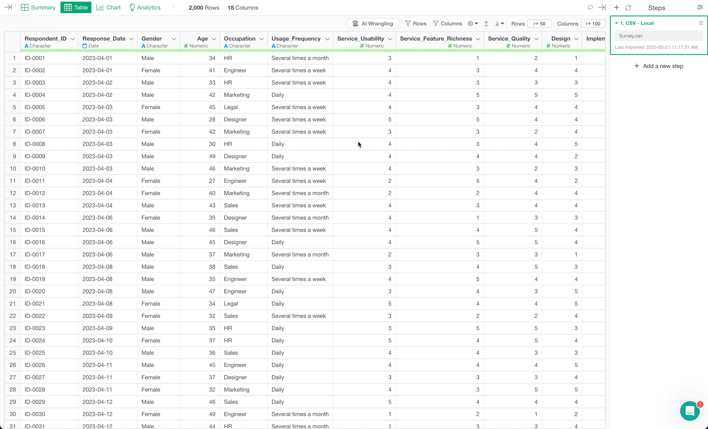

## What AI Suggests

When you submit a prompt, three things are output: “R Command,” “Function Used,” and “Expected Results.”

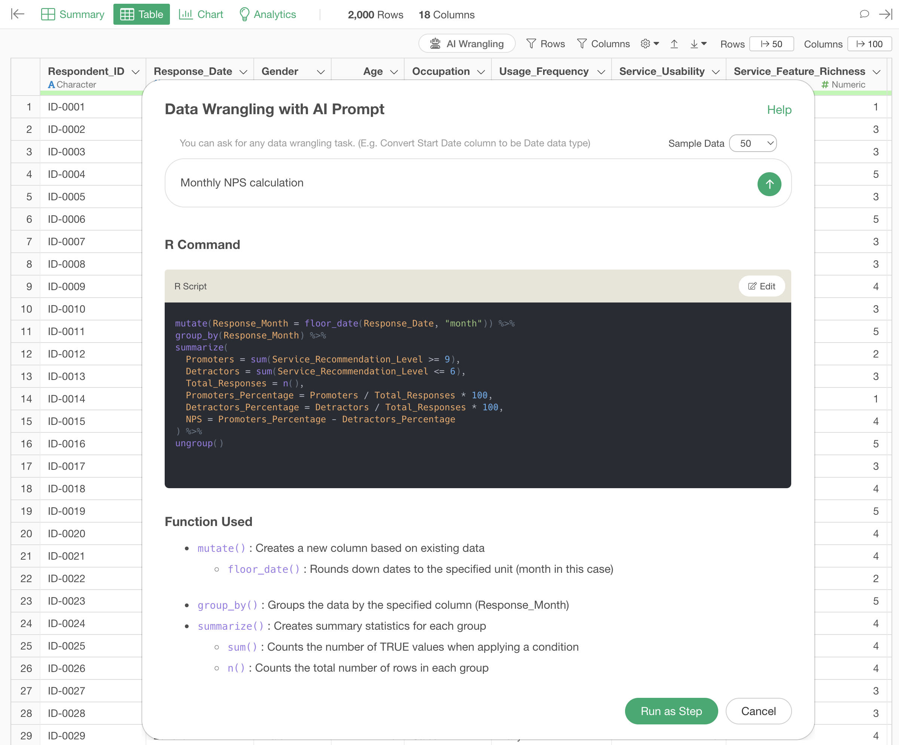

### Run the R Command

In the R Command section, the data wrangling tasks necessary to process the queried content are output as R code, so you can apply that processing by pressing “Run as Step.”

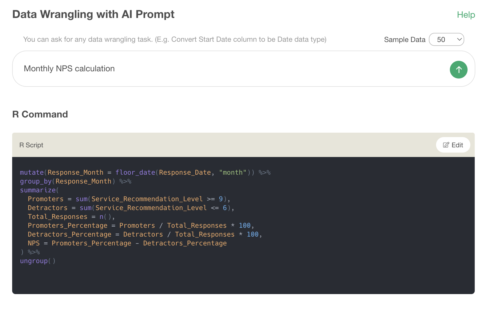

### Edit the R Command

If you want to modify the R Command, click the edit button.

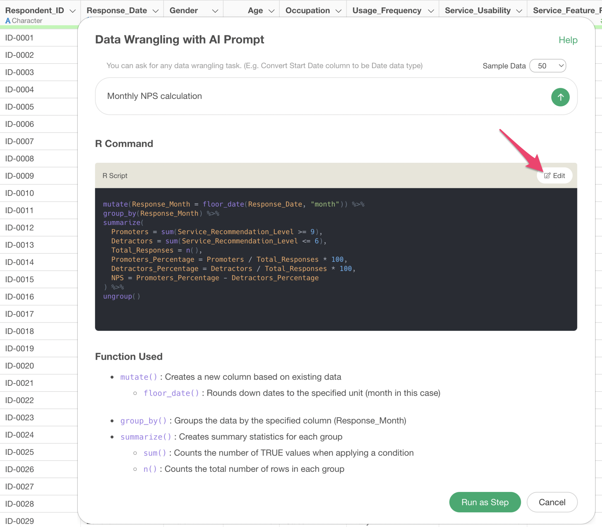

From the edit mode, you can change or modify the generated column names and make other adjustments.

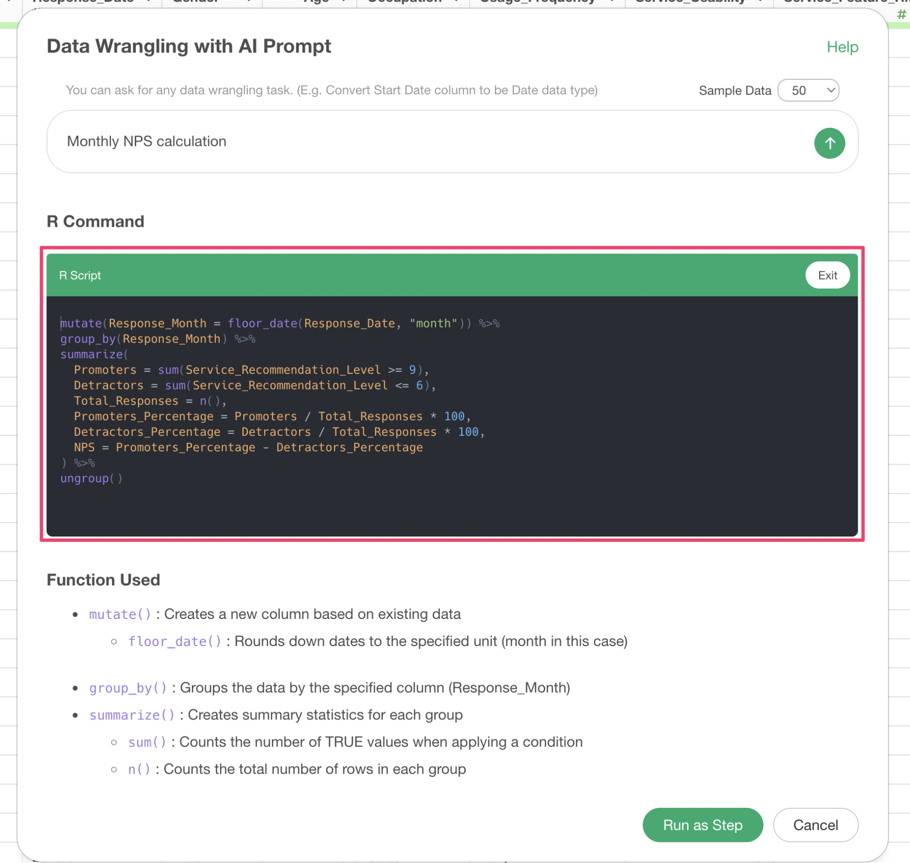

### Check the Function Used

The **Function Used** section explains the functions and arguments in the R command.

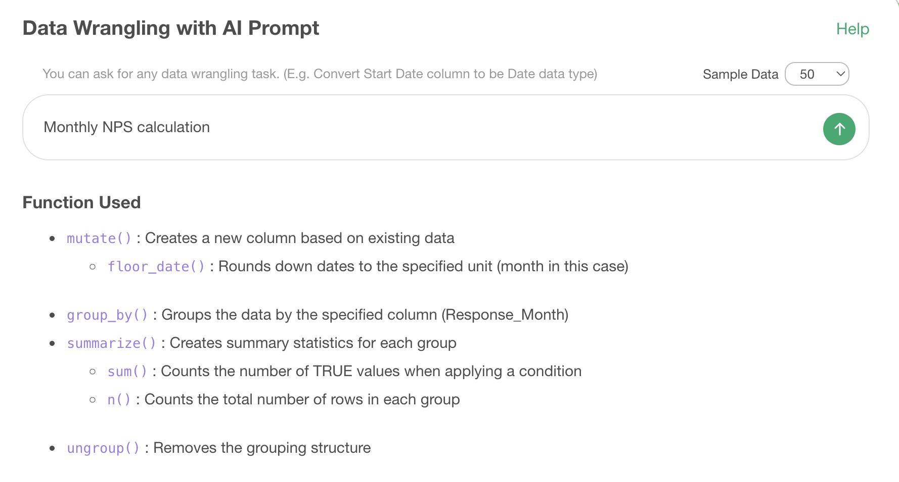

### Check the Expected Results

The “Expected Results” section explains what results will be obtained by executing this code.

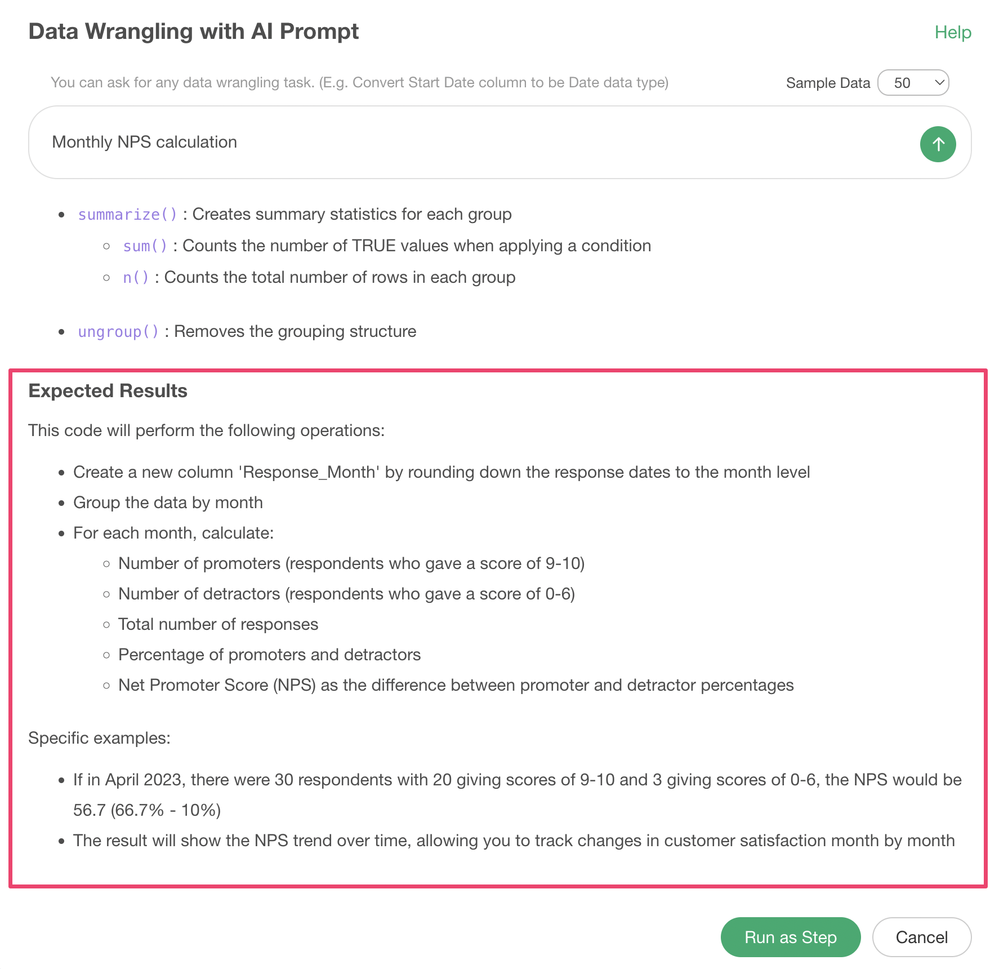

## Writing Prompts

The basic structure for writing prompts in English is typically “verb + column name + processing content” using a command form.

For example, let’s say we’re using sales data from an e-commerce site where each row represents one ordered product.

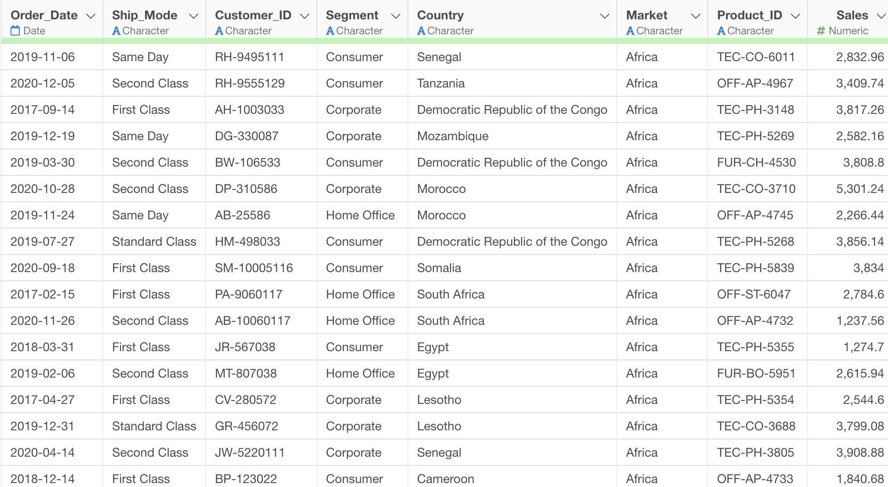

If we want to create a column that determines whether the sales are 1000 or more, on the Table tab, we click **AI Wrangling**, then enter “Determine if sales are 1000 or more.”

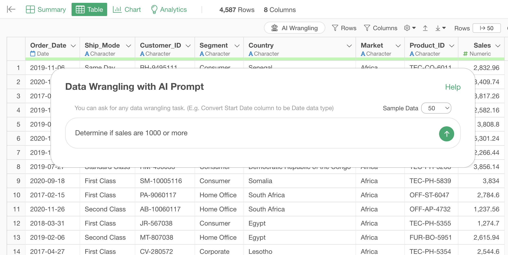

By executing the prompt, we get the R command result to determine if sales are 1000 or more. So, we click the “Run as Step” button.

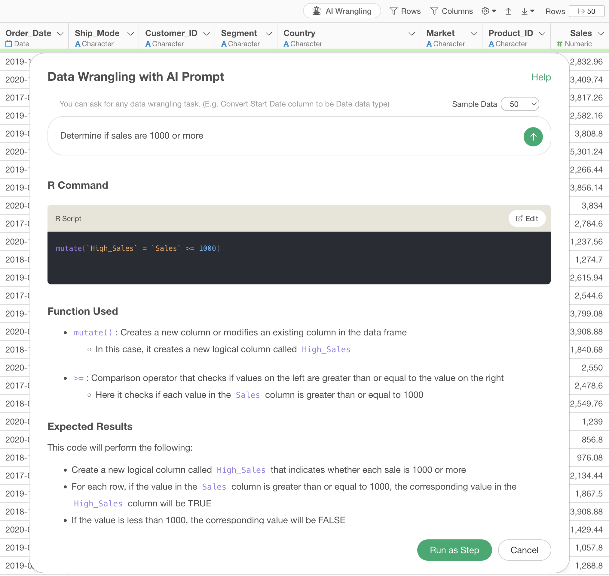

In this example, the new column is called `High_Sales`. It contains TRUE when Sales is at least 1000 and FALSE otherwise.

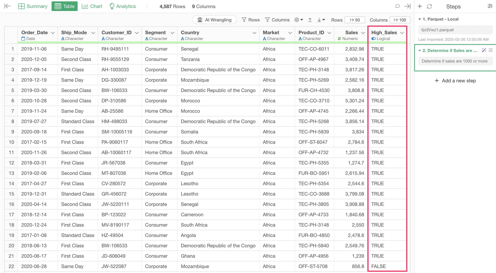

### Aggregate by Group

If you want to aggregate by customer and then determine if sales are 1000 or more, add the “group unit” to the beginning of the original question.

For example, change the question to “For each customer, determine if total sales are 1000 or more”

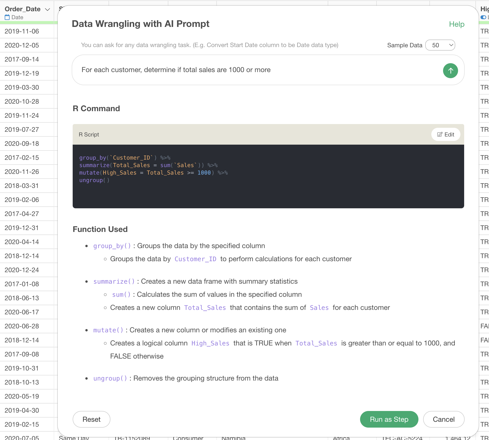

This allows us to aggregate to one row per customer and then determine if the total sales column is 1000 or more.

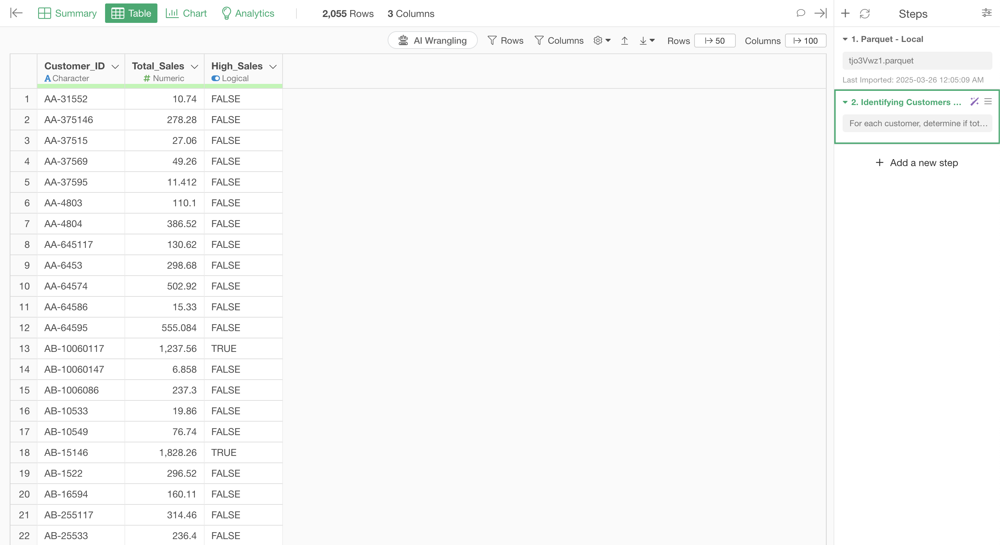

### Tips for Writing Prompts

There are two points to keep in mind when writing prompts:

- Keep it concise: Use short, clear expressions starting with a verb (like “Calculate…”, “Convert…”, “Extract…”)
- Use specific column names: Include the names of the columns you want to process in the prompt
