AI Data lets you describe the data you want in your own words, and AI assembles an R script to get it, runs that script, and builds the data frame from the result. It was added in Exploratory Desktop v16. It replaces the effort of getting data into a usable shape, such as writing SQL, reading an API’s documentation, copying a table out of a PDF, or combining several Excel sheets into one, with a conversation.

## Screen Layout

AI Data is a chat-based data acquisition screen built into Exploratory. The screen is split into three areas:

- **Left: Chat** — where you describe the data you want. Every exchange with AI stays in the history.
- **Top right: R Script** — the acquisition script AI generated.
- **Bottom right: Data Preview** — the result of actually running that script (up to the first 100 rows).

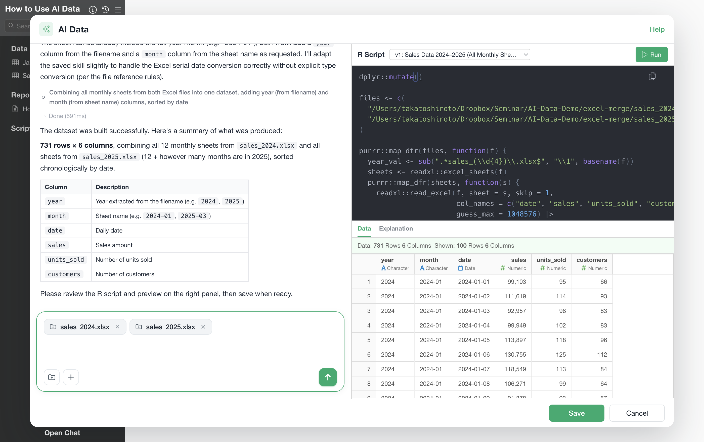

What matters here is that what comes back isn’t “data” — it’s an “R script.” AI isn’t fetching an answer from somewhere and displaying it; it assembles a script that says “here’s how you get this data,” and that script runs on your own machine, in your own R.

This design gives you three things.

1.  **You can see what’s happening** — the script shows exactly what it’s doing. If you’re unsure, read it.
2.  **You can fix it** — either by asking in chat, or by editing the script yourself.
3.  **It’s reproducible** — once saved, it behaves like any other data source; refreshing it just re-runs the saved script.

Turning the tedious, technical parts of data preparation into a conversation, while keeping all the transparency and reproducibility of an R-based data pipeline — that’s what AI Data is about.

## What Kinds of Data Are Supported

You can import essentially any kind of data except images. If R can reach it, consider it within AI Data’s scope.

Internally, AI Data comes with more than **110 reference documents**, one per data source, each describing how to retrieve data from it. AI consults the relevant reference first, before writing anything — so instead of a plausible-looking guess, you get a script that follows the correct way to access that particular source.

### 1. Local Files

| Kind | Extensions | How it’s handled |
|:---|:---|:---|
| Tabular text / binary | `csv` `tsv` `txt` `tab` `log` `parquet` `json` | Read directly as a table |
| Excel | `xlsx` `xls` `xlsm` | Pick a sheet, then read it |
| Statistical software files | `sav` (SPSS) `dta` (Stata) `sas7bdat` `xpt` (SAS) `rds` `rda` `rdata` (R) | Read directly as a table |
| Documents | `pdf` `docx` `xml` `html` `htm` | Extract the tables inside |
| Folder | — | Handle the files inside together |

Being able to say “combine these into one dataset” — for several Excel sheets, or every CSV in a folder — is what sets this apart from doing it by hand.

### 2. Databases

PostgreSQL, MySQL / MariaDB, SQL Server, Oracle, Snowflake, BigQuery, Amazon Redshift, Amazon Athena, Amazon Aurora, Presto / Trino, MongoDB, SQLite, Treasure Data, Vertica, Teradata, MS Access, and more — plus generic ODBC / DBI database connections.

### 3. Cloud Storage and SaaS

Amazon S3, Google Drive, Google Sheets, Google Cloud Storage, Dropbox, Box, SharePoint, Microsoft Azure Storage, Salesforce, Stripe, Intercom, GitHub, Google Analytics, and more.

### 4. Public Statistics and Open Data APIs

This is where AI Data has the biggest impact. You don’t need to read the API spec — just name the source, and it goes and gets it. The list below is a representative sample; many more national statistics agencies and domain-specific open data APIs are supported as well.

- **International organizations**: World Bank, OECD, Eurostat, IMF, ECB, BIS, UN Comtrade, WHO
- **National agencies**: FRED (US Federal Reserve), SEC EDGAR, the U.S. Treasury, the U.S. Bureau of Labor Statistics, USGS, Statistics Canada, the UK Office for National Statistics, and more. For Japan: e-Stat, the e-Gov data portal, EDINET (securities reports), the Japan Meteorological Agency’s disaster-prevention data, and the Real Estate Information Library
- **Others**: Wikipedia / Wikidata, Open-Meteo (weather), OpenStreetMap, CoinGecko (crypto), Our World in Data, stock price data

### 5. Web Pages and Web Search

You can pull a table off a specific page, or ask AI to search the web and find one for you. When you see progress steps like “Searching the web…” and “Fetching web content…” in the chat — shown as the “Searching the Web” and “Fetching Web Page” step cards — this is what’s happening.

## How to Use AI Data

### Step 1: Open AI Data

Click the **+** button above the data frame list, and choose **AI Data** at the top of the menu.

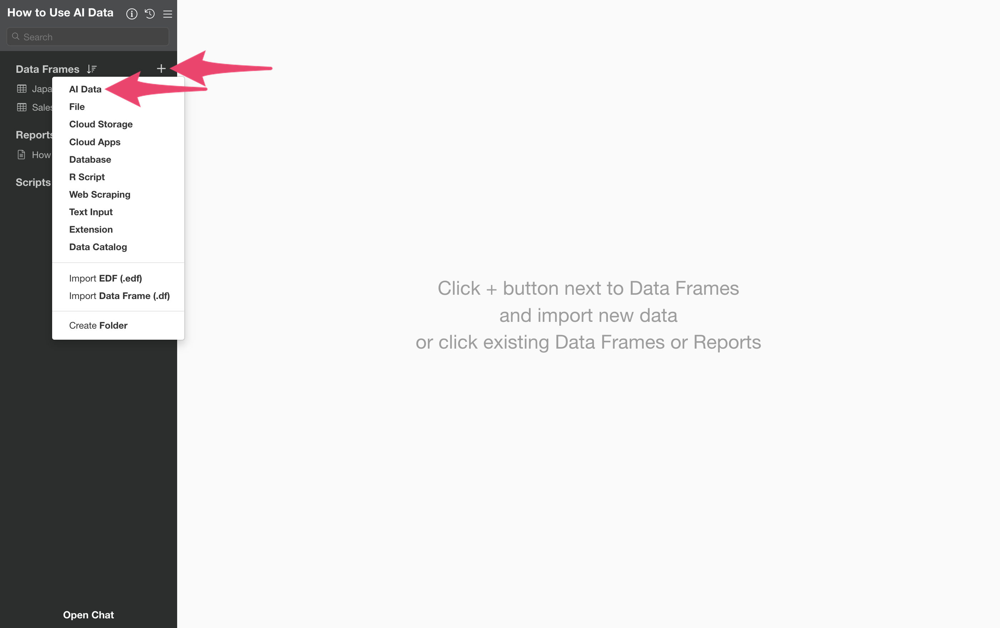

The chat dialog opens, showing the prompt “**What data would you like to get?**” In the input field below (placeholder text: “**Write what data you’d like to get…**”), describe what you want in your own words.

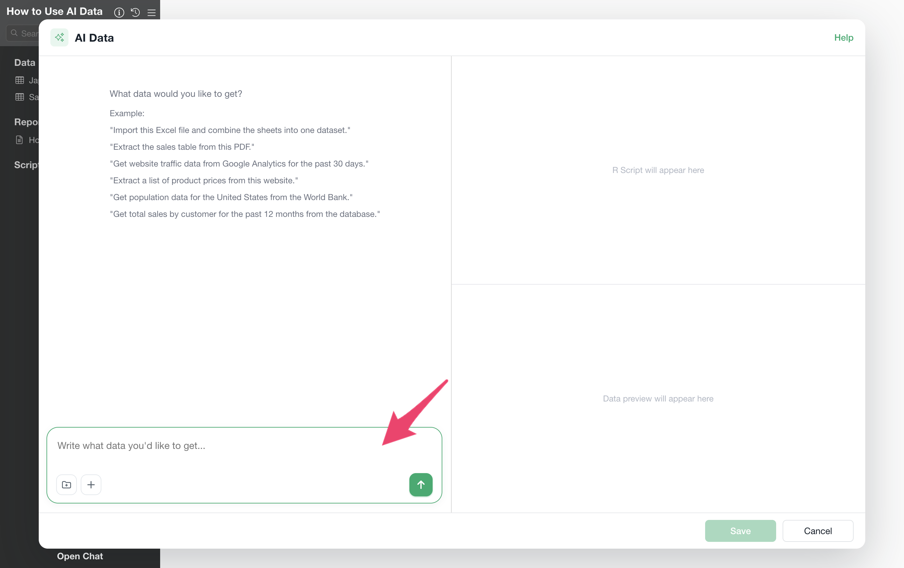

### Step 2: From Files — Instruct via Drag and Drop

From here on, let’s follow a real example. What we have on hand is two workbooks of daily sales data, one for each year:

- `sales_2024.xlsx` — 12 monthly sheets, `2024-01` through `2024-12`
- `sales_2025.xlsx` — 12 monthly sheets, `2025-01` through `2025-12`

Each sheet already carries a full daily `date` — `2024-01-01`, `2024-01-02`, and so on — right alongside `sales`, `units_sold`, and `customers`, and every one of the 24 sheets across both files shares exactly the same four columns. What makes this tedious isn’t messy formatting; it’s the sheer number of tabs. The 731 rows are scattered across 24 separate sheets in two separate workbooks, and Excel has no built-in “read every sheet from every file in this folder and stack them into one table” command. Doing it by hand means clicking into 24 tabs, one at a time, and pasting them together — exactly the kind of data that’s genuinely tedious to assemble manually.

For local files, drag and drop the file or folder onto the chat area.

You can also pick them from the folder icon at the bottom left of the input field (**Select files or folders**), or from **+** → **Add files or folders**.

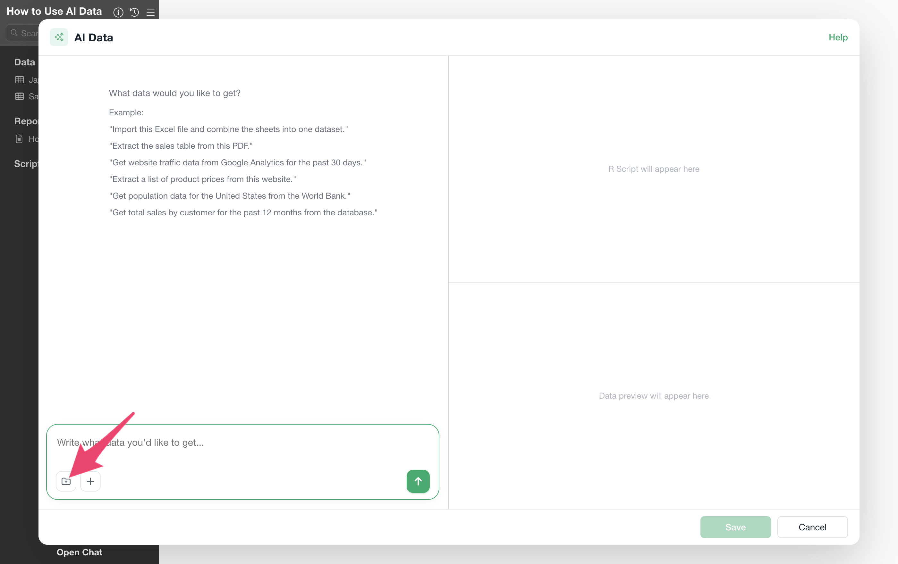

Once you attach the files, AI Data suggests how to import them, based on what’s inside.

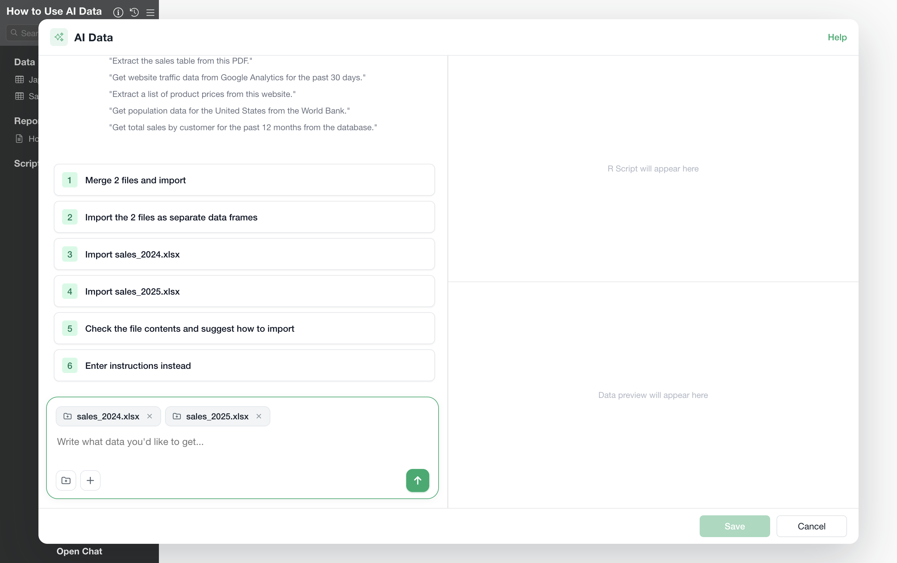

Once you send the request, AI shows what it’s doing as a series of steps — “**Looking up reference…**”, “**Generating R script…**”, “**Running R script…**”, and so on.

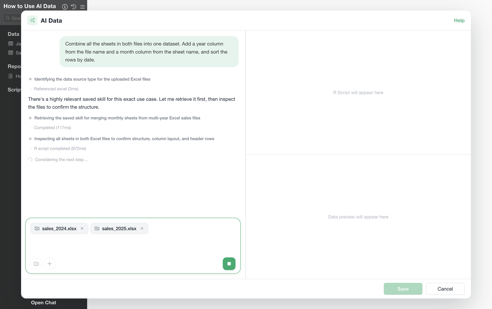

When it finishes, the generated R script appears at the top right, and the preview from running it appears at the bottom right.


All 24 sheets from both workbooks come together into a single table of **731 rows × 6 columns** — the original `date`, `sales`, `units_sold`, and `customers` columns, plus a `year` column parsed from each file name and a `month` column parsed from each sheet name — and AI explains in the chat what it did to combine them.

### Step 2: From Databases and APIs — Choose a Connection

For data sources that require authentication, such as databases and APIs, select a connection before making your request. Click the **+** button in the input field and choose **Data connections** to see your saved connections.

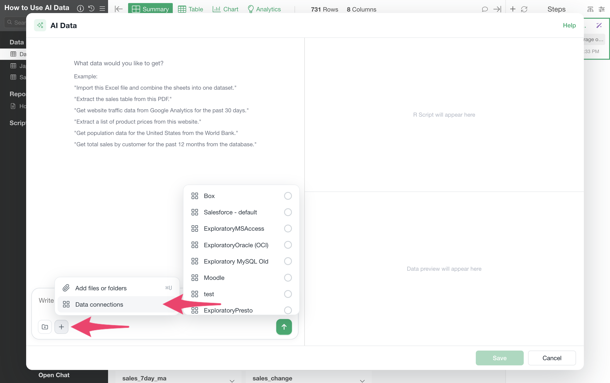

Pick the connection you want, then describe the data you need.

``` text
Aggregate the last 30 days of sales from the orders table, broken down by day and product category.
```

``` text
Get the number of sessions from Google Analytics for the past 90 days, broken down by date, device, and channel.
```

Once you select a connection, AI builds the script with that source’s type in mind — whether it’s PostgreSQL, Salesforce, or something else.

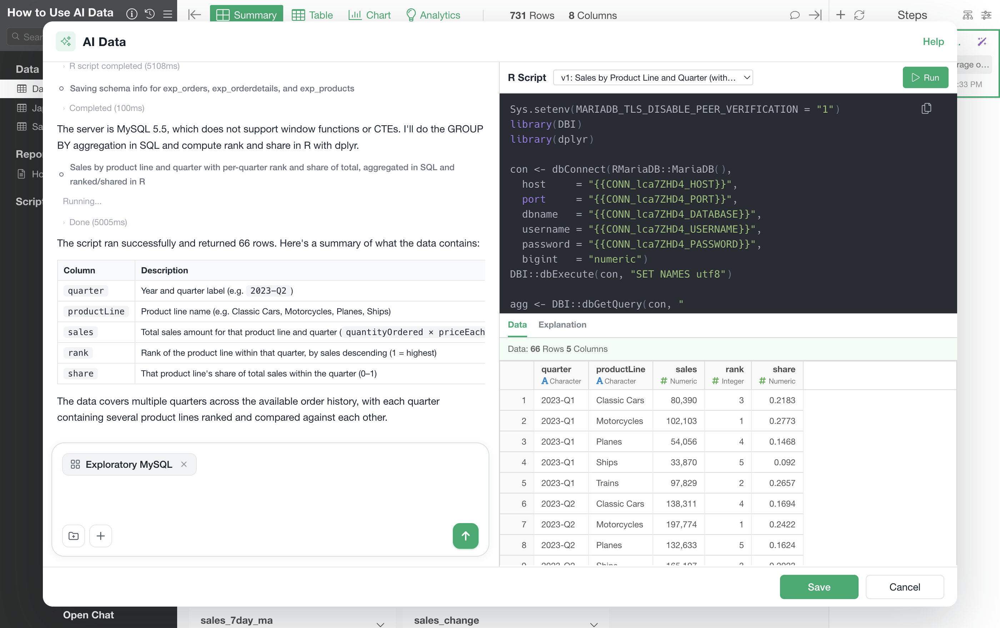

### Step 2: No Connection Yet — Create One from the Chat

You can ask for data from a source you haven’t set up a connection for yet — just go ahead and describe it.

``` text
Get this fiscal year's monthly sales from the sales table in Amazon Redshift.
```

When no matching connection is found, AI recognizes this, **suggests creating one, and opens the connection dialog**.

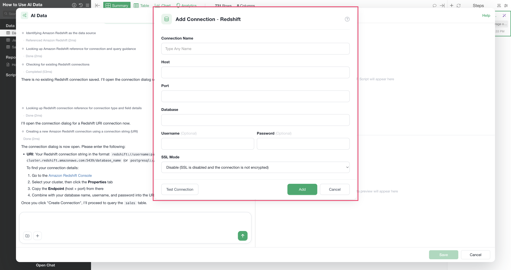

Enter the connection details and save, and a message — `The connection "<name>" has been created.` (for example, `The connection "Redshift (demo)" has been created.`) — is automatically sent into the chat, and **the conversation continues from there**. You don’t need to type your request again.

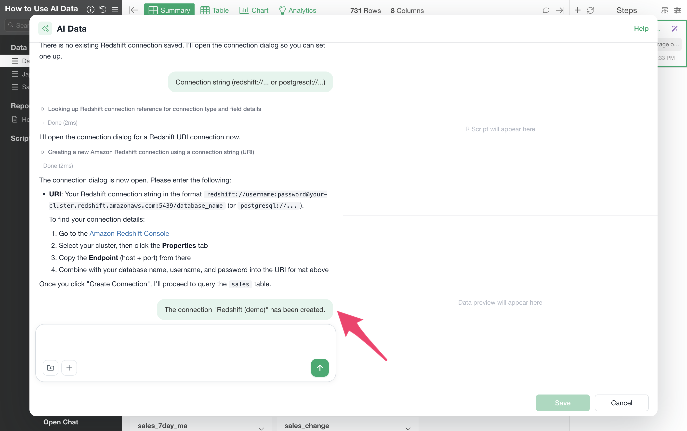

### Step 3: Check the Preview and Refine It in Chat

Because AI Data is chat-based, you can look at the preview it produces and give follow-up instructions to add to it or fix anything that catches your eye. Looking at the 731-row sales table from Step 2, for example, adding one more request —

``` text
Also add a 7-day moving average of sales, and a column showing the change from the previous day.
```

— brings the table to **731 rows × 8 columns**: a `sales_7day_ma` column (a 7-day trailing average, so the first six rows come back as `NA`) and a day-over-day change column, added without disturbing the rows already there.

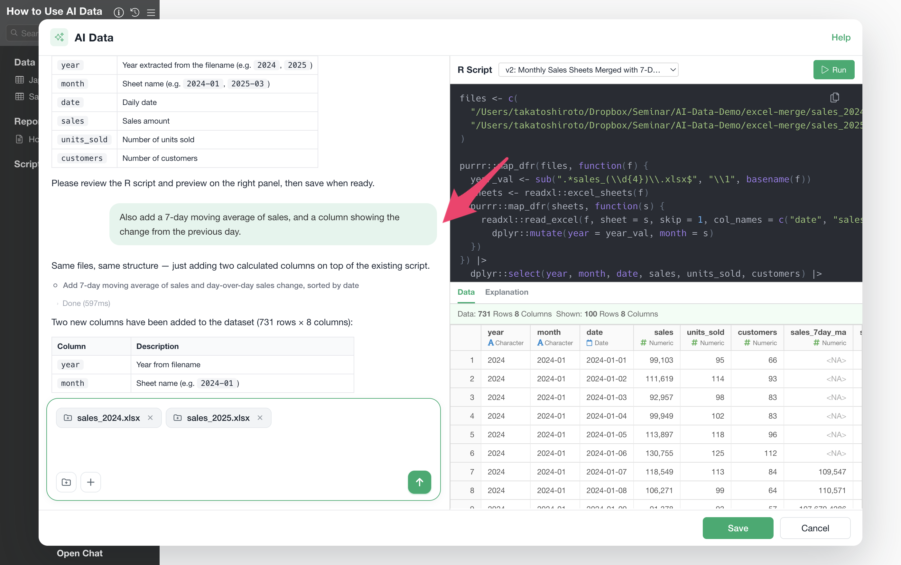

### Step 4: Save

When you’re happy with the preview, click **Save**.

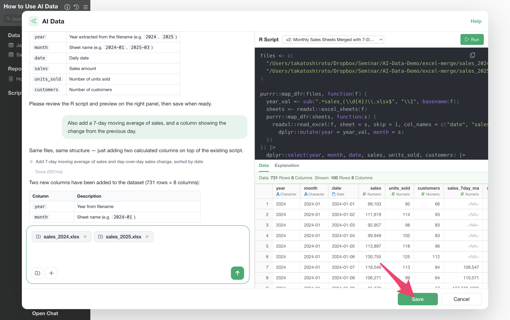

It’s imported as a data frame, and from then on you can treat it just like any other data source.

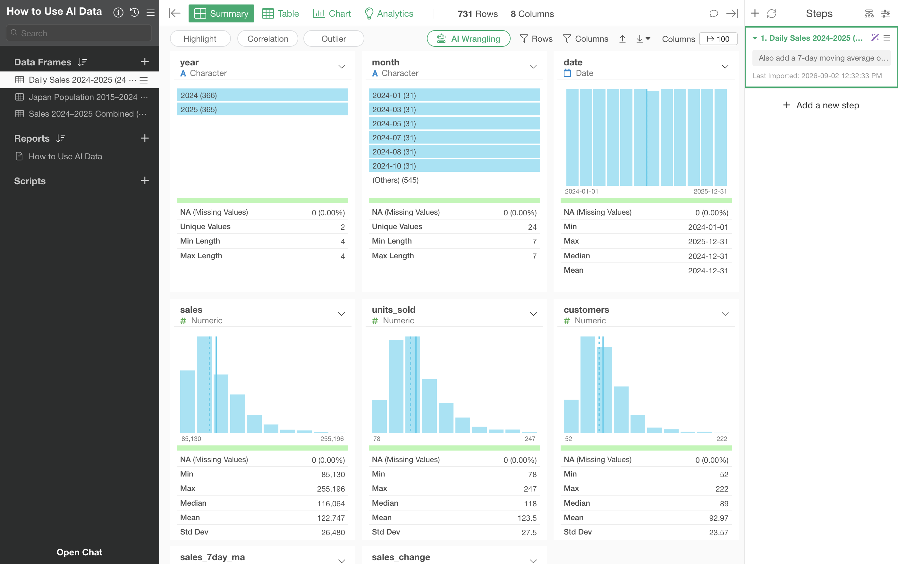

### Step 5: Change It Later

Even after saving, **clicking the instruction box shown on the step reopens the chat with the entire conversation intact**.

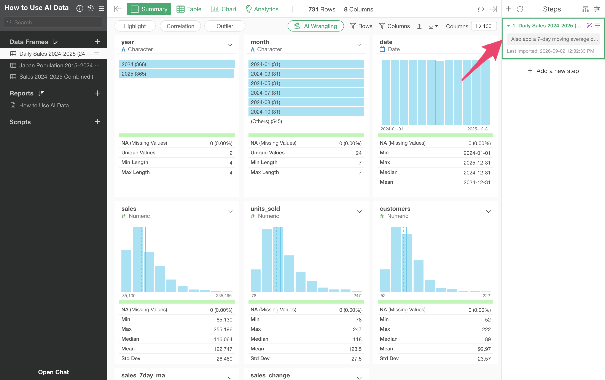

Because the history is still there, you never have to reconstruct what you did last time. Just add your next instruction and continue.

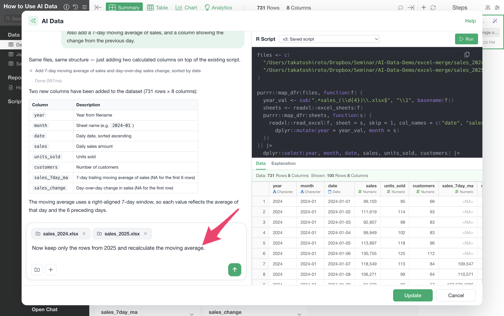

## Automatically Shaping Data into a Tidy, Easy-to-Use Form

The data you want isn’t always already in a clean, ready-to-use shape. Take this CO2 emissions dataset from BP’s Statistical Review of World Energy 2023, for example — it’s 109 rows and 34 columns, and instead of a single `year` column, it spreads 1990 through 2022 out across 33 separate year columns, one per year: a wide layout. Mixed into those 109 rows are eight regional subtotal rows (`Total North America`, `Total S. & Cent. America`, and so on), broader aggregate rows like `Total World` and `of which: OECD`, nine blank rows used as section dividers, and six lines of footnotes at the very bottom explaining things like what `n/a` means and how the former USSR’s figures were compiled.

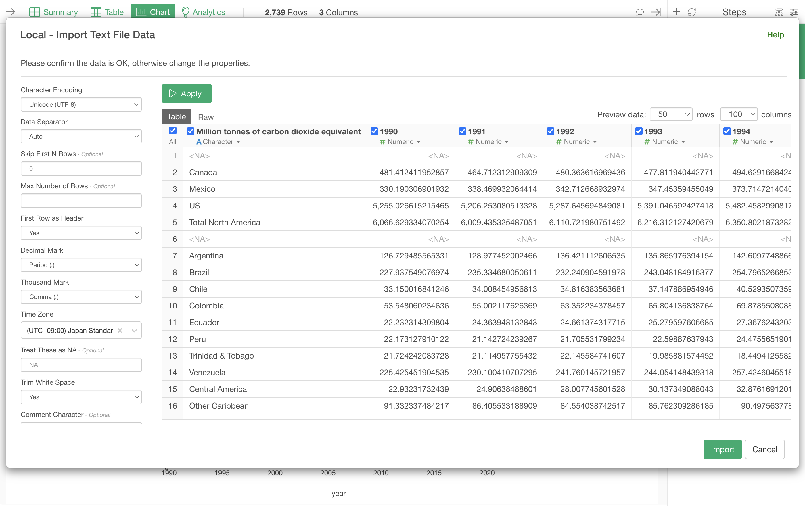

Import the file in this shape and you can’t chart how emissions have changed over time for a given country — there’s no single column you could even put on the axis.

But AI Data reshapes it into a tidy, workable structure automatically, without any extra instruction, reading the shape of the data and adapting to it.

Asking only “Import this CO2 emissions data so I can chart the trend by country over time,” with nothing said about pivoting or reshaping, is enough. AI Data recognizes the wide layout, skips the blank divider rows on its own, and folds the 33 year columns into a single `year` column: **3,267 rows × 3 columns**, with `country`, `year`, and `co2_emissions_mt` — 99 countries and regions across all 33 years.

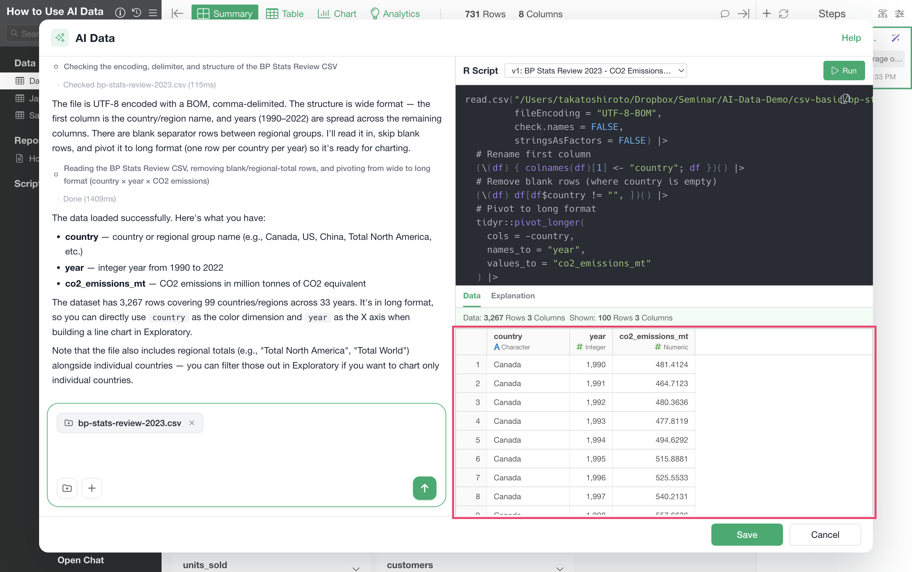

AI also notices, on its own, that the regional subtotal rows (`Total World`, `Total OECD`, and the rest) and the footnote rows are still sitting in the result, and says so — it doesn’t just leave them in silently. Left in, they’d show up in a chart’s legend as if they were countries. One more instruction — “Exclude the regional total rows (Total World, Total OECD, and the other Total rows) and the footnote rows at the bottom of the file, so only individual countries remain.” — takes the table down to **2,739 rows**. The chart legend still includes regional entries such as Western Africa and Other Europe.

From there, charting the trend takes nothing more than setting `year` on the X axis, `co2_emissions_mt` (SUM) on the Y axis, and `country` for color, and every country’s emissions history from 1990 to 2022 is right there.

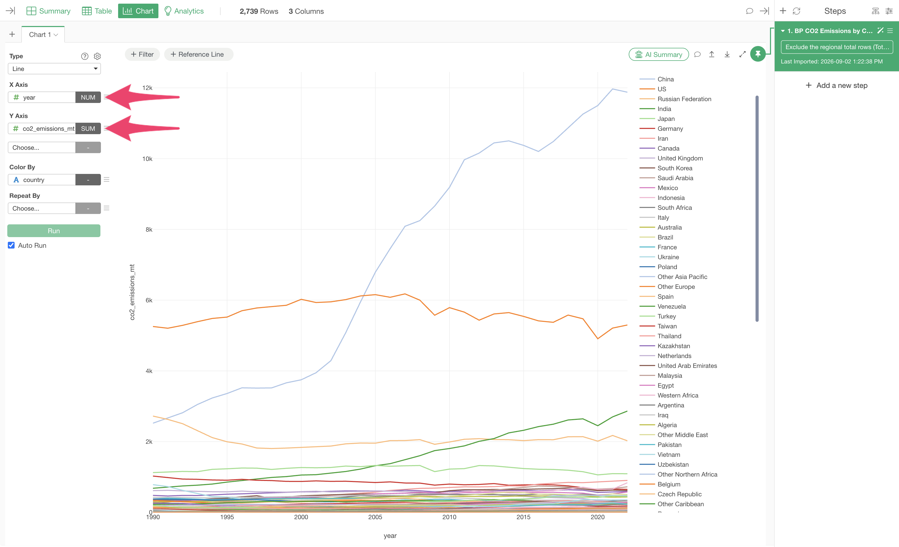

## User Skills: Retrieval Knowledge That Builds Up Over Time

When you save an AI Data result, the retrieval procedure is automatically saved as a **User Skill**, so the knowledge of how to get that data accumulates every time you use it.

### What Gets Saved

A skill is a Markdown file, saved under `~/.exploratory/ai_skills/data_source/`. It looks like this:

``` text
---
title: Google Sheets Survey Response Customer Data
connectionId: ...
connectionName: ...
description: Join survey responses with customer data by customer ID
keywords:
  - survey
  - customer data
  - Google Sheets
useCount: 0
createdAt: '2026-08-19T14:31:14.781Z'
---

# Request Summary
(a summary of what was requested at the time)

# Script
(the R script that was actually used)
```

The title, description, and keywords are written by AI, based on that conversation.

### What Happens Next

The next time you ask for something similar, AI Data **searches your saved skills and builds on the previous procedure**.

Attaching the same two sales workbooks in a brand-new chat and asking, “Combine all the sheets in both files into one dataset with year and month columns, sorted by date,” gets a different response than the first time. AI Data replies, “There’s a very relevant saved skill for this exact use case. Let me retrieve it,” runs a step labeled “Retrieving the saved skill for combining monthly sheets from multiple yearly Excel sales files,” and then says, “I have a saved skill that matches this request exactly. Let me run it directly.” It skips straight past the structure investigation and **retrieves the data using the R script that worked last time as a reference**, landing on the same 731 rows × 6 columns as before.

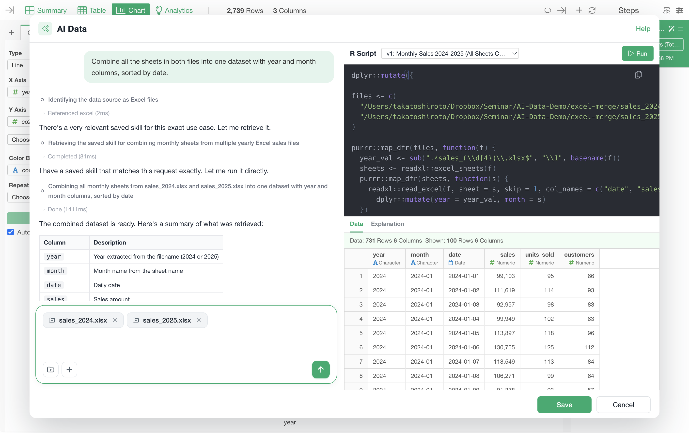

User Skills give you a few concrete benefits.

- **It’s faster the second time** — no need to redo the table-structure investigation or the script trial-and-error.
- **The procedure is preserved as an artifact** — reusing what worked last time keeps you from getting something different every run.

This matters most for knowledge that only applies in your own environment — the quirky table layout of an internal database, or the specific way one particular API has to be called. **AI Data is designed to fit your environment better the more you use it.**

## Frequently Asked Questions

For frequently asked questions about AI Data, please see [this note](https://exploratory.io/note/exploratory/AI-Data-FAQ-zqY1Gmy9).

This FAQ note answers a wide range of questions about AI Data. Below is one example — a question about security.

### About Security

Are API keys or database connection credentials passed to the AI?

No, they are not. Credential handling is designed as follows:

- We never ask for credentials such as API keys or passwords in the chat
- Credentials are never written directly into R scripts
- When connecting to a database, the connection information held by Exploratory is inserted as a variable at the top of the R script. Hostnames and port numbers are never passed to the AI

If you’re using a data source that requires an API key, you’ll be prompted to enter it through a dedicated dialog. The value you enter is stored internally within Exploratory and is never passed to the AI as-is.
