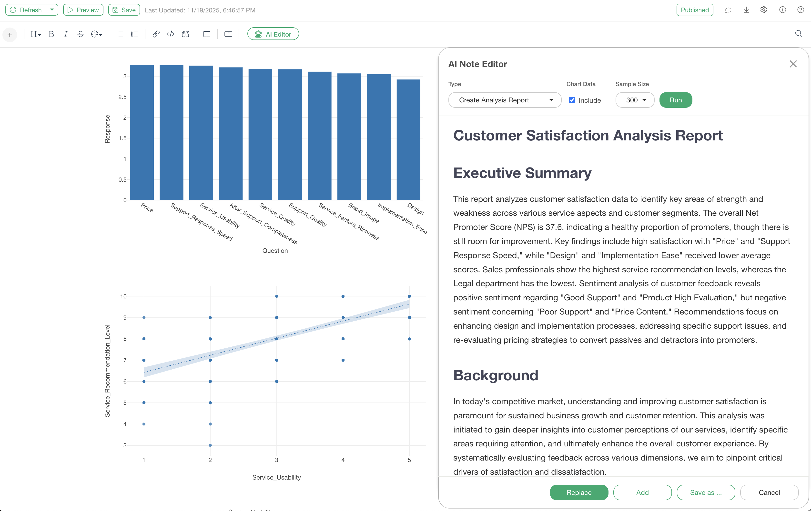
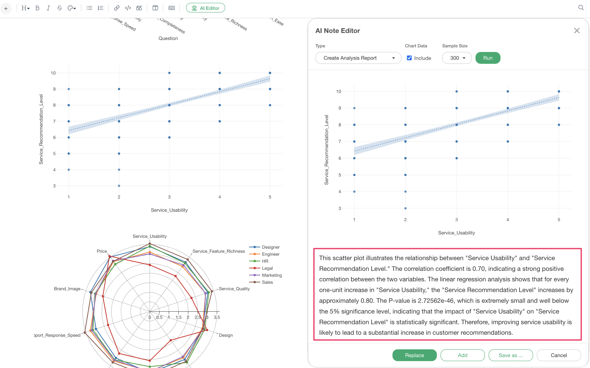
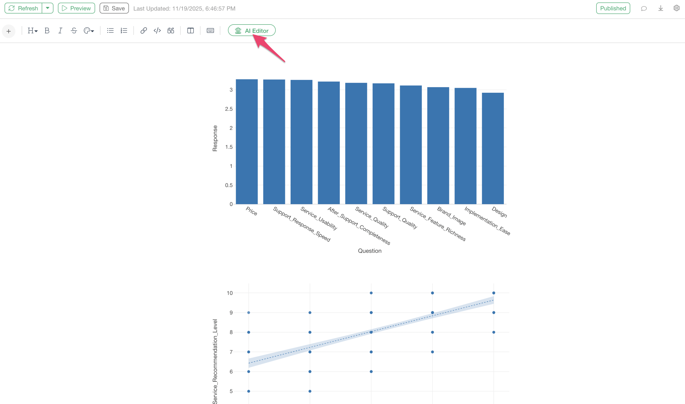
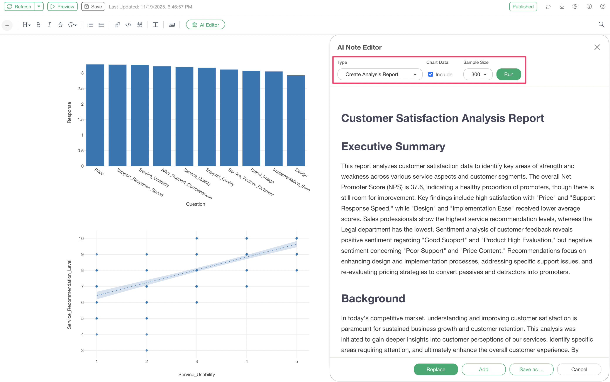
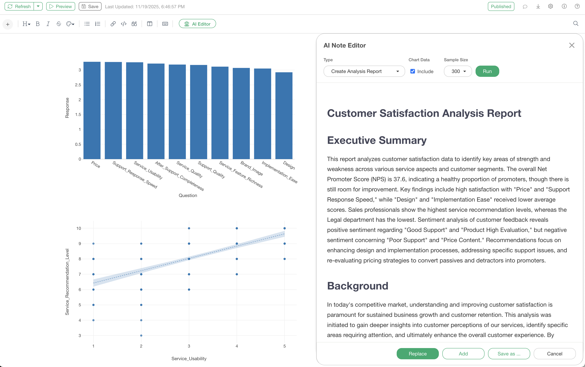
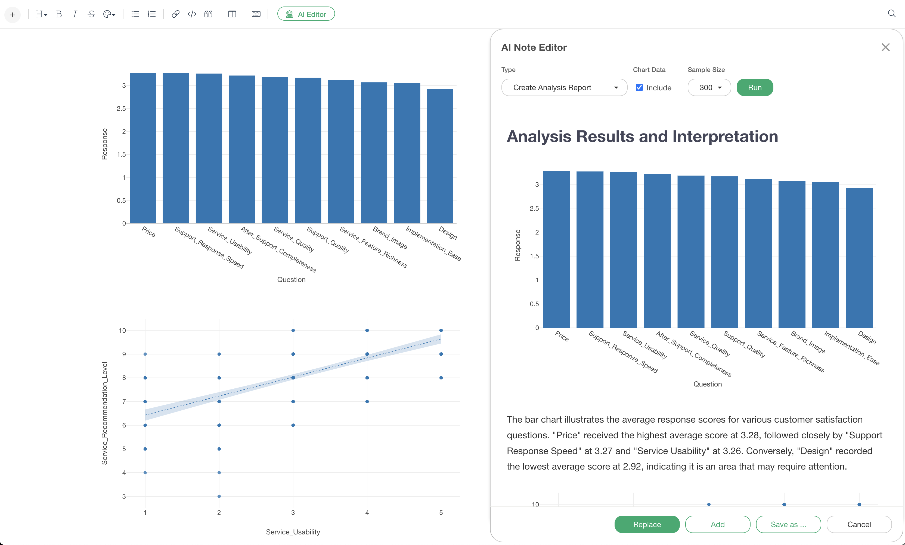
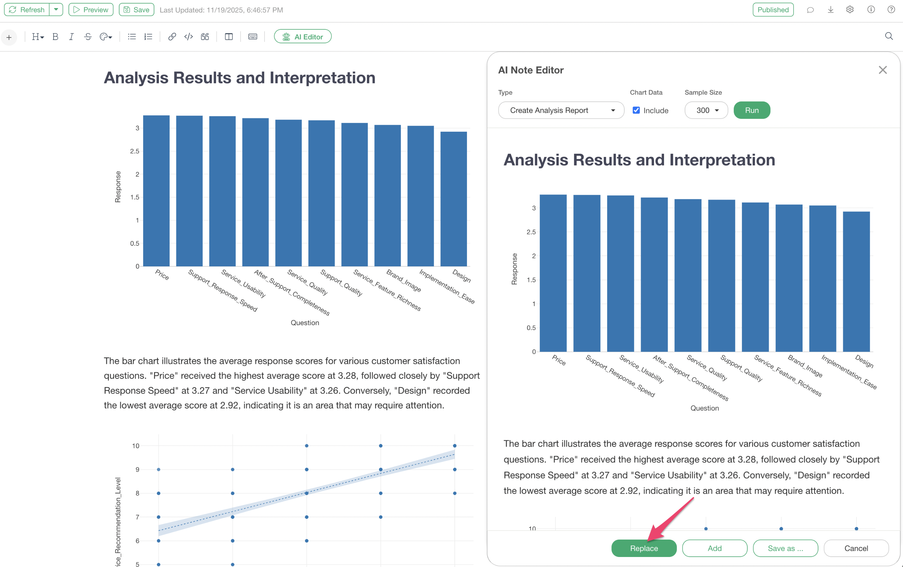

The AI Note Editor was introduced in Exploratory version 14. By simply providing a few lines of notes or just charts, the AI automatically generates a full-fledged report, including components such as background, objectives, analysis results, proposals, and conclusions. This page introduces how to use the analysis report function of the AI Note Editor.

## What You Can Do

Using the AI Note Editor significantly reduces the time spent on note creation.

Charts embedded in notes can be explained by the AI, eliminating the need for users to write their own interpretations of the charts.

This eliminates the burden of starting a report from scratch, allowing users to complete high-quality reports simply by reviewing and revising the AI-generated draft.

## Create an Analysis Report

1. With only charts added to a note, select the “AI Editor” button in the note.

   

2. Select “Create Analysis Report” from the menu and execute it. A full-fledged analysis report with chart explanations is automatically generated.

   

In the example below, the generated Customer Satisfaction Analysis Report opens with an Executive Summary on NPS and satisfaction with service aspects, followed by Background.

Below each chart, insights derived from that chart are output in text format.

## Use the Generated Report

Click the “Replace” button to replace the original note content with the generated report. This allows for further in-depth analysis and discussion based on the AI-generated report, including chart interpretations.

