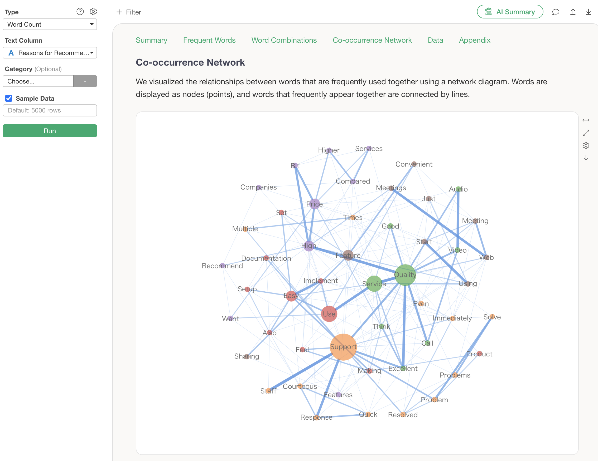
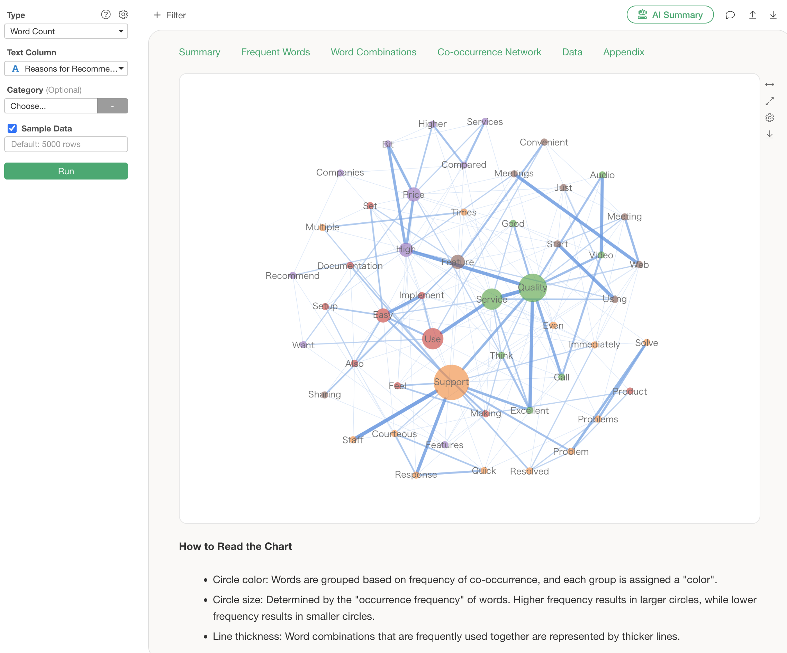
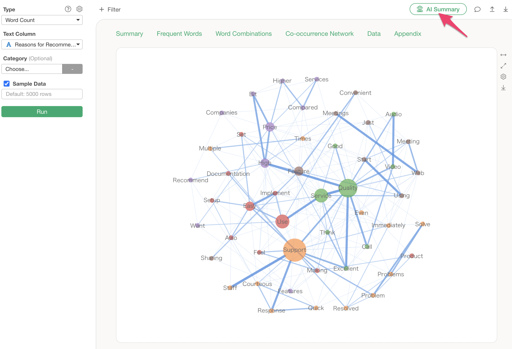
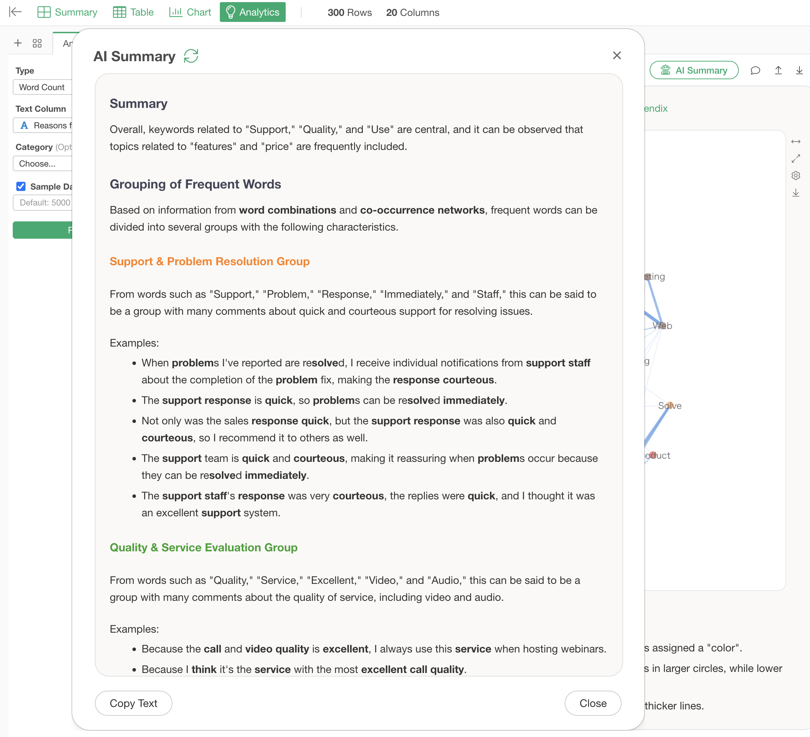
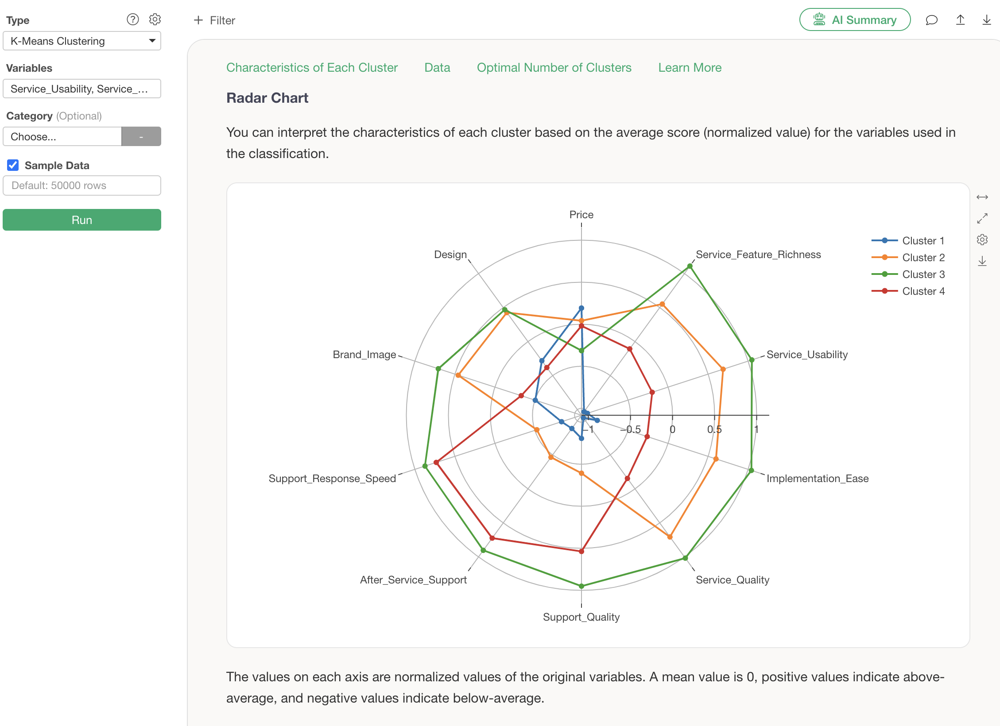
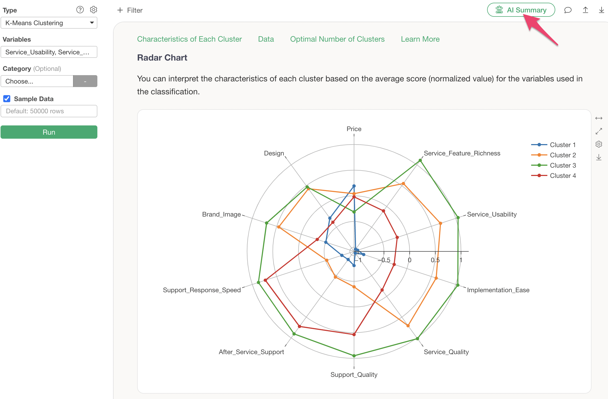
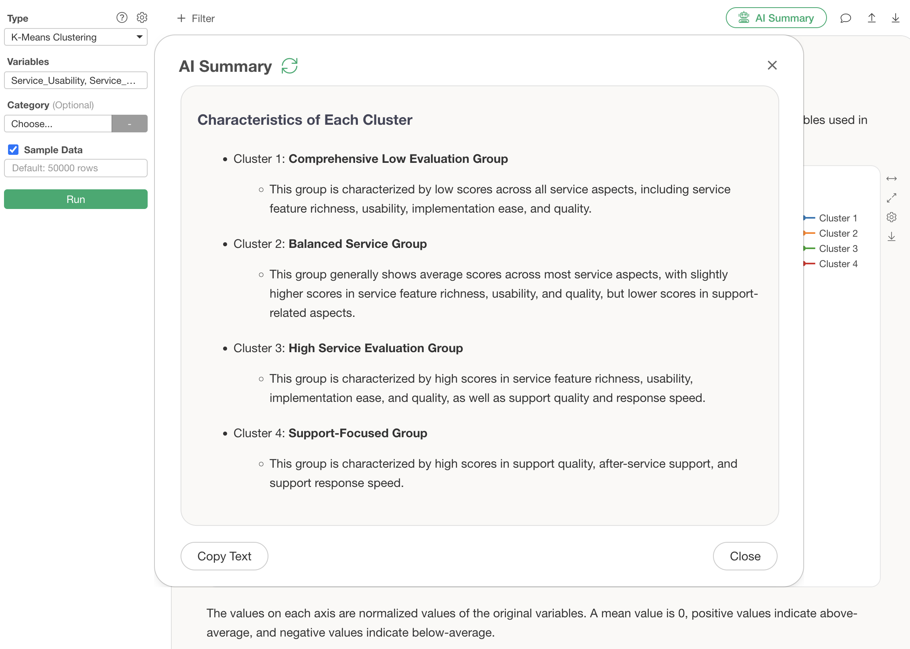
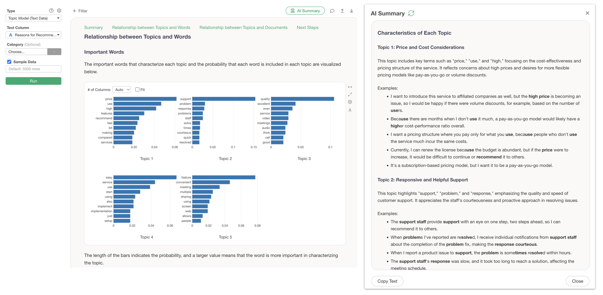
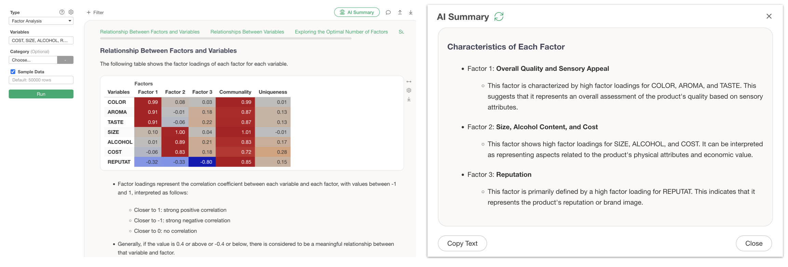
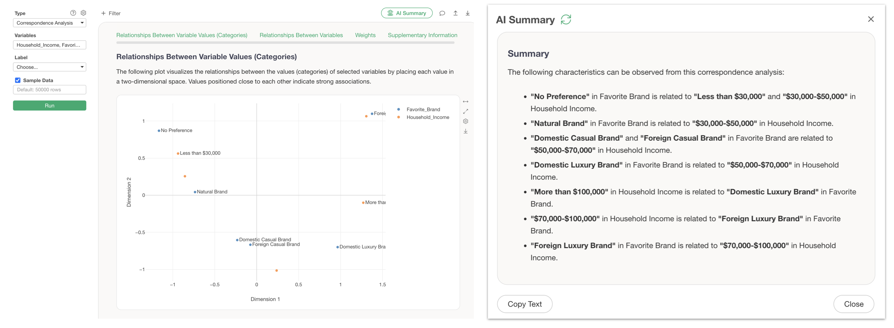

AI Summary explains results from analytics such as K-Means Clustering, Factor Analysis, and Text Analysis in natural language.

## Supported Analytics

- K-Means Clustering
- Factor Analysis
- Correspondence Analysis
- Text Analysis - Word Count
- Text Analysis - Topic Model

## Text Analysis - Word Count

In “Word Count,” you can analyze what kind of word groups exist using charts like co-occurrence networks.

The analytics guide explains how to interpret the chart, so even those new to text analysis are guided on how to view it.

After running the analysis, click the “AI Summary” button.

The **Summary** describes the overall trend of the text. **Grouping of Frequent Words** describes the characteristics of each group and gives examples from the actual sentences.

Just by looking at this AI Summary, you can immediately determine what groups exist as a result of text analysis. Furthermore, examples of actual sentences are displayed, allowing you to understand the background of customer voices that cannot be seen from numerical data alone.

## K-Means Clustering

In K-Means Clustering, you can check the characteristics of each cluster using several charts such as radar charts and scatter plots (biplots).

The following is a radar chart, which shows that Cluster 3 generally has high ratings, and Cluster 1 generally has low ratings. The Guided Analytics also provides detailed explanations on how to read the charts.

After running K-Means Clustering, click the “AI Summary” button.

This outputs information summarizing the cluster names and characteristics of each cluster (group).

For this clustering, the AI summarizes that the groups are classified as follows:

**Characteristics of Each Cluster**

- Cluster 1: **Comprehensive Low Evaluation Group**
- Cluster 2: **Balanced Service Group**
- Cluster 3: **High Service Evaluation Group**
- Cluster 4: **Support-Focused Group**

By simply looking at this AI Summary, you can see what characteristics each divided group possesses, as determined by the AI.

## Results for Other Analytics

### Topic Model

For Topic Models, it summarizes the characteristics of each topic and explains them along with actual sentences.

### Factor Analysis

For Factor Analysis, it explains the characteristics of each factor based on factor loadings.

### Correspondence Analysis

For Correspondence Analysis, it explains the relationships between variable values (categories) in text.

