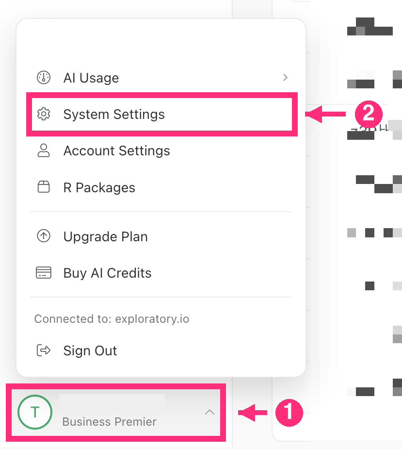
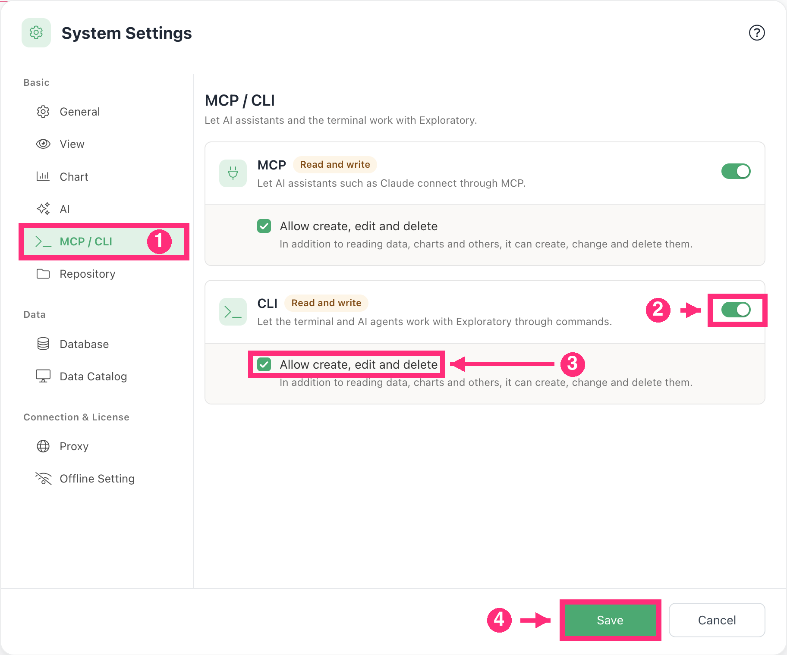

expl comes with Exploratory Desktop. There is nothing else to install.

<a id="enable"></a>

## Turn on the CLI first

In Exploratory Desktop, the CLI is off by default. Even when expl is on your PATH, Desktop refuses its commands until you turn it on.

1. In Exploratory Desktop, choose your name at the bottom left of the screen, then choose System Settings in the menu that opens (1 and 2 in picture 1).



2. In the menu on the left of System Settings, choose MCP / CLI (1 in picture 2).
3. On the CLI card, turn on the switch (2 in picture 2).
4. Only when you want to create, change or delete content with expl, also check Allow create, edit and delete (3 in picture 2).
5. Choose Save at the bottom of the screen (4 in picture 2).



<a id="bundled"></a>

## Bundled with Desktop

When you start Exploratory Desktop, it puts expl on your PATH (the list of folders where commands are found) if it is not there yet. Use it from a newly opened terminal. You do not need to install Node.js.

On macOS this happens only when the app is in /Applications or \~/Applications.

Open a new terminal and run this.

```sh
expl --version
```

<a id="where"></a>

## Where it goes

| OS | Location |
| --- | --- |
| macOS | /usr/local/bin/expl (\~/.local/bin/expl when you decline the administrator permission) |
| Windows | \<install folder\>\\cli is added to your user PATH. Administrator rights are not needed. |

On macOS, installing in /usr/local/bin may ask for administrator permission. If you decline, expl goes to \~/.local/bin; add that folder to your PATH if needed, and run `which expl` to see where it is.

The same program is also installed as exploratory, and as exploratory-mcp for MCP. If another command already uses one of those names, only that name is not installed.

<a id="two"></a>

## When you also installed it with npm

If you have both an npm copy and the Desktop copy of expl, check which one runs.

### macOS and Linux

```sh
which -a expl
```

Shows every copy, in the order they run.

### Windows

```sh
where expl
```

<a id="update"></a>

## Update

The expl that comes with Desktop is updated when you update Exploratory Desktop. Run `expl --version` to check the version. To update an npm copy, see [Update](/en/cli/server/install#update).

For what changed in each version, see the [release notes](/en/release-note).

<a id="remove"></a>

## Remove

| OS | How |
| --- | --- |
| macOS | Run ls -l on /usr/local/bin/expl, /usr/local/bin/exploratory and /usr/local/bin/exploratory-mcp, and delete only the ones that Exploratory added (rm \<path\>; add sudo if administrator rights are needed). A command with the same name that came from somewhere else, such as an npm copy, stays. If you declined the permission, check and delete the same names in \~/.local/bin instead. If the app stays in /Applications, it is installed again at the next start. |
| Windows | Open "Edit the system environment variables" and remove \<install folder\>\\cli from Path in the user variables. It is added again at the next start. |

To connect to Desktop and run your first commands, see [Get started](/en/cli/desktop/get-started#steps).
