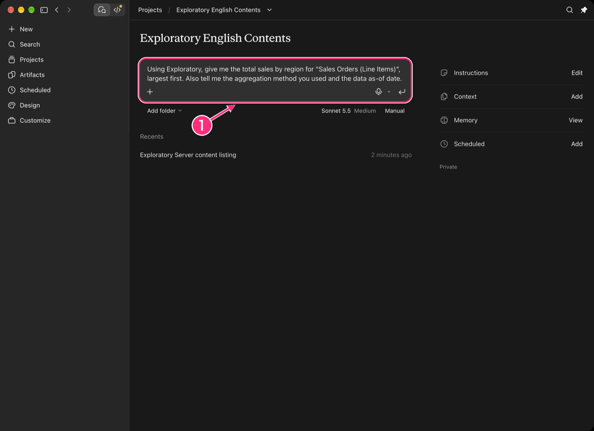
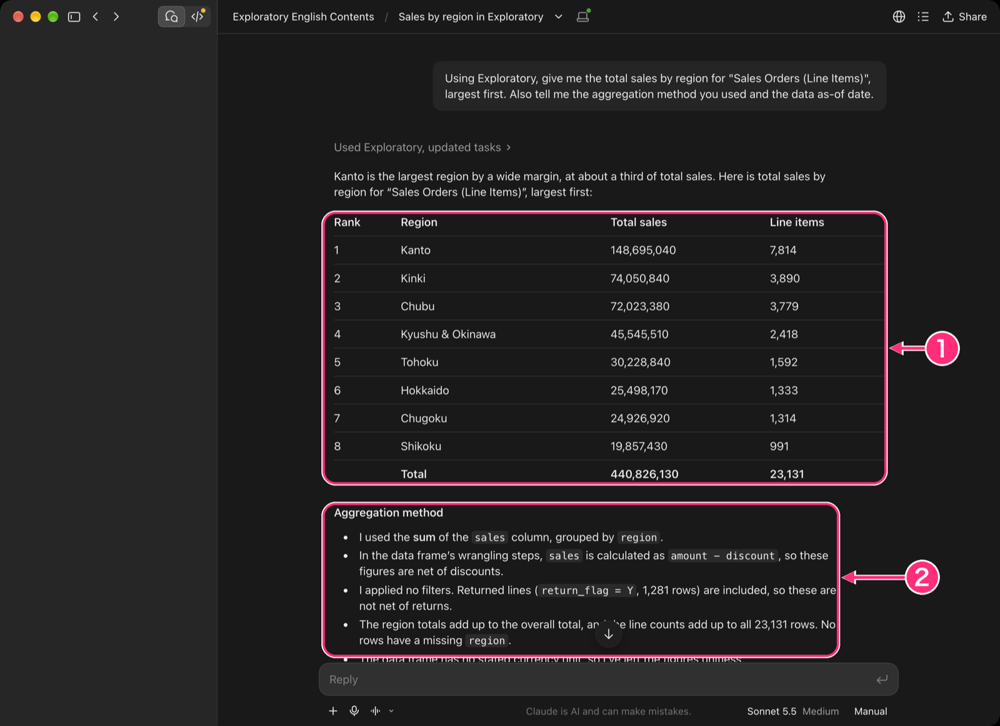
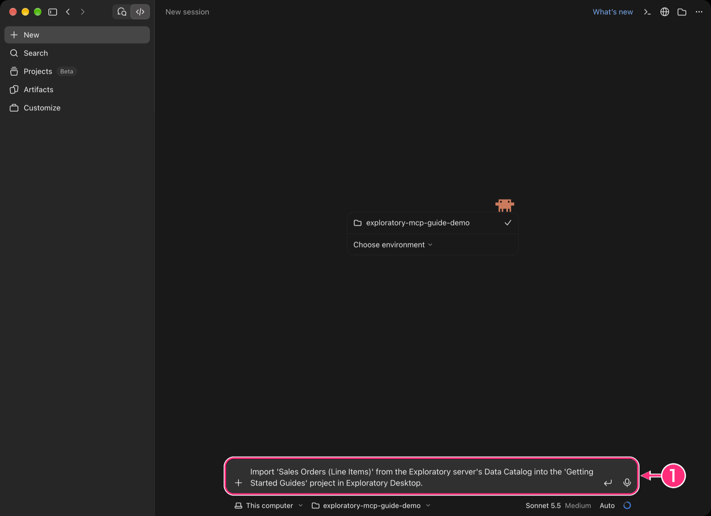
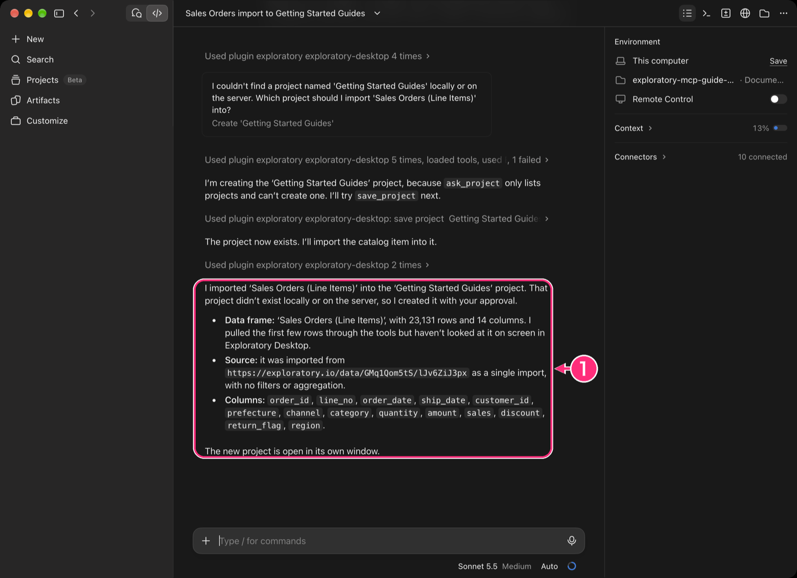
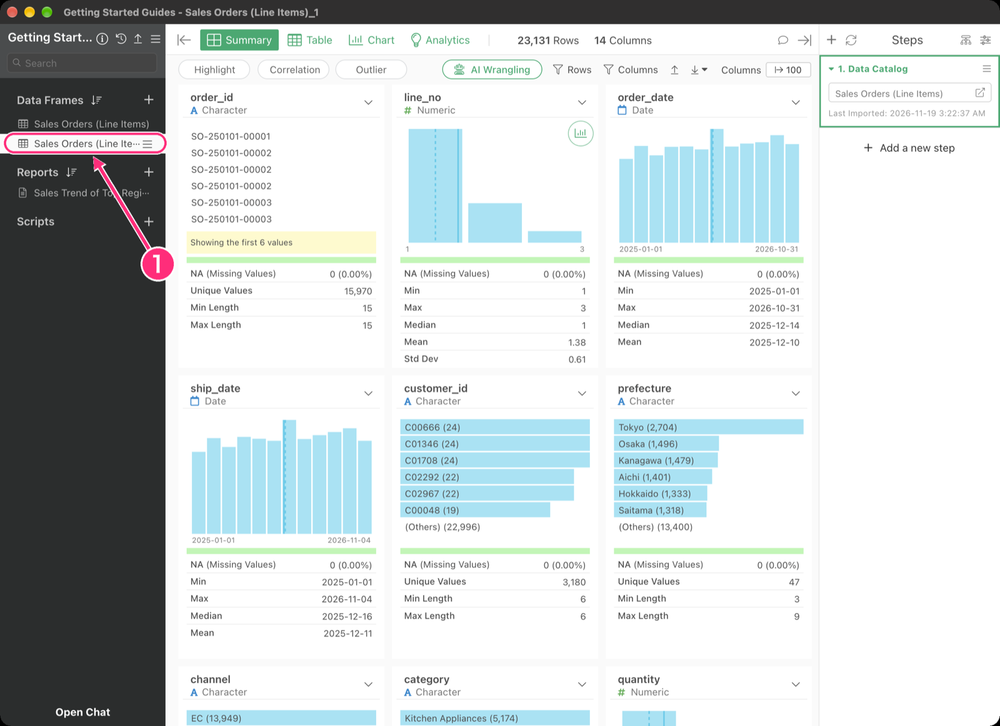
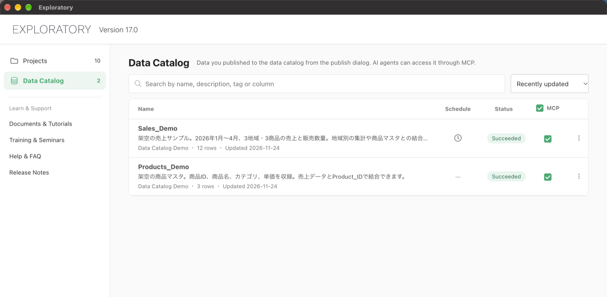

MCP is the connection method that lets an AI such as Claude read data in Exploratory. You can ask an AI agent questions about published data, or have it import the data into Desktop.

## Ask from the server MCP

1. In the list, check that the "MCP Access" column shows "Enabled". If it is off, turn it on in "Set access" on [Use it on the server screen](/en/data-catalog/server-ui)
2. Connect the server MCP to the AI tool you use. See the [instructions for each client](/en/mcp/server/clients/apps)
3. Ask with the title you used when publishing. Replace "Sales Orders (Line Items)" in the example below with the title of your own data

```text
In Exploratory's "Sales Orders (Line Items)", show the sales total by region in descending order. Also include how you aggregated it.
```



4. In the answer, check the sales total for each region. In the image, ❶ is the table of the answer and ❷ is the explanation of the aggregation method and the point in time of the data. AI reads the definitions you approved, and then aggregates



The server MCP tools are used like this.

- `dataframe_get_schema` returns the approved definitions when you get the full detail (`full`). A definition that became "Needs Review", for example after the data changed, comes with a warning. AI reads these definitions before it aggregates
- `query_dataset` filters and aggregates the data on the server. On an on-premises server, it is available only when the administrator has enabled it

## Give AI only the results it needs

When you ask for an aggregation with `query_dataset`, the server calculates the filtering, grouping, aggregation, and joining with DuckDB (the engine that aggregates the data inside the server). An AI agent can receive the aggregated result without reading pages of rows. When it asks for the original rows, or uses another read tool, the returned rows become part of the conversation. See [Server MCP data and permissions](/en/mcp/server/data) for details.

As for speed, in tests during development, data of several million to tens of millions of rows came back within one second. The actual speed depends on the network between the AI agent and the server.

## Import server data into Desktop with the Desktop MCP

You can ask an AI (such as Claude Code) that is connected to the Desktop MCP to import data from the server Data Catalog into a Desktop project. This works with Exploratory Desktop 17.0 or later.

1. Sign in to the Exploratory Desktop that you import into
2. Connect the Desktop MCP to the AI tool you use. See [Get started with the Desktop MCP](/en/mcp/desktop/get-started)
3. Ask with the title of the data and the name of the project to import into. Replace "Sales Orders (Line Items)" and the project name in the example below with your own. You can also ask by giving the URL of the data page

```text
Import "Sales Orders (Line Items)" from the Data Catalog on the Exploratory server into the "[project name]" project in Exploratory Desktop.
```



4. The AI may ask which project to import into. If it does, answer like "Import it into the [project name] project". The AI explains the result of the import



5. Go back to Exploratory Desktop, open the project you specified, and check that the data frame has been created. It is added to the Steps panel on the right as a "Data Catalog" step



To import from the screen while filtering and joining, see [Import from the Data Catalog (Desktop)](/en/data-catalog/import).

## Use the local Data Catalog from AI

From an AI (such as Claude) connected to the Desktop MCP, you can search the local Data Catalog, read the data, and filter, group, aggregate, or join it. The local Data Catalog works without putting data on the server.

- Only data whose "MCP" checkbox is checked in the list is visible to AI agents. Unchecking it hides the data
- You can also add semantic information to local data. AI aggregates using the definitions you approved. See [Semantic information](/en/data-catalog/semantics)
- You can check access to the data on the "Access Log" tab of the details screen



For the tools you can use and when you are asked for confirmation, see these pages.

- [Desktop MCP tools](/en/mcp/desktop/tools)
- [Data and permissions](/en/mcp/desktop/data)
- [Permissions and settings](/en/mcp/desktop/permissions)
- [Server MCP tools](/en/mcp/server/tools)
- [Server MCP data and permissions](/en/mcp/server/data)
