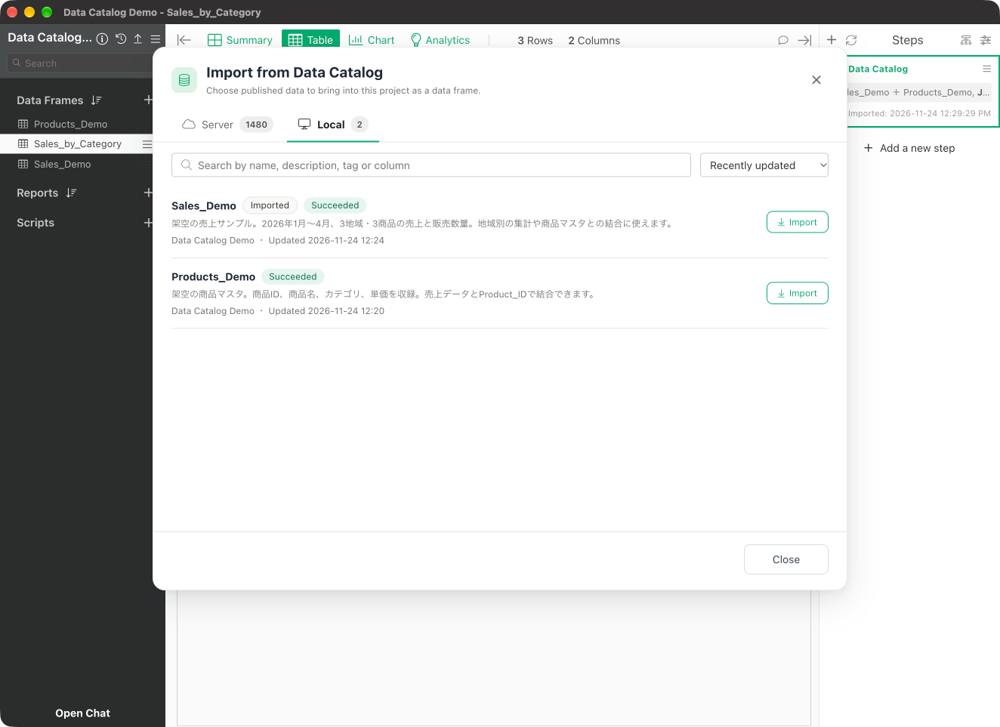
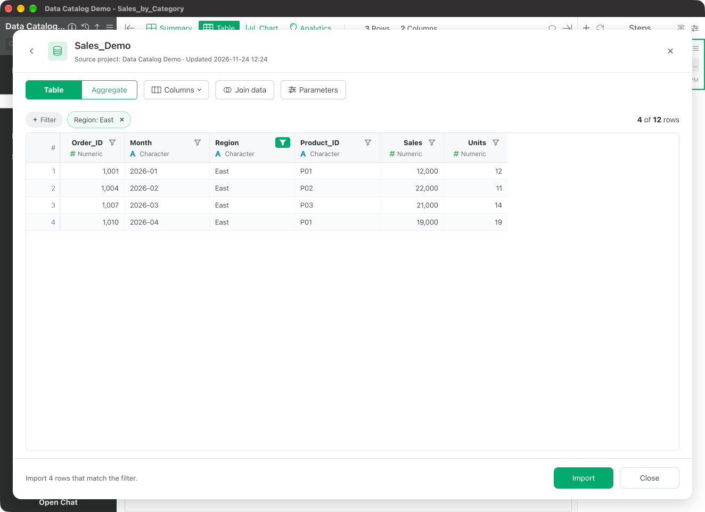
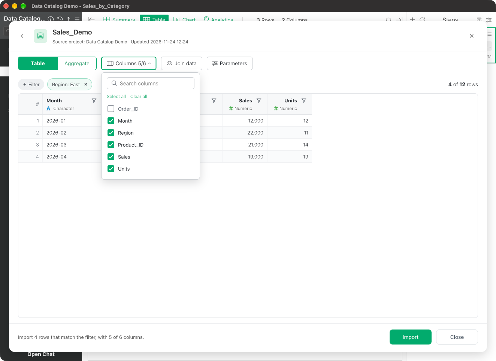
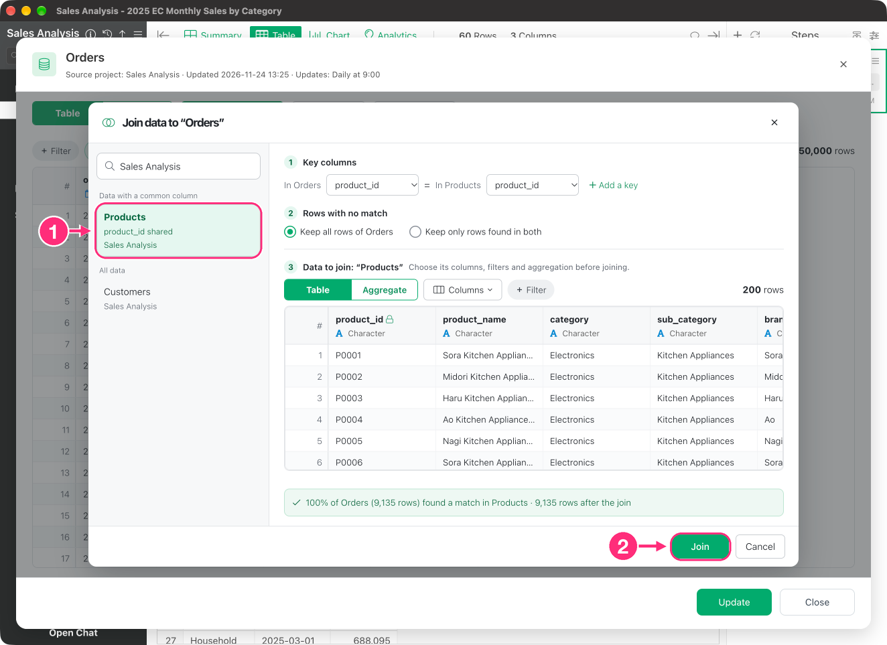
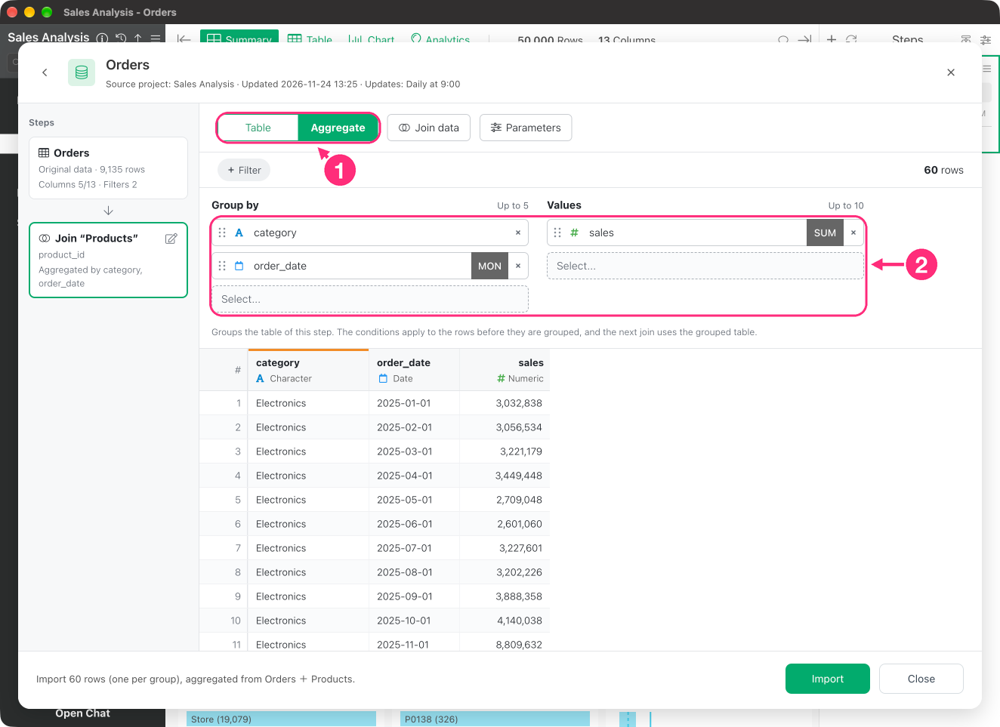
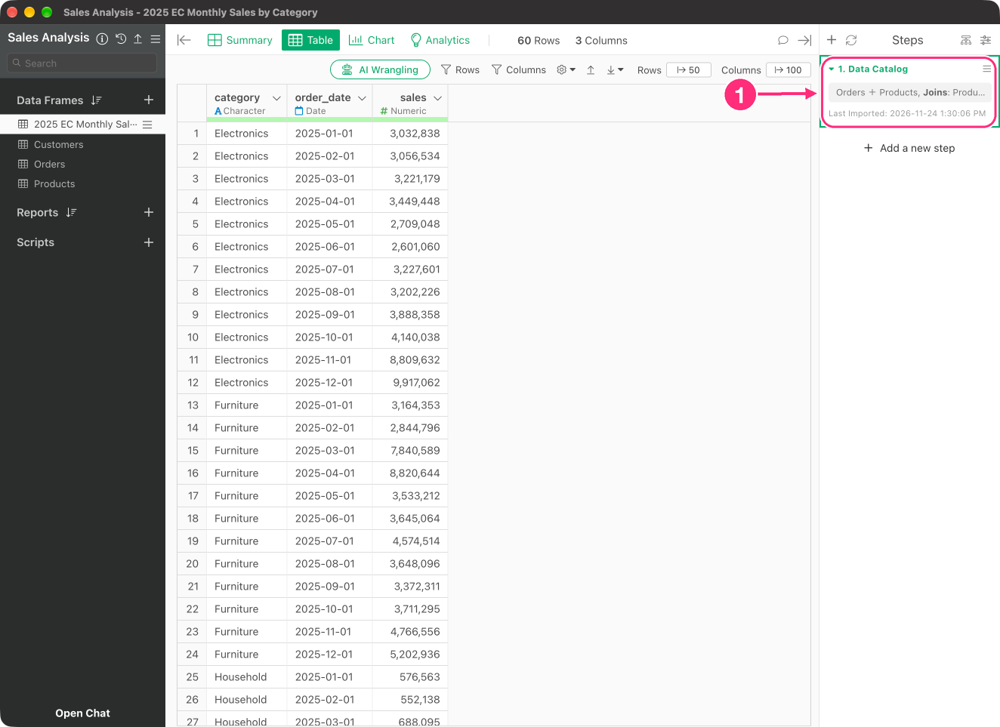

In the "Import from Data Catalog" dialog, you can do more than bring published data in as it is. Before importing, you can filter it, join it with other data, and aggregate it. Server data and local data are handled on the same screen.

## Open the dialog

1. Open the project to import into
2. In the Data Import menu, choose "Data Catalog"
3. At the top of the "Import from Data Catalog" dialog, choose the "Server" or "Local" tab, depending on where the data is

"Server" is the data catalog of Exploratory Server, and "Local" is the data catalog on this PC. The "Local" tab shows how many data items it holds. The tab you opened last is used the next time you open the dialog. In the image, the "Local" tab lists three data items: "Orders", "Products" and "Customers".

To replace the original data of an existing data frame with catalog data, switch the data source of that data frame. The dialog is then titled "Replace Data Source with Data Catalog", and the import button is "Replace".

## Search and choose the data

- **Server**: Search by name, description, tags, and author in the search box. The default sort is "Most relevant". You can browse by "Owned by Me", "Owned by Team", and "Shared with Me"
- **Local**: Search by name, description, tags, and columns in the search box. Matching tags and columns appear under the data name. You can sort by updated date or name. Data you have already imported is marked "Imported"

Click a data name to switch to a dialog that shows the contents of that data. Click "‹" at the top left to return to the list.

On the Local tab, the following data cannot be imported. The dialog shows the reason.

- Data whose full data is not saved: Publish it again from the original project
- Data whose last update failed: Fix the cause and update it again

## Check the contents

When you choose data, the screen switches to one that shows the contents of the data in the "Table". You can switch the view with "Table" and "Aggregate" at the top. At the bottom, a sentence says how many rows will be imported, for example "Import {N} rows of data." The sentence changes when you set filters, choose columns, join, or aggregate.

## Filter the rows

1. Click "Filter" above the table
2. In "Add a filter", choose a column from "Select a column..." and set the condition
3. The filters you add are listed above the table. "Clear all" removes all the filters at once

Only the rows that match are imported. The sentence at the bottom becomes "Import {N} rows that match the filter."

The next image shows an example with two filters, "order_date: 2025-01-01 to 2025-12-31" and "channel: EC", that narrow 50,000 rows to 9,135.

The following filters cannot be used for import. In that case, remove the filter, or filter in a step after importing.

- Among the filters on column "{column}", a filter on a duration column, or a text comparison by order
- A filter that uses a parameter that does not exist in the project (create the parameter, or change the filter)

## Choose the columns

1. Click "Columns" above the table. After you choose, it changes to "Columns {shown}/{total}"
2. Check the columns to import. The search box narrows the column names. "Select all" and "Clear all" are also available

The image shows a state where 5 of the 13 columns are chosen. "sales" is typed in the search box, and the "sales" column is chosen.

Only the chosen columns are imported. The sentence at the bottom becomes "Import all {N} rows, with {chosen} of {total} columns." When a filter is also set, it becomes "Import {N} rows that match the filter, with {chosen} of {total} columns." At least one column must stay selected. A column used as a join key cannot be removed.

## Join other catalog data

A join connects columns of other data in the Data Catalog to the data you import, by key.

1. Click "Join data" above the table
2. In the "Join data to “{title}”" dialog, choose the "Data to join". You can search with "Search the data catalog". "Data with a common column" is listed first
3. Under "Key columns", choose a column on each side. "Add a key" adds more keys. When the key types differ, a note says they are compared as text
4. Under "Rows with no match", choose how to keep rows. "Keep all rows of {title}" (a left join) keeps rows with no partner, and the joined columns are empty. "Keep only rows found in both" (an inner join) keeps only rows whose key is found in both data
5. In the "Data to join: “{title}”" section, you can choose the columns, filters, and aggregation of the data to join, before joining
6. The bottom of the screen shows the match rate and the number of rows after the join, for example "{N}% of {title} ({count} rows) found a match in {right} · {rows} rows after the join"

The next image shows the dialog that joins "Products" to "Orders" with product_id as the key, before you click "Join". ①, ② and ③ on the screen correspond to steps 3, 4 and 5. The match rate is 100% (9,135 rows), and the result is 9,135 rows after the join.

Check the result, and click "Join".

After joining, "Steps" appears on the left of the screen and lists the original data and the join step. The pencil icon on the join step changes the join settings.

When few rows match, or when duplicate keys make the rows grow, the screen shows a warning. When the rows grow, aggregate the data to join by the key before joining, and the rows will not grow.

When you import with a join, the sentence at the bottom becomes "Import {N} rows, joined from {title}." The data to join must also have its full data saved.

## Aggregate and import

An aggregation puts each group into one row before importing.

1. Above the table, switch from "Table" to "Aggregate"
2. Put the columns to group by in "Group by". For a date or date-time column, you can choose a time unit (day, week, month, quarter, year)
3. Put the columns to aggregate in "Values" and choose the function. The functions are Count, Sum (Total), Mean (Average), Median, Min, Max, Unique Count, and Standard Deviation

The aggregation covers the rows left after filtering. The sentence at the bottom becomes "Import {N} rows (one per group) of the summary. Totals and subtotals are not imported." When you aggregate joined data, it becomes "Import {N} rows (one per group), aggregated from {original} + {joined}."

The next image shows an example that groups the joined data by "category" and "order_date" (by month) and totals "sales" with Sum. It makes 60 rows.

An aggregation that has columns (a pivot table) cannot be imported. In that case, remove the columns from "Columns".

## Import

1. Check the settings and click "Import"
2. Enter a name for the data frame and click "OK"

The imported data is added to the project as a data frame. It appears in the Steps panel on the right as a "Data Catalog" step, as the image shows. The image is an example where a data frame of 60 rows and 3 columns (category, order_date, sales) was created.

## Update after importing

On the imported data frame, open the Data Catalog step and click "Update" to read the latest data again with the same filters, columns, joins, and aggregation. The sentence at the bottom of the dialog says what will be read again, such as "This is the filter of the source of data frame “{name}”. Click Update to read the latest data with this filter."

To ask an AI that is connected to the Desktop MCP to import the data, see [Use it with AI](/en/data-catalog/ai).
