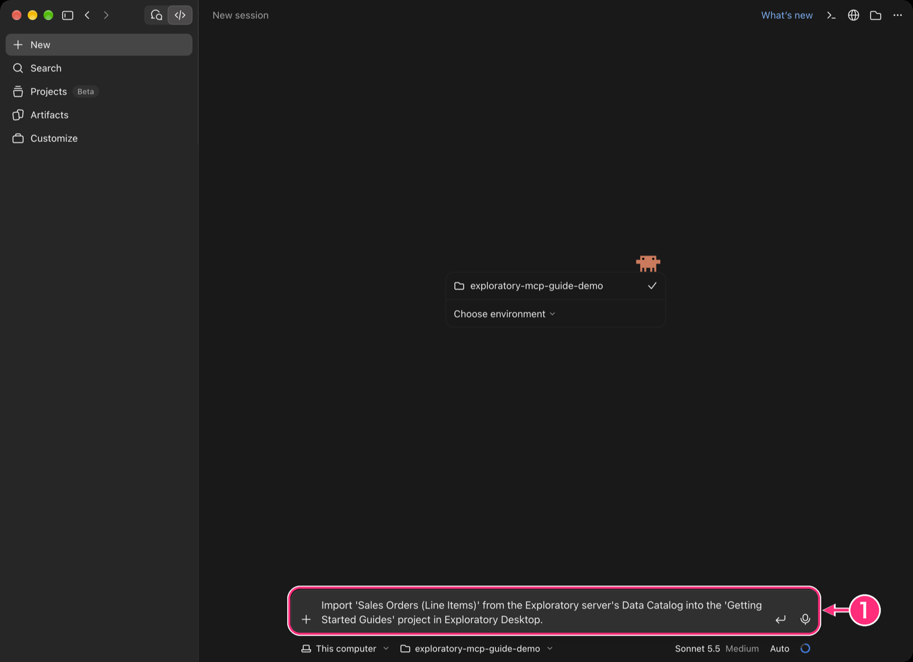
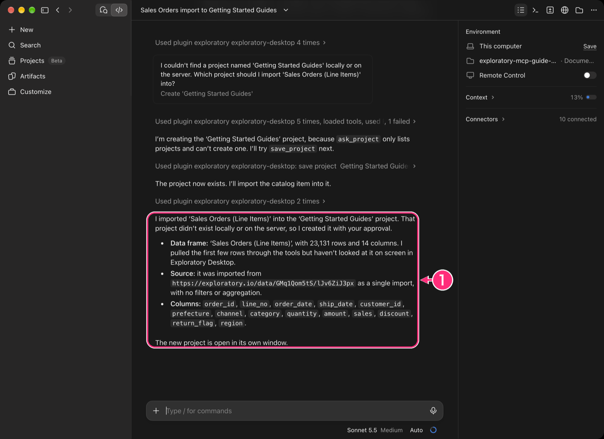
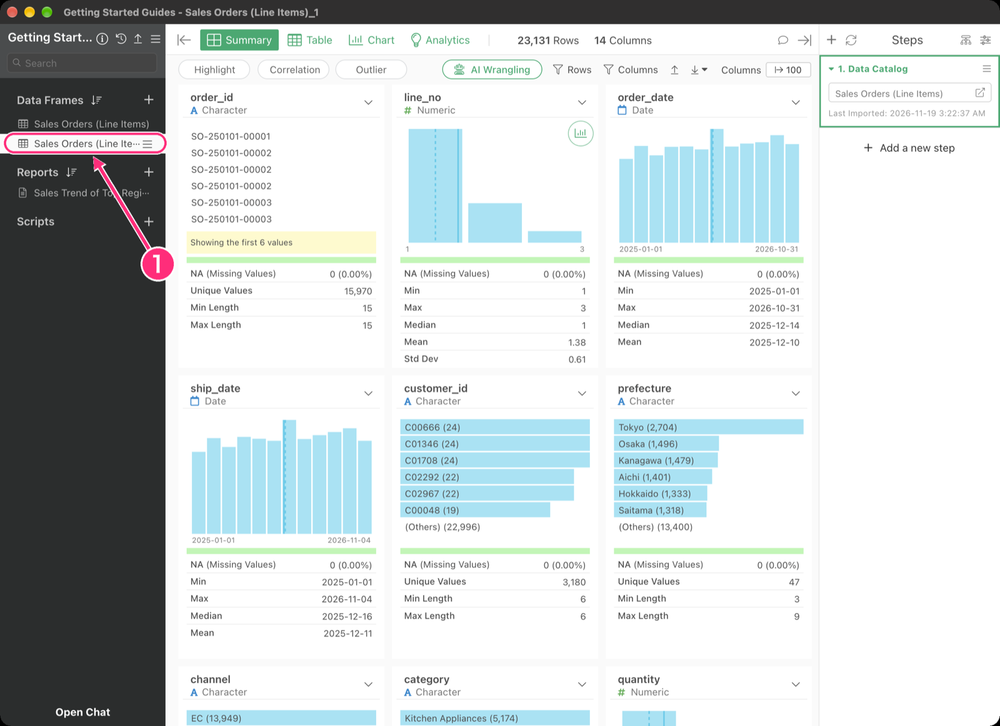

## Import from the Desktop menu

1. Open the project to import into, and choose "Data Catalog" in the Data Import menu
2. At the top of the "Import from Data Catalog" dialog, choose "Server" or "Local"
3. Search and select the data you want to import
4. If needed, set filters, choose columns, join other catalog data, or summarize
5. Click "Import"

On the "Local" tab, data you have already imported is marked "Imported". Data whose full data is not saved cannot be imported. Publish it again from the original project.

The selected data is brought into the project as a data frame. Click "Update" after importing to read the latest data again with the same conditions. You can also switch the data source of an existing data frame to catalog data.

## Import with the Desktop MCP

You can also ask an AI (such as Claude Code) that is connected to the Desktop MCP to import data from the server Data Catalog into a Desktop project. This works with Exploratory Desktop 17.0 or later.

1. Sign in to the Exploratory Desktop that you import into
2. Connect the Desktop MCP to the AI tool you use. See [Get started with the Desktop MCP](/en/mcp/desktop/get-started)
3. Ask with the title of the data and the name of the project to import into. Replace "Sales Orders (Line Items)" and the project name in the example below with your own. You can also ask by giving the URL of the data page

```text
Import "Sales Orders (Line Items)" from the Data Catalog on the Exploratory server into the "[project name]" project in Exploratory Desktop.
```



4. The AI may ask which project to import into. If it does, answer like "Import it into the [project name] project". The AI explains the result of the import



5. Go back to Exploratory Desktop, open the project you specified, and check that the data frame has been created. It is added to the Steps panel on the right as a "Data Catalog" step


