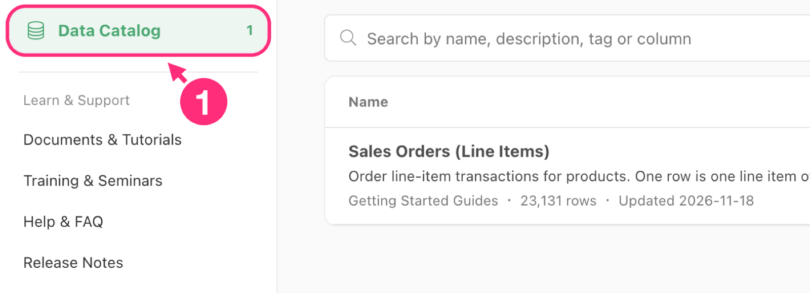
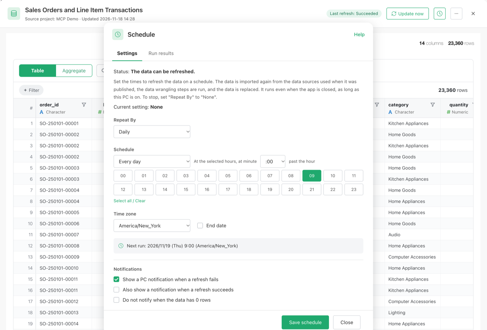
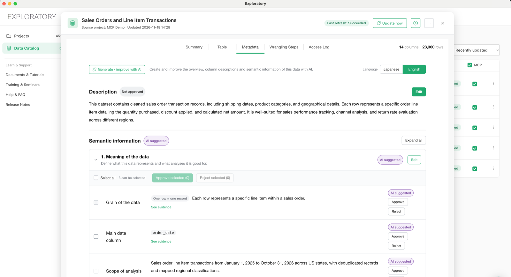

## Find Data in the List

The "Data Catalog" tab of the window that lists your projects shows the local data catalog on this PC.

- In the search box, choose which of "Name", "Description", "Tags", and "Columns" to search. Matching tags and columns appear under the data name as "Match"
- You can sort by updated date (newest or oldest first) or by name (ascending or descending)
- The list shows the data name, the source project, the number of rows, the updated date, the schedule, the refresh status (Success, Failed, Running), and the MCP checkbox
- Click a data name to open its details

The details screen has these tabs.

| Tab | Content |
| --- | --- |
| Summary | An overview of the data |
| Table | The data itself. You can filter and sort it |
| Metadata | The description, tags, and a description for each column. "Generate / improve with AI" has AI write or improve the overview, the column descriptions, and the semantics |
| Wrangling Steps | The data wrangling steps that produce the data |
| Source | Where the data came from |
| Access Log | A record of access from AI agents (MCP) |

The "⋯" menu at the top right has these actions.

- **Open Folder**: Opens the folder where the data is saved
- **Republish**: Opens the publish dialog of the original data frame. It is not available when the original project or data frame cannot be found
- **Export as EDF**: Writes the data out as an EDF file
- **Delete**: Removes it from the catalog. The files saved on this PC are deleted too

## Refresh on a Schedule

Local data can be refreshed regularly at times you choose. Open the schedule dialog from the clock button on the details screen.

- For "Repeat By", choose Monthly, Weekly, Daily, Hourly, or every N minutes
- You can also set a time zone and an end date. "Next run" shows when the next refresh will happen
- A refresh imports the data again from the data sources used when it was published, runs the wrangling steps again, and replaces the data
- If the background refresh is registered with the OS, it runs even when the app is closed. If it could not be registered, it refreshes while the app is open, and missed refreshes run once when you next open the app (on Windows, also when you sign in)
- You can have a PC notification shown when a refresh fails or succeeds
- The "Run results" tab shows the start time, result, number of rows, and duration of recent runs. To stop the schedule, set "Repeat By" to "None"

Some data cannot be refreshed, for example data whose data source was published as a snapshot, or data that uses a data source that does not support refreshing. A refresh also fails when the data source file cannot be found. Put the file back in the same place on this PC, or update the data source in the original project and publish again. Hover over the refresh status in the list to see the reason.

Data published to the server is refreshed by the server's schedule. See [Schedule](/en/schedule/manage).

## Use It from AI Agents (MCP)

AI agents such as Claude can search the local data catalog, read the data, and filter, group, aggregate, or join it. Only data whose "MCP" checkbox is checked in the list is visible to AI agents. Unchecking it hides the data. You can also add semantics to local data on the "Metadata" tab of the details screen.

For the tools you can use and when you are asked for confirmation, see these pages.

- [Desktop MCP tools](/en/mcp/desktop/tools)
- [Data and permissions](/en/mcp/desktop/data)
- [Permissions and settings](/en/mcp/desktop/permissions)
