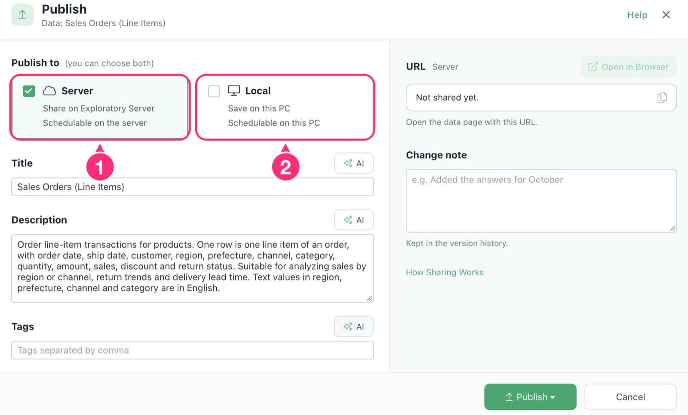
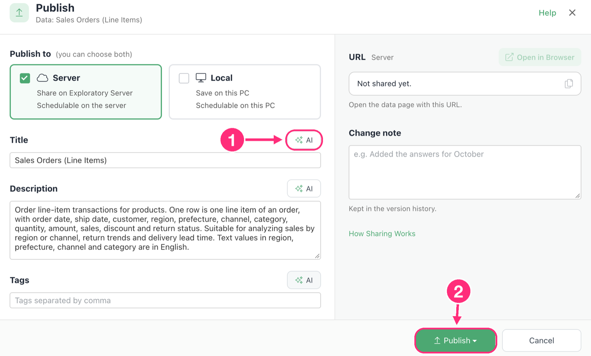
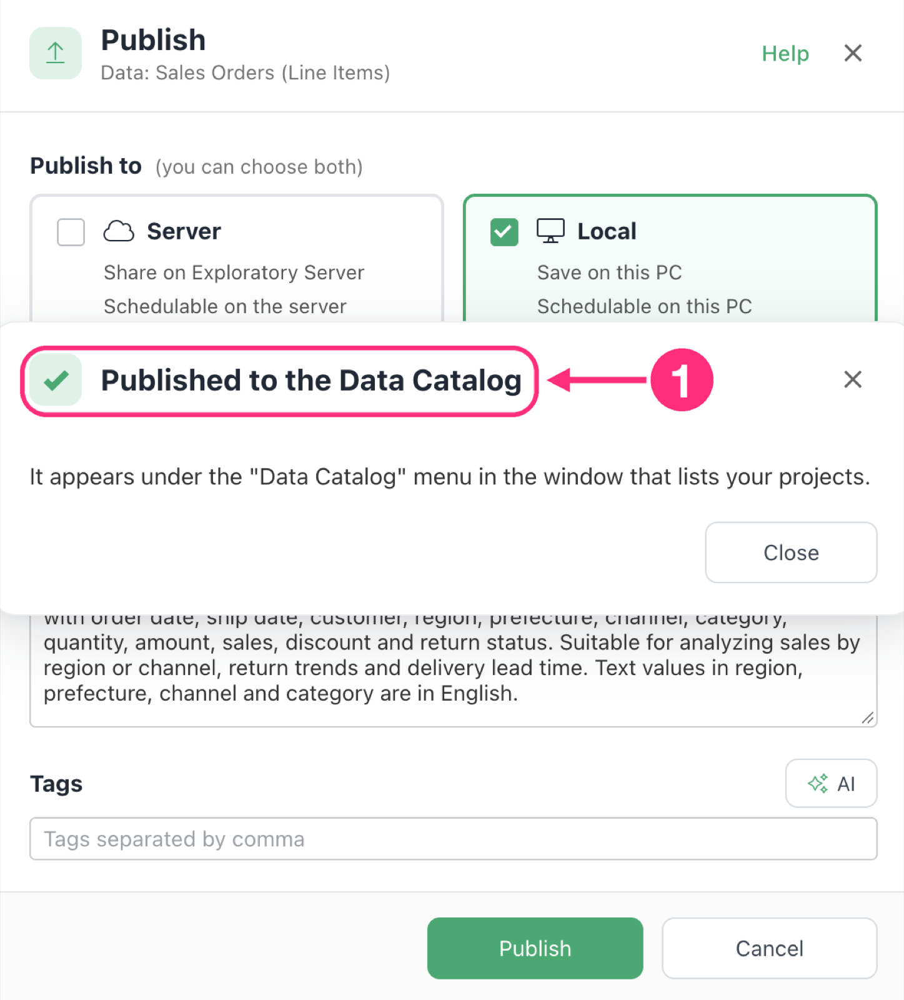

1. In a project, select the data frame you want to add to the catalog and click the "Publish" button at the top right of the "Table" tab. If the window is narrow, the button shows only its icon. It is not in the menu (≡) of the data frame
2. Under "Publish to" in the publish dialog, check "Server", "Local", or both
   - **Server**: "Share on Exploratory Server" and "Schedulable on the server"
   - **Local**: "Save on this PC" and "Schedulable on this PC"

In the image, ❶ is the "Server" card and ❷ is the "Local" card.

3. Enter a title, a description, and tags. Click the "AI" button to the right of each heading (pointing at it shows "Generate with AI") and AI writes a draft. The button appears only when an AI service is available. Check the content and edit it if needed
4. Click the "Publish ▾" button at the bottom of the dialog, and choose who publishes in the menu. To publish as yourself, choose "As Individual"; to publish for a team, choose "As Team". A "Ready to Publish?" confirmation appears. Click "OK"

In the image, ❶ is the "AI" button and ❷ is the publish button. For data you have already published, the button is "Republish". If you publish only to Local, click "Publish".

When publishing to the server is done, a panel shows the progress. Choose "Open" (❶) to open the data page on the server. Then, on the "Metadata" tab of the data page, you can have AI create semantics and approve them. See [Server Data Catalog and AI](/en/data-catalog/server) for the steps.

When you publish only to Local, a message says the data was published to the data catalog. The data appears in the "Data Catalog" tab of the window that lists your projects.

In offline mode, you cannot choose "Server". Even with offline mode off, the data is not published to the server if your sign-in has expired. If you checked both, it is saved only locally. Sign in and publish again.

To update data you have already published, publish it again in the same way. When you publish to the server, a "Change note" you write is kept in the version history.
