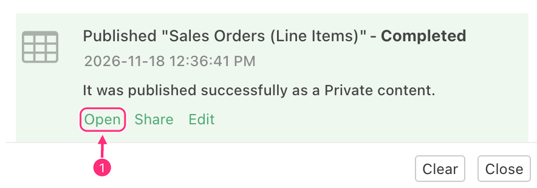
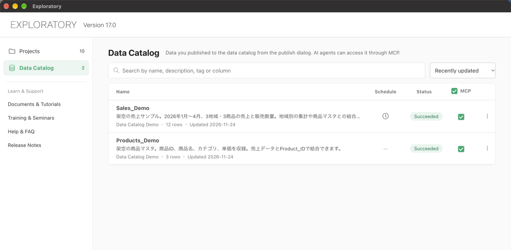
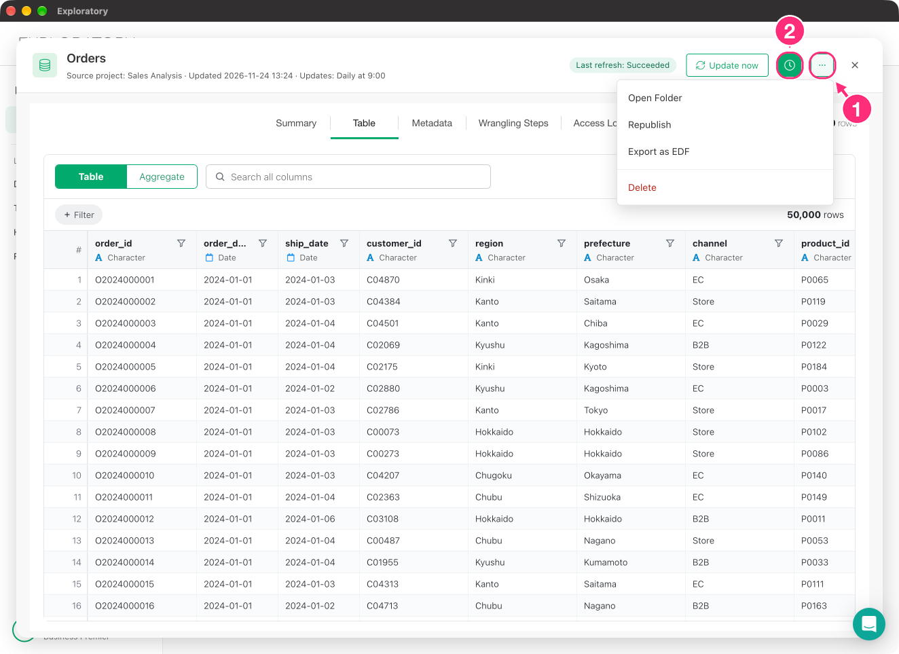
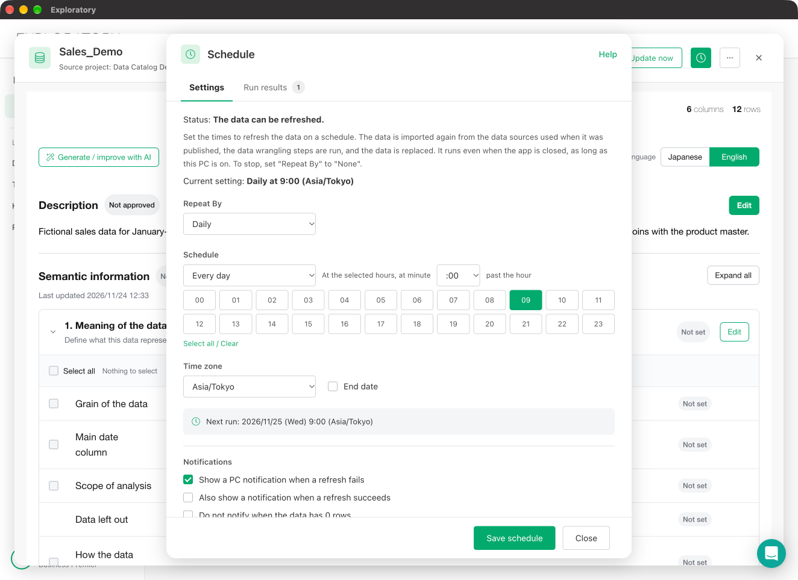
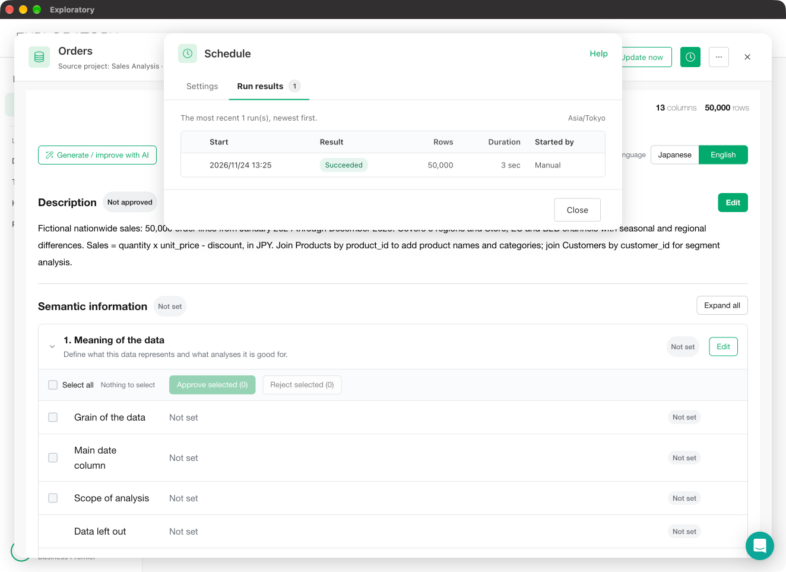

## Publish

1. In a project, select the data frame you want to add to the catalog and click the "Publish" button at the top right of the "Table" tab. If the window is narrow, the button shows only its icon. It is not in the menu (≡) of the data frame
2. Under "Publish to" in the publish dialog, check "Server", "Local", or both
   - **Server**: "Share on Exploratory Server" and "Schedulable on the server"
   - **Local**: "Save on this PC" and "Schedulable on this PC"

In the image, ❶ is the "Server" card and ❷ is the "Local" card.

3. Enter a title, a description, and tags. Click the "AI" button to the right of each heading (pointing at it shows "Generate with AI") and AI writes a draft. The button appears only when an AI service is available. Check the content and edit it if needed
4. Click the "Publish ▾" button at the bottom of the dialog, and choose who publishes in the menu. To publish as yourself, choose "As Individual"; to publish for a team, choose "As Team". A "Ready to Publish?" confirmation appears. Click "OK"

In the image, ❶ is the "AI" button and ❷ is the publish button. For data you have already published, the button is "Republish". If you publish only to Local, click "Publish".

When publishing to the server is done, a panel shows the progress. Choose "Open" (❶) to open the data page on the server. Then, on the "Metadata" tab of the data page, you can have AI create semantic information and approve it. See [Semantic information](/en/data-catalog/semantics) for the steps.

When you publish only to Local, a message says the data was published to the data catalog. The data appears in the "Data Catalog" tab of the window that lists your projects.

In offline mode, you cannot choose "Server". Even with offline mode off, the data is not published to the server if your sign-in has expired. If you checked both, it is saved only locally. Sign in and publish again.

To update data you have already published, publish it again in the same way. When you publish to the server, a "Change note" you write is kept in the version history.

## See the local Data Catalog list

The "Data Catalog" tab of the window that lists your projects shows the local data catalog on this PC. In the image, ❶ is that tab. The number is how many data items it holds. Data you publish to Local appears in the list.

- In the search box, choose which of "Name", "Description", "Tags", and "Columns" to search. Matching tags and columns appear under the data name as "Matches"
- You can sort by updated date (newest or oldest first) or by name (ascending or descending)
- The list shows the data name, the source project, the number of rows, the updated date, the schedule, the refresh status (Succeeded, Failed, Running), and the MCP checkbox
- Click a data name in the "Name" column to open its details. The checkbox in the "MCP" column sets whether AI agents can see the data

The details screen has these tabs.

| Tab | Content |
| --- | --- |
| Summary | An overview of the data |
| Table | The data itself. You can filter and sort it |
| Metadata | The description, tags, a description for each column, and semantic information. See [Semantic information](/en/data-catalog/semantics) |
| Wrangling Steps | The data wrangling steps that produce the data |
| Access Log | A record of access from AI agents (MCP) |

The "⋯" menu at the top right has these actions.

- **Open Folder**: Opens the folder where the data is saved
- **Republish**: Opens the publish dialog of the original data frame. It is not available when the original project or data frame cannot be found
- **Export as EDF**: Writes the data out as an EDF file
- **Delete**: Removes it from the catalog. The files saved on this PC are deleted too

## Refresh on a schedule

Local data can be refreshed regularly at times you choose. Open the schedule dialog from the clock button on the details screen.

- For "Repeat By", choose Monthly, Weekly, Daily, Hourly, or every N minutes
- You can also set a time zone and an end date. "Next run" shows when the next refresh will happen
- A refresh imports the data again from the data sources used when it was published, runs the wrangling steps again, and replaces the data
- If the background refresh is registered with the OS, it runs even when the app is closed. If it could not be registered, it refreshes while the app is open, and missed refreshes run once when you next open the app (on Windows, also when you sign in)
- You can have a PC notification shown when a refresh fails or succeeds
- After you choose the times and notifications, click "Save schedule"
- The "Run results" tab shows the start time, result, number of rows, duration, and how each run was started (for example, Manual) for recent runs. To stop the schedule, set "Repeat By" to "None"

Some data cannot be refreshed, for example data whose data source was published as a snapshot, or data that uses a data source that does not support refreshing. A refresh also fails when the data source file cannot be found. Put the file back in the same place on this PC, or update the data source in the original project and publish again. Hover over the refresh status in the list to see the reason.

Data published to the server is refreshed by the server's schedule. See [Schedule](/en/schedule/manage).
