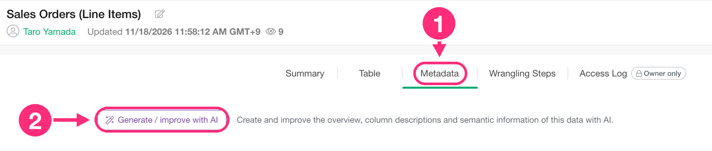
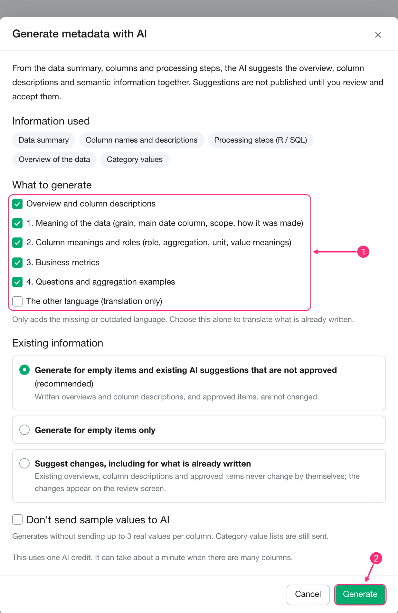
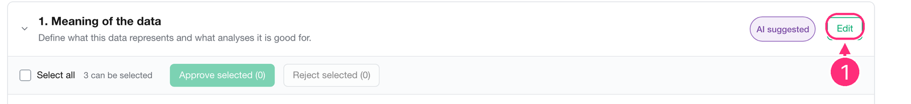
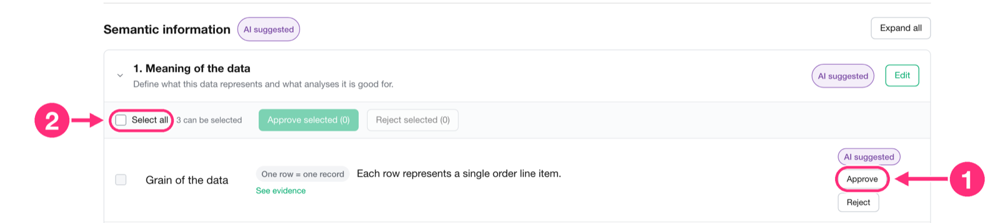
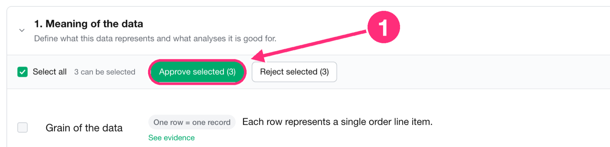
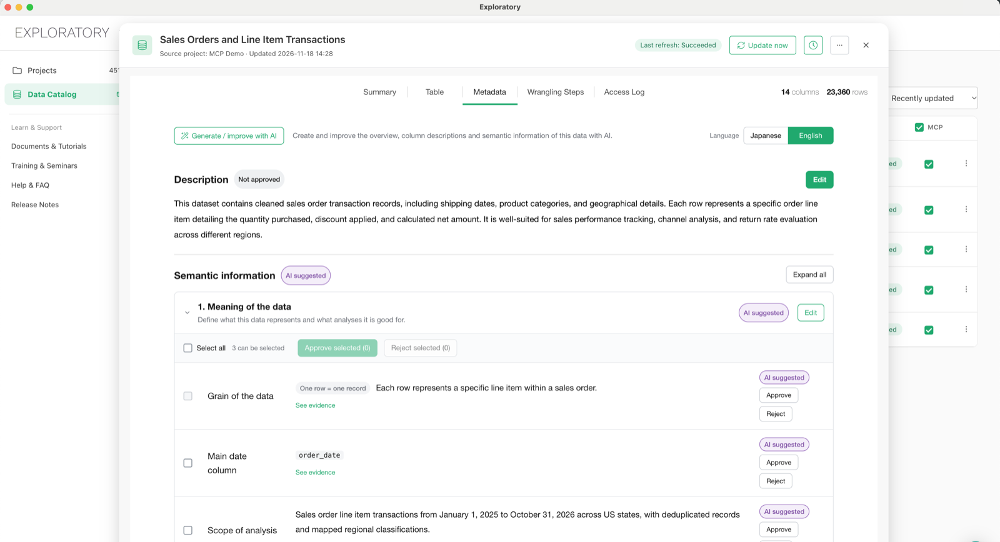

Semantic information is a set of definitions that tell AI what the data means and what its business rules are. An AI agent reads from it what column names alone do not say, such as what one row represents, which columns can be summed, and whether cancellations are included.

In the server data catalog, you attach it to published data. You can attach it to the local data catalog in the same way.

## What the definitions contain

The definitions fall into five groups. Aggregation rules are generated only when your server settings enable them.

| Group | What you define |
| --- | --- |
| Meaning of the data | The grain (what one row is), the primary date column, what is in and out of scope, a summary of the wrangling, and the update status |
| Column meanings and roles | What each column is for and how to aggregate it |
| Business metrics | The main metrics calculated from this data and how each one is calculated. You can also register alternative names |
| Aggregation rules and cautions | The rules needed to aggregate and interpret the data correctly |
| Questions and aggregation examples | Common questions and the right way to aggregate for each |

## Create it in the server Data Catalog

### 1. Have AI write a draft

1. Open the "Metadata" tab of the data page
2. Click "Generate / improve with AI"

In the image, ❶ is the "Metadata" tab and ❷ is "Generate / improve with AI".

3. In the "Generate metadata with AI" dialog, check "What to generate" and click "Generate". AI drafts the semantic information from the overview, the column information, statistics, the wrangling steps, and so on

In the image, ❶ is "What to generate" and ❷ is the "Generate" button.

### 2. Read the proposals and fix them

Read the items marked "AI suggested" and fix anything that is wrong with "Edit". In the image, ❶ is "Edit".

### 3. Approve the correct items

For each item that is correct, click "Approve". To reject one, click "Reject". In the image, ❶ is "Approve" and ❷ is "Select all" in each section.

### 4. Approve many at once

Check "Select all" in each section and click "Approve selected (N)". N is the number of items you selected. In the image, ❶ is that button. For "Grain of the data", however, click "Approve" on its own. If other items cannot be approved at once, check their contents and approve each one.

### The standard for approving

Only the data owner can edit semantic information. The standard for approving is whether the item is correct as the meaning of this data. With the sales order data, for example, check that the grain of the data is "1 row = 1 record" (an order line item), the main date column is order_date, and the sales column is a "Numeric measure" with "Sum" as its aggregation. Things that column names alone cannot settle, such as whether net sales should use the gross sales column or the net sales column, are settled in the definitions.

Approved items are passed to AI agents as official definitions. Definitions you have not approved are not used. The values in the column can still be aggregated. If you edit an approved item and save, the approval is removed, so approve it again.

The "AI Ready" column in the data list shows the preparation status: "Ready", "Needs Review", "Draft", or "Not Set".

## Create it in the local Data Catalog

Open the details screen of the local data, and click "Generate / improve with AI" on the "Metadata" tab. AI creates or improves the overview, the column descriptions, and the semantic information. You review the proposals and adopt them in the same way as on the server.

The image shows the Metadata tab, where AI-suggested definitions are being reviewed.

<!-- IMAGE: local-metadata -->
