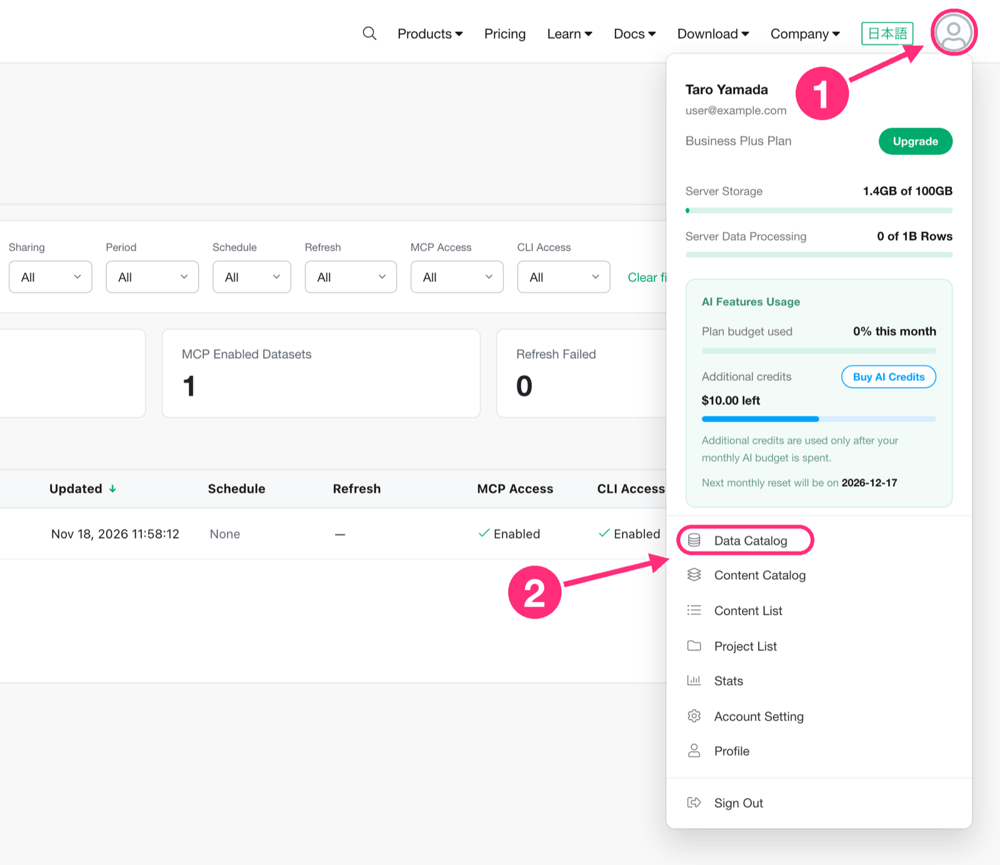
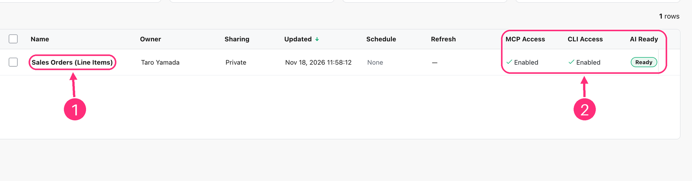
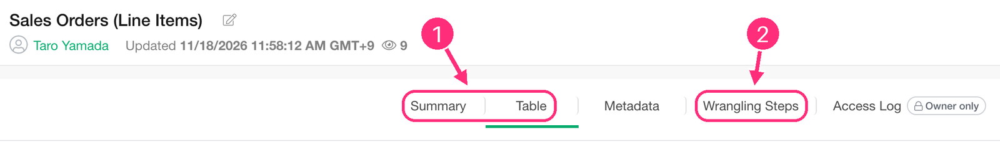
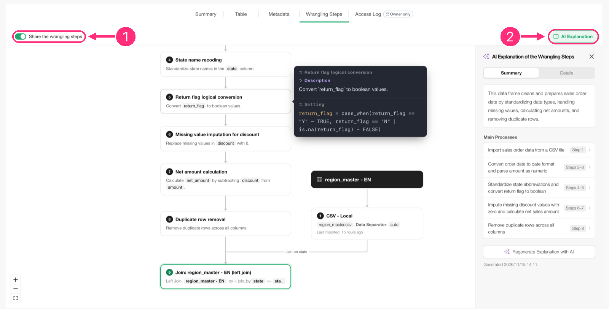
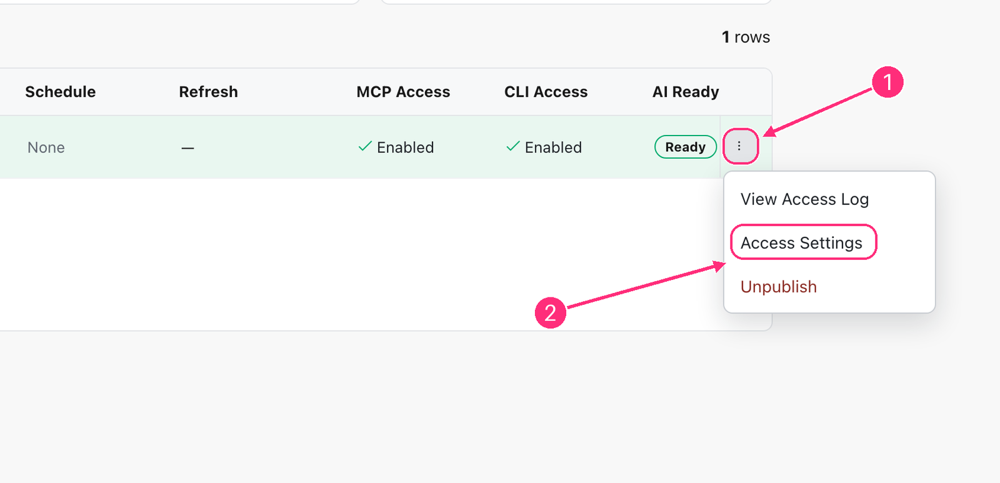
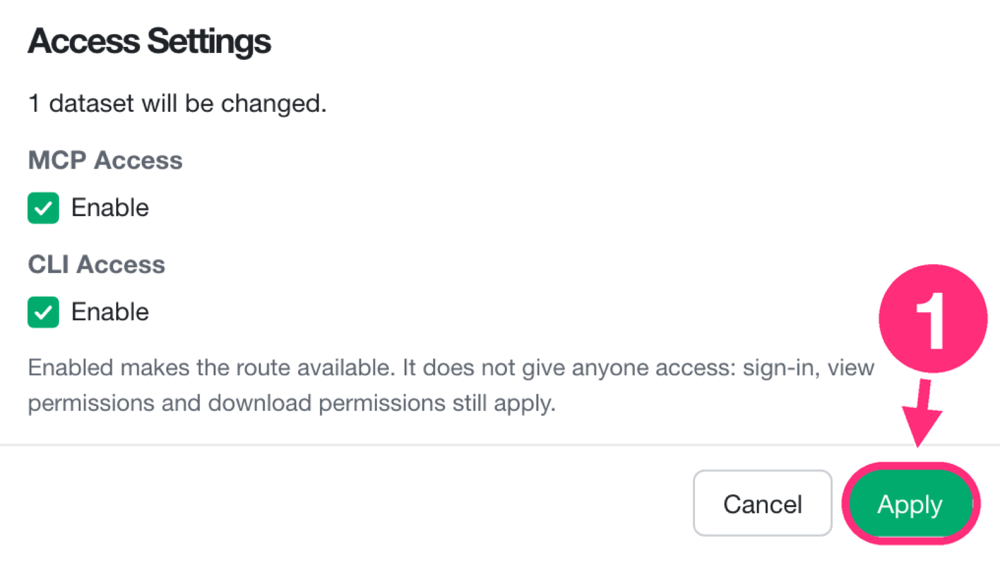

The server Data Catalog works in the browser on exploratory.io. You can find published data in a list, check its contents and how it was made on the data page, and manage access from AI agents and other routes.

## Open the Data Catalog page

1. On exploratory.io, choose the account icon at the top right
2. Choose "Data Catalog" in the menu

The list of the data you published appears on the "Data" tab. Some accounts also show an "Access Log" tab. The list has these columns.

- Name, Owner, Sharing, Updated, Schedule, Refresh (the refresh status)
- MCP Access, CLI Access (some environments also show a REST API Access column)
- AI Ready

The next image shows a row of the list. ❶ is the data name, and ❷ is the MCP Access, CLI Access, and AI Ready columns. The search box and the totals are not in the image.

You can find data with the search box above the list and the filters "Owner", "Sharing", "Period", "Schedule", "Refresh", "MCP Access", and "CLI Access". Totals such as the number of datasets and the number of scheduled datasets also appear above the list.

## Check the contents on the data page

Choose a data name to open its data page. In the image, ❶ is the "Summary" and "Table" tabs, and ❷ is the "Wrangling Steps" tab.

- **Summary**: Check an overview of the data
- **Table**: Look at the rows. You can search with "Search all columns", narrow with "Filter", and choose the columns to show with "Columns". Switch "View" to "Aggregate" to see grouped and aggregated results. "Download CSV" saves it as a CSV, and "Copy link" copies a link that includes the table settings
- **Metadata**: Check the description, tags, column descriptions, and semantic information. The owner edits and approves them here. See [Semantic information](/en/data-catalog/semantics)
- **Wrangling Steps**: See in a diagram how the data was made from the original data. The "Share the wrangling steps" switch decides whether others can see it. "AI Explanation" gives a summary of the wrangling. The image shows the "Wrangling Steps" tab, with the sharing switch at the top left and the AI explanation on the right

- **Access Log**: Check access to the data. Only the owner can see it

The "Access Log" shows the access method (MCP, API, UI), where it came from (country, IP address, client), the query content, the processing time, and the status.
## Set access

The data owner can set MCP and other access for each data item.

1. In the server "Data Catalog", click the "⋮" at the right end of the row. The menu shows "View Access Log", "Access Settings", and "Unpublish"
2. Choose "Access Settings". You can also select several data items and set them all at once

In the image, ❶ is the "⋮" and ❷ is "Access Settings".

3. For each of "MCP Access", "CLI Access", and "REST API Access", decide whether to check "Enable". "CLI Access" lets a terminal or an AI agent read the data with `expl server`. "REST API Access" does not appear in some environments
4. When you change a setting, click "Apply". You cannot click "Apply" until you change a setting. In the image, ❶ is "Apply"

For example, for data you do not want AI agents to use, uncheck "Enable" under "MCP Access" and click "Apply". Enabling access does not open the data to everyone. Sign-in, view permissions, and download permissions apply as before.

To ask questions from an AI agent, see [Use it with AI](/en/data-catalog/ai).
