## Open the Server Data Catalog Page

1. On exploratory.io, choose the account icon at the top right
2. Choose "Data Catalog" in the menu

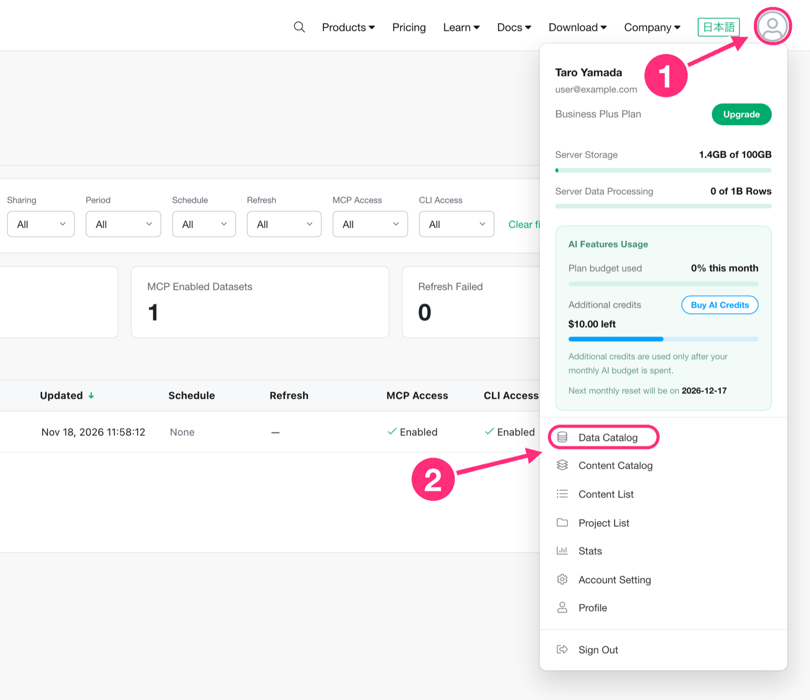

The list of the data you published appears on the "Data" tab. Some accounts also show an "Access Log" tab. The list has these columns.

- Name, Owner, Sharing, Updated, Schedule, Refresh (the refresh status)
- MCP Access, CLI Access, REST API Access
- AI Ready

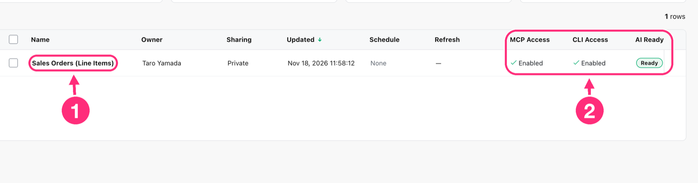

Choose a data name to open its data page. You can check the contents on tabs such as "Summary" and "Table". On the "Wrangling Steps" tab, you can see in a diagram how the data was made from the original data.

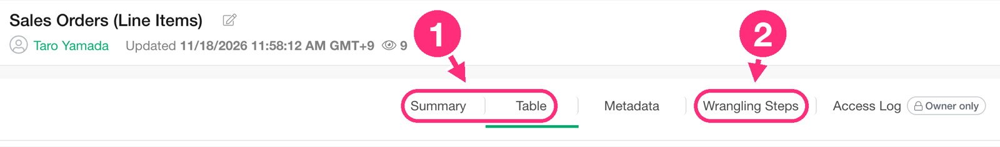

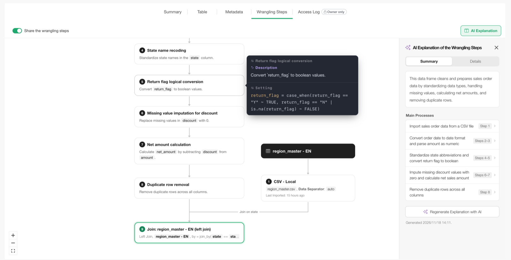

The "Access Log" shows access to the data: the access method (MCP, API, UI), where it came from (country, IP address, client), the query content, the processing time, and the status.

## Let AI Answer Questions with the Server Data Catalog

In the server data catalog, you can attach "semantics" to published data. Semantics are definitions that tell AI what the data means. An AI agent reads from them what column names alone do not say, such as what one row represents, which columns can be summed, and whether cancellations are included.

### Generate with AI, then approve as a person

1. Open the "Metadata" tab of the data page
2. Click "Generate / improve with AI"
3. In the "Generate metadata with AI" dialog, check "Generation targets" and click "Generate". AI drafts the semantics from the overview, the column information, statistics, the wrangling steps, and so on

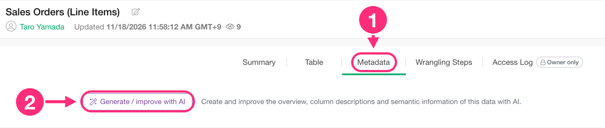

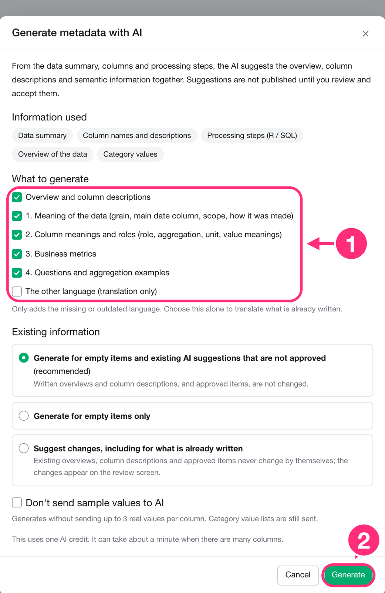

The definitions fall into five groups. Aggregation rules are generated only when your server settings enable them.

| Group | What you define |
| --- | --- |
| Meaning of the data | The grain (what one row is), the primary date column, what is in and out of scope, a summary of the wrangling, and the update status |
| Column meanings and roles | What each column is for and how to aggregate it |
| Business metrics | The main metrics calculated from this data and how each one is calculated. You can also register alternative names |
| Aggregation rules and cautions | The rules needed to aggregate and interpret the data correctly |
| Questions and aggregation examples | Common questions and the right way to aggregate for each |

What AI writes does not become an official definition as it is. The data owner reviews it in these steps. Only the data owner can edit semantics.

1. Read the items marked "AI suggestion available" and fix anything that is wrong with "Edit"
2. For each item that is correct, click "Approve". To reject one, click "Reject"
3. To approve many at once, check "Select all" in each section and click "Approve selected (N)". N is the number of items you selected. For "Grain of the data", however, click "Approve" on its own. If other items cannot be approved at once, check their contents and approve each one

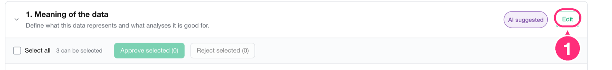

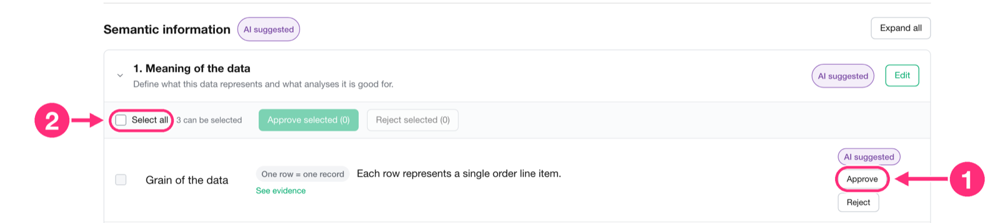

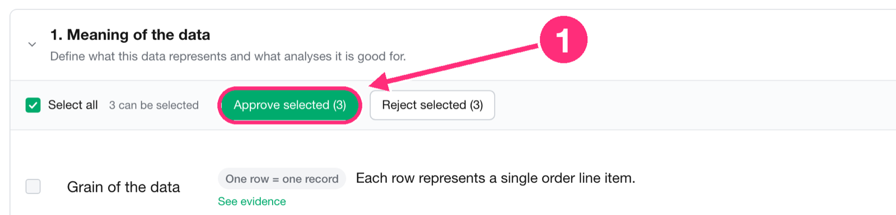

Approved items are passed to AI agents as official definitions. Definitions you have not approved are not used. The values in the column can still be aggregated. If you edit an approved item and save, the approval is removed, so approve it again.

The "AI Ready" column in the data list shows the preparation status: "Ready", "Needs Review", "Draft", or "Not Set".

### Give AI only the results it needs

When you ask for an aggregation with `query_dataset`, the server calculates the filtering, grouping, aggregation, and joining with DuckDB. An AI agent can receive the aggregated result without reading pages of rows. In tests during development, data of several million to tens of millions of rows came back within one second. The actual speed depends on the network between the AI agent and the server. When it asks for the original rows, or uses another read tool, the returned rows become part of the conversation. See [Server MCP data and permissions](/en/mcp/server/data) for details.

### Use it from the server MCP

From the server MCP, AI can find and aggregate data using the approved semantics.

- `dataframe_get_schema` returns the approved definitions when you get the full detail (`full`). A definition that became "Needs Review", for example after the data changed, comes with a warning. AI reads these definitions before it aggregates
- `query_dataset` filters and aggregates the data on the server. On an on-premises server, it is available only when the administrator has enabled it

The data owner can set MCP and other access for each data item.

1. In the server "Data Catalog", click the "⋮" at the right end of the row. The menu shows "View Access Log", "Access Settings", and "Unpublish"
2. Choose "Access Settings". You can also select several data items and set them all at once
3. For each of "MCP Access", "CLI Access", and "REST API Access", decide whether to check "Enable". "CLI Access" lets a terminal or an AI agent read the data with `expl server`. "REST API Access" does not appear in some environments
4. When you change a setting, click "Apply". You cannot click "Apply" until you change a setting

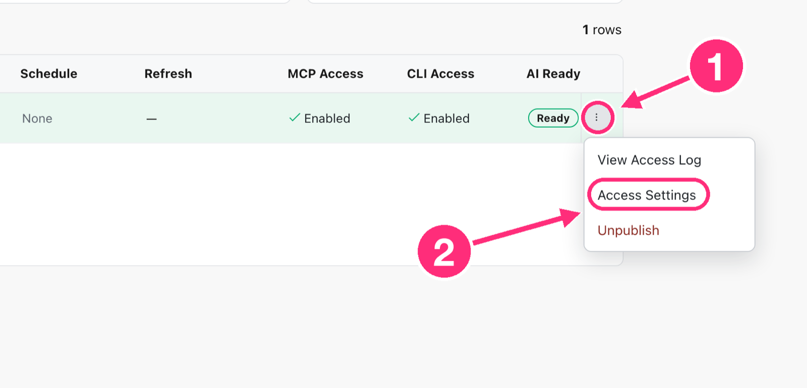

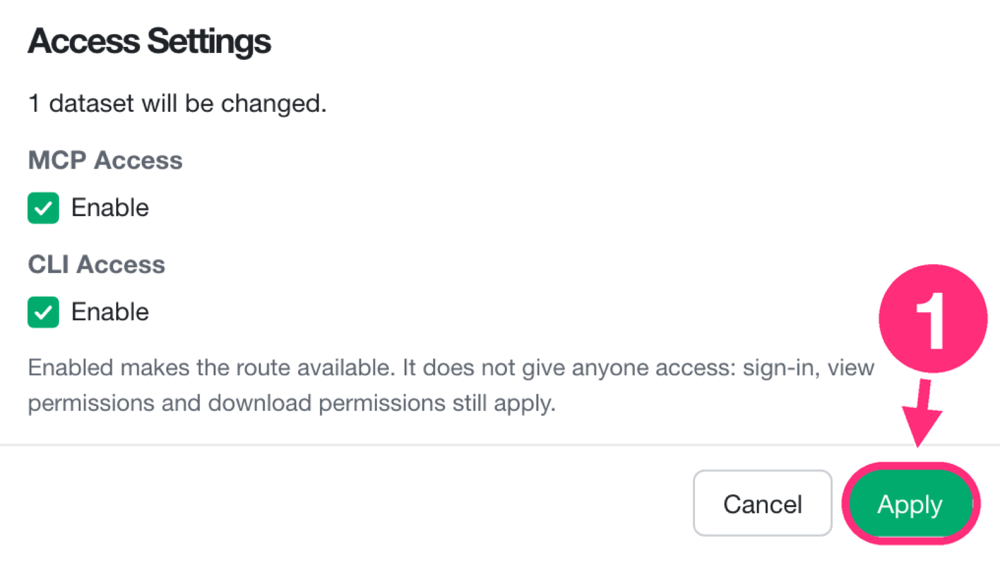

For example, to stop MCP, uncheck "Enable" under "MCP Access" and click "Apply". Enabling access does not open the data to everyone. Sign-in, view permissions, and download permissions apply as before.

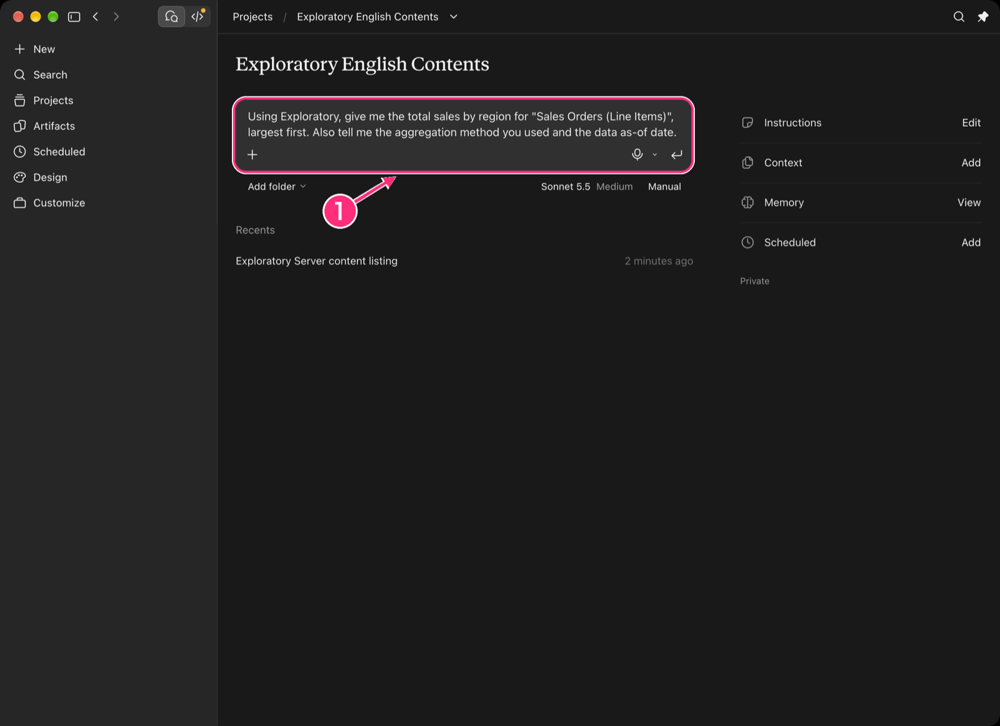

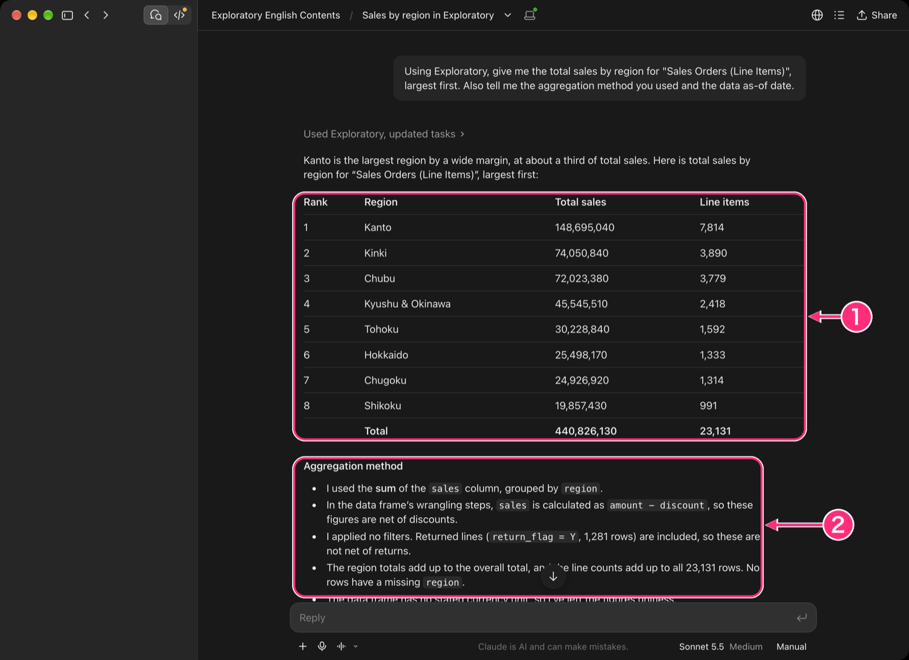

For how to use the tools and what is recorded, see these pages.

- [Server MCP tools](/en/mcp/server/tools)
- [Server MCP data and permissions](/en/mcp/server/data)
