This page describes how to set up a connection to Oracle Database through ODBC with Oracle's Instant Client. Follow the steps for your operating system, then create the connection in Exploratory.

## Mac

### Install unixODBC

Install unixODBC by following the [instruction](https://exploratory.io/note/exploratory/How-to-set-up-ODBC-in-Mac-unixodbc-lQz2Fnp7).

### Install Oracle Instant Client packages

Visit Oracle's official website and download the Instant Client packages compatible with your macOS architecture (either ARM64 or Intel x86). Download the Basic and ODBC packages.

1. [Oracle Instant Client Downloads for macOS (ARM64)](https://www.oracle.com/database/technologies/instant-client/macos-arm64-downloads.html)
2. [Oracle Instant Client Downloads for macOS (Intel x86)](https://www.oracle.com/database/technologies/instant-client/macos-intel-x86-downloads.html)

Unzip the downloaded packages into a directory, for example `~/instantclient_23_3`.

### Configure ODBC drivers

The commands below assume Homebrew is installed in `/opt/homebrew`. Run `brew --prefix` first to check, and use your own path both in the registration command and in the symbolic link.

Run the provided script to update the `odbcinst.ini` file.

```text
cd ~/instantclient_23_3
./odbc_update_ini.sh /opt/homebrew
```

Verify that the `odbcinst.ini` file has been updated with the Oracle ODBC driver information.

### Create a symbolic link to libodbcinst.2.dylib

Create the following symbolic link so that the Oracle ODBC driver works with unixODBC. This assumes that `libodbcinst.2.dylib` is located in `/opt/homebrew/lib`.

```text
cd ~/instantclient_23_3
ln -s /opt/homebrew/lib/libodbcinst.2.dylib . 
```

### Set environment variables

Add the following lines to your shell configuration file (for example, `~/.zshrc` or `~/.bash_profile`).

```text
export PATH=~/instantclient_23_3:$PATH
export ORACLE_HOME=~/instantclient_23_3
export DYLD_LIBRARY_PATH=~/instantclient_23_3
export TNS_ADMIN=~/instantclient_23_3/network/admin  # Optional, if using TNS names
```

Reload your shell configuration.

```text
source ~/.zshrc  # or source ~/.bash_profile
```

### Create a database connection

1. From the 3 bars menu, select Data Connections.

   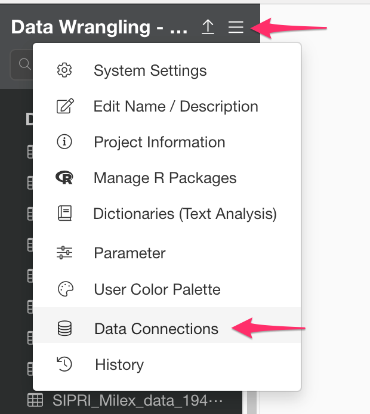

2. Click the Add button.

   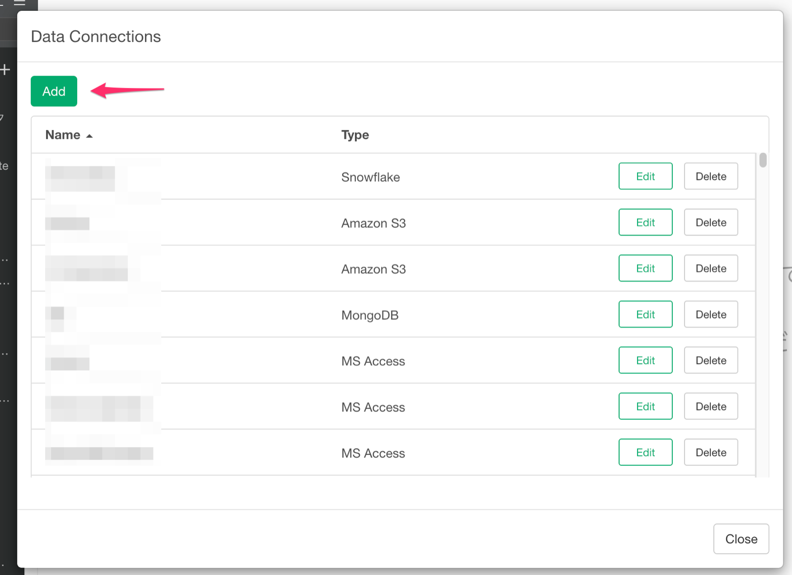

3. Select the Database tab and then click the "Oracle" icon.

   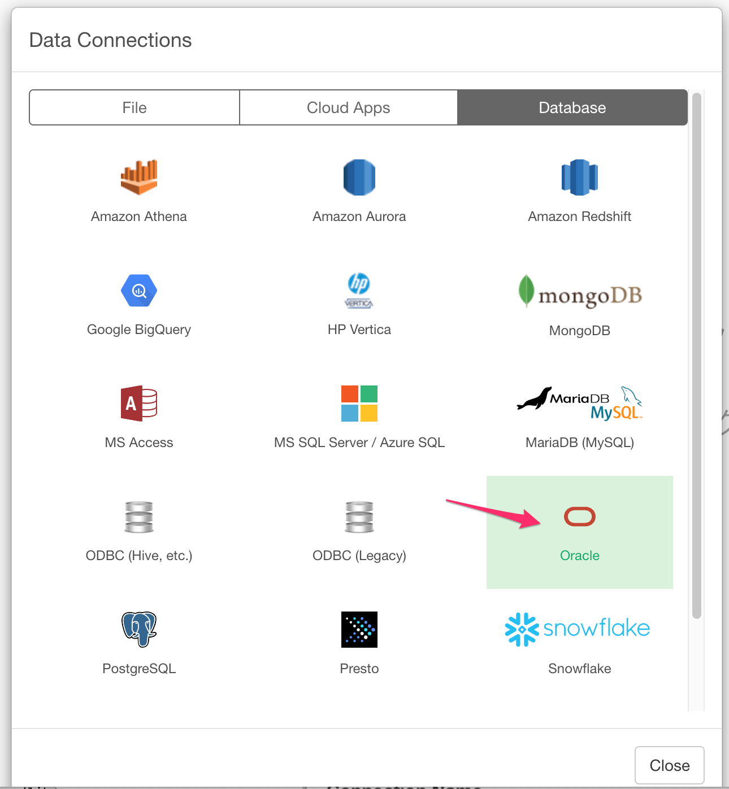

4. Enter the required information and select the Oracle 23 ODBC driver that you just installed.

   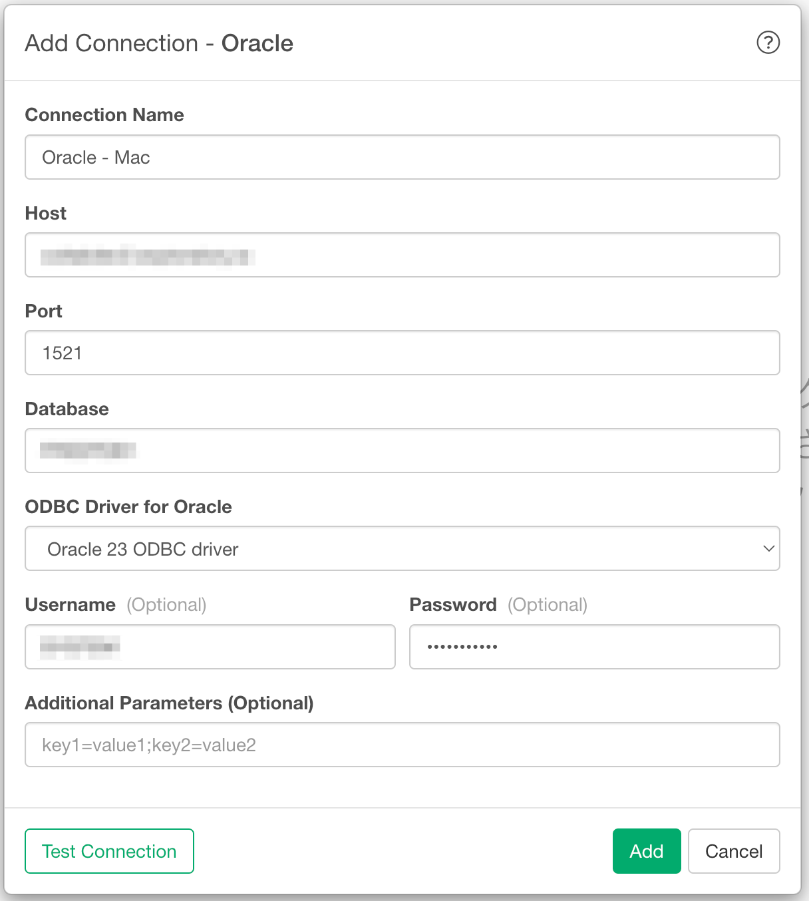

5. Click the Test Connection button and make sure it works, then click the Add button to save the connection.

   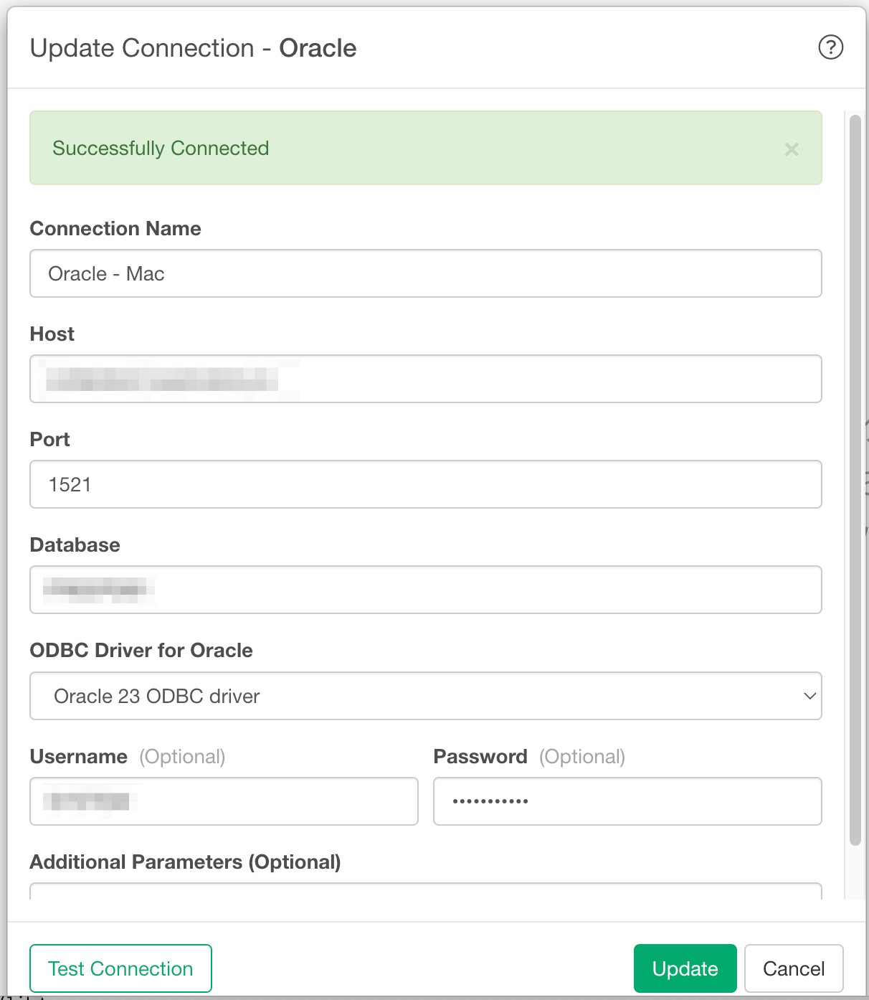

## Windows

### 1. Install Microsoft Visual C++ Redistributable

Oracle's Instant Client requires the Microsoft Visual C++ Redistributable. If you haven't installed it yet, download the installer from [this link](https://aka.ms/vs/17/release/vc_redist.x64.exe) and run it. For more details, see [Latest Microsoft Visual C++ Redistributable Version](https://learn.microsoft.com/en-us/cpp/windows/latest-supported-vc-redist?view=msvc-170#latest-microsoft-visual-c-redistributable-version).

### 2. Install Oracle Instant Client

Visit the [Oracle Instant Client Downloads for Microsoft Windows (x64) 64-bit](http://www.oracle.com/technetwork/topics/winx64soft-089540.html) page (registration required). Multiple driver versions are available. Choose the version certified for your Oracle Database and download the following two packages:

- Basic package
- ODBC package

After downloading, extract both packages into the same directory, for example `C:/Oracle/oracle_odbc`. You should see the files from both zip files in this directory.

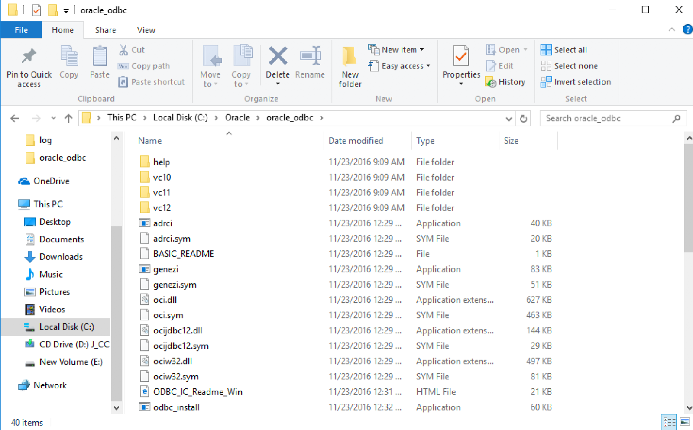

Then run `odbc_install.exe` as Administrator by right-clicking it and selecting **Run as Administrator**.

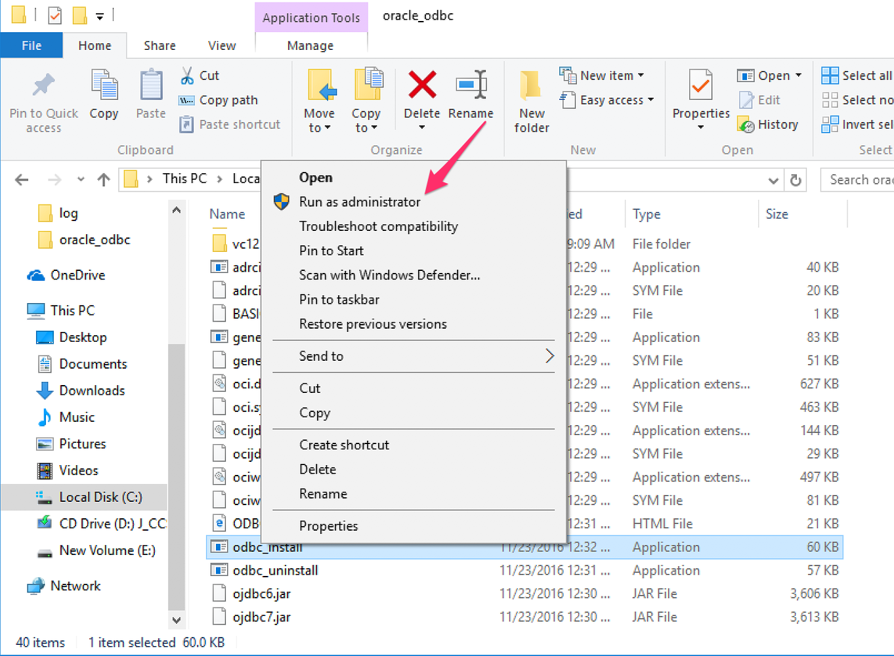

### 3. Set environment variables

Set up two environment variables that point to the Oracle Instant Client installation directory (for example, `C:/Oracle/oracle_odbc`).

1. Type "environment" into the Windows search box. You should see a result like "Edit the system environment variables".

   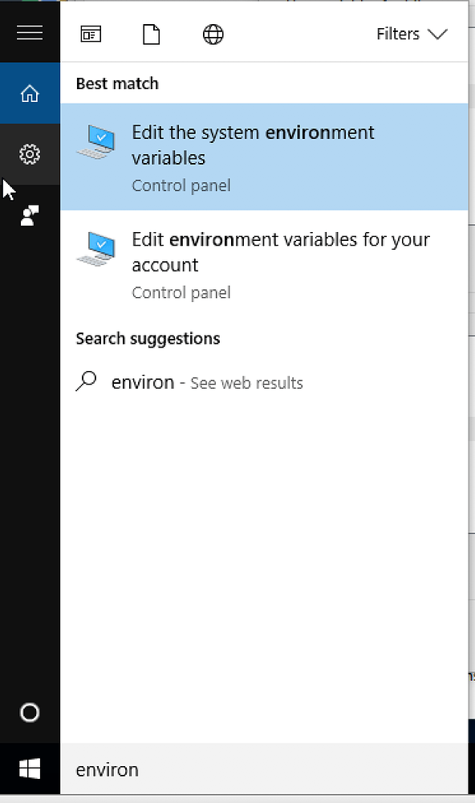

2. Click it to open the **System Properties** window.

   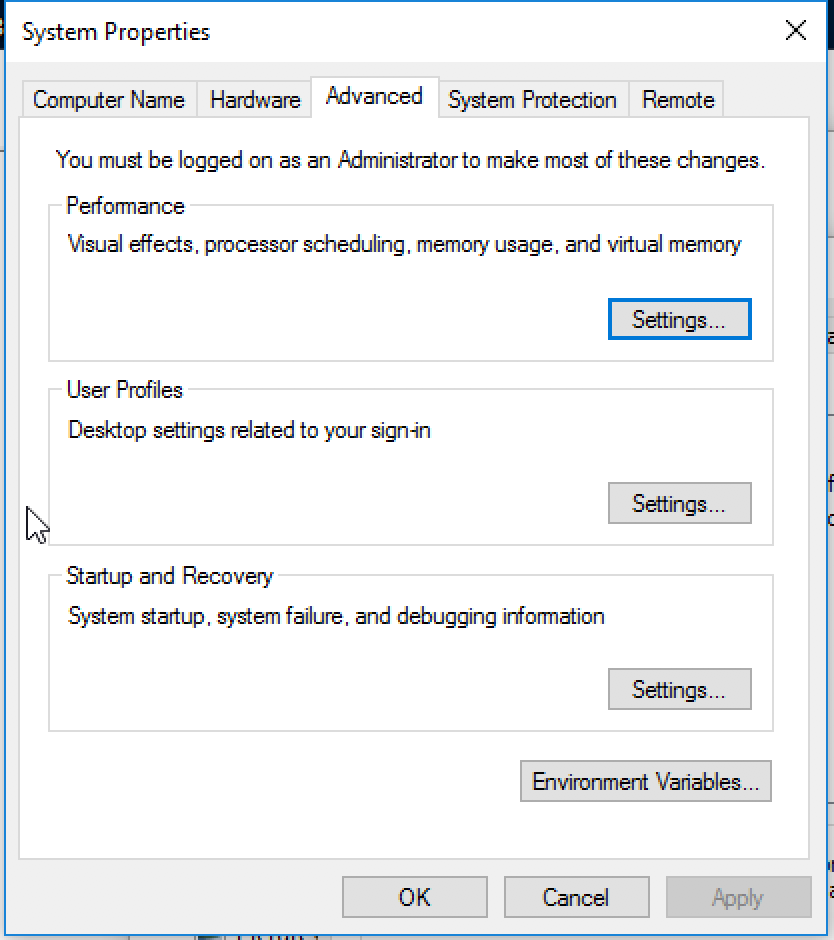

3. Click **Environment Variables...**.

   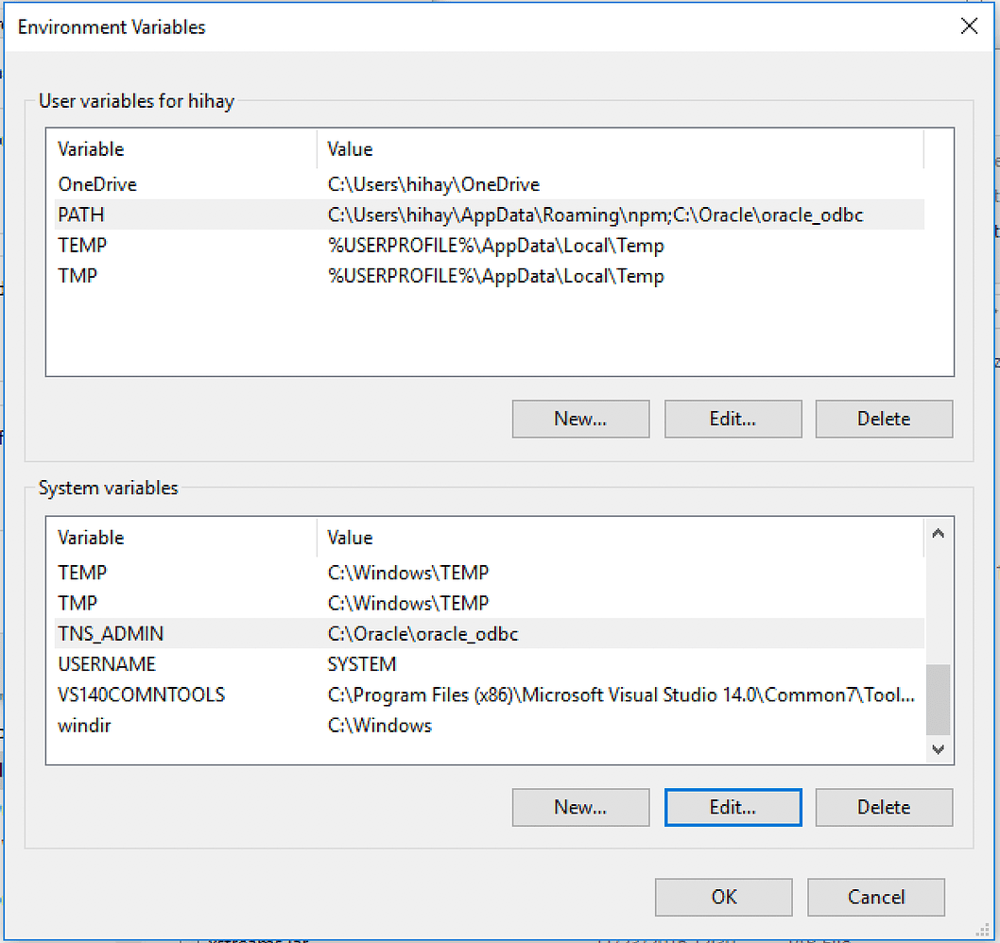

#### Update the PATH environment variable

In the **User variables** pane (upper section), select **PATH** and click **Edit...**. In the dialog that appears, click **New** and enter the Oracle Instant Client installation directory path.

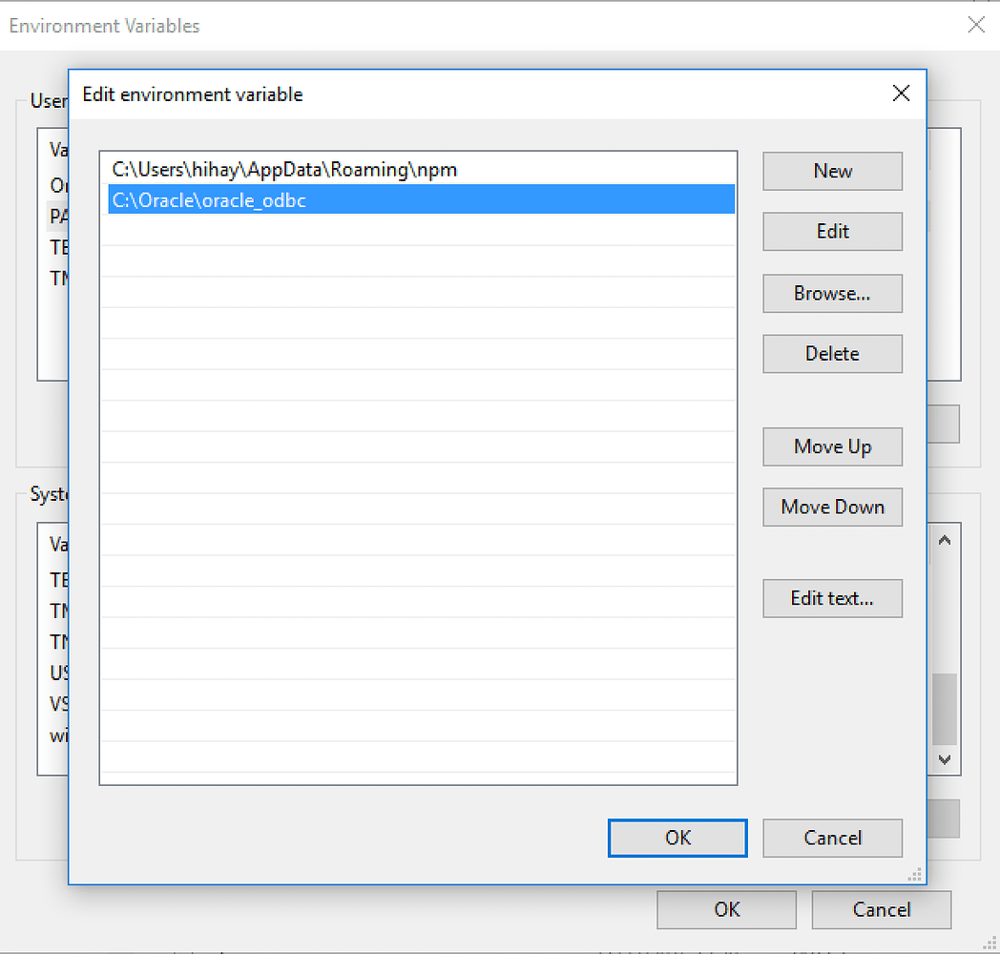

#### Add the TNS_ADMIN environment variable

In the **System variables** pane (lower section), click **New**, set `TNS_ADMIN` as the **Variable name**, and enter the Oracle Instant Client installation directory as the **Variable value**. Click **OK** to save the changes.

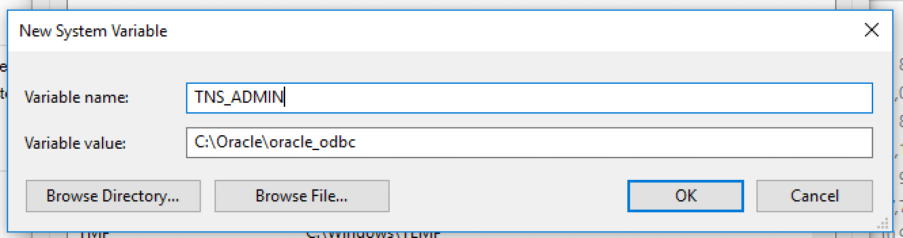

### 4. Create a connection in Exploratory

1. Start Exploratory, open a project, and select **Data Connection** from the project menu.

   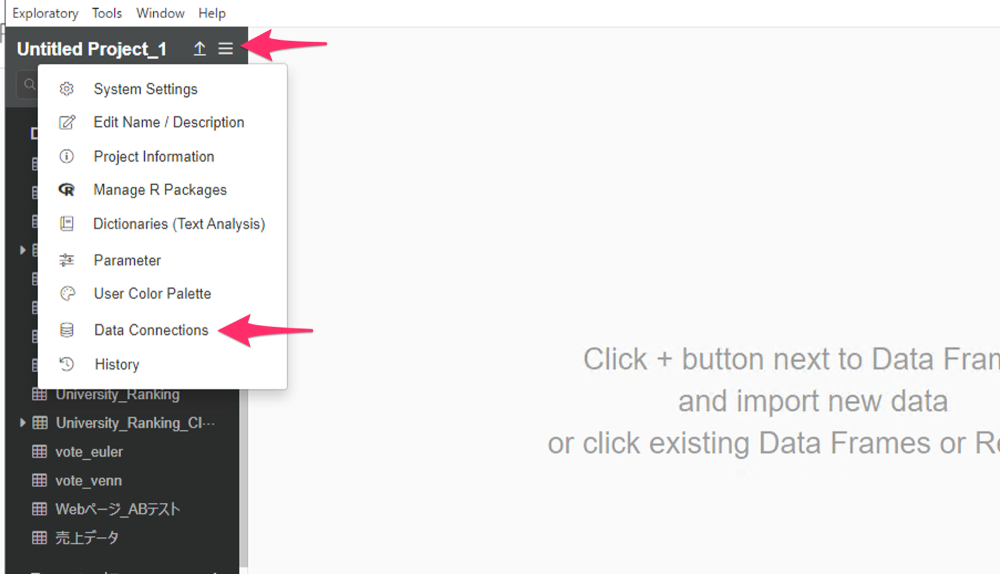

2. Click **Add** to create a new connection, select the **Database** tab, and choose **Oracle**. Make sure the ODBC driver you installed appears in the **ODBC Driver for Oracle** dropdown, and fill in your Oracle database details. Click **Test Connection** to make sure it works, then click **Add** to save the connection.

   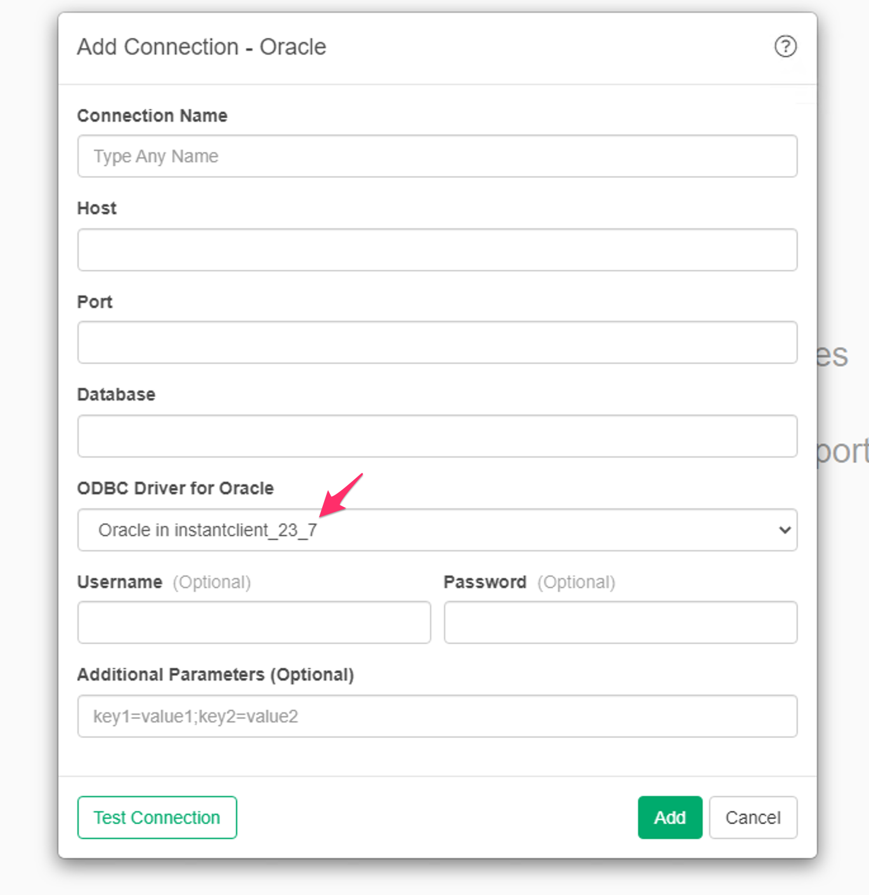
