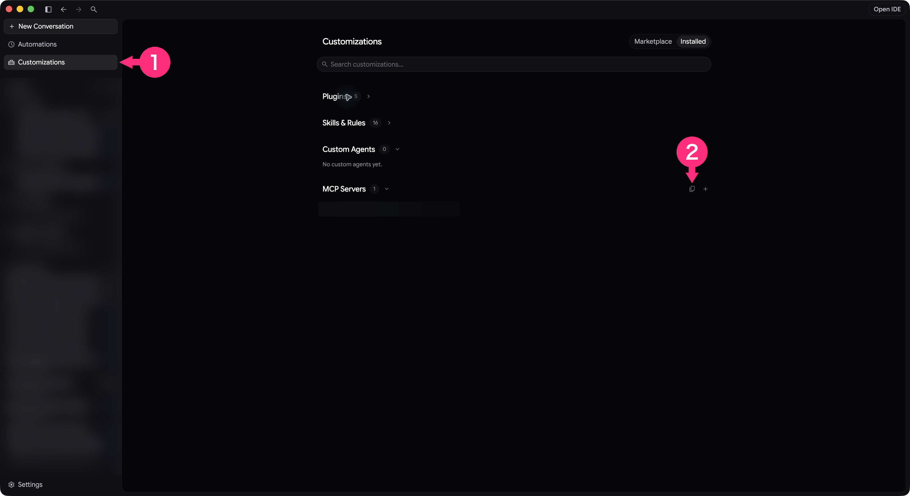
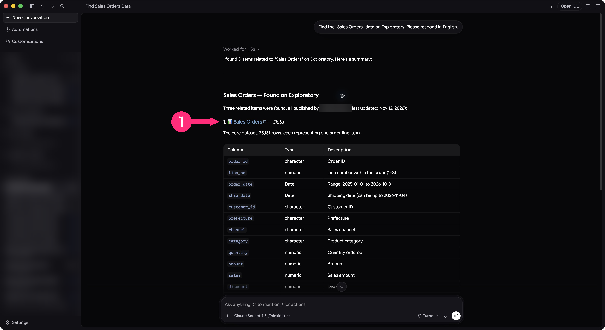
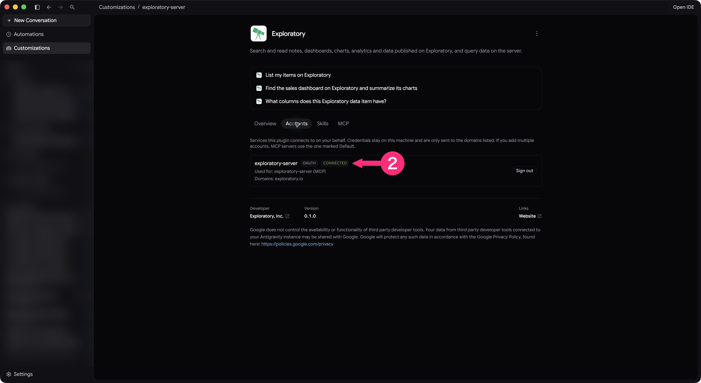
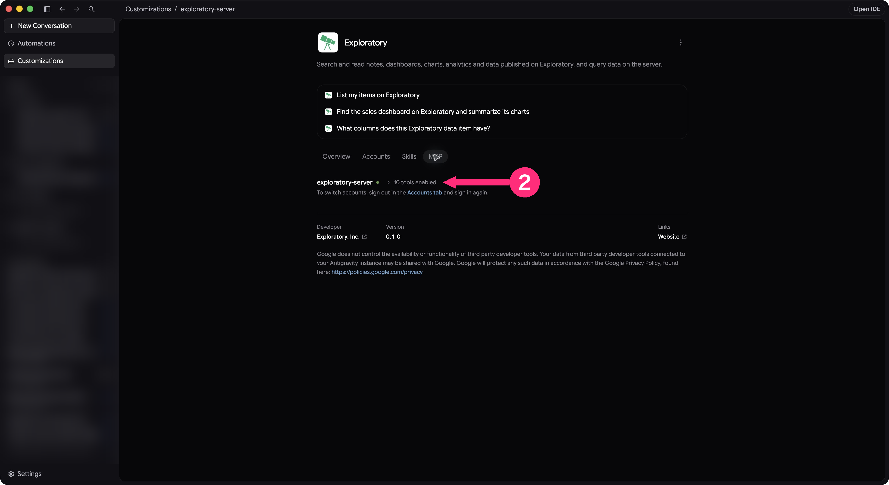

After you connect, an AI can read notes and data published on Exploratory, and create Pages (HTML pages). You register the Exploratory server in Antigravity and sign in through your browser.
It takes about 10 minutes. You need an Exploratory account and Antigravity.

<a id="need"></a>

## Requirements

- An Exploratory account
- Antigravity
- You do not need an API key or a client ID.

<a id="steps"></a>

## Steps

### Copy the config file path

Do this.

1. In the Antigravity app, select Customizations in the sidebar. Check that Installed is selected at the top of the screen.
2. At the right end of the MCP Servers row, select the copy icon (Copy Config File Path). The location of the config file (mcp_config.json) is copied.



### Register the server

A remote server takes its URL in "serverUrl".

1. Open mcp_config.json.
2. Add the `exploratory-server` entry below. If `mcpServers` already exists in the file, add only the `exploratory-server` entry inside it and keep the other server settings. The example shows a complete new file.

   ```json
   {
     "mcpServers": {
       "exploratory-server": {
         "serverUrl": "https://exploratory.io/mcp"
       }
     }
   }
   ```

To use the agy command line, write the same content in \~/.gemini/config/mcp_config.json.

### Start the sign-in

In the app, do this.

1. Under MCP Servers, select Authenticate next to exploratory-server.

In agy, follow these steps.

1. Start agy.
2. Run `/plugin`.
3. Open the exploratory-server connection (the Desktop plugin exploratory is separate).
4. Choose Sign in.

### Approve the access on exploratory.io

Your browser opens, in the app and in agy.

1. In the browser, sign in to Exploratory.
2. On Exploratory's consent page, approve the access.
3. Copy the authorization code shown in the browser.

### Paste the authorization code

In the app, go back to Antigravity and do this.

1. Paste the authorization code into the Enter authorization code field.
2. Select Submit.

The server reconnects automatically. A server you have signed in to shows a Sign out button.

In agy, go back to agy and do this.

1. Paste the authorization code.

### Check that it is connected

In a new chat, send this.

```text
Find the "Sales Orders" data on Exploratory. Please respond in English.
```

Sales Orders is an example. Replace it with the name of data you can view. An empty result does not necessarily mean that authentication or the connection failed. To tell them apart, see [Your content does not appear](/en/mcp/server/troubleshooting#zero).

After you send it, check the result.

1. Check the Sales Orders link in the reply.



If the Sales Orders data appears with its URL, the connection works.

<a id="plugin"></a>

## Check the connection when you installed the plugin

If an Exploratory plugin that lists exploratory-server is installed (as in the pictures below), open Exploratory under Plugins in Customizations to check the connection. `exploratory@exploratory` is the Desktop plugin, a different plugin from Server.

You can check it on these two screens.

1. Select the Accounts tab.
2. Check the CONNECTED label of exploratory-server.



When exploratory-server shows OAUTH and CONNECTED, it is connected.

Next, check the MCP tab.

1. Select the MCP tab.
2. Check the exploratory-server row.



The tab shows exploratory-server and the number of tools it provides.

<a id="trouble"></a>

## Troubleshooting

| What you see | What to do |
| --- | --- |
| You are asked to sign in | Go through the sign-in steps above again. |
| You installed the Desktop plugin but the Server tools do not appear | The Desktop plugin exploratory is separate from Server. Register Server with the configuration above. |

- [Troubleshooting](/en/mcp/server/troubleshooting) - Fixes by symptom for the Server MCP as a whole.

<a id="remove"></a>

## Disconnect

These steps are for the server you registered in mcp_config.json above. In the app, select More actions (⋮) next to exploratory-server and choose Delete. To pause it only, choose Disable. You can also disconnect by deleting the exploratory-server entry you added to mcp_config.json.

Removing the registration does not revoke the access you approved. To revoke it, also remove the client under Connected AI Apps in Account Settings on exploratory.io.
