After you connect, ChatGPT can read notes and data published on Exploratory, and create Pages (HTML pages). You add the Exploratory server to the ChatGPT desktop app as an MCP server. An MCP server is the address an AI app connects to in order to use the data and features of an outside service.
It takes about 5 minutes. You need an Exploratory account and the ChatGPT desktop app.

On the web (chatgpt.com), the screens for adding a server differ. The web steps are further down this page.

<a id="need"></a>

## Requirements

- An Exploratory account
- The ChatGPT desktop app

You do not need an API key or a client ID.

<a id="steps"></a>

## Steps (desktop app)

### Open the MCPs tab

In the ChatGPT desktop app, open Settings.

1. In the menu on the left of settings, choose Plugins under Integrations.
2. Choose the MCPs tab.
3. Choose Add at the top right.

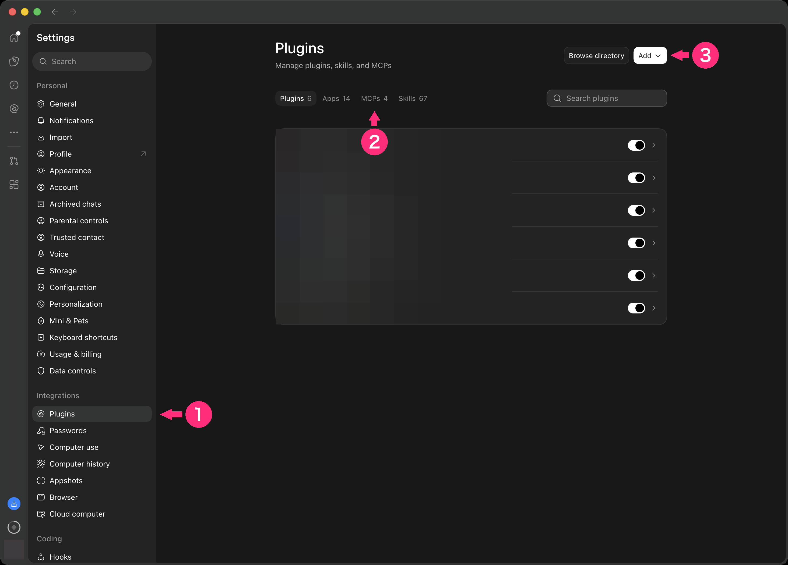

Next, the Add menu opens.

1. Choose Add MCP server. The Connect to a custom MCP screen opens.

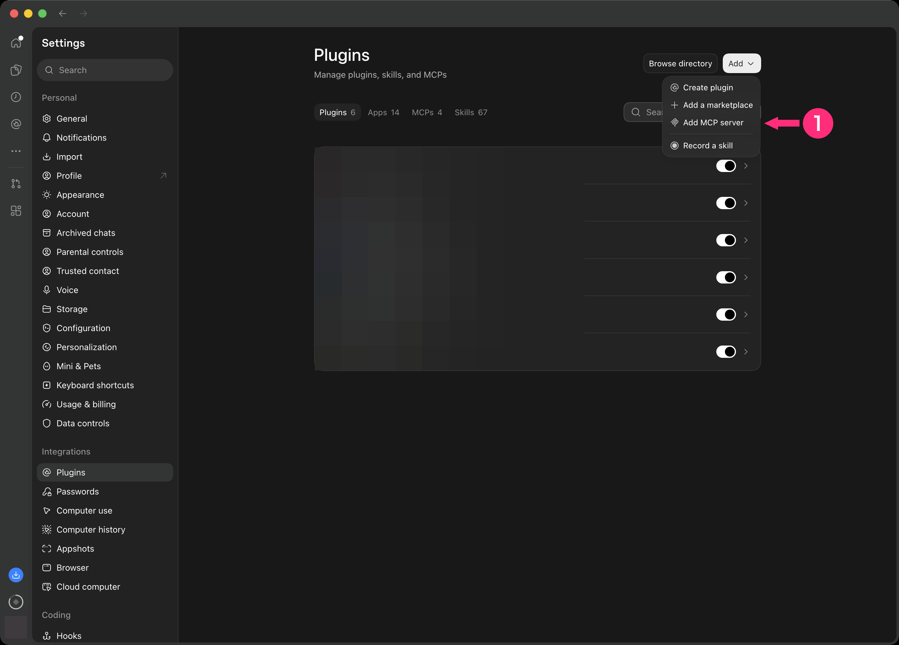

### Enter the address

1. In Name, enter `Exploratory`.
2. For Type, choose Streamable HTTP.
3. In URL, enter `https://exploratory.io/mcp`.

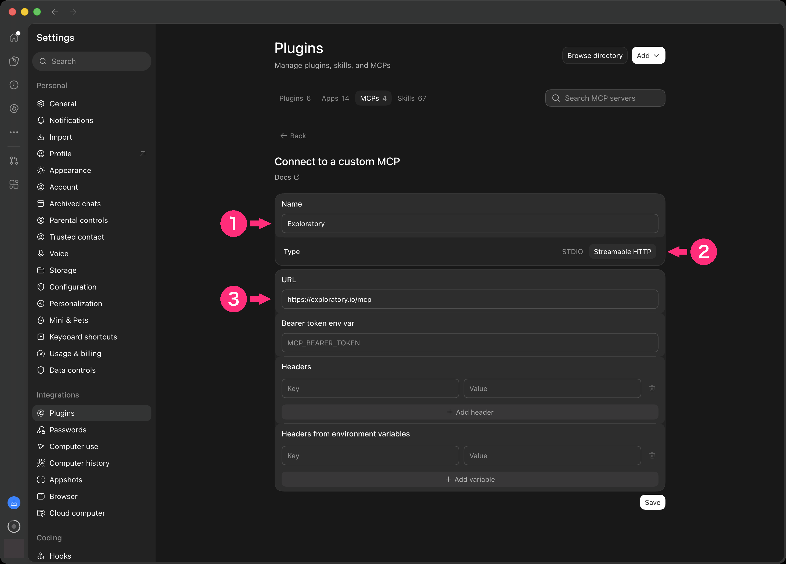

4. Choose Save at the bottom right.

Do not choose STDIO. You can leave the other fields empty (Exploratory connects through a sign-in in your browser).

### Restart and authenticate

The [official documentation](https://learn.chatgpt.com/docs/extend/mcp) says: "Save the server, then select Restart." and "Select Authenticate when an OAuth server requires sign-in." If the labels on your screen differ, choose the button with the same meaning.

1. After you save, select Restart.
2. When the list of servers shows that the server needs OAuth, select Authenticate.

### Approve the access on exploratory.io

Your browser opens exploratory.io. If you are not signed in, sign in first.

1. On the screen where ChatGPT asks for access, choose Allow.

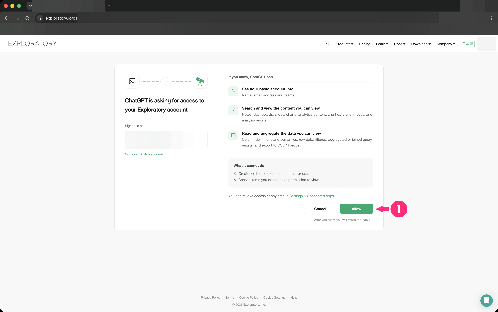

### Check that it is connected

1. Check the row of the server you added under Servers on the MCPs tab.

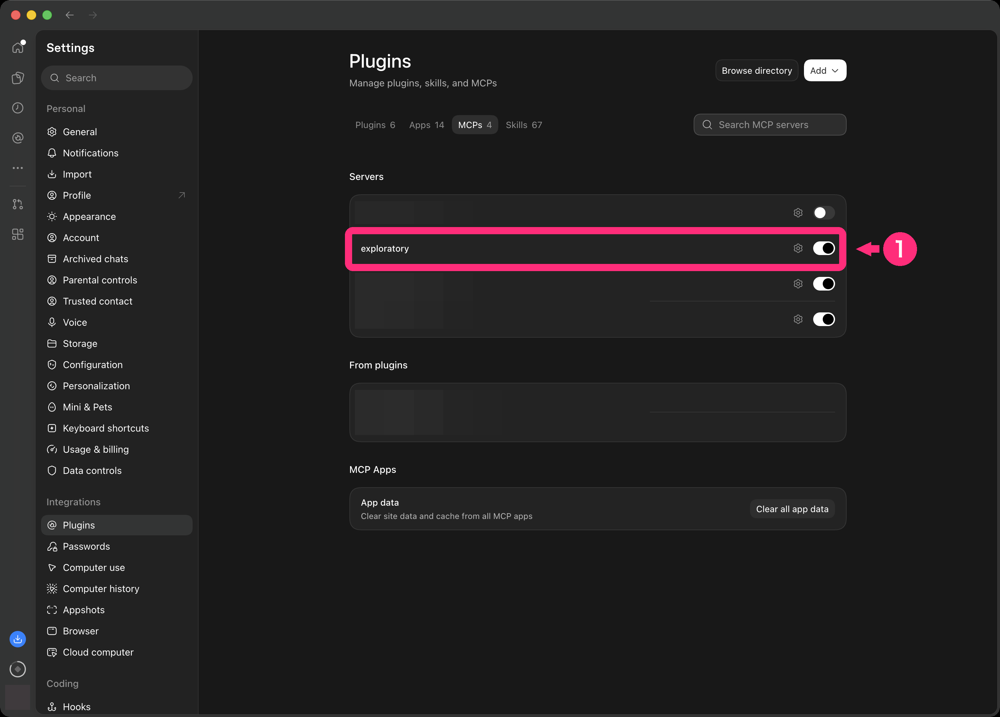

If the server you added appears, it was added.

2. Type `/mcp` in the chat box. It shows the connected servers.
3. Open a new chat.
4. Send this.

   ```text
   Using the connected Exploratory Server, list up to three items I can view, with their URLs. If none are found, say so.
   ```

If items appear with their URLs, it works. An empty result does not necessarily mean that authentication or the connection failed. To tell them apart, see [Your content does not appear](/en/mcp/server/troubleshooting#zero).

<a id="web"></a>

## Add it on the web (chatgpt.com)

On the web, the screens for adding a server differ from the desktop app. This section describes the web steps.

### Open Plugins in Settings

In ChatGPT, open Settings.

1. Choose Plugins in Settings.
2. Choose Browse directory. The Plugins screen under Customize opens.

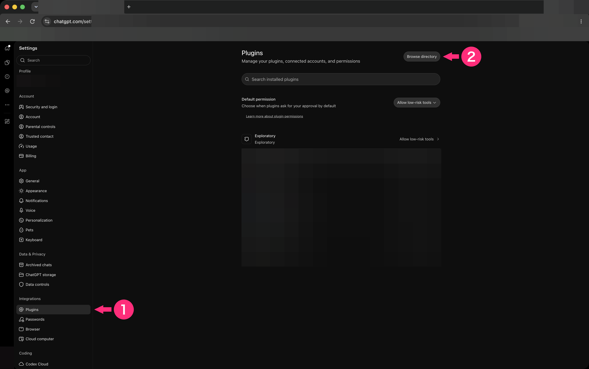

### Open the Add menu

On the Plugins screen under Customize, do this.

1. Choose Add at the top right.

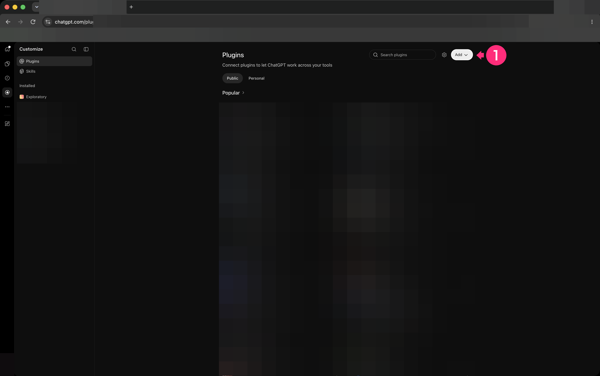

Next, the menu opens.

1. Choose Add custom MCP server.

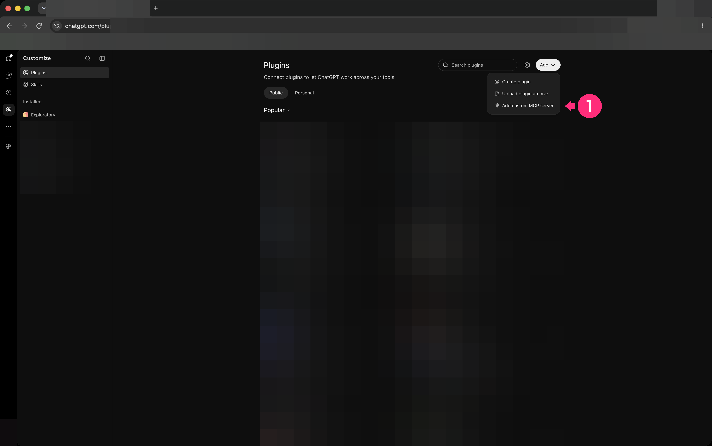

### Enter the address

On the Add custom MCP server screen, enter these values. The screen says "Custom MCP servers introduce risk." Make sure you trust the server before you enter the values.

1. In Name, enter `Exploratory`.
2. Under Connection, leave Server URL selected. In the URL field, enter `https://exploratory.io/mcp`.
3. Select I understand and want to continue.

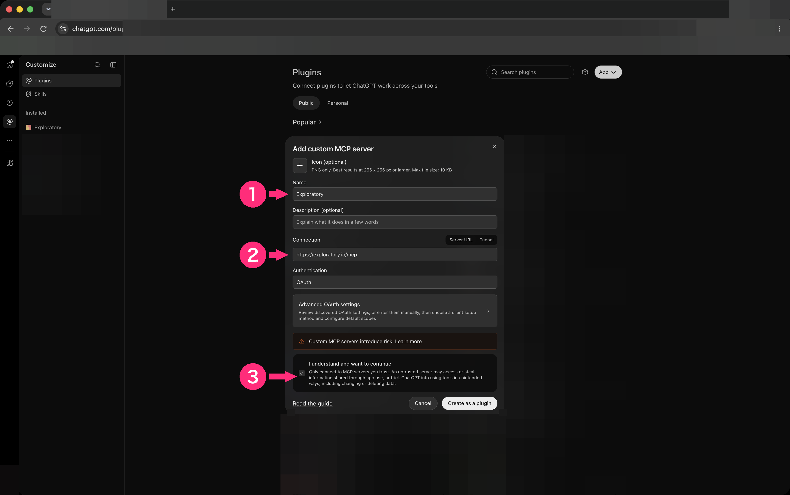

4. Check that Authentication is OAuth. There is nothing to change.
5. Choose Create as a plugin.

Next, the Connect Exploratory screen opens.

1. Choose the Connect Exploratory button.

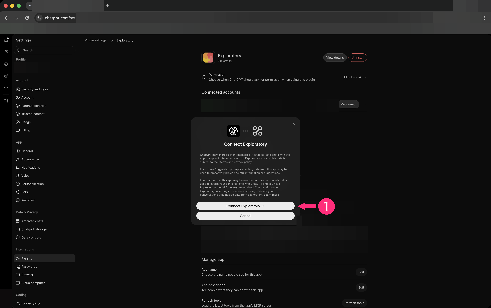

### Approve the access on exploratory.io

Your browser opens exploratory.io. If you are not signed in, sign in first.

1. On the screen where ChatGPT asks for access, choose Allow.


### Check that it is connected

Back in ChatGPT, do this.

1. Under Installed on the left of Customize, choose Exploratory.

The details screen opens. Next, do this.

1. Check the Exploratory row under Apps.

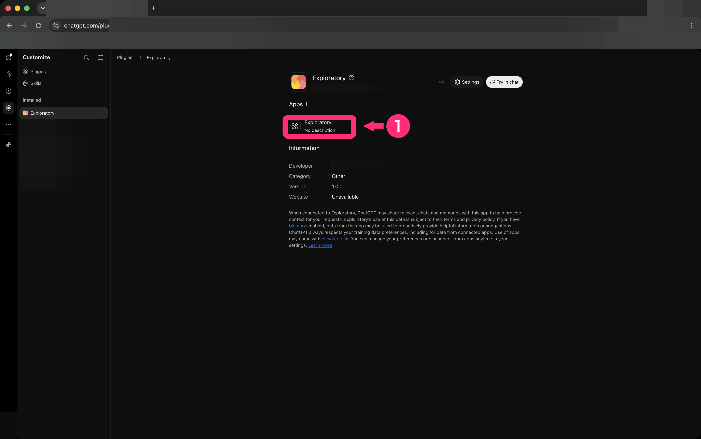

The Developer field is blurred in the image. Information lists Developer, Category, Version and Website.

2. Choose Try in chat to open a chat.
3. Send this.

   ```text
   Using the connected Exploratory Server, list up to three items I can view, with their URLs. If none are found, say so.
   ```

If items appear with their URLs, it works. An empty result does not necessarily mean that authentication or the connection failed. To tell them apart, see [Your content does not appear](/en/mcp/server/troubleshooting#zero).

<a id="trouble"></a>

## If it does not work

For symptoms and fixes, see [Troubleshooting](/en/mcp/server/troubleshooting).

<a id="remove"></a>

## Disconnect

In the desktop app, turn off the switch of the server you added under Servers on the MCPs tab, and it is no longer used. On the web, delete the Exploratory plugin you added in the plugin list. Then open Account Settings on exploratory.io and remove the app you connected under Connected AI Apps. Deleting it in ChatGPT alone does not revoke the access you approved on Exploratory.
