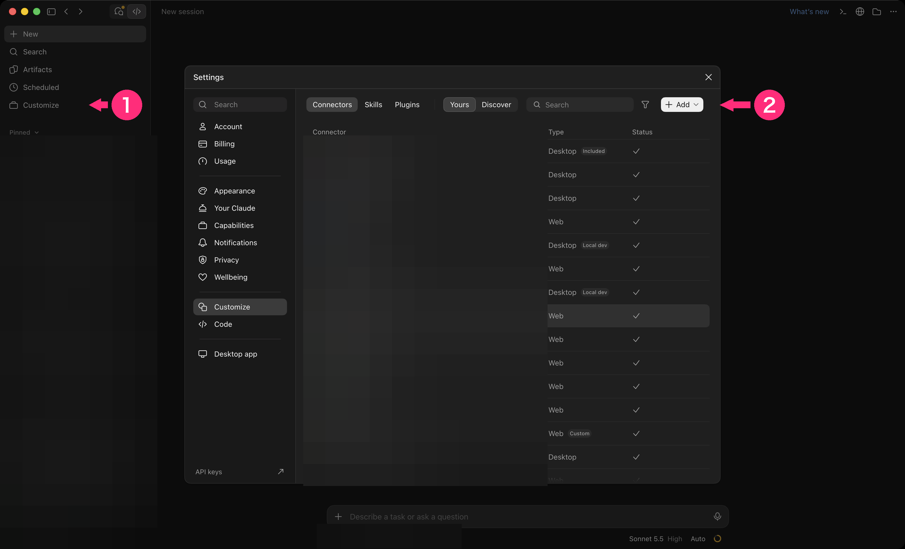
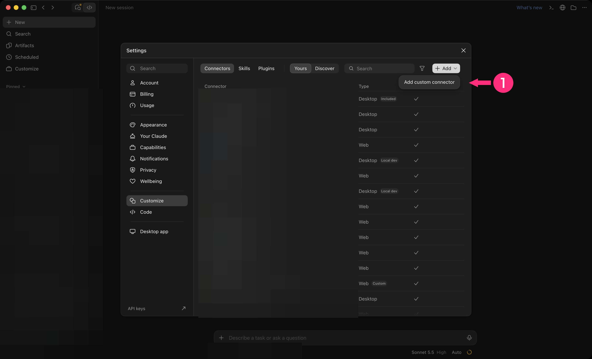
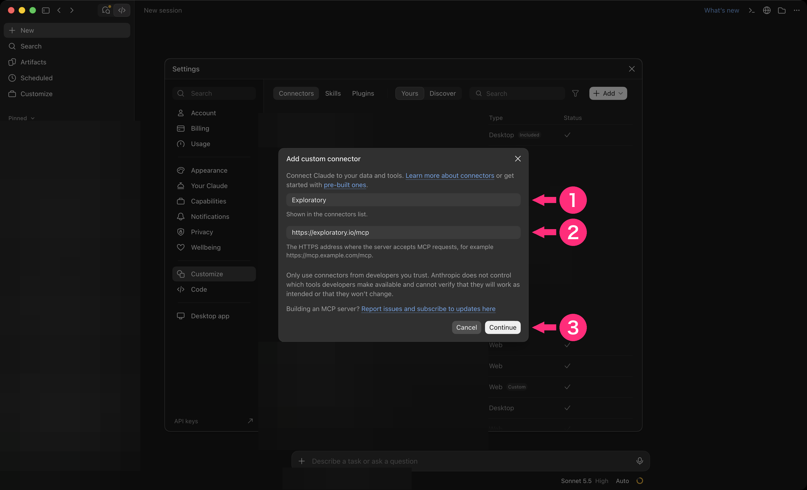
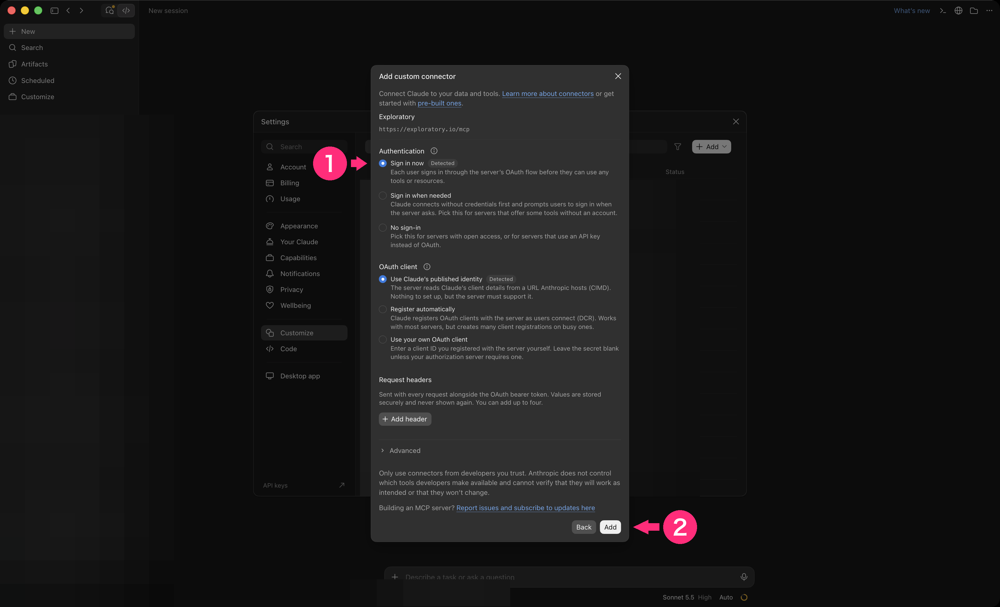
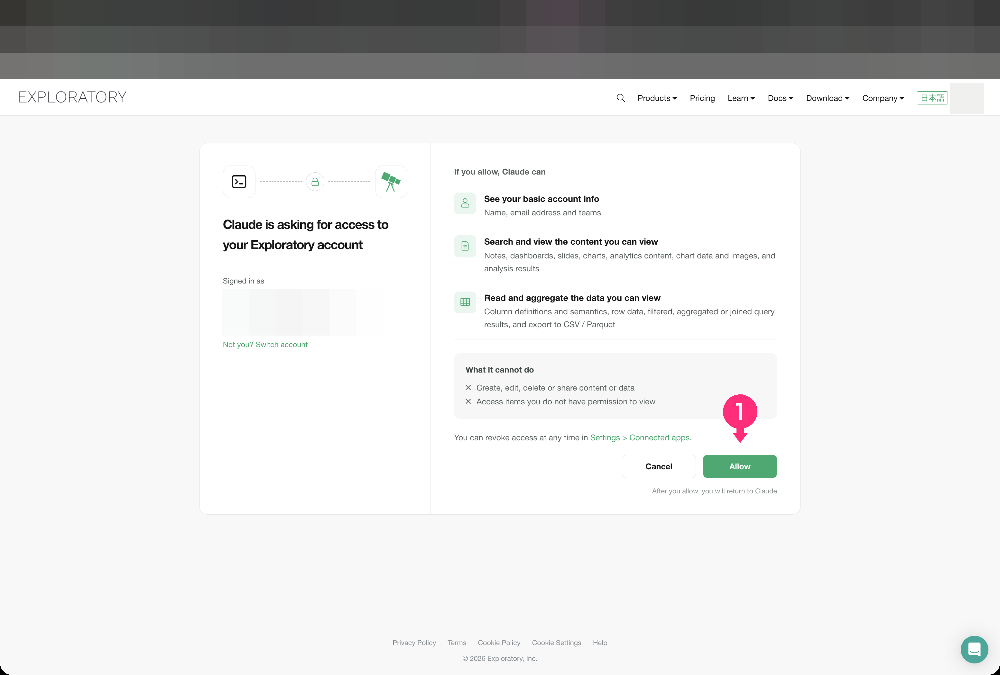
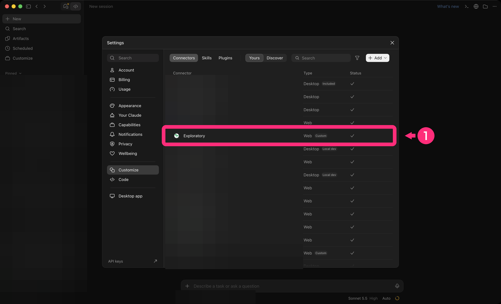
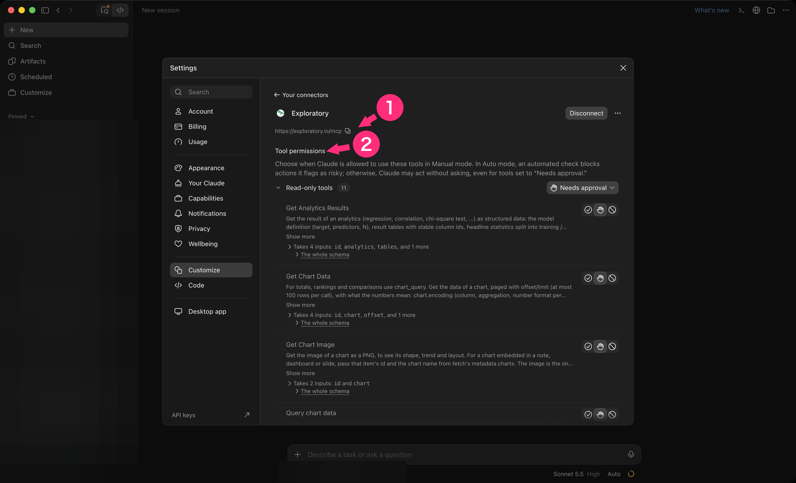

Add the Exploratory server to Claude as a custom connector. A connector is a link that lets Claude use the data and features of an outside service. After you connect, you can read notes and data published on Exploratory, and create Pages (HTML pages) from a Claude chat.
It takes about 5 minutes. You need an Exploratory account and the Claude desktop app or the web (claude.ai).

The connector screens are the same in the Claude desktop app and on the web.

<a id="need"></a>

## Requirements

- An Exploratory account
- The Claude desktop app, or the web (claude.ai)

You do not need an API key or a client ID.

<a id="steps"></a>

## Steps

### Open the add screen

In the Claude desktop app, open the Connectors screen in Settings. You work on the screen where the Connectors tab and Yours are selected.

1. Choose Customize in the sidebar on the left. Settings opens and shows the Connectors screen.
2. Choose Add at the top right of the list.



Next, the add menu opens.

1. Choose Add custom connector.



### Enter the address

1. In the name field, enter `Exploratory`.
2. In the MCP server URL field, enter `https://exploratory.io/mcp`.
3. Choose Continue.



Next, the authentication screen opens.

1. Check that Authentication is Sign in now.
2. Choose Add.



OAuth client is Use Claude's published identity. Both are marked Detected. There is nothing to change.

### Approve the access on exploratory.io

Your browser opens exploratory.io and shows "Claude is asking for access to your Exploratory account". If you are not signed in, sign in first.

1. Choose Allow.



If the connector connects without showing this screen, go on to the next check.

### Check that it is connected

1. Check the Exploratory row in the Yours list.



When Exploratory appears with the Custom label and a check mark under Status, the connection works.

2. Open a new chat.
3. Send this.

   ```text
   Using the connected Exploratory Server, list up to three items I can view, with their URLs. If none are found, say so.
   ```

If items appear with their URLs, it works. An empty result does not necessarily mean that authentication or the connection failed. To tell them apart, see [Your content does not appear](/en/mcp/server/troubleshooting#zero).

### Use it in Claude Code too

If you sign in to [Claude Code](/en/mcp/server/clients/claude-code) with the same claude.ai account, the connector you added here also appears there as "claude.ai Exploratory", and you can use it as is. You do not need to add it again in Claude Code.

<a id="permissions"></a>

## Check when tools run

Open Exploratory in the list.

1. Check the server URL (https://exploratory.io/mcp).
2. Check Tool permissions.



The Exploratory connector has tools that only read, and tools that create, update or delete Pages. You can choose when each tool runs. This setting decides when Claude may use the tools in Manual mode. In Auto mode, an automated check blocks actions it flags as risky; for other actions, Claude may act without asking, even for tools set to Needs approval.

<a id="trouble"></a>

## If it does not work

| What you see | What to do |
| --- | --- |
| A message says that a connector for this URL already exists in your organization | Someone on your team (organization) already added it. Do not add it again; use the existing connector in the list. |
| You are asked to sign in | Open Exploratory in the connectors list and sign in again. |

For other symptoms, see [Troubleshooting](/en/mcp/server/troubleshooting).

<a id="remove"></a>

## Disconnect

Open Exploratory in the connectors list and use the disconnect button at the top right.

Disconnecting does not revoke the access you approved on Exploratory. To revoke it too, open Account Settings on exploratory.io and remove Claude under Connected AI Apps.
