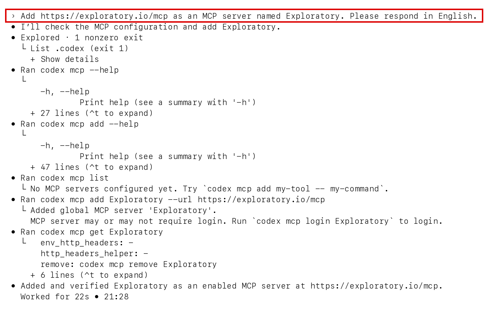
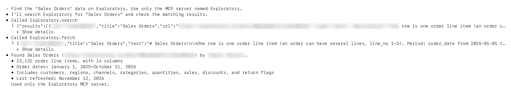

After you connect, an AI can read notes and data published on Exploratory, and create Pages (HTML pages). You register the Exploratory server in Codex and sign in through your browser.
It takes about 3 minutes. You need an Exploratory account and Codex.

<a id="need"></a>

## Requirements

- An Exploratory account
- Codex
- You do not need an API key or a client ID.

<a id="steps"></a>

## Steps

### Register

This registers only the server, without the skill. Use either of the two ways below.

**To edit the config file**

1. Add this to \~/.codex/config.toml.

   ```text
   [mcp_servers.exploratory-server]
   url = "https://exploratory.io/mcp"
   ```

**To add with a command**

1. Run this command.

   ```sh
   codex mcp add exploratory-server --url https://exploratory.io/mcp
   ```

exploratory@exploratory in Exploratory's GitHub marketplace is for Desktop and does not install Server.

### Sign in

1. Run this command.

   ```sh
   codex mcp login exploratory-server
   ```

2. When your browser opens, sign in to Exploratory.
3. Approve the access.

### Check that it is connected

1. In a new chat, send this.

   ```text
   Using the connected Exploratory Server, list up to three items I can view, with their URLs. If none are found, say so.
   ```

If items appear with their URLs, the connection works. An empty result does not necessarily mean that authentication or the connection failed. To tell them apart, see [Your content does not appear](/en/mcp/server/troubleshooting#zero).

A skill gives an AI instructions for using a service. It is separate from the MCP connection settings.

<a id="chat"></a>

## Add by asking in chat

Instead of running the command yourself, you can ask Codex in the chat to add the server.

### Ask in the chat

1. In Codex, send this.

   ```text
   Add https://exploratory.io/mcp as an MCP server named Exploratory
   ```

   The image below used this request with "Please respond in English." added, so that the reply is in English.



Codex added the server with `codex mcp add` and answered that the server was added and enabled. If you have not signed in yet, run `codex mcp login Exploratory`. Which command the AI chooses can differ from run to run, so read its answer.

### Sign in and check

1. If you are not signed in yet, run `codex mcp login Exploratory`. Your browser opens. Approve the access in the browser.
2. Start a new session and open `/mcp`. Check that Exploratory is connected.

3. Ask for the data, and name the connection to search with.

   ```text
   Find the "Sales Orders" data on Exploratory. Use only the MCP server named Exploratory.
   ```

Codex searches through the Exploratory server and finds the data.



If you already have another Exploratory connection (for example exploratory-server or Desktop), Codex may pick that one. Naming the connection avoids it.

<a id="apikey"></a>

## Connect with an API key

If your environment cannot open a browser, use an API key instead of the sign-in. Create the key in Account Settings \> API Keys, and put it in an environment variable. Set EXPLORATORY_API_KEY through your environment's secret-management facility, such as your operating system's credential store or the secrets of your CI, not through your shell's startup file. Do not write the key itself on the command line or in a configuration file. The configuration below assumes that this environment variable is already set.

Add the name of the variable, not the key, to \~/.codex/config.toml.

```text
[mcp_servers.exploratory-server]
url = "https://exploratory.io/mcp"
bearer_token_env_var = "EXPLORATORY_API_KEY"
```

If you write the key in the file as it is, it stays in that file. Use one way only: the sign-in above or this one. See [Connect with an API key](/en/mcp/server/auth#apikey) for what a key can read.

<a id="trouble"></a>

## Troubleshooting

| What you see | What to do |
| --- | --- |
| You are asked to sign in | Run codex mcp login exploratory-server to sign in again. If you added the server by chat, give the name you registered (Exploratory in the example). |
| The Server tools do not appear | exploratory@exploratory is for Desktop. Register Server with the steps above. |

- [Troubleshooting](/en/mcp/server/troubleshooting) - Fixes by symptom for the Server MCP as a whole.

<a id="remove"></a>

## Disconnect

Delete the \[mcp_servers.exploratory-server\] entry you added to \~/.codex/config.toml. If you added the server by chat, the entry carries the name you gave it (Exploratory in the example), so delete \[mcp_servers.Exploratory\] instead. Use the name you registered.

Removing the registration does not revoke the access you approved. To revoke it, also remove the client under Connected AI Apps in Account Settings on exploratory.io.
