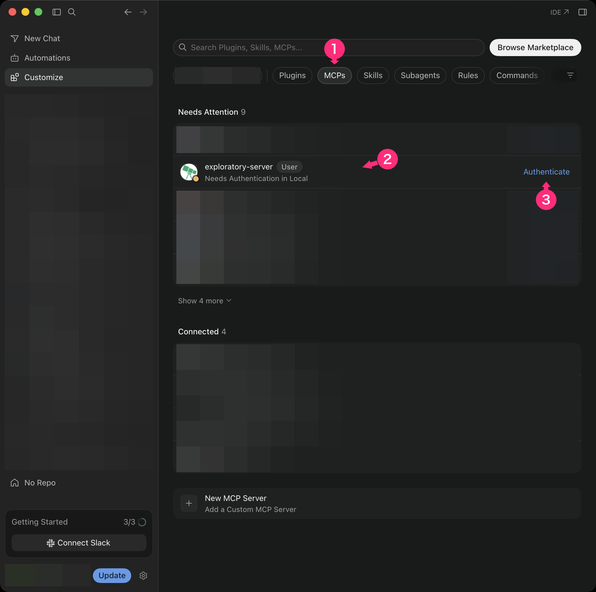
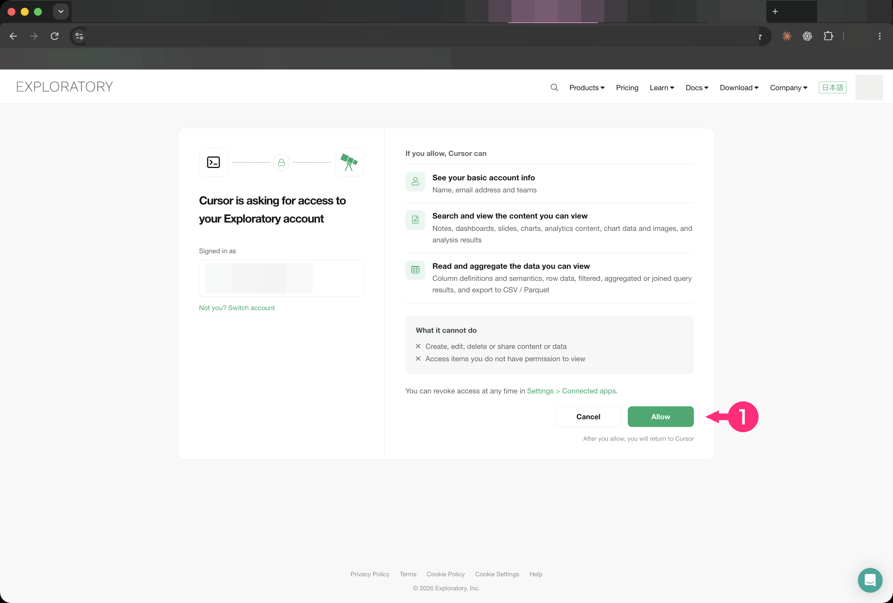
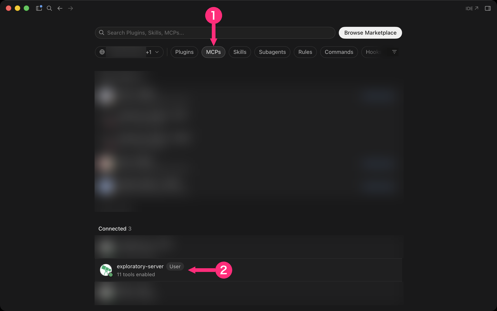
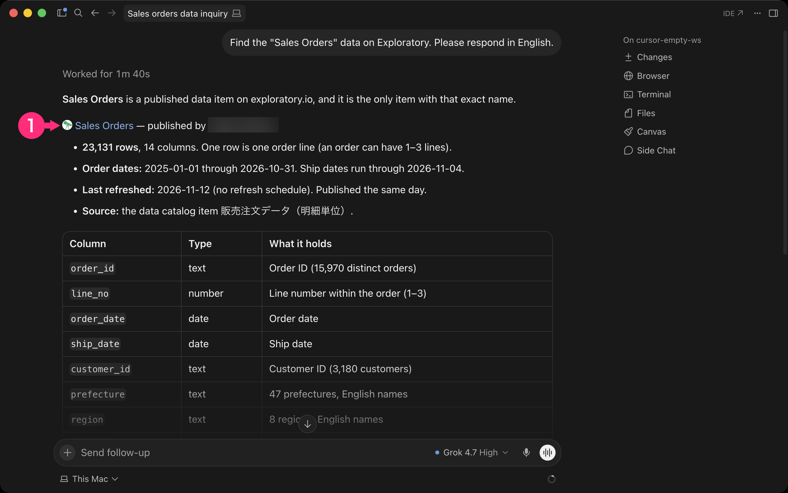

After you connect, an AI can read notes and data published on Exploratory, and create Pages (HTML pages). You register the Exploratory server in the Cursor agent and sign in through your browser. It works with the model you pick in Cursor, including Grok.
It takes about 5 minutes. You need an Exploratory account and Cursor.

<a id="need"></a>

## Requirements

- An Exploratory account
- Cursor (its command-line agent is `agent` or `cursor-agent`)
- You do not need an API key or a client ID.

<a id="steps"></a>

## Steps

### Register in mcp.json

If your app's official directory lists Exploratory Server, follow its installation instructions. Otherwise, add only the server by hand, without the skill, as follows. `exploratory@exploratory` is for Desktop.

1. Open \~/.cursor/mcp.json (or .cursor/mcp.json in a project).
2. Add the `exploratory-server` entry below. If `mcpServers` already exists in the file, add only the `exploratory-server` entry inside it and keep the other server settings. The example shows a complete new file.

   ```text
   {
     "mcpServers": {
       "exploratory-server": {
         "type": "http",
         "url": "https://exploratory.io/mcp"
       }
     }
   }
   ```

### Open MCPs

In the Cursor app, check the MCP server you added.

1. Choose Customize in the sidebar.

Next, work on the Customize screen.

1. Choose MCPs.
2. Check the exploratory-server row. Before you sign in, it shows "Needs Authentication in Local".
3. Choose Authenticate at the right of the row.



Instead of the app, you can start the sign-in in a terminal.

```sh
agent mcp login exploratory-server
```

### Approve the access on exploratory.io

Your browser opens. If you are not signed in, sign in to Exploratory. Choosing Authenticate in the app and running the terminal command open the same browser screen.

1. Choose Allow.



### Check that it is connected

When you have signed in, exploratory-server moves to the Connected list under MCPs.

1. Choose MCPs.
2. Check the exploratory-server row in the Connected list.



Next, in a new chat, send this.

```text
Find the "Sales Orders" data on Exploratory. Please respond in English.
```

Sales Orders is an example. Replace it with the name of data you can view. An empty result does not necessarily mean that authentication or the connection failed. To tell them apart, see [Your content does not appear](/en/mcp/server/troubleshooting#zero).

After you send it, check the result.

1. Check the Sales Orders link in the search result.



If the Sales Orders data appears with its URL, the connection works.

A skill gives an AI instructions for using a service. It is separate from the MCP connection settings.

<a id="apikey"></a>

## Connect with an API key

If your environment cannot open a browser, use an API key instead of the sign-in. Create the key in Account Settings \> API Keys, and put it in an environment variable named EXPLORATORY_API_KEY before you start Cursor, and set it from a secret manager, not in a shell startup file. Then refer to it in mcp.json.

```text
{
  "mcpServers": {
    "exploratory-server": {
      "type": "http",
      "url": "https://exploratory.io/mcp",
      "headers": {
        "Authorization": "Bearer ${env:EXPLORATORY_API_KEY}"
      }
    }
  }
}
```

If you write the key in mcp.json as it is, it stays in that file. Use one way only: the sign-in above or this one. See [Connect with an API key](/en/mcp/server/auth#apikey) for what a key can read.

<a id="trouble"></a>

## Troubleshooting

| What you see | What to do |
| --- | --- |
| You are asked to sign in | Run agent mcp login exploratory-server to sign in again. |
| You installed the Desktop plugin but the Server tools do not appear | The Desktop plugin does not add Server. Add Server with the JSON above. |

- [Troubleshooting](/en/mcp/server/troubleshooting) - Fixes by symptom for the Server MCP as a whole.

<a id="remove"></a>

## Disconnect

Delete the exploratory-server entry you added to mcp.json.

Removing the registration does not revoke the access you approved. To revoke it, also remove the client under Connected AI Apps in Account Settings on exploratory.io.
