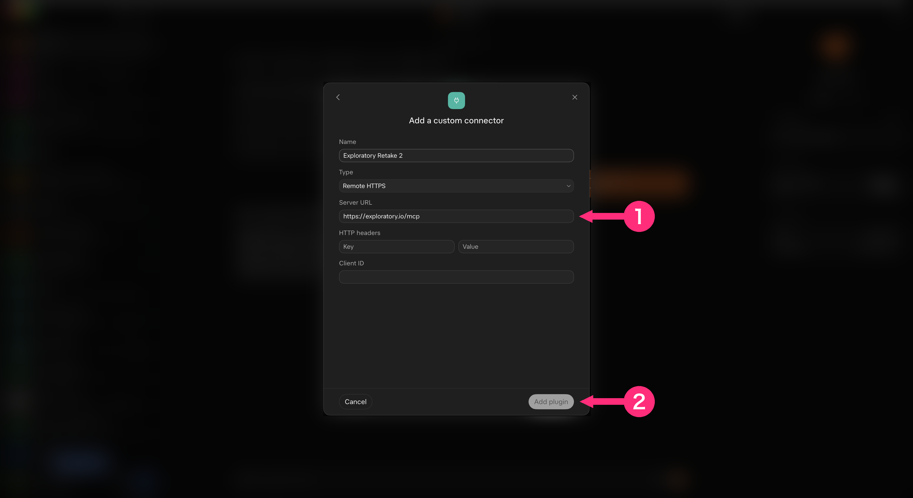
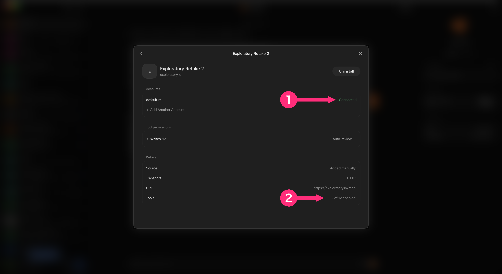
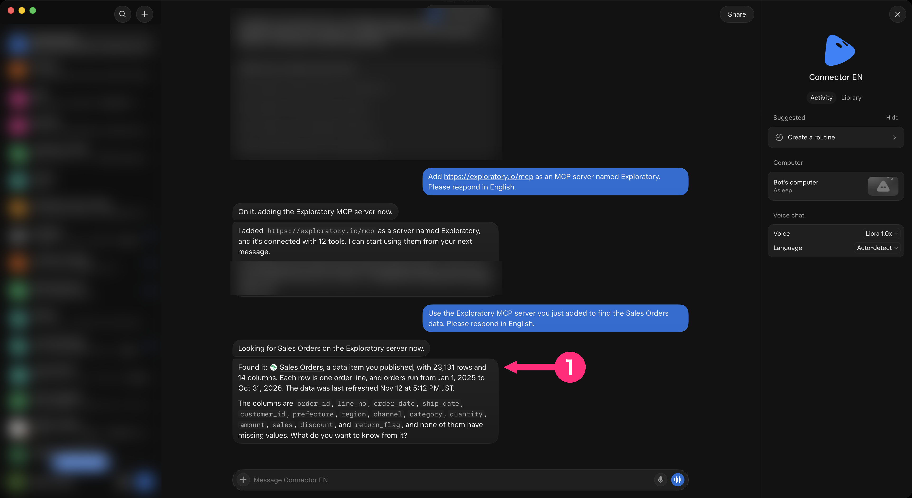

After you connect, an AI can read notes and data published on Exploratory, and create Pages (HTML pages). You add the Exploratory server in Grok Bot as a custom connector.
It takes about 3 minutes. You need an Exploratory account and Grok Bot.

<a id="need"></a>

## Requirements

- An Exploratory account
- Grok Bot
- You do not need an API key or a client ID.

<a id="steps"></a>

## Steps

### Open the custom connector form

This adds the MCP server only; it does not install the skill.

1. In Grok Bot's sidebar, open the item for connecting apps.
2. Scroll down and choose Add a custom connector.

### Fill in the form

Enter Exploratory as the Name, and keep the Type as Remote HTTPS. The image shows an example name.

1. In Server URL, enter `https://exploratory.io/mcp`.
2. Choose Add plugin.



When the browser opens, sign in to Exploratory and allow the access.

### Check that it is connected

Open the connector you added and check its details.

1. Check that the account shows Connected.
2. Check that Tools shows all the tools enabled. The number depends on the server settings; see [Tools](/en/mcp/server/tools#overview). Grok Bot lists these tools under its own "Write" permission group, but the only writes of this server are creating, updating and deleting Pages; dataframe_export only makes a download link.



Next, in a chat, send this.

```text
Use the Exploratory MCP server you just added to find the Sales Orders data. Please respond in English.
```

Sales Orders is an example. Replace it with the name of data you can view. An empty result does not necessarily mean that authentication or the connection failed. To tell them apart, see [Your content does not appear](/en/mcp/server/troubleshooting#zero).

After you send it, check the result.

1. Check the Sales Orders link in the reply.

If the reply shows a link to Sales Orders, it is working.



A skill gives an AI instructions for using a service. It is separate from the MCP connection settings.

<a id="trouble"></a>

## Troubleshooting

| What you see | What to do |
| --- | --- |
| You are asked to sign in | Remove the connection and add it again. |

- [Troubleshooting](/en/mcp/server/troubleshooting) - Fixes by symptom for the Server MCP as a whole.

<a id="remove"></a>

## Disconnect

Open the connector's details in Grok Bot and choose Uninstall.

Removing the registration does not revoke the access you approved. To revoke it, also remove the client under Connected AI Apps in Account Settings on exploratory.io.
