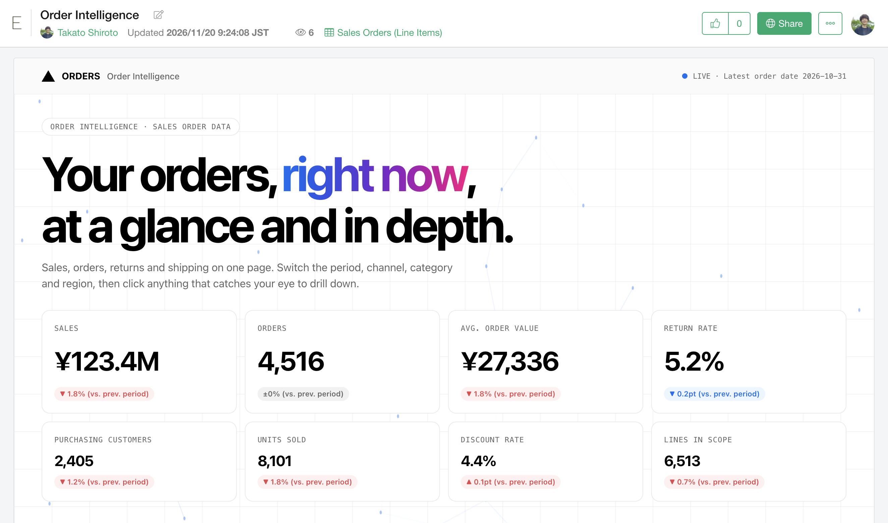
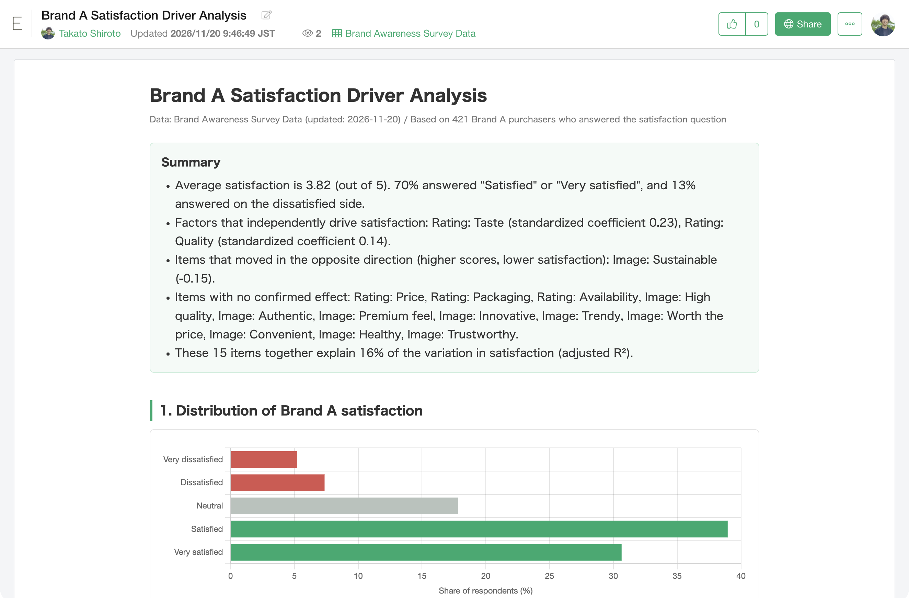
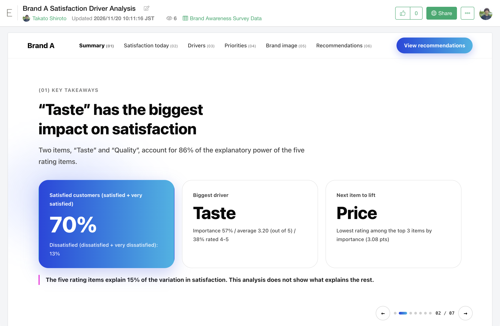

These are English versions of three Pages originally created in Japanese. The requests below are English translations of the original requests.

## Monitor orders with a dashboard

This one was made with a different design reference from the [Getting Started](/en/mcp/server/page) steps.

```text
Using the "Sales Orders (Line Items)" data on Exploratory Server, build an interactive dashboard for monitoring order status and publish it as a Page.
For the design, use this as a reference:
https://v0.app/templates/optimus-the-ai-platform-to-build-and-ship-LHv4frpA7Us
```



[Open the example dashboard](https://exploratory.io/page/GMq1Qom5tS/yHU6UaB2Rh)

## Read an analysis report on satisfaction with Brand A

```text
Using the data below, run a driver analysis to find out which factors are related to satisfaction with Brand A. Create an analysis report as an Exploratory Page.
https://exploratory.io/data/GMq1Qom5tS/whf4mHN9yL
```



[Open the example analysis report](https://exploratory.io/page/GMq1Qom5tS/QpF5Xmz7bG)

## Present the findings to executives

```text
Use the brand survey data published on Exploratory Server to run a driver analysis of satisfaction with Brand A. Create slides for executives and publish them as a Page. Follow the design in this example as closely as possible. You can use its colors in place of the usual Page colors.
https://v0.app/templates/ai-product-portfolio-LFFFrvSq9Bb
```



[Open the example slides](https://exploratory.io/page/GMq1Qom5tS/pAa5DRz3Kf)

<Tip>
For the dashboard and slides, adding template links to the requests helped us get the look we wanted. Find an example close to what you want to make and include its URL in your request. [Browse v0 templates](https://v0.app/templates)
</Tip>
