With Exploratory Page, you can tell Claude or another AI tool which data to use and what you want to see. The AI can create a dashboard, an analysis report, or slides that you can open in your browser. In this guide, you'll use the Claude desktop app and the Sales Orders (Line Items) dataset to build a dashboard for monitoring orders.

## Connect your AI tool to Exploratory

You can create an Exploratory Page from any AI tool connected to Server MCP: Claude, ChatGPT, Cursor and others. For connection instructions, see [Add from an AI tool](/en/mcp/server/clients/apps). This example starts in the Claude desktop app with the Exploratory connector already set up.

## Create an order dashboard

In your request, name the dataset, explain what you want to see, and include links to any designs you want Claude to use as references.

```text
Using the "Sales Orders (Line Items)" data on Exploratory Server, build an interactive dashboard for monitoring order status and publish it as a Page.
For the design, use these as references:
https://v0.app/templates/campaignhub-marketing-campaign-management-platfo-wpeZSxe4nfK
https://v0.app/templates/uxbooster-modern-ux-analytics-dashboard-pHUEegzaKXu
```

❶ Paste the request above into the **New session** input box.

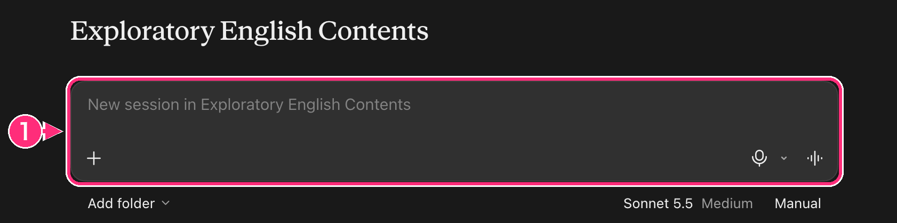

❶ Click the send arrow (↵) in the lower-right corner of the input box.

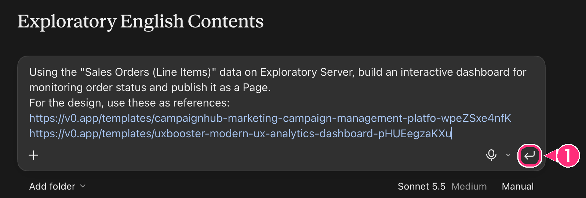

The first time Claude uses an Exploratory tool such as Get Data Schema or Publish a Page, it may ask for permission. Review the tool and the action before you approve it.

❶ In the **Progress** panel on the right, check the first step, “Find the Sales Orders (Line Items) data and inspect its schema.”

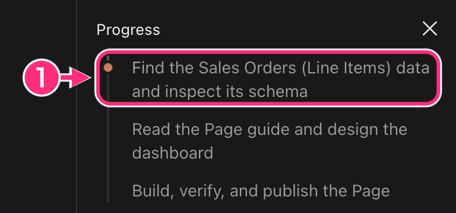

## Allow Claude to check your Page in Chrome

If you have the Claude in Chrome extension, Claude may open the finished Page in Chrome to check it.

❶ If Claude asks to open the Page in Chrome, check the URL and select **Always allow for this website**.

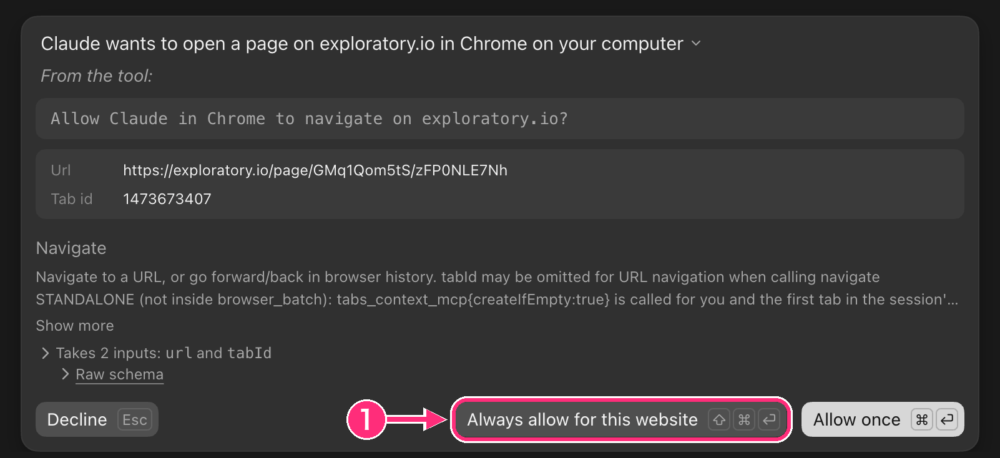

In our test, after we selected **Always allow for this website**, Claude didn’t ask again for permission to navigate to the same site in the same chat. It did ask again when it needed to open a new tab (below). In a new chat, Claude may ask again the first time it opens a page on that site.

❶ If Claude asks to open a new Chrome tab (**Tabs Create**), select **Allow once** each time the prompt appears. This is the only option that grants permission.

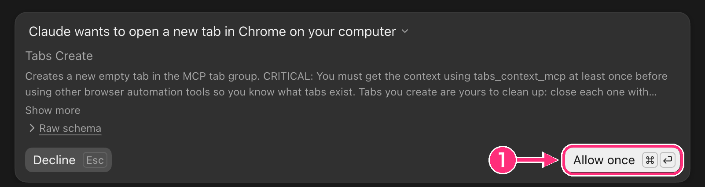

## Open your Page

❶ In Claude’s final reply, click the Page URL to open your dashboard.

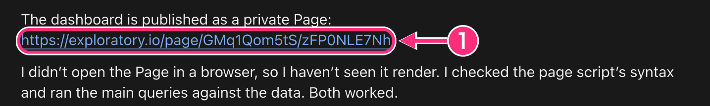

❶ In Order Status Monitor, check the **Orders** card to see how many orders were placed in the selected period.

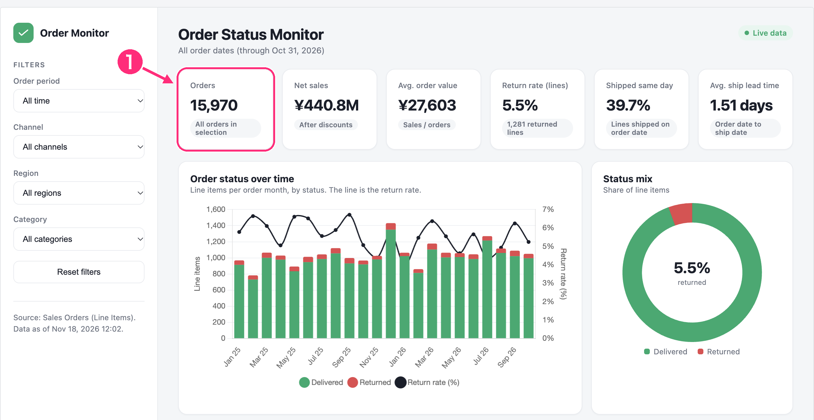

❶ On the left, open the **Category** filter, which displays **All categories**. Select a category to see orders for that category.

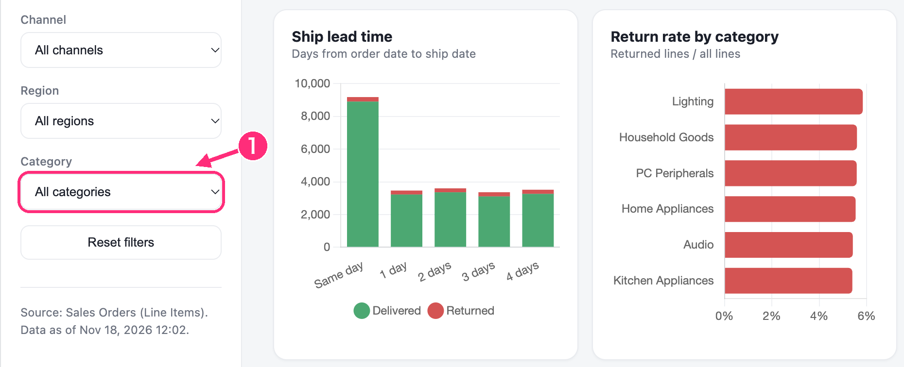

[Open the dashboard made in these steps](https://exploratory.io/page/GMq1Qom5tS/zFP0NLE7Nh)

## Explore three example Pages

These are English versions of three Pages originally created in Japanese. The requests below are English translations of the original requests.

**Monitor orders with a dashboard**

This one was made with a different design reference from the steps above.

```text
Using the "Sales Orders (Line Items)" data on Exploratory Server, build an interactive dashboard for monitoring order status and publish it as a Page.
For the design, use this as a reference:
https://v0.app/templates/optimus-the-ai-platform-to-build-and-ship-LHv4frpA7Us
```

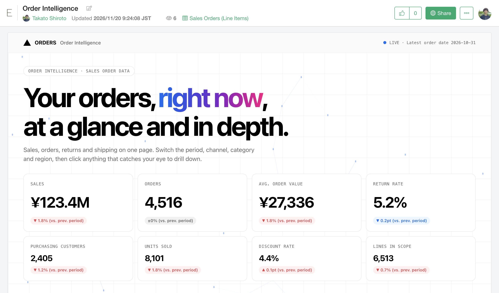

[Open the example dashboard](https://exploratory.io/page/GMq1Qom5tS/yHU6UaB2Rh)

**Read an analysis report on satisfaction with Brand A**

```text
Using the data below, run a driver analysis to find out which factors are related to satisfaction with Brand A. Create an analysis report as an Exploratory Page.
https://exploratory.io/data/GMq1Qom5tS/whf4mHN9yL
```

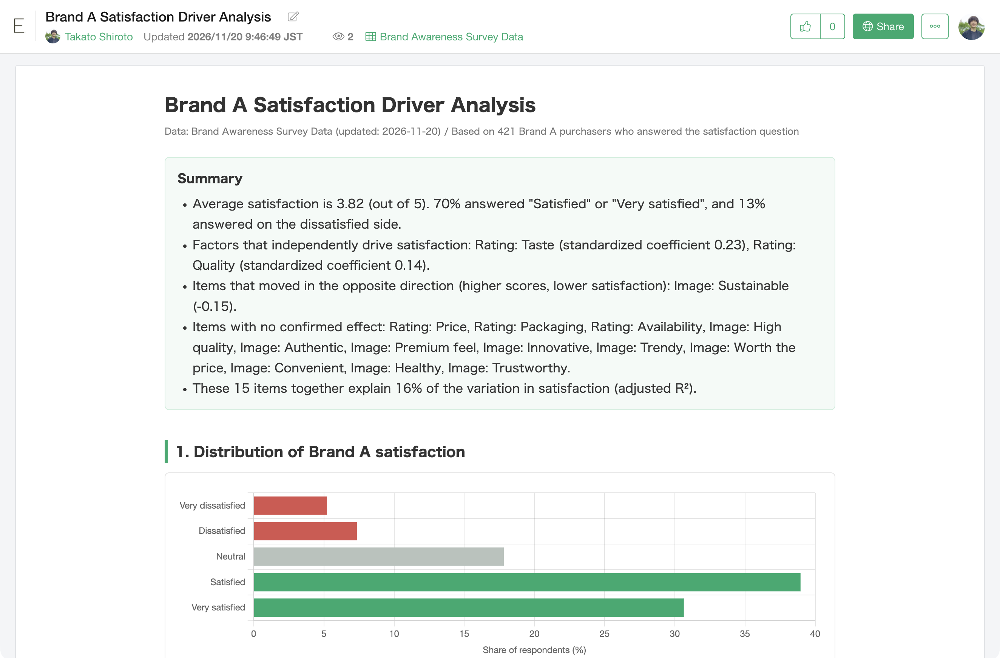

[Open the example analysis report](https://exploratory.io/page/GMq1Qom5tS/QpF5Xmz7bG)

**Present the findings to executives**

```text
Use the brand survey data published on Exploratory Server to run a driver analysis of satisfaction with Brand A. Create slides for executives and publish them as a Page. Follow the design in this example as closely as possible. You can use its colors in place of the usual Page colors.
https://v0.app/templates/ai-product-portfolio-LFFFrvSq9Bb
```

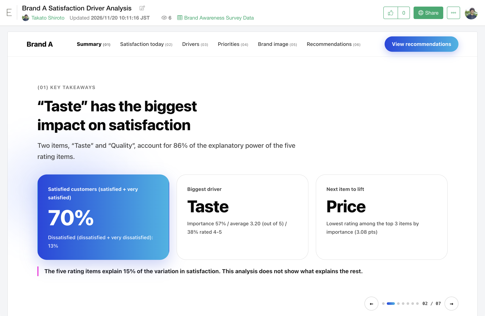

[Open the example slides](https://exploratory.io/page/GMq1Qom5tS/pAa5DRz3Kf)

<Tip>
For the dashboard and slides, adding template links to the requests helped us get the look we wanted. Find an example close to what you want to make and include its URL in your request. [Browse v0 templates](https://v0.app/templates)
</Tip>
