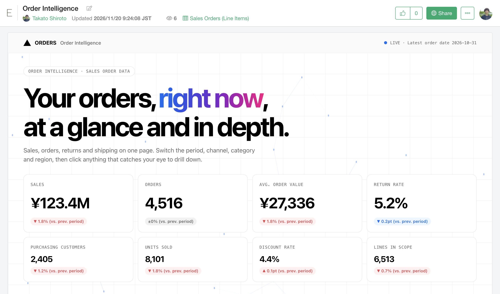

Examples of what to ask your AI for what you want to do with published content, with the tools it uses and a few tips. The tools are what the AI uses; you do not call them yourself.

| What you want to do | Section | Main tools the AI uses |
| --- | --- | --- |
| Find data | [Find data](#find) | search, fetch |
| Read a note | [Read a note](#notes) | search, fetch |
| Aggregate data | [Aggregate data](#data) | dataframe_get_schema, query_dataset |
| Get the numbers of a chart | [Get the numbers of a chart](#chart) | fetch, chart_get_data, chart_query |
| Get the results of analytics | [Get the results of analytics](#analytics) | fetch, analytics_get_result |
| Save results to a file | [Save results to a file](#export) | query_dataset, dataframe_export |
| Publish a dashboard or report as a Page | [Create a Page](#page) | get_page_guide, page_publish, page_update |

To do the same from a terminal, see [Use](/en/cli/server/use) of CLI Server.

<a id="find"></a>

## Find data

```text
Find the "Sales Orders" data on Exploratory.
```

The AI calls search with scope: "all" and shows the matching data with its URL. To read one, it calls fetch with the id.

<a id="notes"></a>

## Read a note

```text
Read the note "Sales Orders Report" on Exploratory and tell me the key points.
```

The AI calls fetch with the id it found through search and reads the body of the note or dashboard as Markdown. For a long note, it reads only the parts it needs with the section and query options of fetch. Along with the note name, tell it the topic you care about (for example "only the forecast section") to read faster.

To do the same from a terminal, see [Read notes](/en/cli/server/guides/read-notes).

<a id="data"></a>

## Aggregate data

```text
What columns does the "Sales Orders" data on Exploratory have, and which 5 regions have the highest sales?
```

Describe the data and your question. The AI checks the columns and aggregation rules before calculating. Review the calculation conditions (aggregation, filters) and the data date alongside the result.

To do the same from a terminal, see [Query data](/en/cli/server/guides/query-data).

<a id="chart"></a>

## Get the numbers of a chart

```text
Tell me the numbers of the chart "Monthly Sales Trend" in the dashboard "Sales Orders Dashboard".
```

The AI looks up the chart name in the dashboard and gets the numbers. For charts in notes, dashboards and slides, it can also filter, sort or aggregate them with chart_query. The numbers are the values as published.

To do the same from a terminal, see [Get chart numbers](/en/cli/server/guides/dashboard-charts).

<a id="analytics"></a>

## Get the results of analytics

```text
Tell me the results of the analytics "Monthly Sales Forecast" in the dashboard "Sales Orders Dashboard".
```

The AI confirms the name of the analytics in the dashboard with fetch, then gets the result with analytics_get_result. Values such as coefficients and p-values come back as displayed. Tell it the name (title) of the analytics and the numbers you want (coefficients, p-values and so on).

To do the same from a terminal, see [Get analytics results](/en/cli/server/guides/analytics).

<a id="export"></a>

## Save results to a file

```text
Save the sales total by region of the "Sales Orders" data as a CSV.
```

The AI filters or aggregates with the same conditions as query_dataset, saves the result as CSV or Parquet with dataframe_export, and returns a download link. Use it when the result is too large to get on screen. Tell it the format (CSV or Parquet) and the aggregation conditions. Data whose publisher does not allow downloading cannot be saved.

To do the same from a terminal, see [Save results to a file](/en/cli/server/guides/export).

<a id="page"></a>

## Create a Page

```text
Using the "Sales Orders (Line Items)" data on Exploratory Server, build an interactive dashboard for monitoring order status and publish it as a Page.
For the design, use this as a reference:
https://v0.app/templates/optimus-the-ai-platform-to-build-and-ship-LHv4frpA7Us
```

The AI checks how to write a Page with get_page_guide, looks at the columns of the data, publishes the Page with page_publish, and returns its URL. A Page is a dashboard, an analysis report or slides that you open in a browser, and it reads the published data each time it opens. A new Page is private, and only you can share it. Tell the AI the name of the data and what you want to see. If you have a page you want the design to follow, add its URL.

This is a dashboard made with the request above.



For the full steps and examples of notes and slides, see [Create a Page](/en/page/getting-started).
