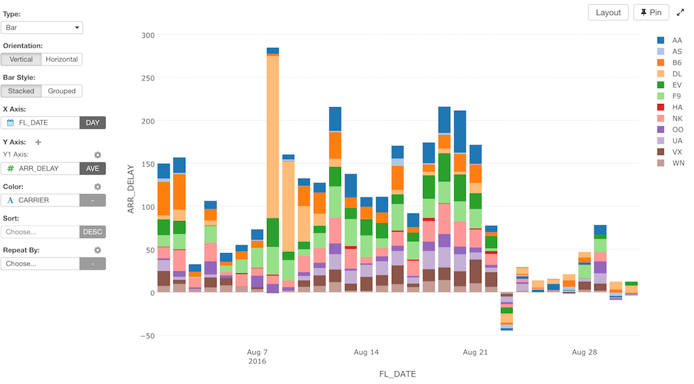
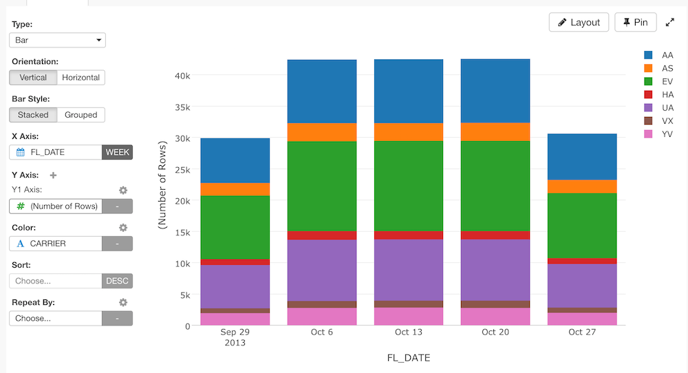
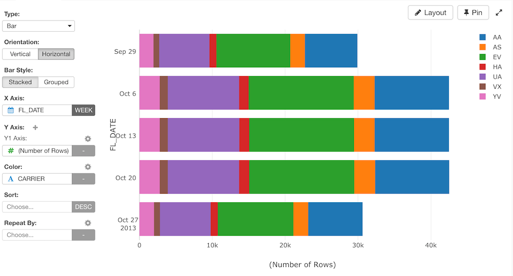
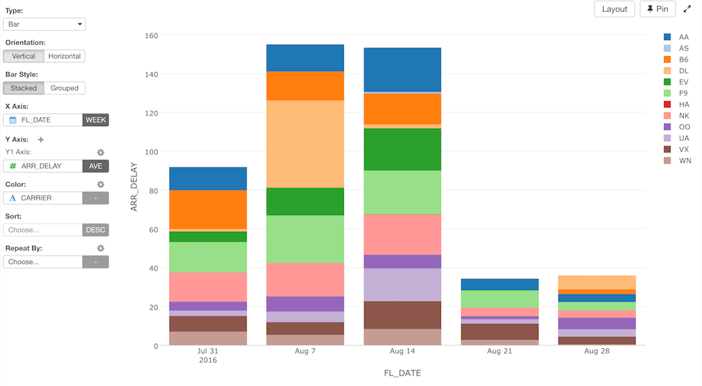
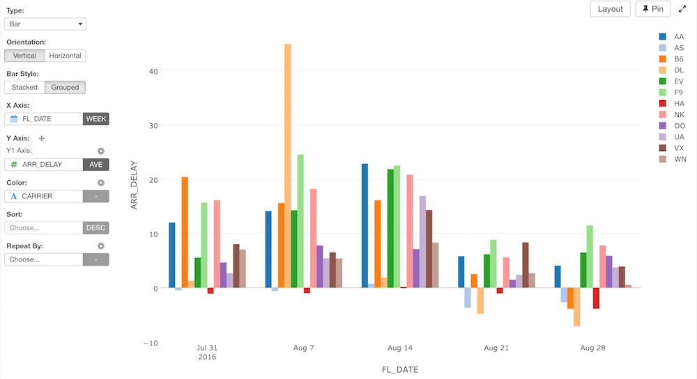

## Column Assignments

* Orientation - You can choose a chart orientation. Either 'Vertical' or 'Horizontal'.
* X-Axis - Assign a column you want to show at X-Axis. If it's a Date / Time column assigned, you can select the aggregation level such as `Month`, `Week`, `Day`, etc. If you assign a Number column, you can choose either `As Number` to treat values as continuous values or `As Text` to treat values as categorical values.  
* Y-Axis - Assign a column you want to show at Y-Axis. If it's a Numeric column assigned, you can set the aggregation function such as `Sum`, `Mean (Average)`, etc. to aggregate the values. You can also assign a Window Calculation from the gear icon on Y-Axis. Look at [Window Calculation](/en/viz/window-calc) section for details.  
* Color - Take a look at [Color](/en/viz/color) section for more details.
* Sort By - Assign a column to use for Sorting the X-Axis values. The default is based on either the alphabetic order or the factor level order for Factor type columns.
* Repeat By - You can assign a column to repeat the chart for each of its values. Take a look at [Repeat By](/en/viz/small-multiple) section for more details.

You can assign multiple columns to Y-Axis. Take a look at [Multiple Y-Axis](/en/viz/multi-y) section for more details.

## Orientation - Vertical vs. Horizontal

You can select from one of the following orientations. The default is `Vertical`.

### Vertical

### Horizontal

* In this orientation type, X-Axis goes vertically and Y-Axis goes horizontally in order to make it easy to switch between horizontal and vertical orientation.
* At this moment, the horizontal orientation doesn't support [Repeat By](/en/viz/small-multiple). 

## Bar Type - Stacked vs. Grouped

You can select from one of the following bar types. The default is `Stacked`.

### Stacked

### Grouped

## Reference Line

Take a look at [Reference Line](/en/viz/reference-line) section for more details.

## Highlight 

You can change the color of the specific markers such as bars, lines or circles that you pick to stand out from others. See [Highlight](/en/viz/highlight) for the detail. 

## Category 

You can categorize numeric values inside the chart. See [Category(Binning)](/en/viz/category) for the detail.

## Limit Values

You can use Limit Values to filter the categories by the aggregated values. It is on by default for X-Axis. See [Limit Values](/en/viz/limit) for the detail. 

## 'Others' Group

If you have many categories, you can reduce the number of categories by changing some category names to 'Others' using the 'Others' Group feature. See ['Others' Group](/en/viz/others-group) for the detail. 

## Custom Function

You can use the Custom Function feature to define your own aggregation function. See [Custom Function](/en/viz/custom-function) for the detail.

## Missing Value Handling

You can use the Missing Value Handling feature to control missing values. See [Missing Value Handling](/en/viz/missing-value-handling) for the detail.

## Rename Column Names

You can use the Rename Column Names feature to update column names if you assign multiple columns to Y-Axis. See [Rename Column Names](/en/viz/rename-column-names) for the detail.

## Axis Setting

You can use the Axis Setting feature to assign columns to Y1/Y2 axes if you assign multiple columns to Y-Axis. See [Axis Setting](/en/viz/dualy-setting) for the detail.

## Show Detail

You can show the detailed data underlying the chart by clicking the chart figure. See [Show Detail](/en/viz/show-detail) for the detail.

## Layout Configuration

Take a look at [Layout Configuration](/en/viz/layout) on how to configure the layout and format. 

## Save as an Image

You can save the chart as an image file. See [Save as PNG/SVG](/en/viz/save) for more details.
