AI プロンプトは、データラングリング（加工、整形）でやりたいことを自然言語で入力すると、AI が R コードを提案してくれる機能です。データの整形、計算、集計、結合、文字列の加工に使えます。v12 で追加されました。

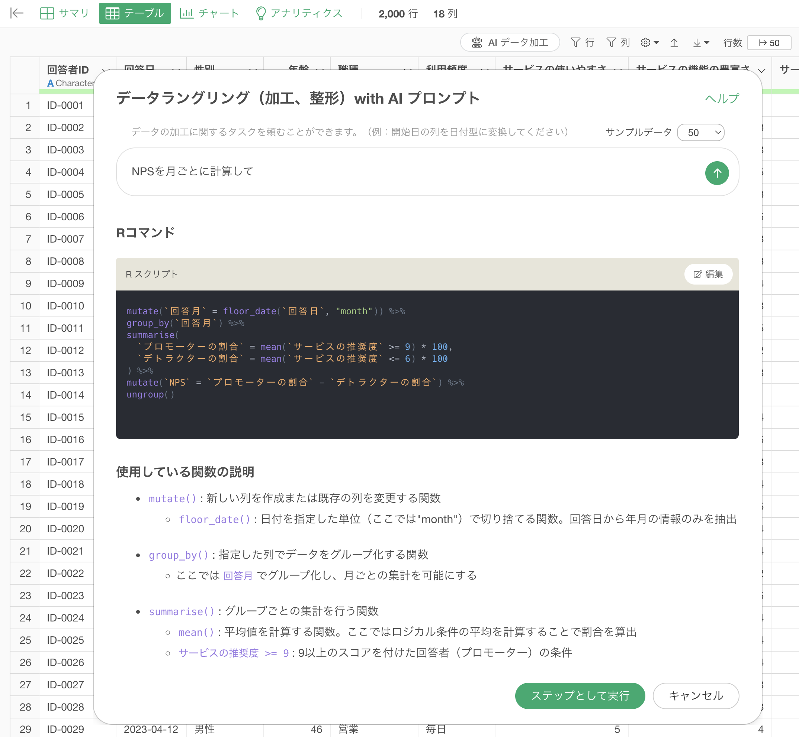

## 何ができるか

データラングリングのためにさまざまな UI を操作したり、複雑な関数を使いこなしたりする必要はありません。やりたいことを、

- 「企業名だけを抽出してください」
- 「日付に関する列を正しいデータ型に変換してください」
- 「”都道府県情報”のデータと結合してください」
- 「リテンション率を計算してください」
- 「直近7日間のデータだけにしてください」
- 「顧客生涯価値を算出してください」

といった日本語でプロンプトに入力するだけで、データを自由自在に素早く加工できるようになります。

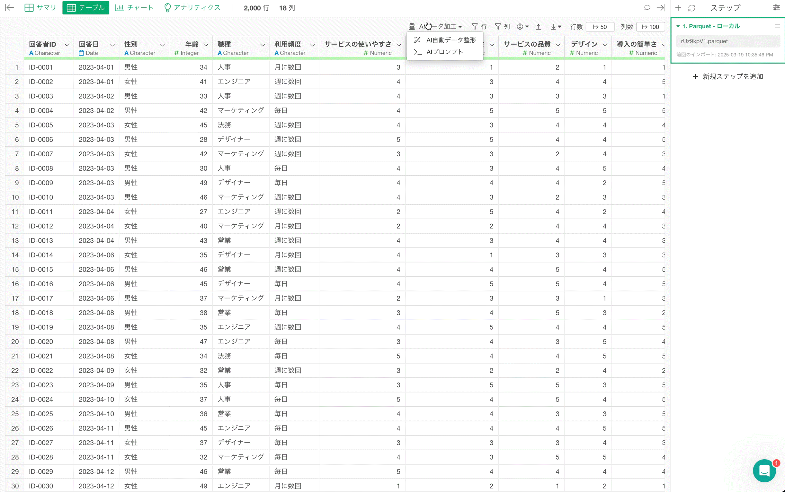

## 提案される内容

プロンプトを投げかけると、「Rコマンド」と「使用している関数の説明」、「期待される結果」の3つが出力されます。

### R コマンドを実行する

Rコマンドでは、質問された内容を処理するために必要なデータラングリングのタスクがRのコードとして出力されるため、ステップとして実行を押すことでその処理が適用されます。

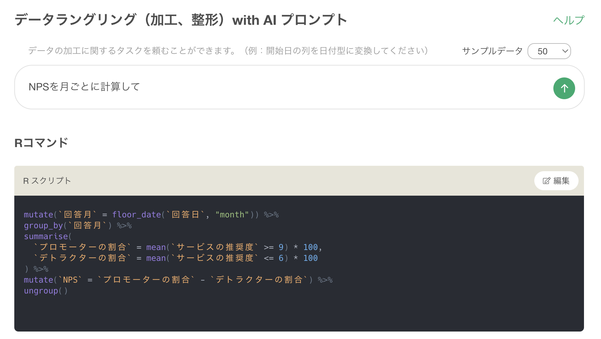

### R コマンドを編集する

もしRコマンドの方を修正をしたい場合は、編集ボタンをクリックします。

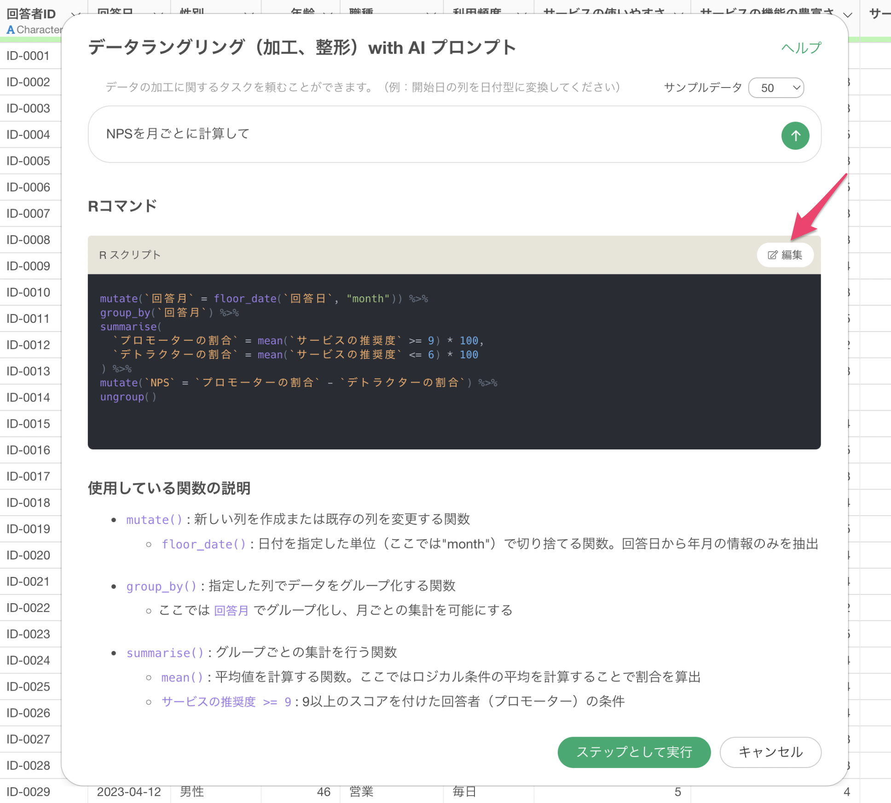

編集モードから生成された列名の変更や修正などを行っていくことが可能です。

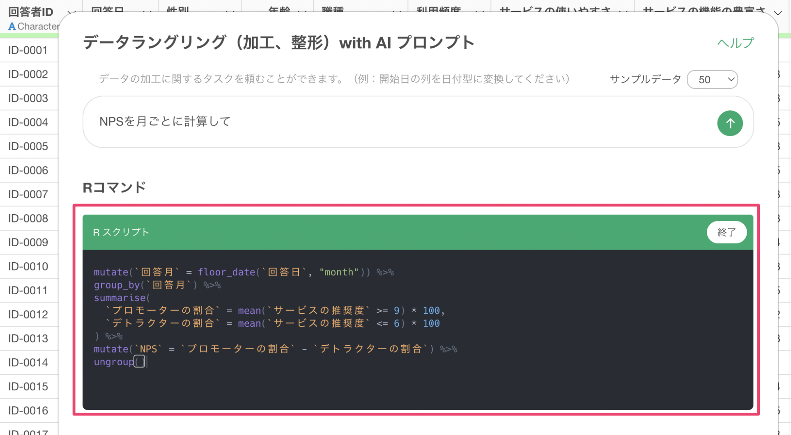

### 使用している関数の説明を見る

Rコマンドで使用している関数は、「使用している関数の説明」の方でどういった関数や引数が使われているのかを説明しています。

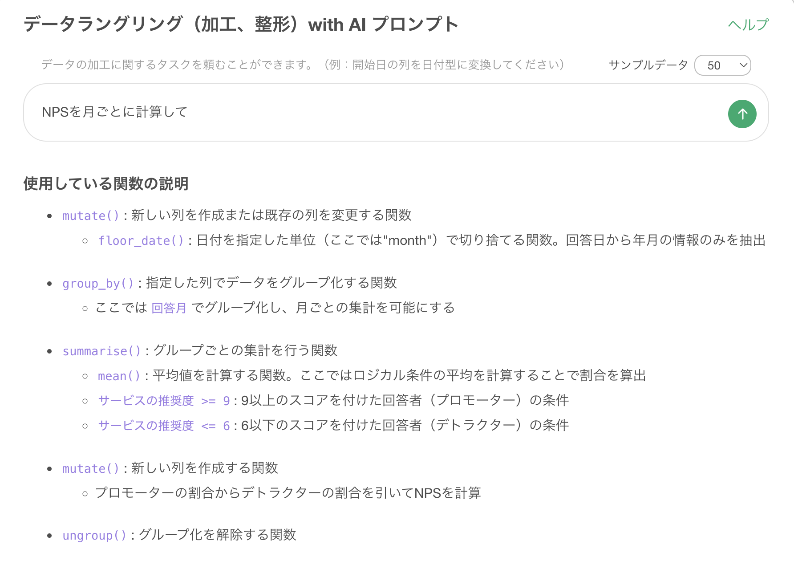

### 期待される結果を見る

「期待される結果」のセクションでは、このコードを実行することでどういった結果が得られるのかを説明するようになっています。

## プロンプトの書き方

基本的なプロンプトの書き方は「&lt;列名&gt;に&lt;処理内容&gt;をしたい」といった書き方となります。

例えば、 1行が1注文製品のECサイトの売上データを使用していたとします。

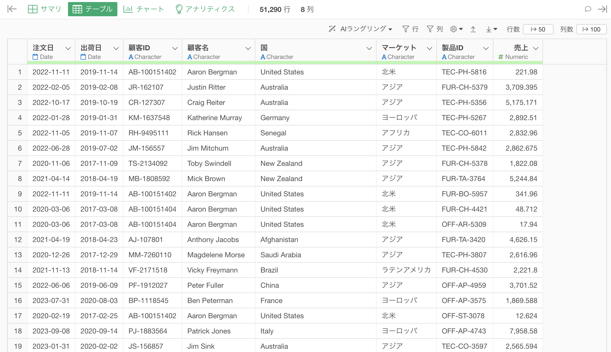

売上が1000以上かどうか判定した列を作りたいため、「テーブル」タブで「AI データ加工」をクリックし、入力欄に「売上が1000以上かどうか判定したい」と入力します。

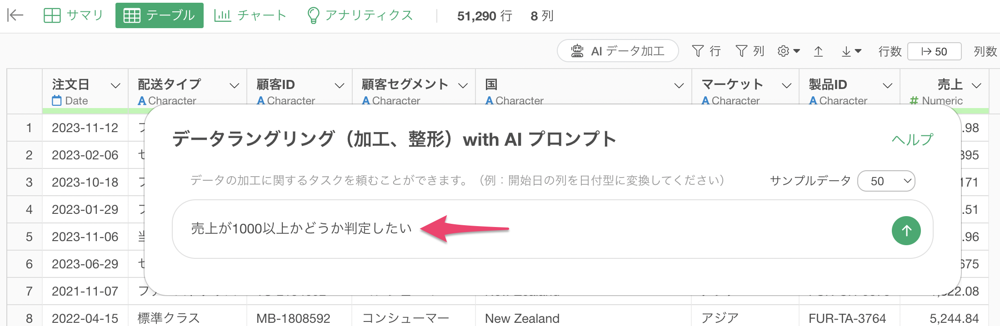

プロンプトを実行することで、売上を1000以上かどうか判定するためのRコマンドの結果が返ってきました。そのため、「ステップとして実行」のボタンをクリックします。

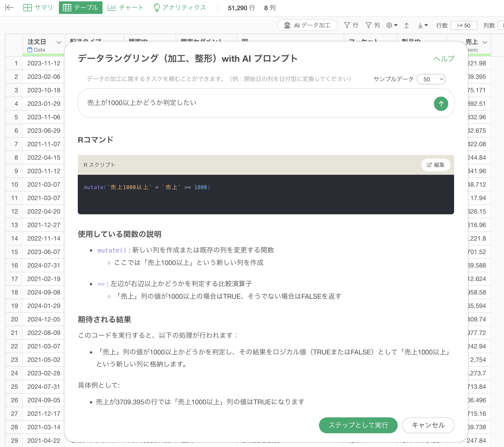

これによって「売上1000以上」といった列が作成されています。

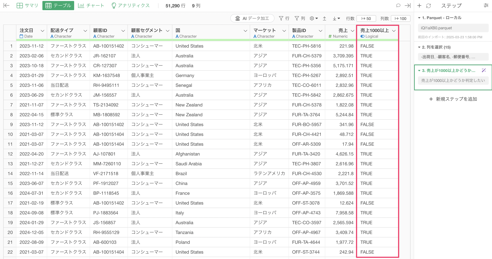

### グループ単位で集計する

顧客ごとに集計をした上で売上が1000以上にしたい場合には、「グループ単位」を元の質問の冒頭に追加します。

例えば、「**顧客ごと**に売上合計が1000以上かどうか判定したい」といった質問に変更します。

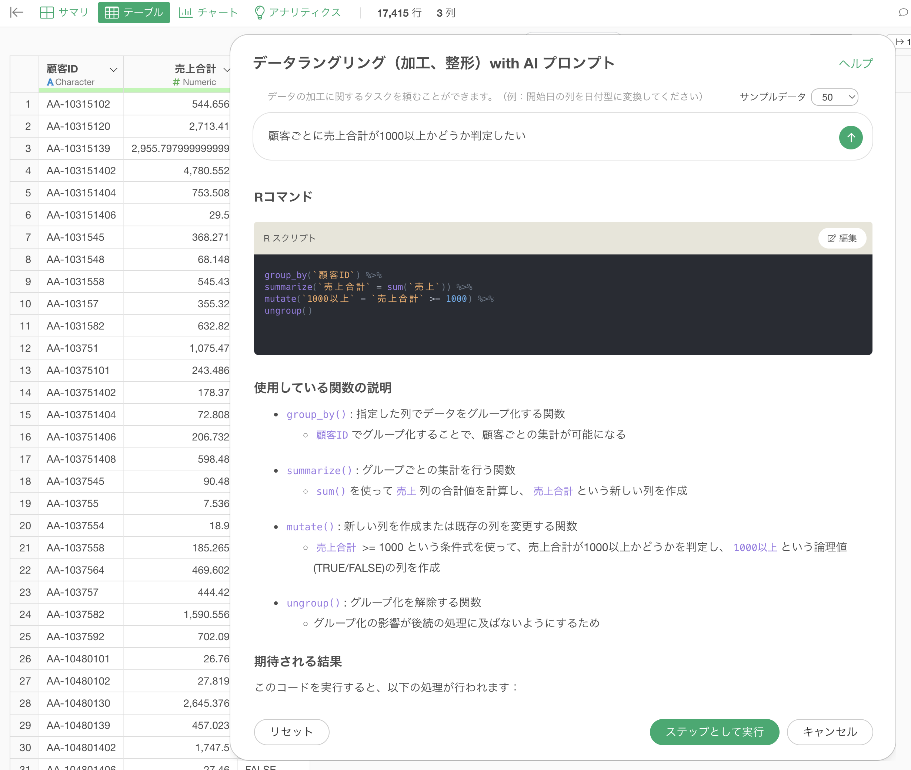

これによって1行1顧客に集計をした上で、売上合計の列を元にして1000以上かどうかを判定できます。

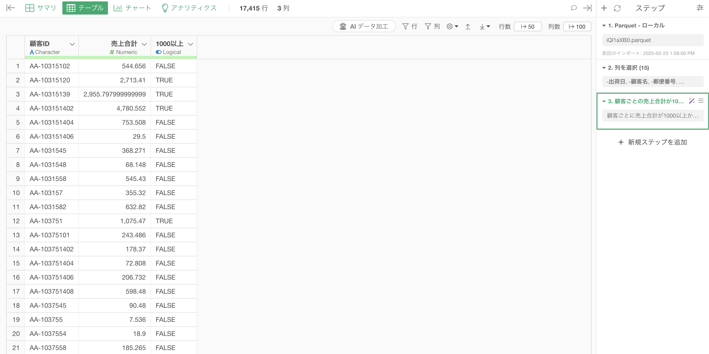

### プロンプトを書くときのポイント

プロンプトを書く際に意識するべきことは以下の2点です。プロンプトに実施したい内容を具体的に書いていくことで、AI側がそれを正確に認識して望む結果が返ってくる確率が高まります。

- シンプルな一文で表現する：「～して、～したい」で終わる簡潔な一文が理解されやすい
- 具体的な列名を使う：処理を行いたい対象の列名をプロンプトに含める

より詳しいプロンプトの書き方については、[こちら](https://exploratory.io/note/exploratory/AI-utX8JTO8)の「プロンプトのベストプラクティス」のノートをご覧ください。
