AI データは、欲しいデータを言葉で伝えるだけで、AI が取得用の R スクリプトを組み立てて実行し、データフレームを作る機能です。Exploratory Desktop v16 で追加されました。SQL を書く、API の仕様書を読む、PDF の表をコピーする、複数の Excel シートを1つにまとめる、といったデータの取得にかかる工数を、AI との会話に置き換えます。

## 画面の構成

AI データは、Exploratory に組み込まれたチャット形式のデータ取得画面です。画面は3つに分かれています。

- **左: チャット** — 欲しいデータを書く場所。AI とのやりとりがそのまま履歴として残る
- **右上: R スクリプト** — AI が生成した取得用のスクリプト
- **右下: データプレビュー** — そのスクリプトを実際に実行した結果（先頭100行まで）

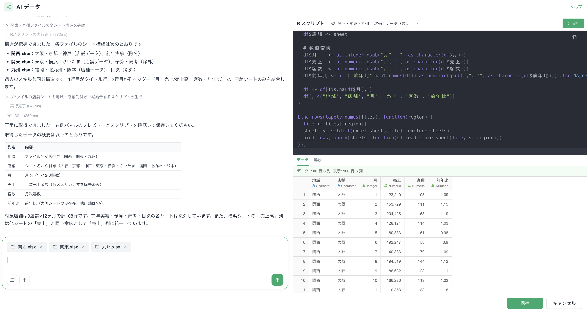

ここで大事なのは、出てくるものが「データ」ではなく「R スクリプト」という点です。AI がどこかから答えを持ってきて表示しているのではなく、「このデータを取るには、こう書けばいい」というスクリプトを組み立て、それを手元の R で実行しています。

この設計には3つの利点があります。

1.  **中身が見える** — 何をやっているかスクリプトで確認できる。不安なら読めばよい
2.  **直せる** — チャットで直すことも、スクリプトを自分で書き換えることもできる
3.  **再現性がある** — 保存後は通常のデータソースと同じで、更新時は保存されたスクリプトが実行できるため、再現性があります。

面倒で技術的なデータ準備の工程を会話に置き換えながら、R ベースのデータパイプラインが持つ透明性と再現性はそのまま保つこと。これが AI データの特徴です。

## サポートしているデータの種類

画像以外であれば、基本的にどんなデータでもインポートできます。 R から取得できるものは AI データの守備範囲だと考えて構いません。

AI データの内部には、データソースごとの取得手順を書いたリファレンスが **110 種類以上**用意されていて、AI はまずそれを参照してから R スクリプトを組み立てます。だから「なんとなく書いてみる」のではなく、そのデータソースの正しい取り方に沿ったスクリプトが出てきます。

### 1. 手元のファイル

| 種類 | 拡張子 | 扱い |
|:---|:---|:---|
| 表形式のテキスト・バイナリ | `csv` `tsv` `txt` `tab` `log` `parquet` `json` | そのまま表として読み込む |
| Excel | `xlsx` `xls` `xlsm` | シートを選んで読み込む |
| 統計ソフトのファイル | `sav` (SPSS) `dta` (Stata) `sas7bdat` `xpt` (SAS) `rds` `rda` `rdata` (R) | そのまま表として読み込む |
| 文書 | `pdf` `docx` `xml` `html` `htm` | 中に含まれる**表を抽出**する |
| フォルダ | — | 中のファイルをまとめて扱う |

Excel の複数シートや、フォルダ内の複数 CSV を「1つのデータにまとめて」と頼めるのが、手作業との大きな違いです。

### 2. データベース

PostgreSQL、MySQL / MariaDB、SQL Server、Oracle、Snowflake、BigQuery、Amazon Redshift、Amazon Athena、Amazon Aurora、Presto / Trino、MongoDB、SQLite、Treasure Data、Vertica、Teradata、MS Access など。ODBC / DBI 経由の汎用 DB にも対応しています。

### 3. クラウドストレージ・SaaS

Amazon S3、Google Drive、Google Sheets、Google Cloud Storage、Dropbox、Box、SharePoint、Microsoft Azure Storage、Salesforce、Stripe、Intercom、GitHub、Google Analytics など。

### 4. 公的統計・オープンデータの API

ここは AI データがとくに効く領域です。API の仕様を読まなくても、名前を出すだけで取りにいってくれます。以下は代表例で、これ以外にも各国の統計機関や分野別のオープンデータ API に対応しています。

- **国際機関**: World Bank、OECD、Eurostat、IMF、ECB、BIS、UN Comtrade、WHO
- **各国の公的機関**: FRED（米国連邦準備制度）、SEC EDGAR、米国財務省、米国労働統計局、USGS、カナダ統計局、英国国家統計局など。国内では e-Stat、e-Gov データポータル、EDINET（有価証券報告書）、気象庁 防災情報、不動産情報ライブラリ
- **その他**: Wikipedia / Wikidata、Open-Meteo（気象）、OpenStreetMap、CoinGecko（暗号通貨）、Our World in Data、株価データ

### 5. Web ページ・Web 検索

特定のページから表を取ってくる、あるいは「Web を検索して探してくる」こともできます。チャットの進行表示に「Web を検索」「Web ページを取得」というステップが出てきたら、この動きをしています。

## AI データの使い方

### ステップ1: AI データを開く

データフレーム一覧の **「+」ボタン**をクリックし、メニューのいちばん上にある **「AI データ」** を選びます。

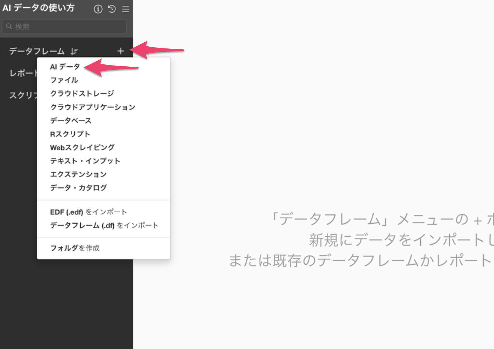

チャットのダイアログが開きます。チャットの入力欄に、欲しいデータを普段の言葉で書きます。

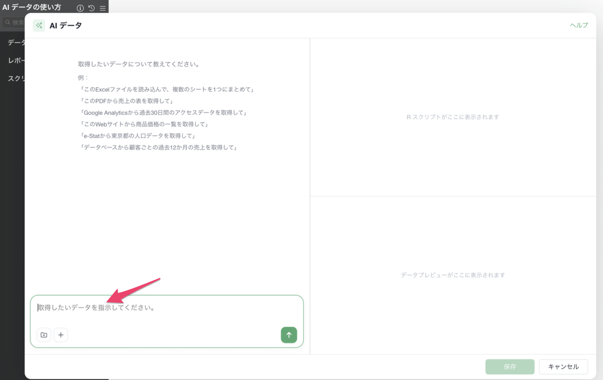

### ステップ2: ファイルから取る - ドラッグ&ドロップで指示する

ここからは、実際の例で流れを追っていきます。手元にあるのは、地域ごとに分かれた3つの売上ファイルです。

- `関西.xlsx` … 大阪・京都・神戸、**前年実績**
- `関東.xlsx` … 東京・横浜・さいたま、**予算**と**備考**
- `九州.xlsx` … 福岡・北九州・熊本、**目次**

店舗ごとにシートが分かれていて、そこに店舗以外のシートが混ざっています。さらに、**1行目はレポートのタイトル行**でヘッダーは2行目、**ファイルによって列構成も違う**（関西の各店舗シートだけ、他には無い「前年比」列がある。除外対象の「前年実績」シートとは別物）。店舗名はシート名、地域はファイル名にしか書かれていません。手作業でまとめようとすると、なかなか骨の折れるデータです。

手元のファイルを使う場合は、**チャット欄にファイルやフォルダをドラッグ&ドロップ**します。

入力欄の左下にあるフォルダのアイコン（「ファイルやフォルダを選択」）や、「+」→「ファイルを追加」からも選べます。


ファイルを添付すると、その中身に応じて**取り込み方の候補**が提示されます。

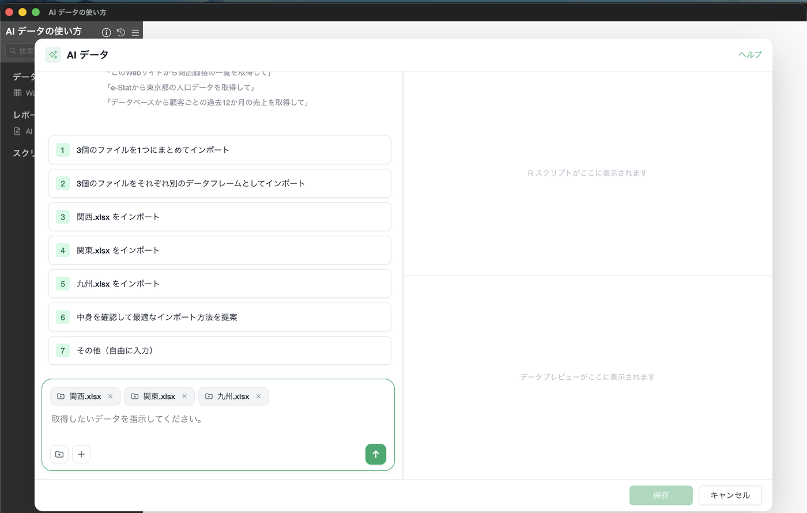

送信すると、AI が何をしているかがステップとして表示されます。「リファレンスを参照中…」「R スクリプトを生成中…」「R スクリプトを実行中…」といった具合に進みます。

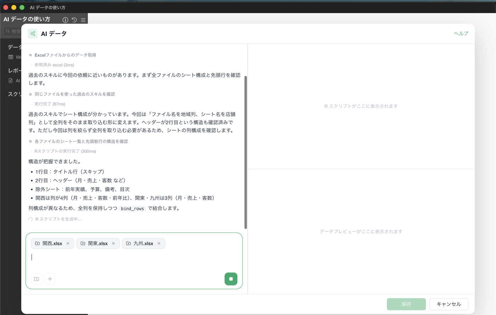

終わると、右上に生成された R スクリプトが、右下にそれを実行したデータのプレビューが表示されます。


9店舗分が117行にまとまり、ファイル名から `地域`、シート名から `店舗` の列ができています。除外したシートも「前年実績（関西）・予算（関東）・備考（関東）・目次（九州）」と明示されました。ファイルによって列構成が違う点も、AI 側が気づいて説明しています。

### ステップ2: データベースやAPIから取る - コネクションを選ぶ

データベースや API のように認証が必要なデータソースは、**コネクションを選んでから**依頼します。入力欄の「+」ボタンから「データコネクション」を選ぶと、登録済みのコネクションが一覧で出てきます。

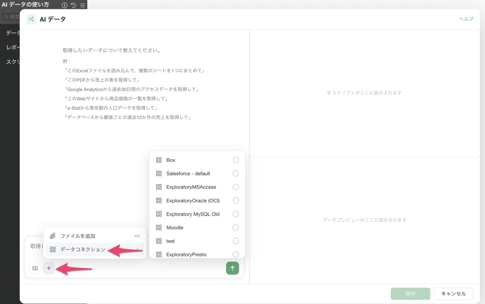

使いたいコネクションを選んでから、欲しいデータを書きます。

``` text
注文テーブルから、直近30日の売上を日別・商品カテゴリ別に集計して。
```

``` text
Google Analytics から過去90日のセッション数を、日付・デバイス・チャネル別に取ってきて。
```

コネクションを選ぶと、AI はそのデータソースの種類（PostgreSQL なのか Salesforce なのか）を踏まえてスクリプトを組み立てます。

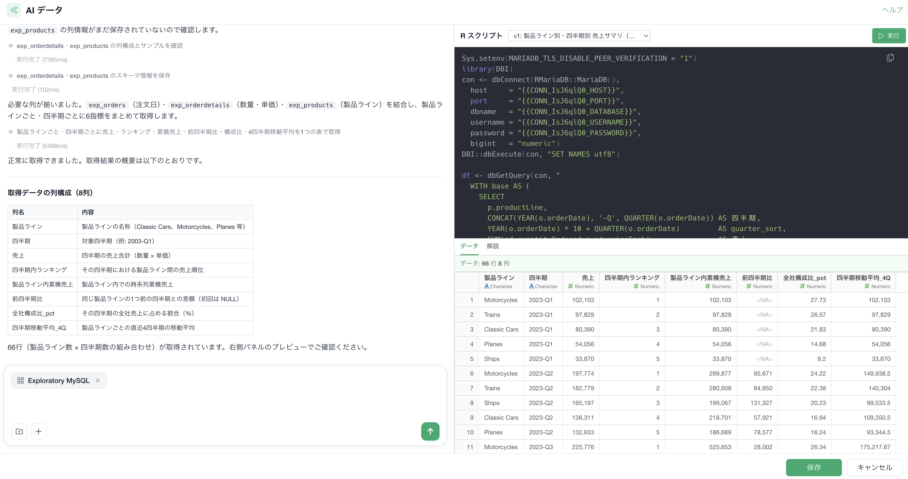

### ステップ2: コネクションが無いとき - チャットから作る

まだコネクションを作っていないデータソースでも、いきなり依頼して構いません。

``` text
MySQLの売上テーブルから、今年度の月別売上を取ってきて。
```

コネクションが見つからない場合、AI がそれを判断して **コネクションの作成を提案し、作成ダイアログを開きます**。

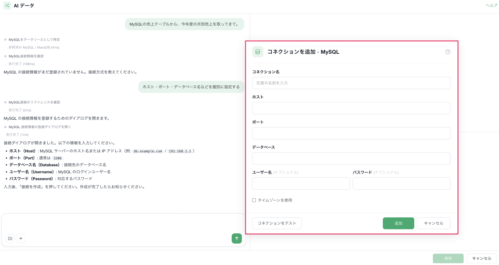

接続情報を入力して保存すると、「コネクション「〇〇」の作成が完了しました。」というメッセージがチャットに自動で送られ、**会話が継続されます**。改めて依頼を書き直す必要はありません。

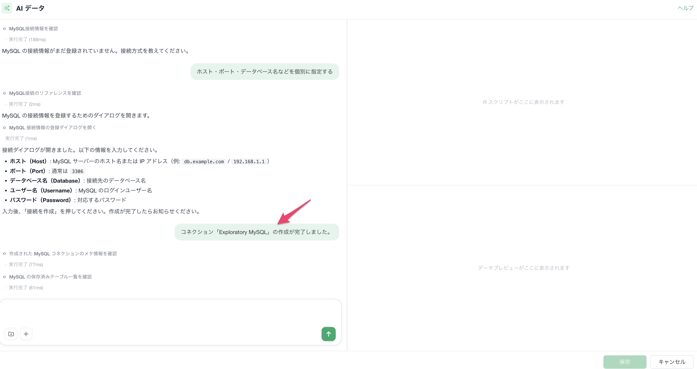

### ステップ3: プレビューを確認して、チャットで直していく

AI データはチャット形式のため、出てきたプレビューを見て、気になるところを追加で指示をして修正していけます。

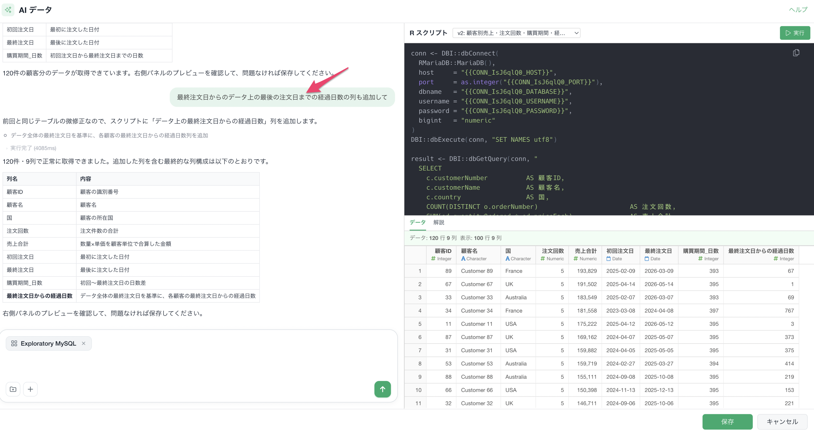

### ステップ4: 保存する

プレビューの内容に納得したら **「保存」** を押します。

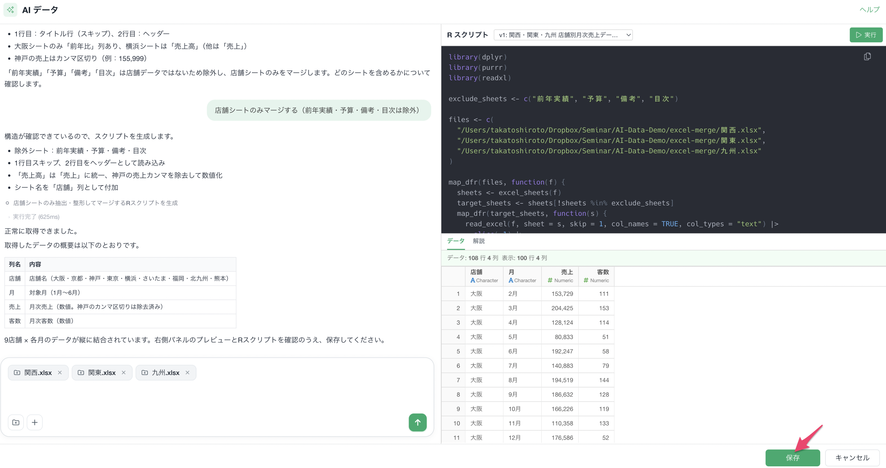

データフレームとして取り込まれ、以降は通常のデータソースと同じように扱えます。

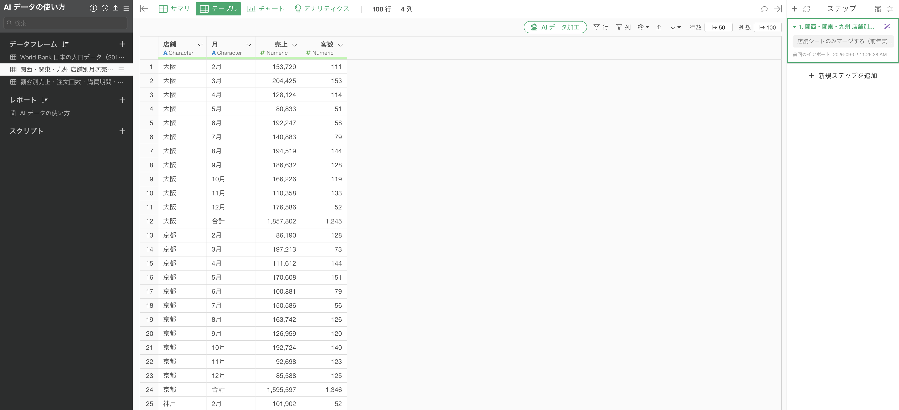

### ステップ5: あとから直す

保存したあとでも、**ステップに表示されている指示のボックスをクリックすると、それまでの会話ごとチャットが開きます**。

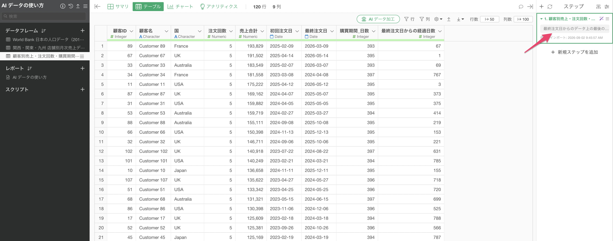

会話の履歴が残っているので、「あのとき何をやったか」を思い出す必要はありません。続きから指示を足すだけです。

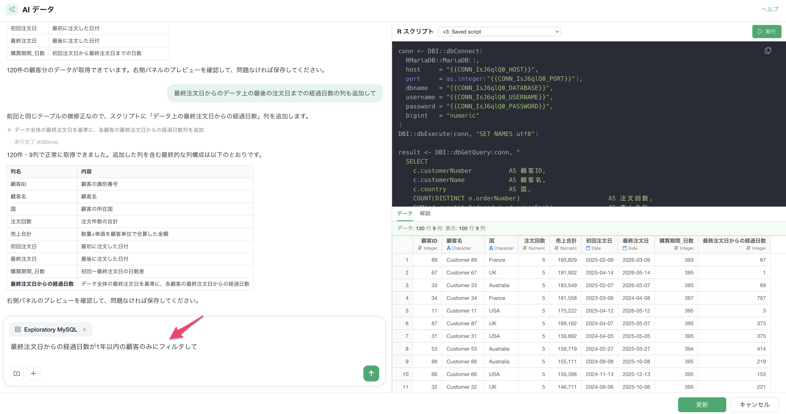

## データを扱いやすい形（整然データ）に自動的に整える

取得したいデータが必ずしも綺麗な状態になっているとは限りません。例えば、以下はAppleの移動傾向データですが、日毎に列を持つワイド型のデータになっています。

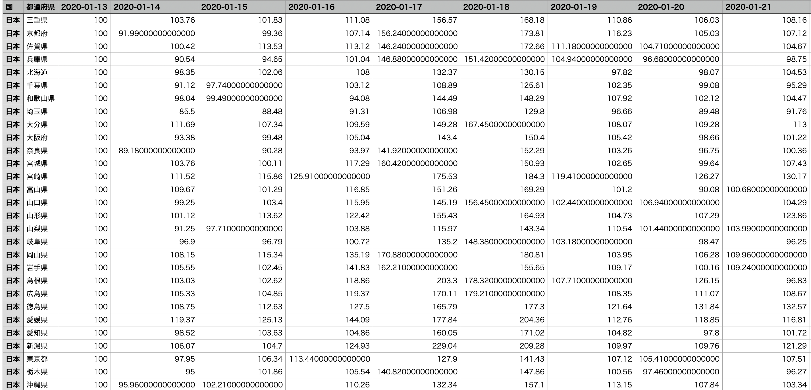

この形のままデータをインポートしても、日毎の移動傾向の推移を可視化することはできません。

しかし、AI データでは追加で指示をすることなしに、データの形を踏まえて自動的にデータを扱いやすい「整然データ」に整えてくれます。

このケースでは、日毎に列を持っていたワイド型の形式ですが、「日付」といった列にまとめたロング型の形式に直してインポートがされます。

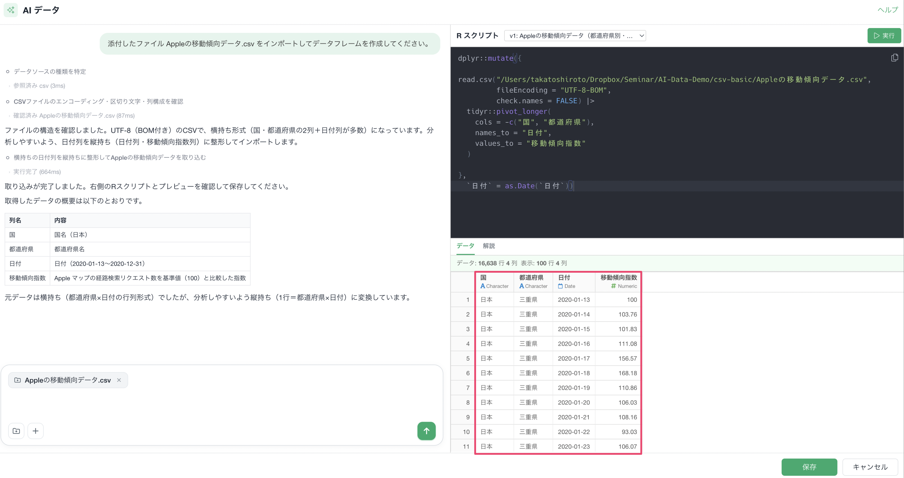

これにより、時系列での移動傾向の推移を可視化するといったことが、データをインポートしてすぐに行うことが可能です。

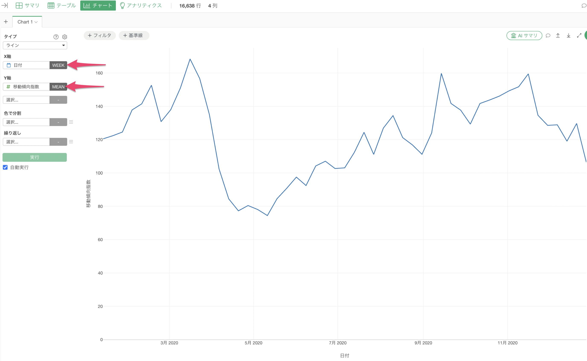

## 取得方法の知識を蓄積できるユーザースキル

AI データを保存すると、その取得手順が **ユーザースキル** として自動的に保存され、データの取得手順の知識を使うたびに蓄積していけます。

### 何が保存されるのか

スキルの実体は Markdown ファイルで、`~/.exploratory/ai_skills/data_source/` の下に保存されます。中身は次のような構成です。

``` markdown
---
title: Google Sheets アンケート利用顧客データ
connectionId: ...
connectionName: ...
description: アンケートの回答データを顧客IDで結合して取得
keywords:
  - アンケート
  - 顧客データ
  - Google Sheets
useCount: 0
createdAt: '2026-08-19T14:31:14.781Z'
---

# Request Summary
（そのとき何を依頼したかの要約）

# Script
（実際に使われた R スクリプト）
```

タイトル・説明・キーワードは、そのときのやりとりを踏まえて AI が付けます。

### 何が起きるのか

次に同様のデータ取得を依頼したとき、AI データは**保存済みのスキルを検索して、前回の手順を下敷き**にします。

同様のリクエストが送られた時には、「過去のスキルが複数見つかりました」と判断してスキルを読み込み、**過去に使われたRスクリプトを参考**にしたデータの取得が行われます。

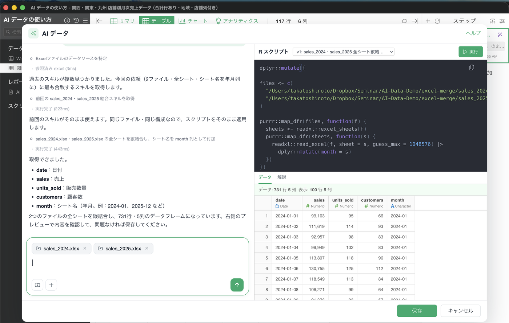

ユーザースキルにより、以下のメリットがあります。

- **2回目以降が速くなる** - テーブル構造の調査やスクリプトの試行錯誤をやり直さずに済む
- **手順が形として残る** - 前回うまくいった手順をそのまま踏襲するので、毎回違うものが出てくるのを防げる

とくに、社内データベースの独特なテーブル構成や、API の細かい呼び方といった「そこでしか通用しない知識」は、スキルとして蓄積されるほど効いてきます。**AI データは使うほど自分の環境に馴染んでいく**、という設計です。

## よくある質問

AI データのよくある質問については、[こちら](https://exploratory.io/note/exploratory/AI-pbb7KJu8)のノートをご覧ください。

このよくある質問のノートには、AI データに関するたくさんの質問に対して、それぞれ回答をしています。以下は、その一つの例として、セキュリティ面に関する質問を取り上げています。

### セキュリティについて

#### API キーやデータベースの接続情報は、AI に渡りますか

渡ることはございません。認証情報の取り扱いについては、次のとおり設計しています。

- API キーやパスワードなどの認証情報を、チャットでお伺いすることはありません
- 認証情報を R スクリプトに直接書き込むことはありません
- データベースに接続する場合、R スクリプトの先頭では、Exploratory 側が保持している接続情報を変数として差し込む形になります。ホスト名やポート番号が AI に渡ることはありません

API キーの入力が必要なデータソースをお使いの場合は、専用のダイアログを表示してご入力いただく形になります。ご入力いただいた値は Exploratory の内部で保持され、AI に対してそのまま渡されることはありません。
