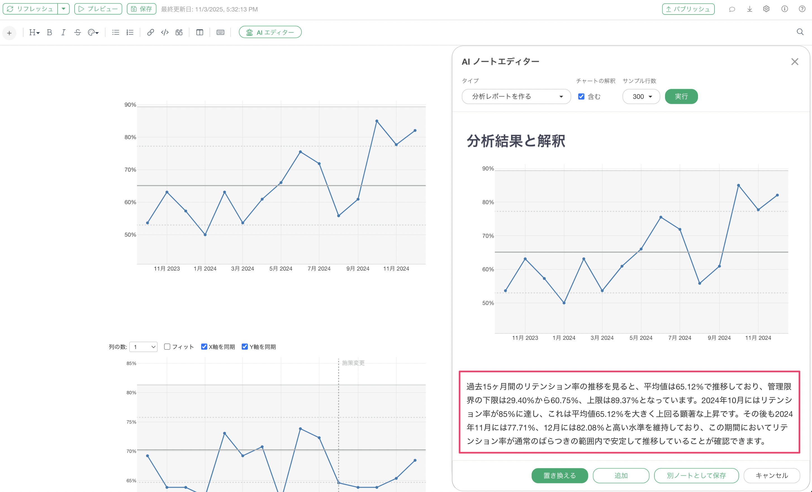
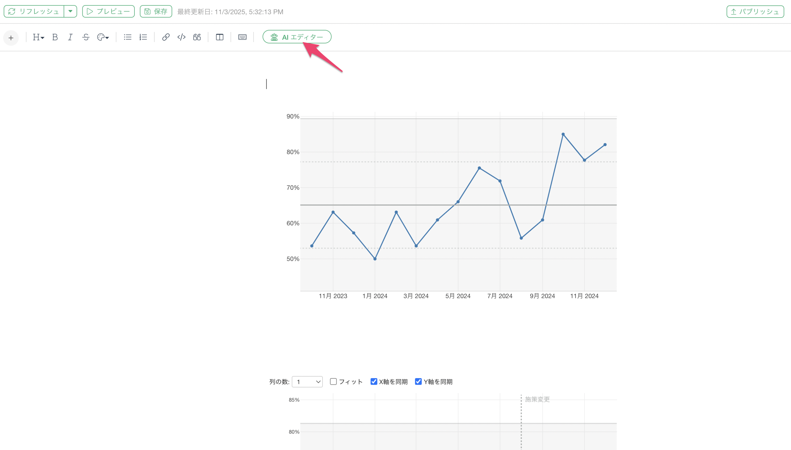
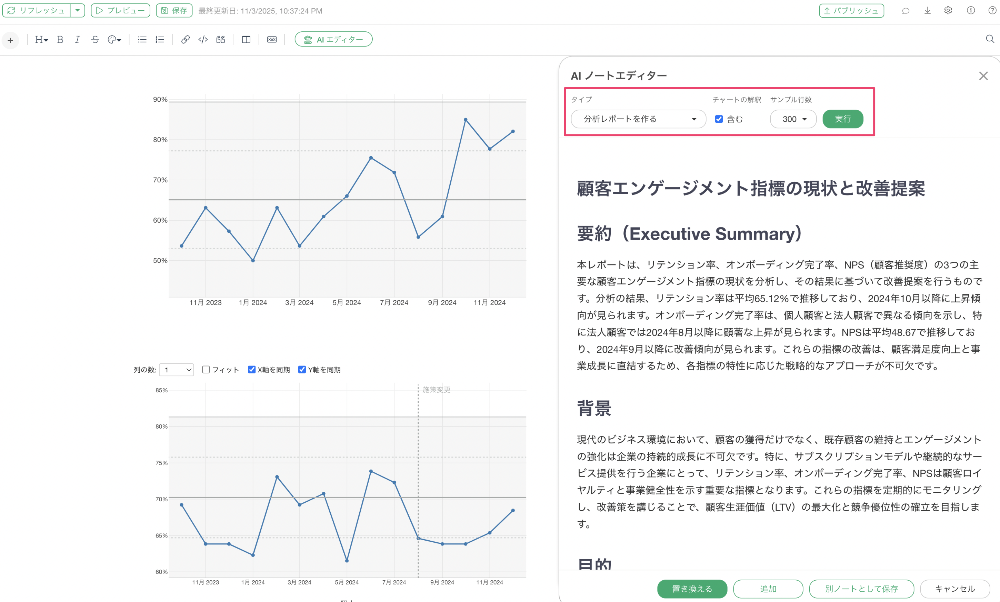
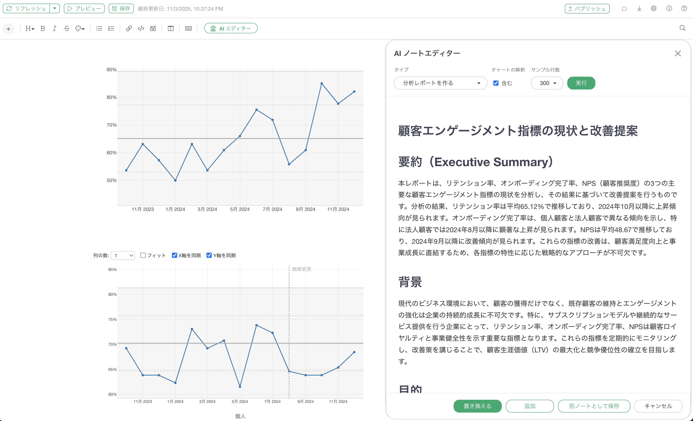
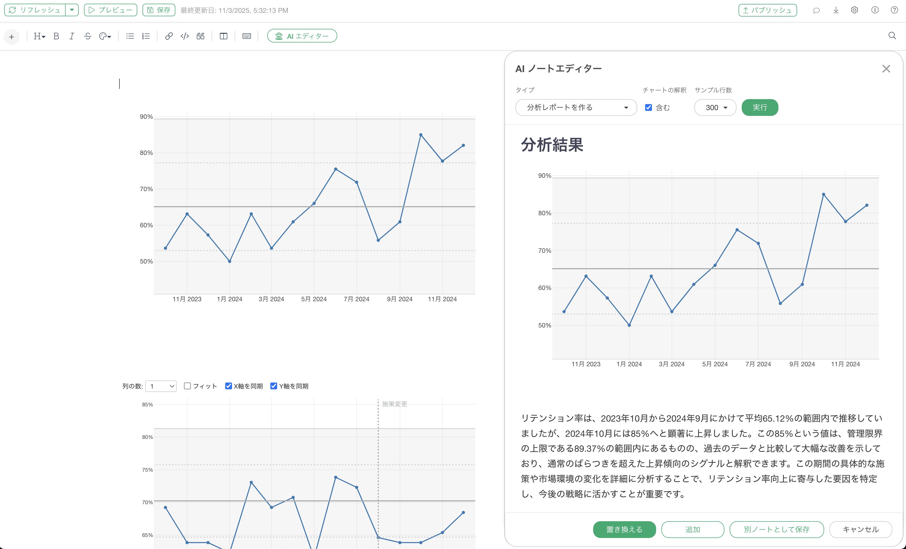
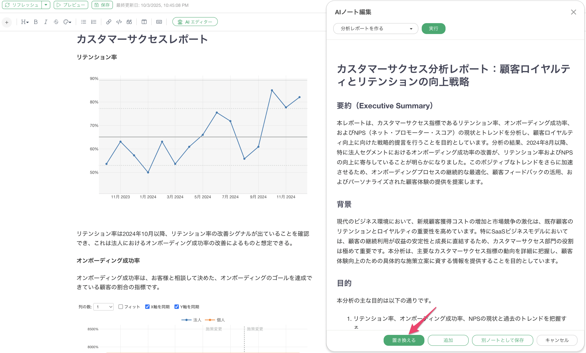

AI ノート エディターは、Exploratoryのバージョン14で導入された機能です。わずか数行のメモ、またはチャートだけ用意すれば、本格的なレポートをAIが自動的に生成してくれます。レポートには、背景、目的、分析結果、提案、結論といった構成要素が含まれます。ここでは、AI ノート エディターの分析レポート機能の使い方を紹介します。

## 何ができるか

AI ノート エディターを使うことで、ノート作成の時間を大幅に短縮できます。

ノート内に埋め込んだチャートは、チャートの結果を解説させられるため、自分でチャートの解釈について記述する必要がありません。

ゼロからレポートを書き始める負担がなくなり、AIが作成した初稿をレビュー・修正するだけで高品質なレポートを完成させられます。

## 分析レポートを作る

1. チャートだけをノートに追加した状態で、ノートにある「AIエディター」ボタンを選択します。

   

2. メニューから「分析レポートを作る」を選択して実行します。チャートの解説もした上で本格的な分析レポートが自動生成されます。

   

たとえば、リテンション率やNPSなどのいくつかのチャートをノート内に追加しただけの状態から、次のような構成の完全なレポートが生成されます。

- 要約（エグゼクティブサマリー）
- 背景と目的
- 分析手法の説明
- 詳細な分析結果（チャートを適切に配置）
- リテンション率やオンボーディングに関する洞察
- 提案とアクションアイテム
- 結論
- 補足資料

チャートの下には、そのチャートから読み取れるインサイトが文章形式で出力されます。

## 生成されたレポートを使う

生成されたレポートは、「置き換える」ボタンを押すことで、元のノートの内容と置き換えることが可能です。AIが生成したチャート解釈を含むレポートを基に、さらに深い分析や議論を進められます。

