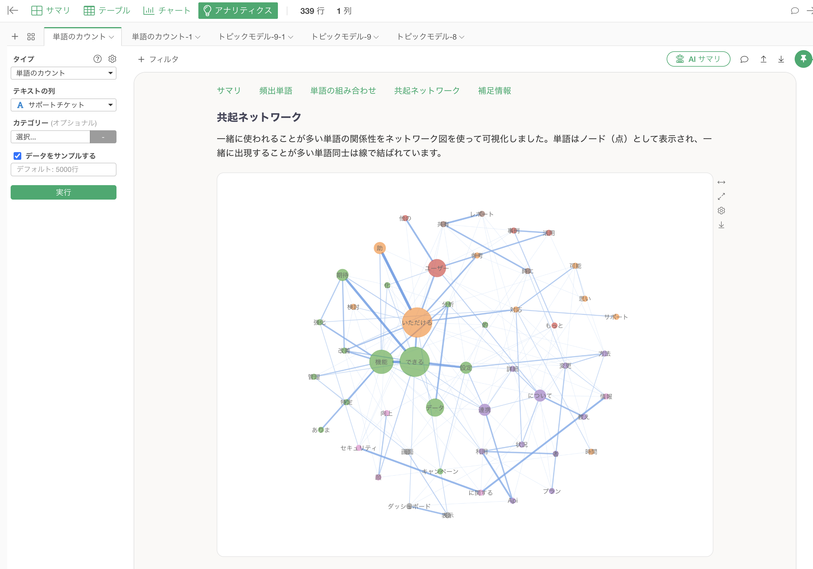
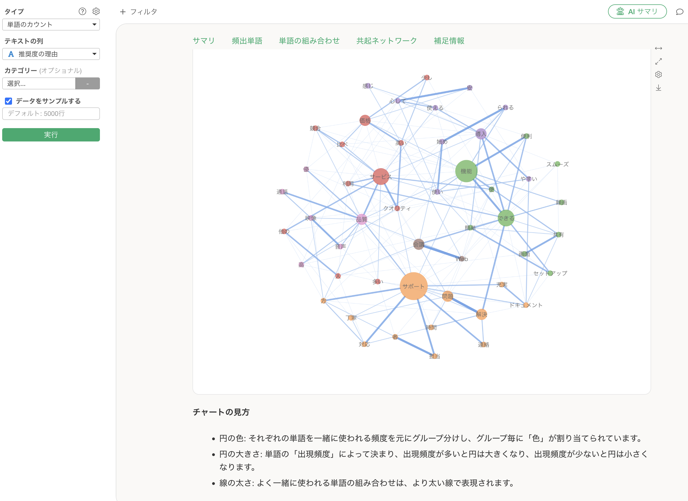
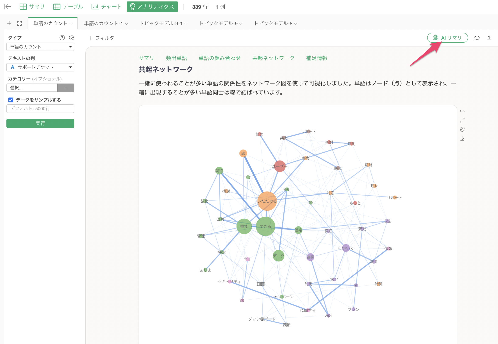
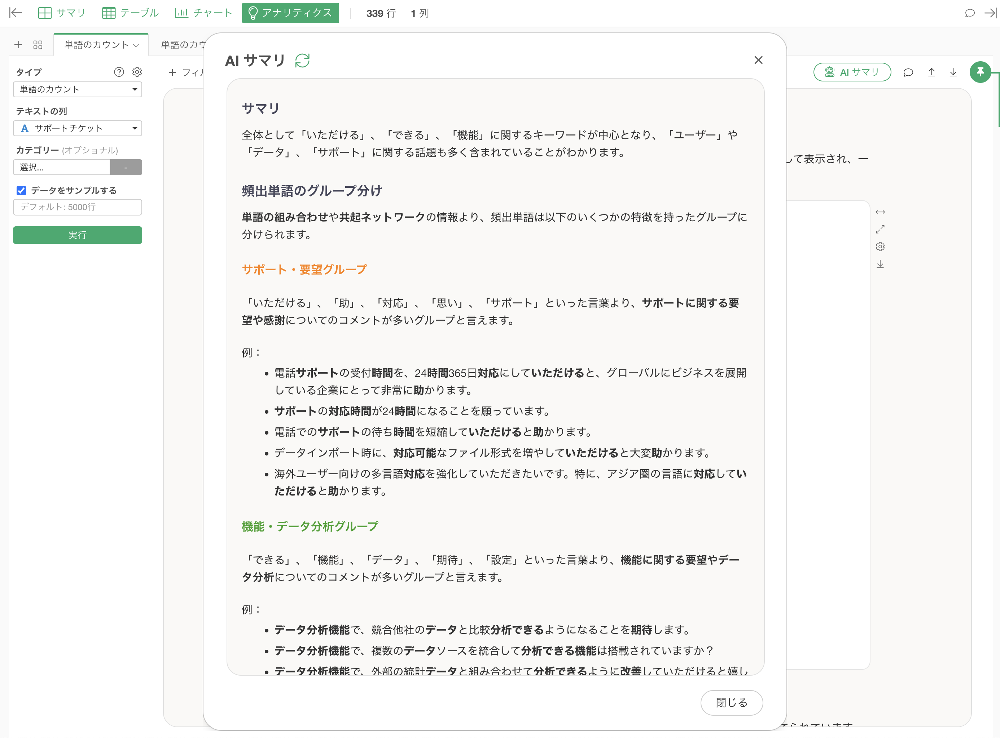
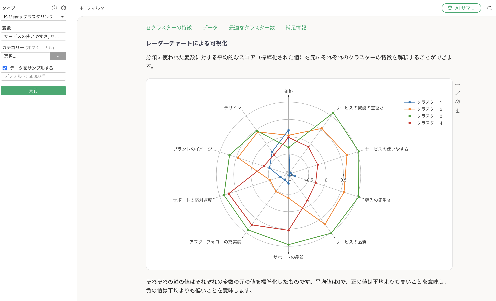
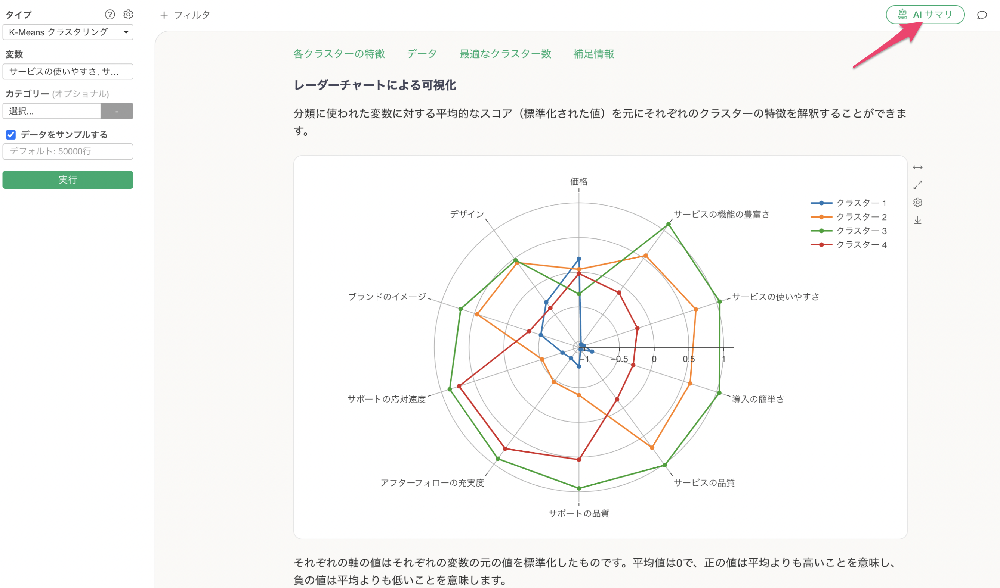
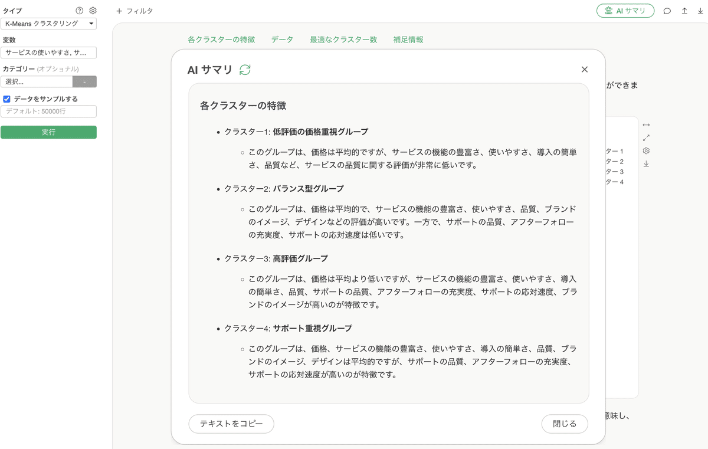
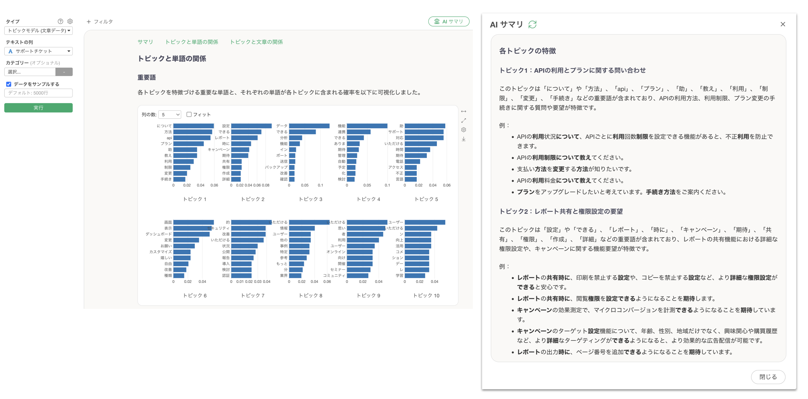
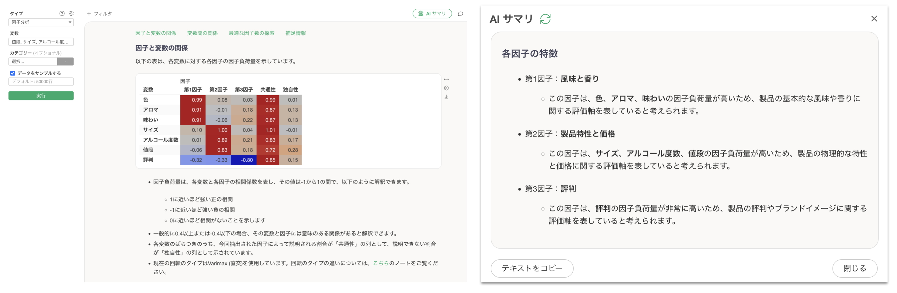
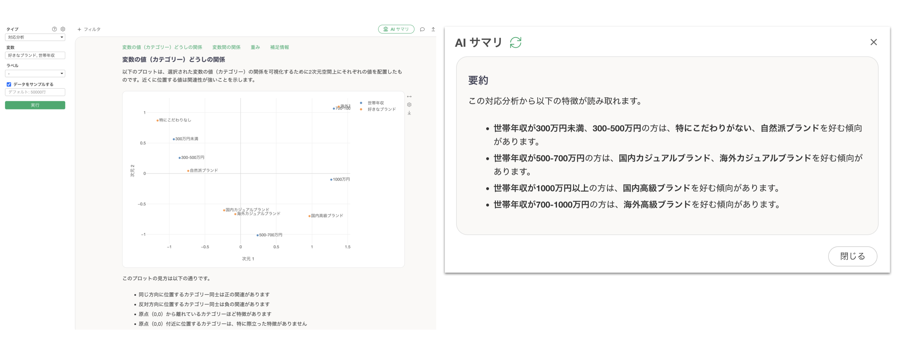

AI サマリは、K-Means クラスタリングや因子分析、テキスト分析などの結果を文章で説明します。

## 対応しているアナリティクス

- K-Means クラスタリング
- 因子分析
- 対応分析
- テキスト分析 - 単語のカウント
- テキスト分析 - トピックモデル

## テキスト分析 - 単語のカウント

「単語のカウント」では、共起ネットワークといったチャートで、どういった単語グループがあるのかを分析できます。

アナリティクスガイドによってチャートの見方を解説してくれているので、初めてテキスト分析をする人でも、どのようにチャートを見ていくのかはガイドされています。

分析を実行した後に「AIサマリ」ボタンを押します。

テキスト全体の傾向を要約した「サマリ」の情報と、各グループの特徴と実際の文章をまとめた「頻出単語のグループ分け」の情報が出力されます。

このAI サマリを見るだけでも、テキスト分析の結果としてどういうグループがあるのかをすぐに判断ができます。さらには、実際の文章の例も表示されるため、数値だけでは見えない顧客の声の背景まで理解できます。

## K-Means クラスタリング

K-Meansクラスタリングでは、各クラスターの特徴をレーダーチャートや散布図（バイプロット）などのいくつかのチャートで確認できます。

以下はレーダーチャートとなりますが、クラスター3は全体的に高評価、クラスター1は全体的に低評価であることが分かります。ガイド付きのアナリティクスにより、チャートの読み方も詳しく解説されています。

K-Meansクラスタリングを実行した後に「AIサマリ」のボタンを押します。

各クラスター（グループ）のクラスター名と特徴をまとめた情報が出力されます。

今回のクラスタリングでは、以下のようなグループに分類されていることを要約してくれています。

**各クラスターの特徴**

- クラスター1: **低評価の価格重視グループ**
- クラスター2: **バランス型グループ**
- クラスター3: **高評価グループ**
- クラスター4: **サポート重視グループ**

このAIサマリを見るだけで、それぞれの分けられたグループにはどういった特徴を持っているのかをAIが判断して教えてくれます。

## その他のアナリティクスの結果

### トピックモデル

トピックモデルでは、各トピックの特徴の要約と実際の文章をまとめて説明してくれます。

### 因子分析

因子分析では、因子負荷量を元にした各因子の特徴について説明します。

### 対応分析

対応分析では、変数の値（カテゴリ）の関係について文章として教えてくれます。

