「ベイジアン A/B テスト」は、A/B テストの結果から、A が B より優れている（または劣っている）「確率」をベイズ推定で求めるアナリティクスです。

## 何ができるか

A/B テストは、A と B の 2 つのグループを作り、各グループのパフォーマンスを測って、どちらが優れているかをテストするものです。

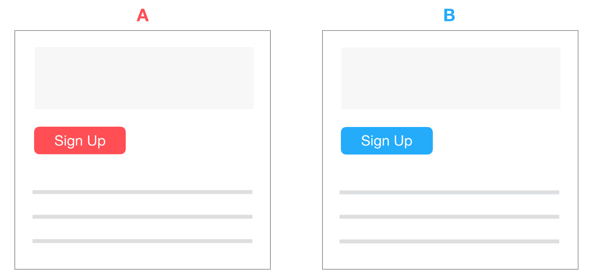

ベイジアン A/B テストには、2 つの利点があります。

- 統計学の知識がなくても、結果を直感的に理解できます。ビジネスの担当者とのやり取りもしやすくなります。
- 結果を評価するとき、データの量をあまり心配しなくて済みます。A と B のどちらかが優れている確率を読み取るので、テストの初日（または最初の 1 時間）から評価できます。十分なデータがあるに越したことはありませんが、「まだ十分なデータがない」より「A は B より 60% の確率で優れている」と言えるほうが、意思決定が必要なビジネスでは役に立ちます。

## 使い方

このページの例では、[Web サイトのランディングページのデータ](https://exploratory.io/data/exploratory/A-B-IJp6BcB2)を使います。ランディングページを 2 つのバージョンでテストしたデータで、ページごとに、日ごとのページビュー数とサインアップ数があります。

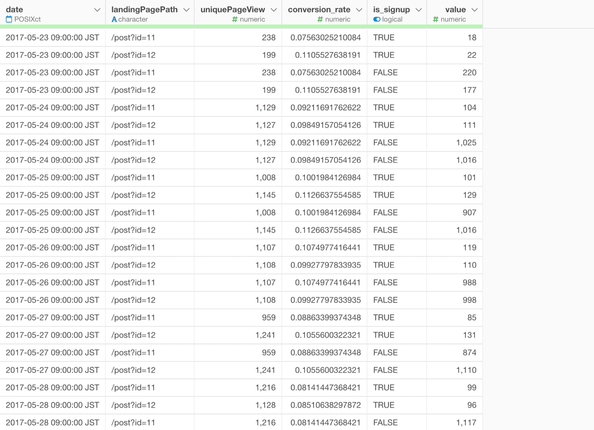

1. アナリティクス・ビューを開き、タイプの「ベイジアン」から「ベイジアン A/B テスト」を選びます。

   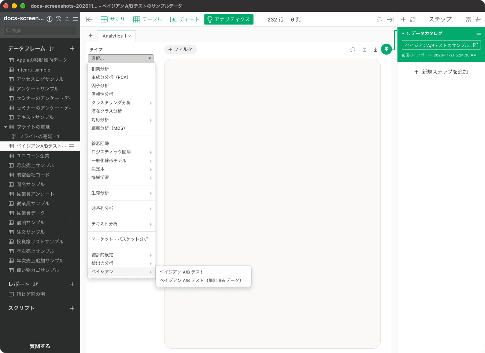

2. 「目的変数」「説明変数」「値」に列を割り当てます。

   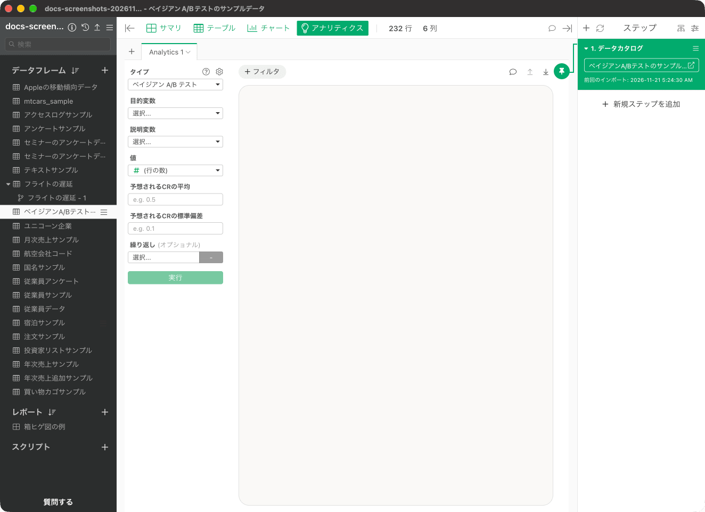

   - 目的変数: 見たい結果の列です。この例では、ユーザーがサインアップしたかどうかを見るため、is_signup を選びます。
   - 説明変数: テスト対象の A と B を表す列です。この例では landingPagePath を選びます。
   - 値: A または B ごとの、各結果（サインアップかどうか）に当てはまる件数を表す列です。初期状態では「(行の数)」が選ばれています。この例では value を選びます。

   「予想されるCRの平均」「予想されるCRの標準偏差」は、事前情報を与えるための項目で、後の「事前情報を追加する」で説明します。「繰り返し」は任意の項目です。

   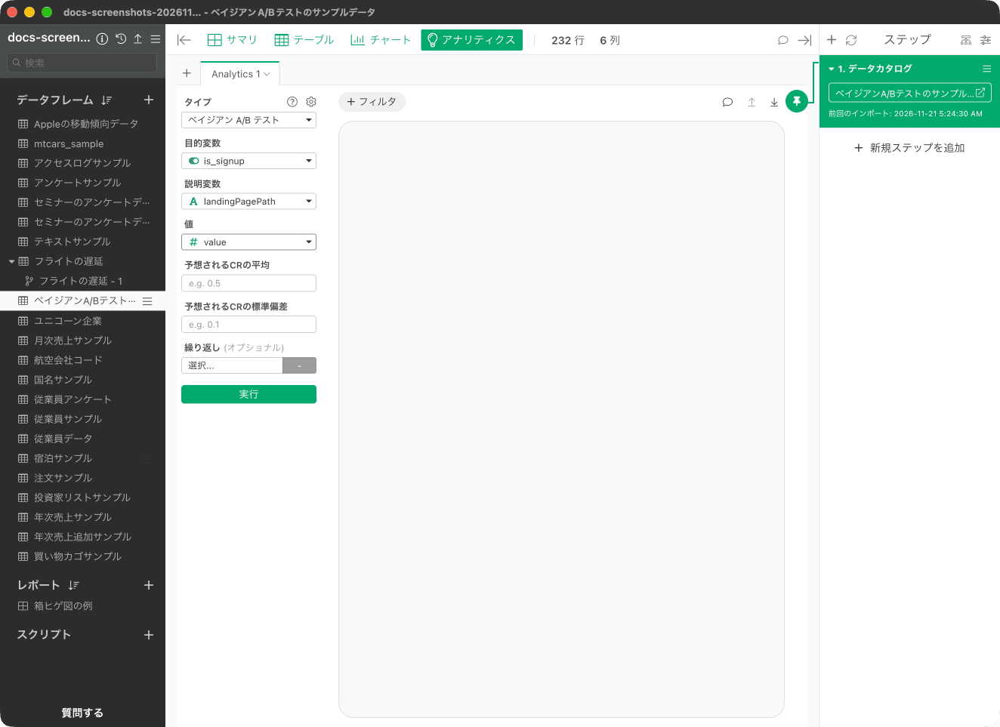

3. 「実行」ボタンをクリックします。ベイジアン A/B テストの結果がレポートとして表示されます。上部の「分析結果」「確率分布」「ピボットテーブル」「比率チャート」「次のステップ」のリンクから、それぞれの節に移動できます。

   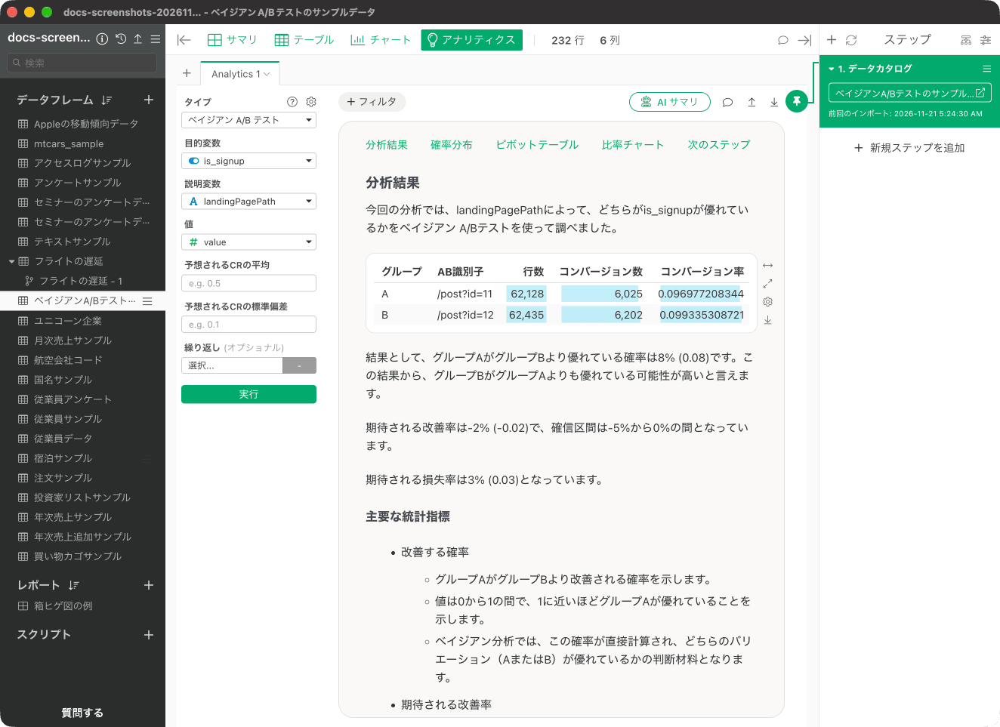

## 結果の見方

### 分析結果

A と B のどちらが優れているかを確認できます。表には、グループごとの行数、コンバージョン数、コンバージョン率が表示されます。特に注目するのは、結果として示される「改善する確率」です。この例では、A が B より優れている確率は 8%（0.08）なので、B が A より優れている可能性が高くなります。

期待される改善率は -2%（-0.02）、その信頼区間は -5% から 0% の間で、期待される損失率は 3%（0.03）と表示されます。改善率が負なので、ページ A に進むと、コンバージョンが 2% ほど悪化すると解釈できます。

### 改善率の分布

「確率分布」の「改善率の分布」では、A が B と比べてどれだけ改善されるかの確率分布を確認できます。


X 軸は、A が B よりどれだけ優れているかを、次の計算で表します。

```
(A-B) / B * 100
```

棒の高さは、その区間に改善率が入る割合です。0 より小さい（A で改善しない）区間の棒はオレンジ色、0 以上（A で改善する）の区間の棒は青色です。チャートの拡大ボタンを押すと、大きく表示できます。

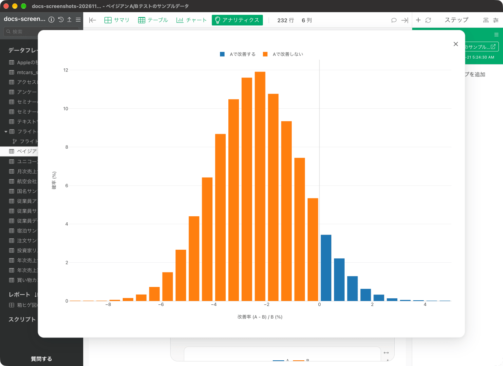

事前情報を入力する前の「改善する確率」は 8% で、これは青色の棒の合計に対応します。オレンジ色は残りの約 92% です。

### 事後確率分布

「確率分布」の「事後確率分布」では、テスト後の A グループと B グループのコンバージョン率の分布を確認できます。分布が重なっていない、または重なりが少ないときは、グループ間の差が明確で、どちらが優れているかの確実性が高いことを示します。

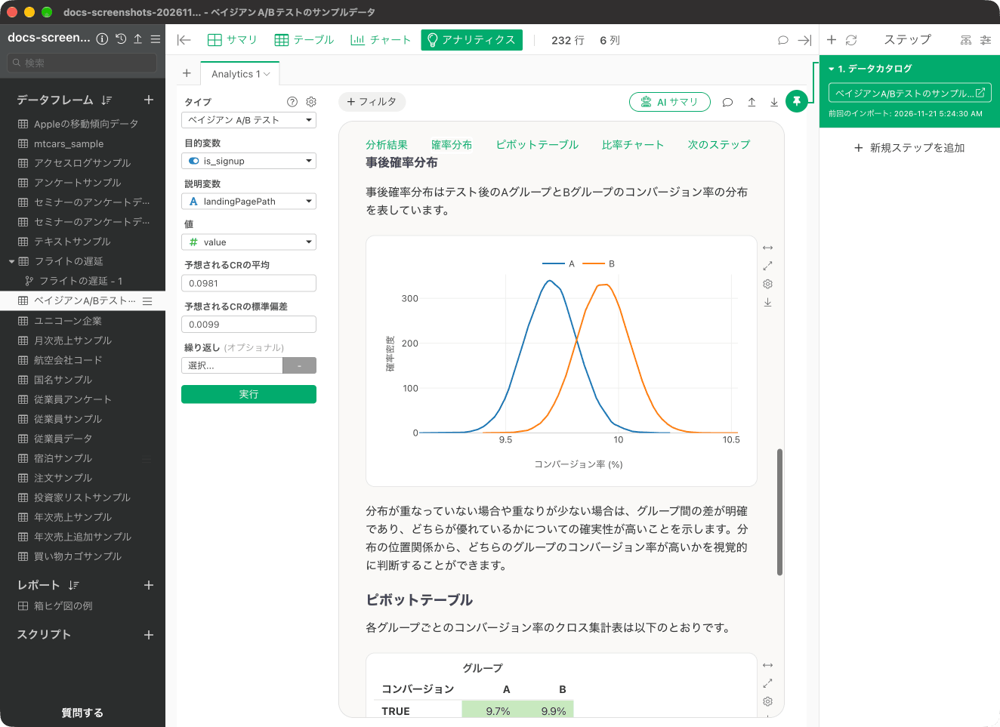

この画面と、次のピボットテーブル・比率チャートの画面は、事前情報を入力した後に撮影しました。入力した値は、予想されるCRの平均 0.0981、標準偏差 0.0099 です（後の「事前情報を追加する」で説明します）。

### ピボットテーブルと比率チャート

「ピボットテーブル」には、グループごとのコンバージョンのクロス集計表が表示されます。この例では、TRUE の割合は A が 9.7%、B が 9.9% です。「比率チャート」には、グループごとのコンバージョンの割合が積み上げバーで表示されます。

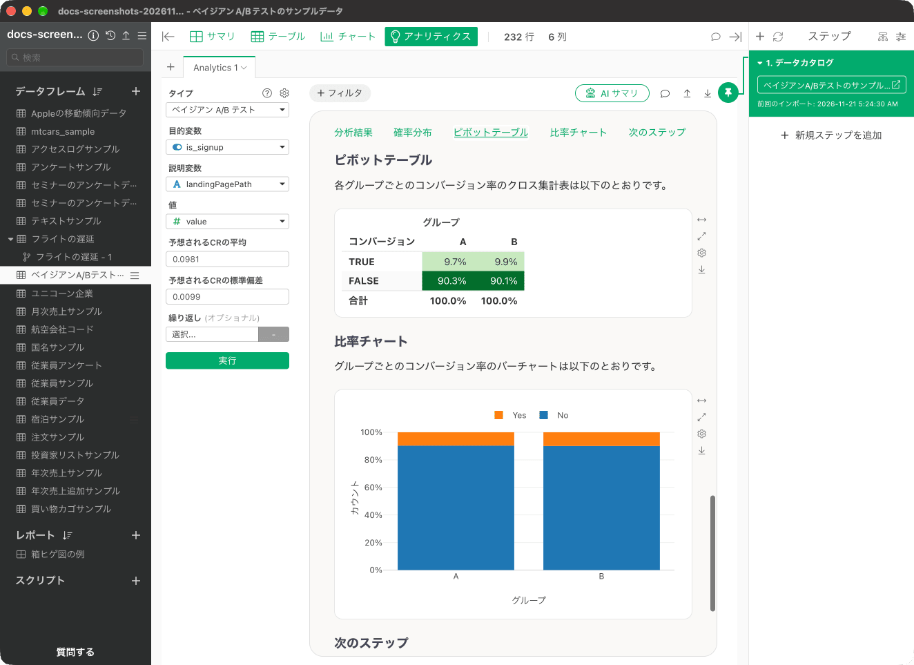

## 事前情報を追加する

「分析結果」と「改善率の分布」の評価は、事前情報を明示的に設定せずに行いました。事前情報を追加しない場合は、分布に関する事前知識がないものとして、一様分布を事前情報に使います。十分なデータがあれば、これで問題ありません。ただし、最初の数日分のデータしかないときは、そうとは限りません。

事前情報を与えるには、過去のコンバージョン率（CR）の平均と標準偏差を指定します。Exploratory が、そこから事前情報を内部で計算します。「予想されるCRの平均」と「予想されるCRの標準偏差」が、コンバージョン率を表します。

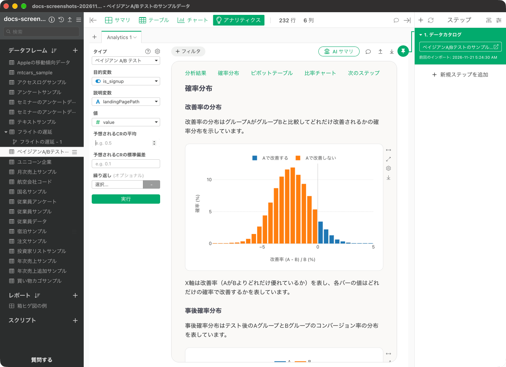

### 平均と標準偏差の求め方

過去のデータを取り込めば、コンバージョン率の平均と標準偏差を Exploratory で計算できます。ここでは、日付とページごとに signUpCount と uniquePageView を持つ集計表を使います（上の分析用データとは別の表です）。この表で signUpCount / uniquePageView を計算します。

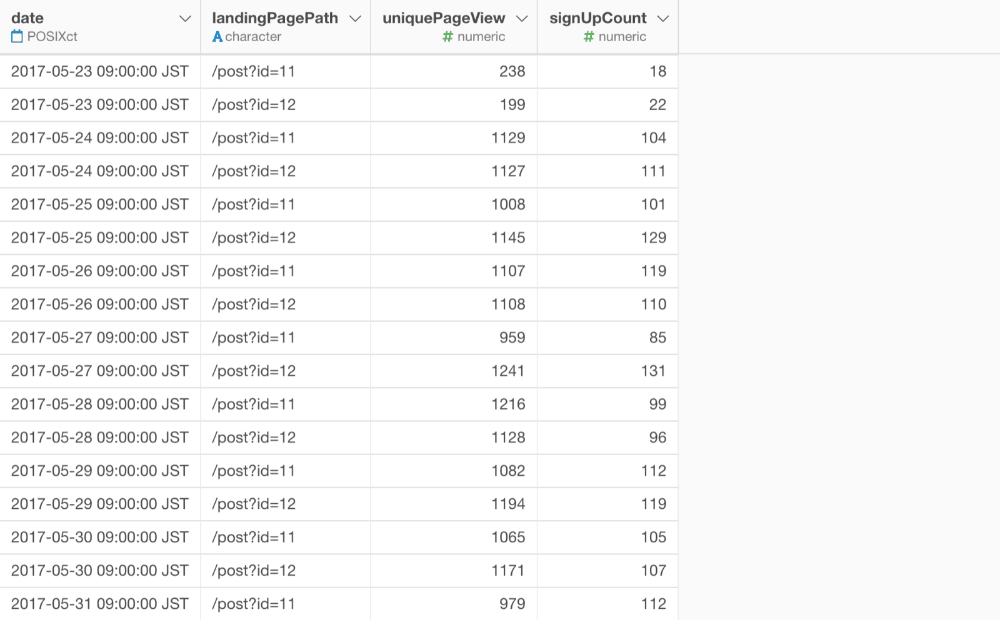

1. まず、コンバージョン率を計算します。列ヘッダーメニューで「計算を作成」→「標準」を選びます。

   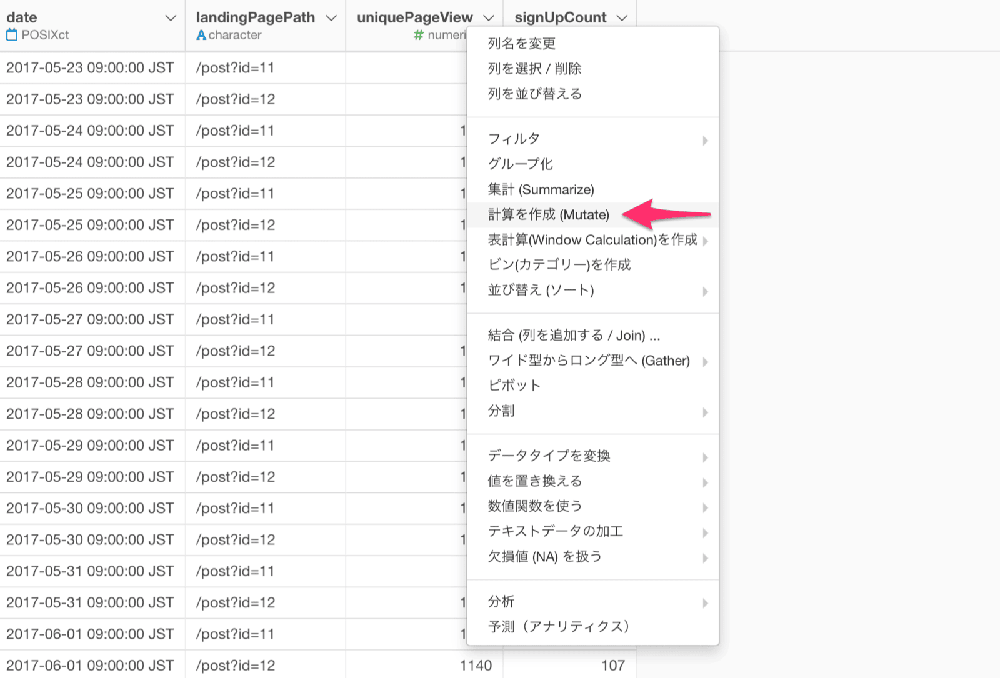

2. 次の式を入力して、コンバージョン率を計算します。

   ```
   signUpCount / uniquePageView
   ```

   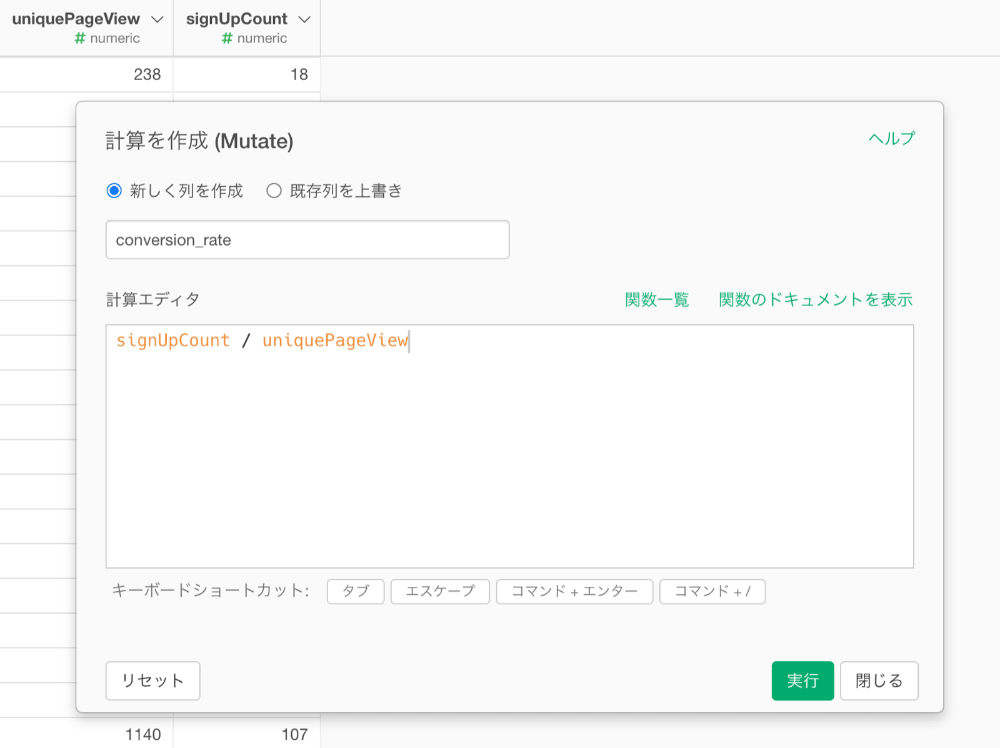

   ページごと、日ごとのコンバージョン率の列ができます。

   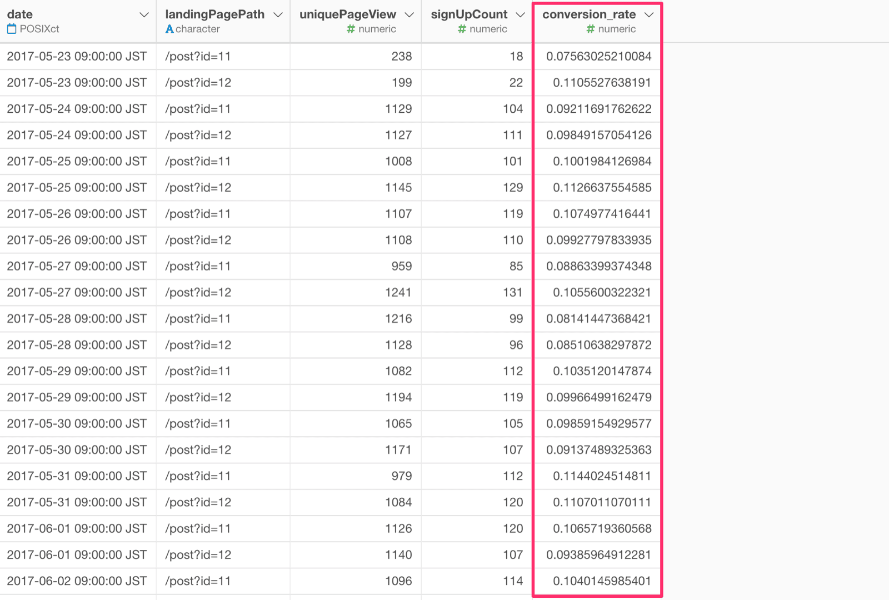

3. サマリビューで、コンバージョン率の平均値と標準偏差を確認します。

   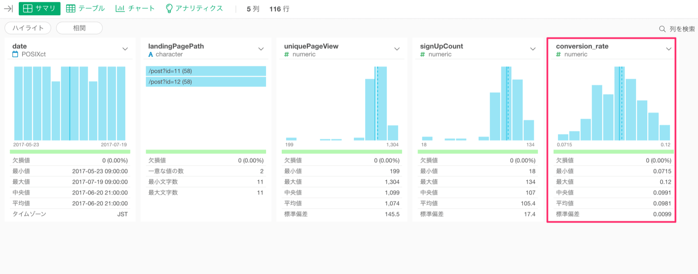

   この例では、平均値が 0.0981（9.8%）、標準偏差が 0.0099（約 1%）です。これらの数値を、ベイジアン A/B テストに指定します。

   
