分散分析（ANOVA）は、グループ間で数値に差があるかを調べる統計的検定です。アナリティクス・ビューでは、タイプの「統計的検定」から、次の 2 つを選べます。

- Two-Way ANOVA（分散分析）: 2 つの要因が結果にどう影響しているかを、要因どうしの交互作用も含めて調べます。
- ANCOVA（共分散分析）: 連続変数（共変量）の影響を調整したうえで、グループ間の差を調べます。

## Two-Way ANOVA

Two-Way ANOVA（二元配置分散分析）は、2 つの要因（説明変数）が 1 つの結果（目的変数）にどう影響しているかを調べる手法です。各要因の主効果に加えて、2 つの要因の組み合わせによる交互作用も検証できます。

たとえば、年齢層と性別が購入金額にどう影響しているかを調べるとき、年齢層による影響、性別による影響、2 つの組み合わせによる影響（交互作用）を同時に評価できます。「年齢層が上がるほど購入金額が増えるが、その増え方が性別で違う」といった関係も見つけられます。

### 必要なデータ

- 数値型の目的変数 1 つ（分析する変数）
- カテゴリ型の変数 2 つ（要因）
- カテゴリの組み合わせごとに十分なサンプル数
- 極端な外れ値が含まれていないこと

このページの例では、[小売業顧客購買データ](https://exploratory.io/data/exploratory/nus9XZh9)を使います。1 行が 1 顧客の購買情報で、顧客 ID、年齢層、性別などの列があります。

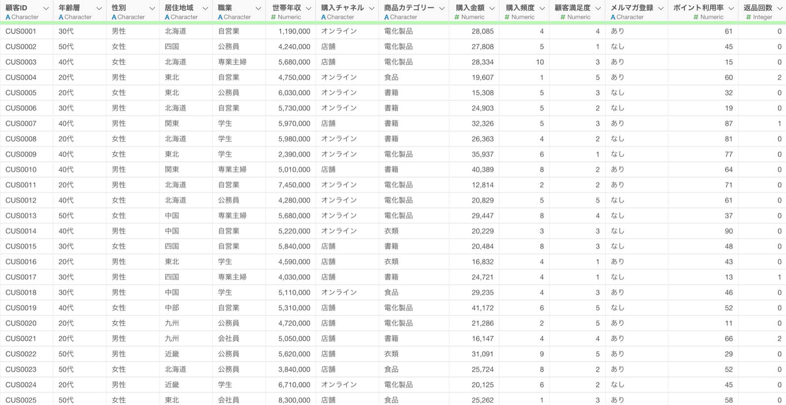

### 使い方

1. データフレームからアナリティクス・ビューを開きます。

   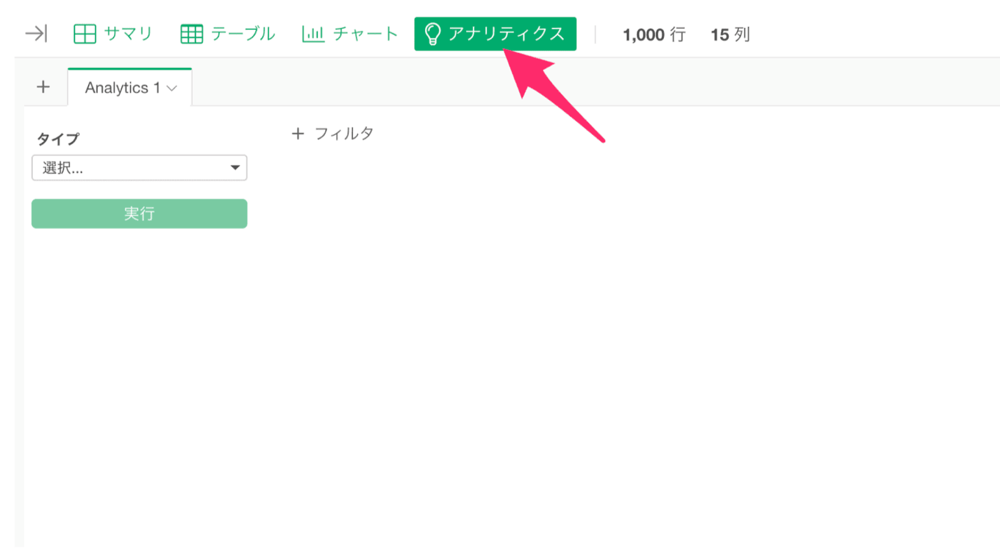

2. タイプに「統計的検定」を選び、「Two-Way ANOVA（分散分析）」を選びます。

   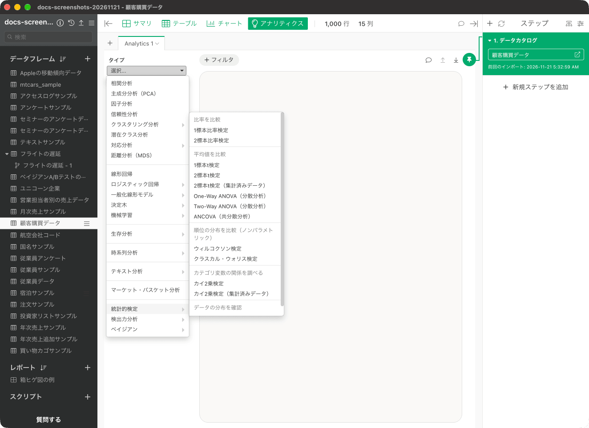

3. 目的変数に「購入金額」を割り当てます。

   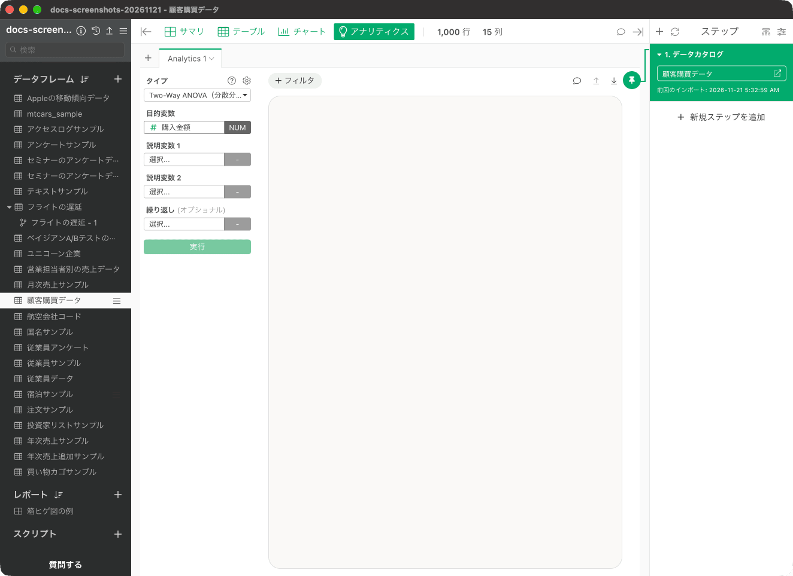

4. 説明変数 1 に「年齢層」、説明変数 2 に「性別」を割り当てます。

   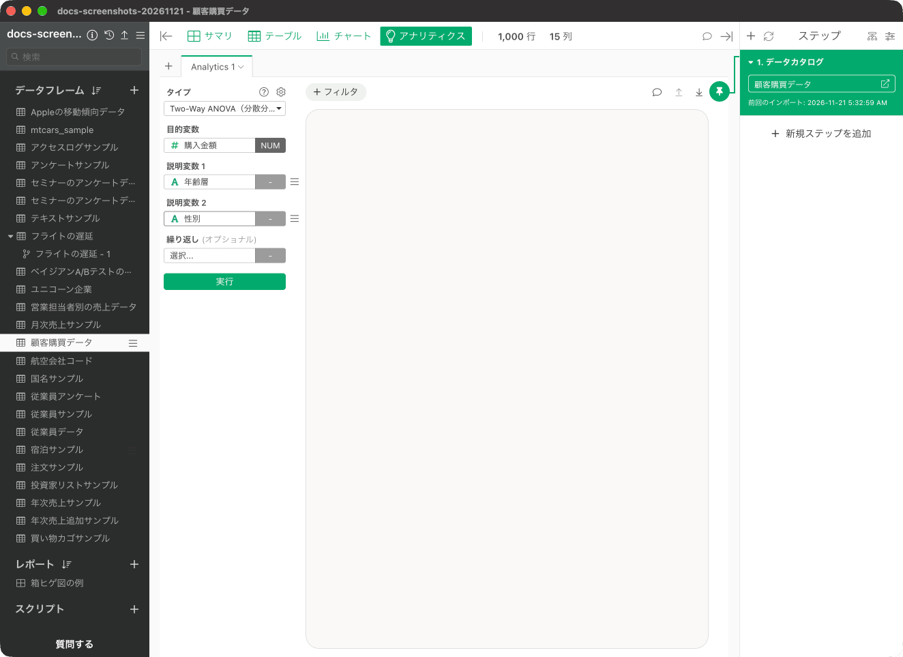

5. 「実行」ボタンをクリックして、結果を確認します。結果はレポートとして表示されます。上部の「サマリ」「有意性」「多重比較 - 変数」「多重比較 - 交互作用」「記述統計情報」のリンクから、それぞれの節に移動できます。

   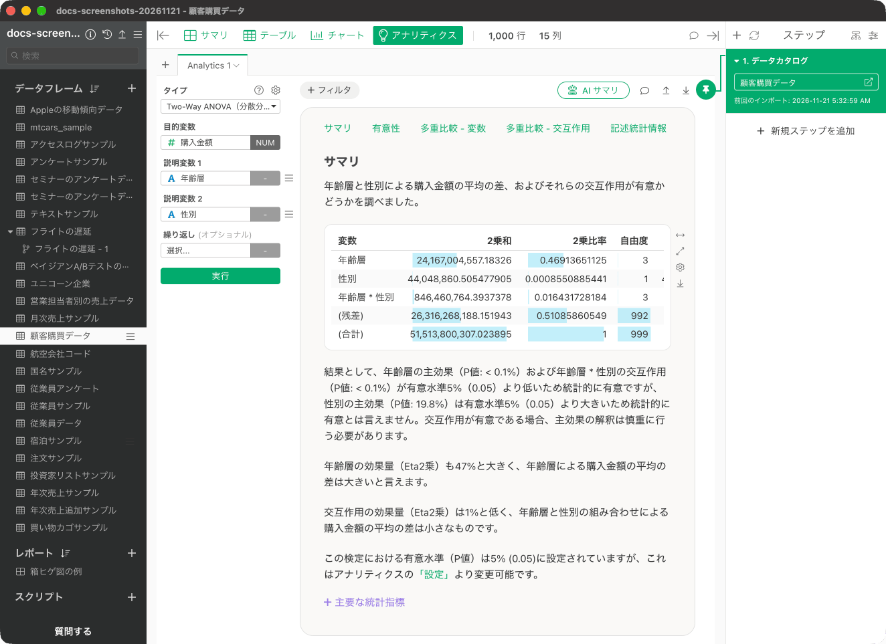

### 結果の見方

#### サマリ

年齢層の主効果と、年齢層と性別の交互作用は、P 値が 0.1% 未満（0.001 未満）で、有意水準 5%（0.05）より低いため、統計的に有意です。性別の主効果は P 値が 19.8%（0.198）で、有意とは言えません。交互作用が有意な場合は、主効果の解釈を慎重に行う必要があります。

効果量（Eta2 乗）は、年齢層が 47% と大きく、年齢層と性別の組み合わせは 1% と小さい結果です。

#### 有意性

年齢層の主効果、性別の主効果、年齢層と性別の交互作用のそれぞれについて、帰無仮説と P 値、F 値が説明されます。年齢層の F 値は 303.66、性別の F 値は 1.66 です。

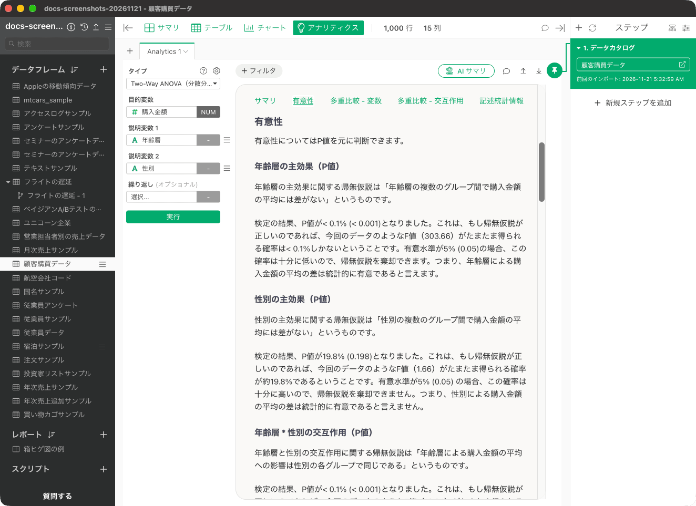

#### 多重比較 - 変数

年齢層の間、性別の間で、購入金額の平均の差を比べる表です。多重比較を何度も行うとタイプ 1 エラーの確率が上がるため、Bonferroni 補正をかけています。P 値が有意水準の 5% 以下である組み合わせでは、購入金額の平均の差が統計的に有意です。年齢層の差が最も大きいのは「20 代」と「40 代」の組み合わせで、約 -13,981 です。

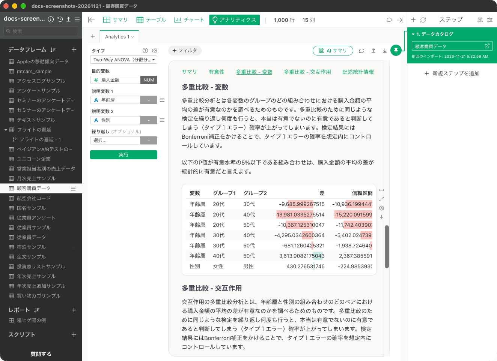

#### 多重比較 - 交互作用

年齢層と性別の組み合わせ（例: 20 代：女性）どうしを比べる表です。Bonferroni 補正をかけていることと、有意かどうかの見方は、「多重比較 - 変数」と同じです。

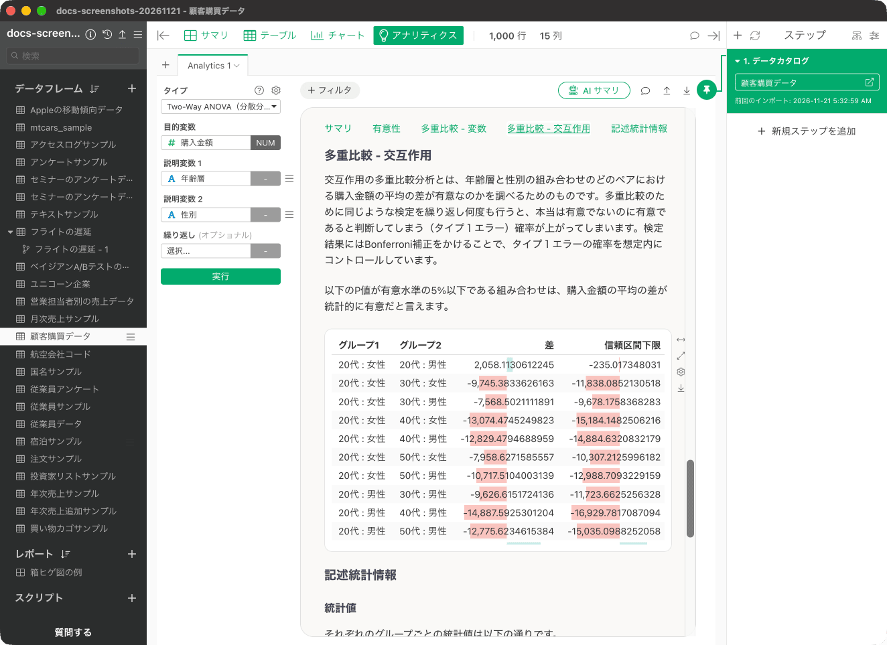

#### 平均値の交互作用（ライン）

「記述統計情報」にある「平均値の交互作用(ライン)」では、年齢層ごとの購入金額の平均を、性別の線で比べられます。「信頼区間 (95%)」のチェックを入れると、信頼区間も表示されます。この例では、男女とも 40 代でほぼ同じ水準になり、20 代と 30 代は女性の平均が高く、50 代は男性の平均が女性より高くなっています。

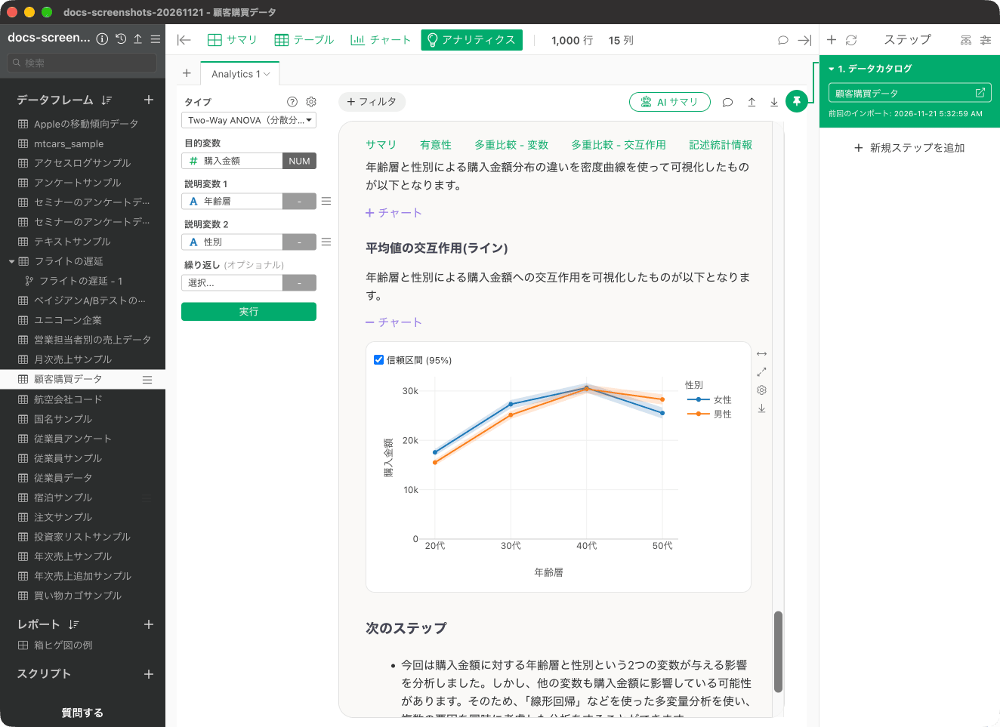

## ANCOVA（共分散分析）

ANCOVA は共分散分析（Analysis of Covariance）の略で、分散分析を拡張した手法です。ANOVA が、カテゴリ変数（要因）が目的変数に与える影響を調べるのに対して、ANCOVA は連続変数（共変量）の影響も同時に考慮します。そのため、カテゴリ変数の「純粋な効果」を見きわめられます。

たとえば社員研修の効果を調べるとき、部署間で研修後のスコアを比べるだけでなく、研修前のスコアの影響を調整したうえで、部署による違いを検証できます。共変量を調整したあとの「調整済み平均値」も求められます。

### 必要なデータ

- 目的変数が連続変数（例: 研修後スコア）
- 説明変数がカテゴリ変数（例: 部署）
- 共変量が連続変数（例: 研修前スコア）

このページの例では、[社員研修効果分析データ](https://exploratory.io/data/exploratory/JDR3JCf5)を使います。1 行が 1 名の従業員の研修データで、「従業員ID」「部署」「研修前スコア」「研修後スコア」などの列があります。

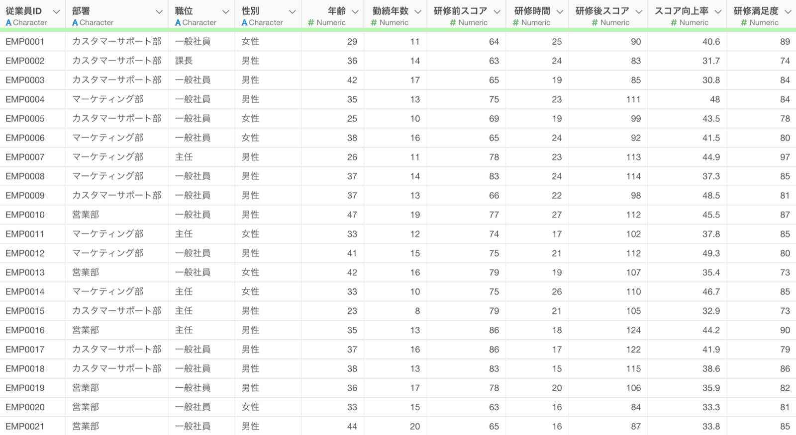

### 使い方

1. データフレームからアナリティクス・ビューを開きます。

   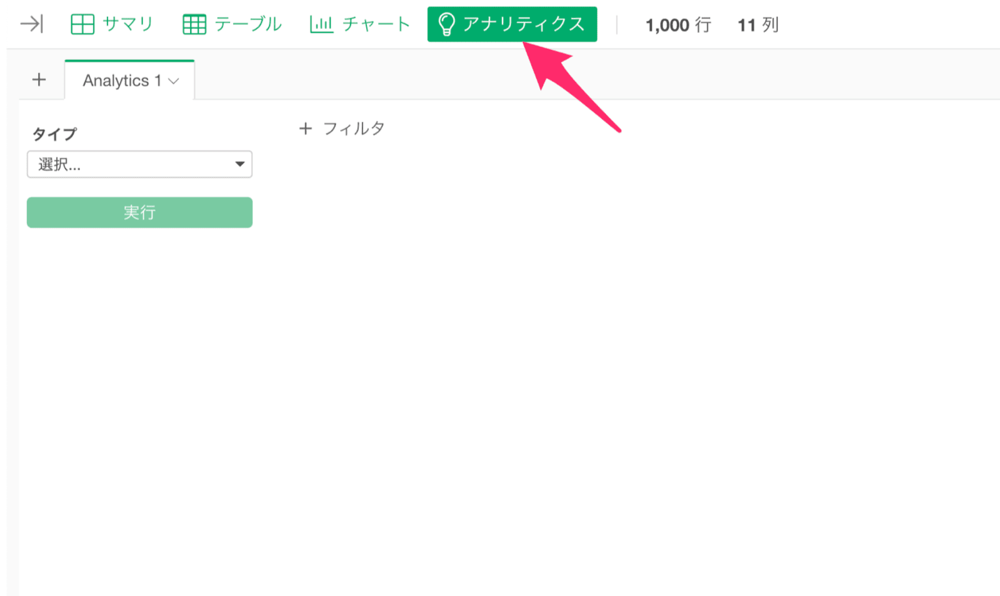

2. タイプに「統計的検定」を選び、「ANCOVA（共分散分析）」を選びます。

   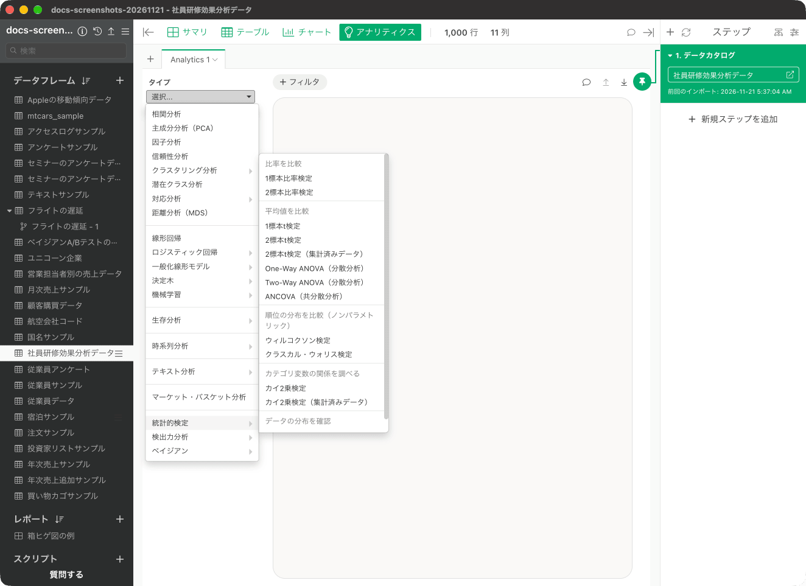

3. 目的変数に「研修後スコア」、説明変数に「部署」、共変量に「研修前スコア」を割り当てます。

   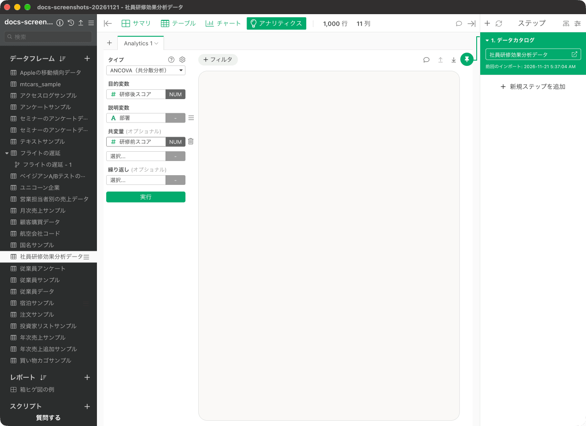

4. 「実行」ボタンをクリックして、結果を確認します。

   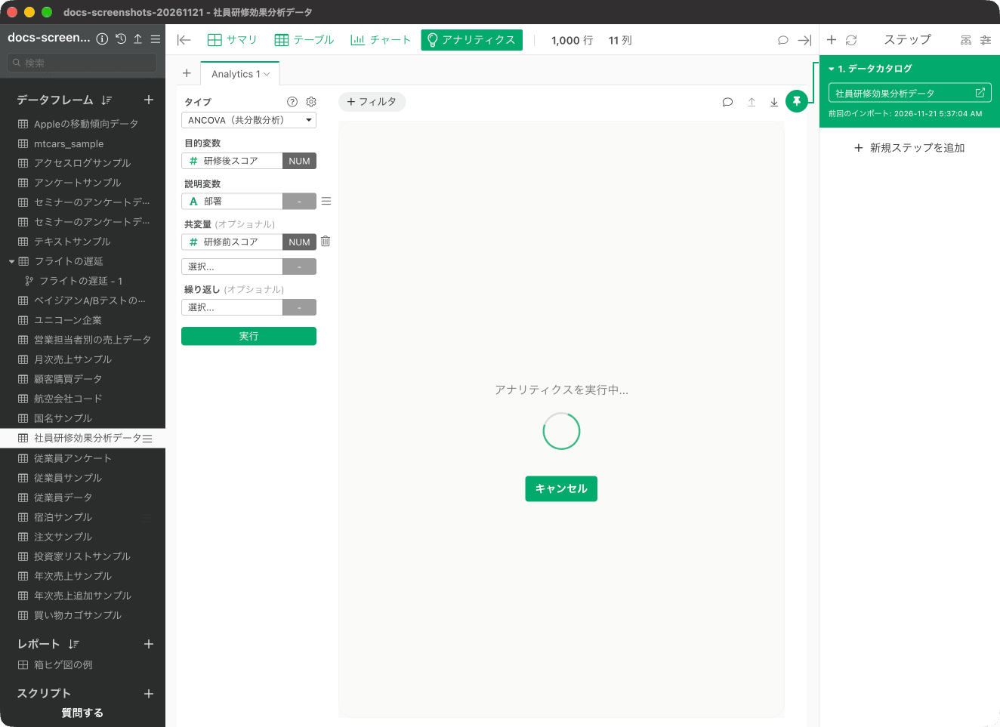

   結果はレポートとして表示されます。上部の「サマリ」「調整済み平均」「グループ間の比較（多重比較）」「共変量と目的変数」のリンクから、それぞれの節に移動できます。

### 結果の見方

#### サマリ

共変量の研修前スコアを調整したうえで、部署によって研修後スコアの平均に差があるかを確認できます。この例では、研修前スコアを調整したあとでも、部署による研修後スコアの差は統計的に有意です（F(2, 996) = 135.57、P 値は 0.001 未満）。部署の効果量（偏 Eta2 乗）は 0.214 で、設定された基準では大きい効果に相当します。

部署間の比較では、マーケティング部の調整済み平均が、カスタマーサポート部より 6.7、営業部より 5.93 高く、どちらも補正後 P 値は 0.001 未満で統計的に有意でした。ほかの組み合わせでは、有意な差は検出されませんでした。

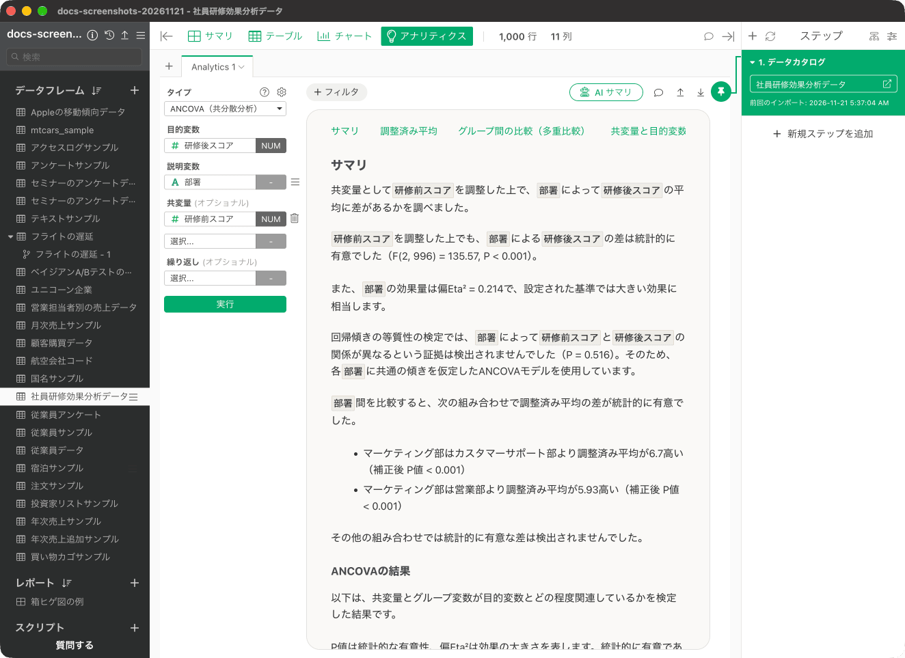

#### 調整済み平均

「調整済み平均の可視化」では、研修前スコアを同じ値（この例では 74.86）にそろえたときの、部署ごとの調整済み平均と 95% 信頼区間が表示されます。信頼区間が重なっているかどうかだけで、統計的な有意性は判断できません。グループ間の差は、「グループ間の比較」で確認します。

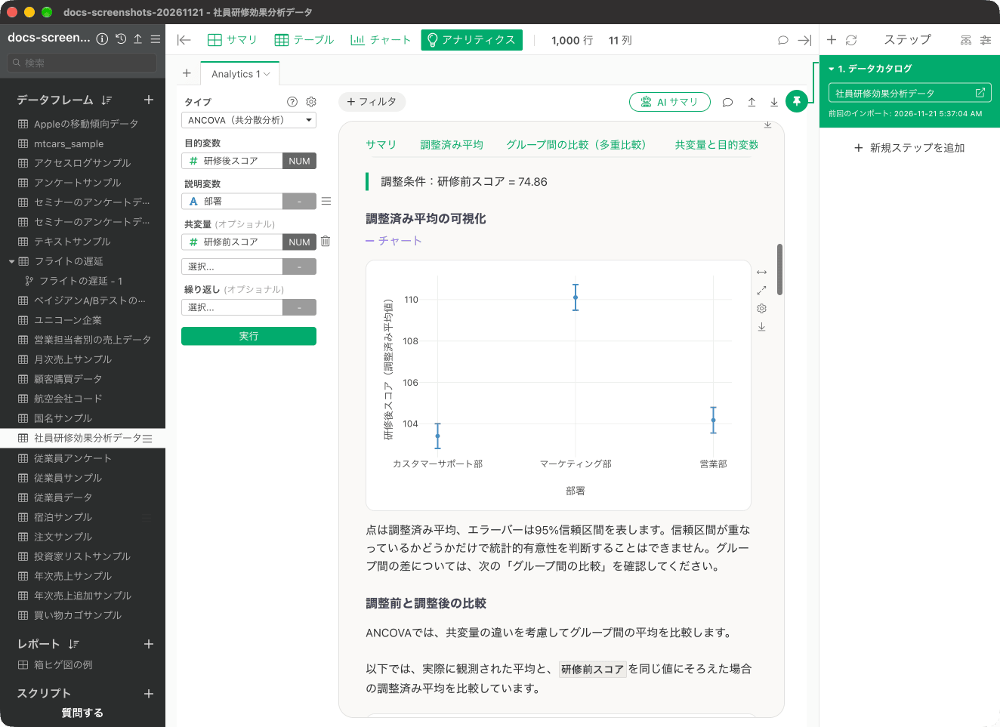

#### 共変量と目的変数の関係

部署ごとに、研修前スコアと研修後スコアの関係を散布図で表します。点は各観測値、線は部署ごとに推定した回帰直線、帯は 95% 信頼区間です。各部署の回帰直線が概ね平行であれば、ANCOVA が仮定する「回帰傾きの等質性」と整合的です。

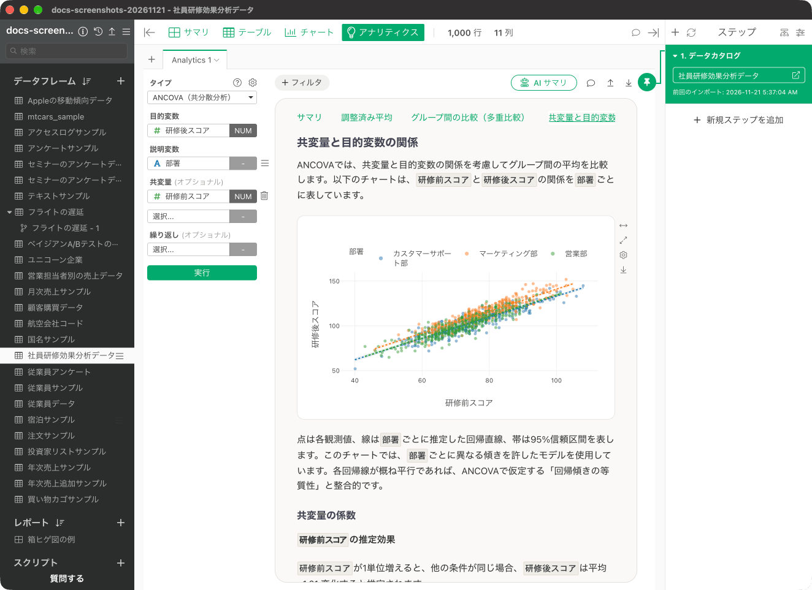

#### ANCOVA の前提の確認

ANCOVA の結果を適切に解釈するために、レポートでは、回帰傾きの等質性、残差と予測値の関係、残差の分布を確認します。

「回帰傾きの等質性」では、研修前スコアと研修後スコアの関係の傾きが、部署によって異なるかどうかを、部署と研修前スコアの交互作用を使って検定します。この例では、F 値が 0.66、P 値が 0.516 で、傾きが異なるという証拠は検出されませんでした。

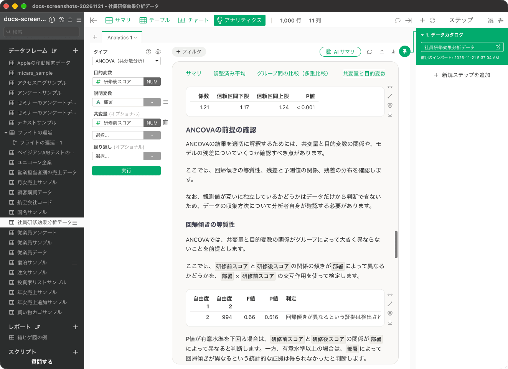

「残差と予測値」のチャートでは、モデルがデータの関係を適切に捉えていれば、残差は 0 を中心に、予測値の大きさにかかわらず概ねランダムに分布します。曲線的なパターンが見られる場合は、モデルが関係を十分に捉えていない可能性があります。予測値が大きくなるにつれて残差のばらつきが広がる場合は、残差の分散が一定であるという前提に問題がある可能性があります。実線は残差の傾向を示す平滑線で、0 付近を概ね水平に推移していることが望まれます。±2 の点線は、標準化残差が大きい観測値を確認するための目安です。

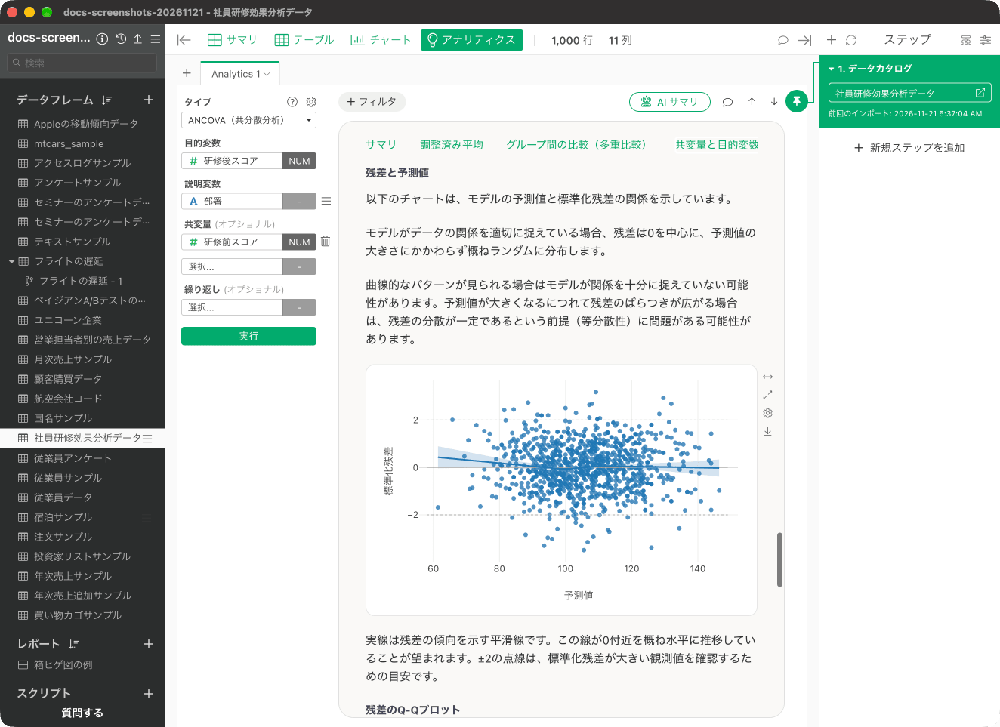

「残差の Q-Q プロット」では、残差の分布が正規分布から大きく外れていないかを確認します。残差が正規分布に近いときは、点は基準線に概ね沿って並びます。青い帯は、残差が正規分布に従う場合に点が入ることが期待される 95% の範囲です。多くの点がこの範囲から系統的に外れている場合は、正規分布からのずれがある可能性があります。

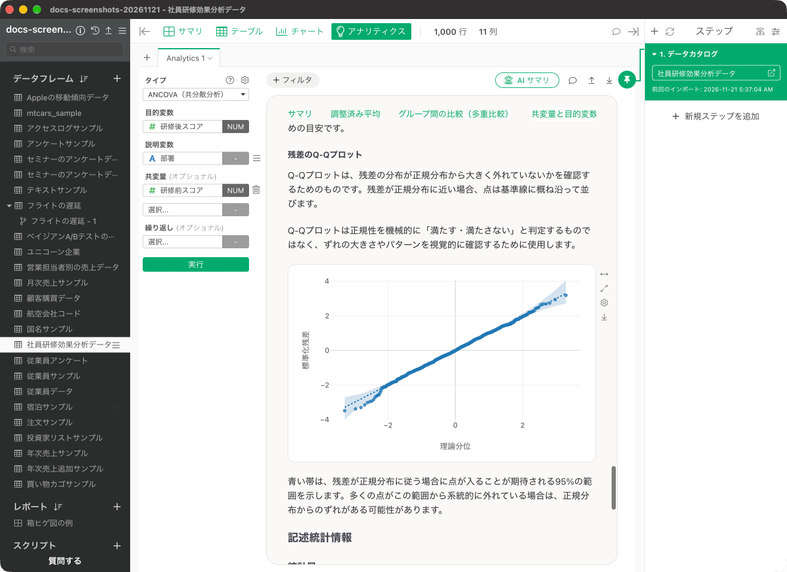
