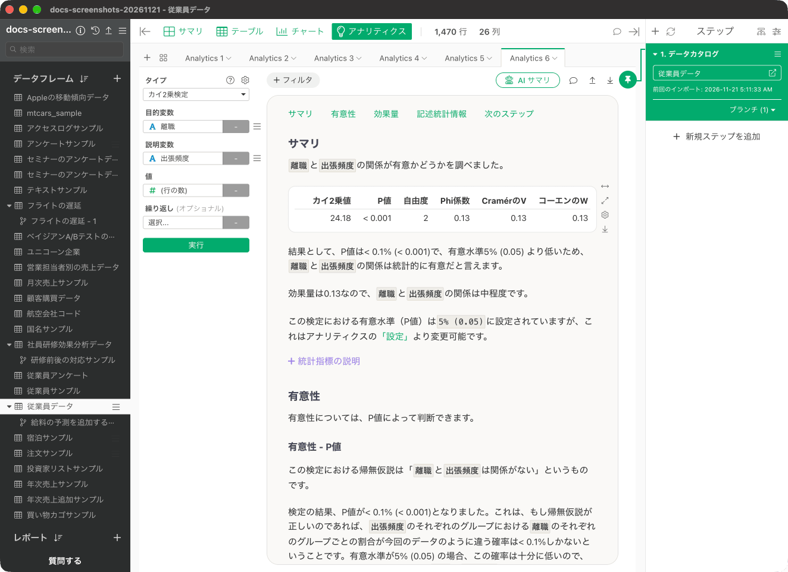
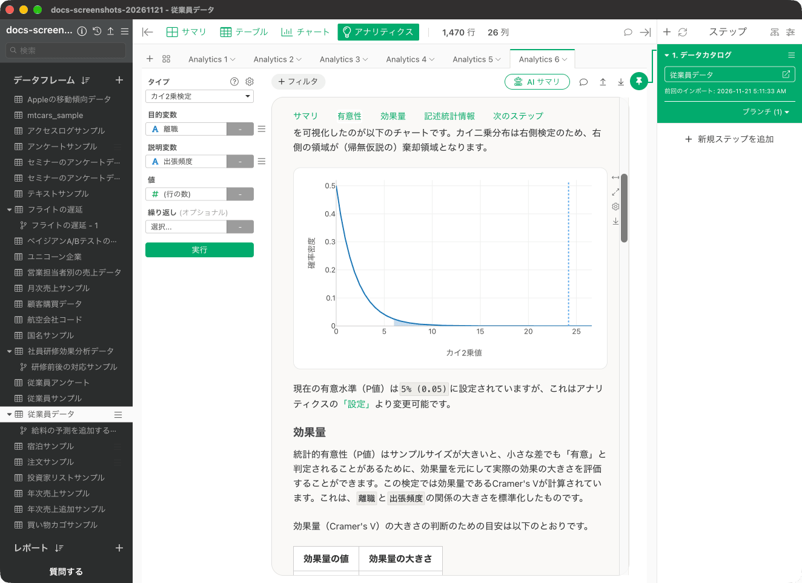
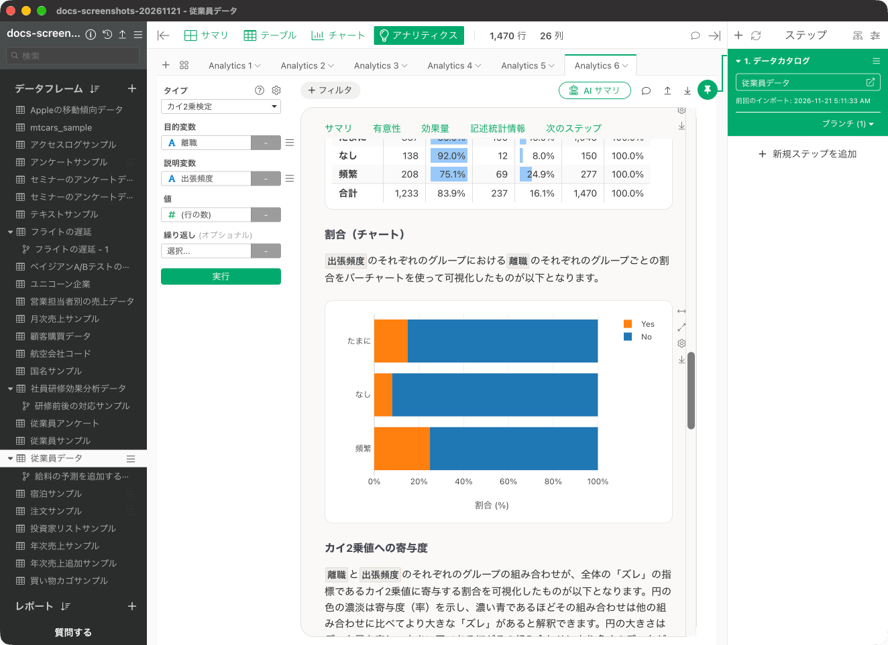
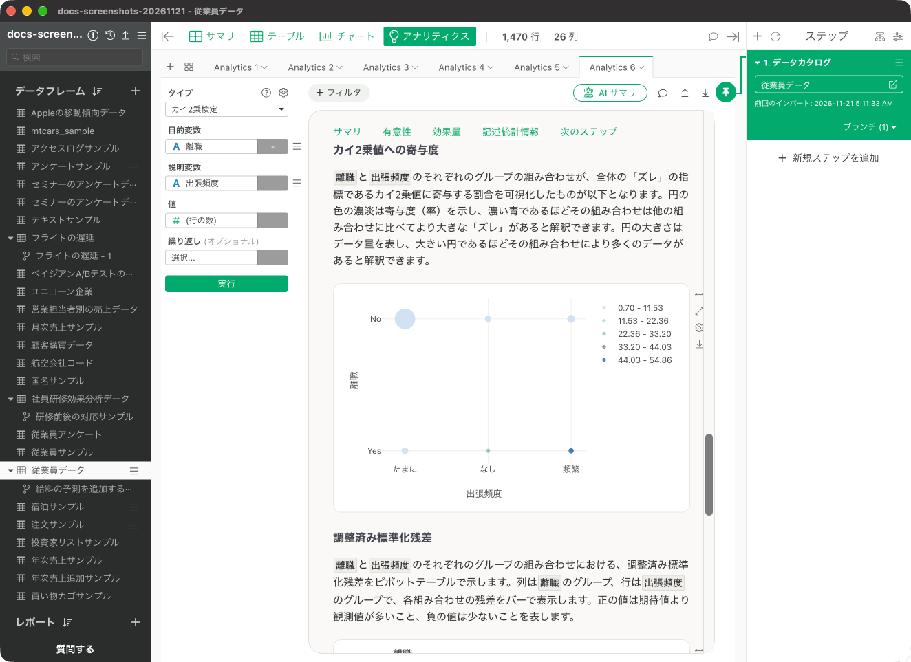
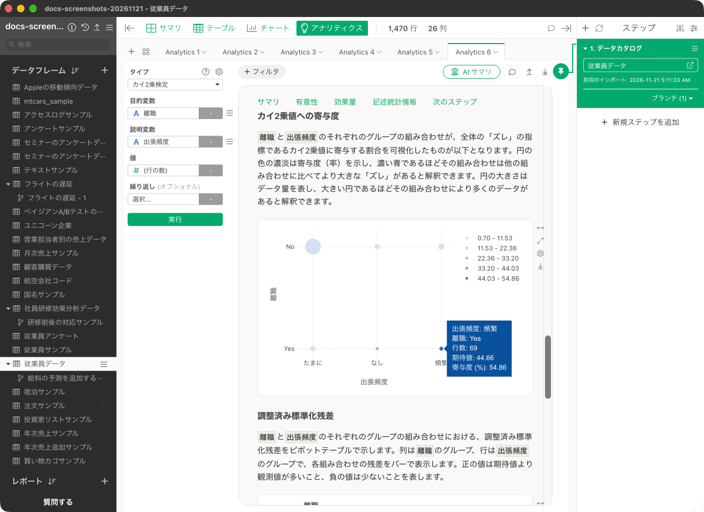
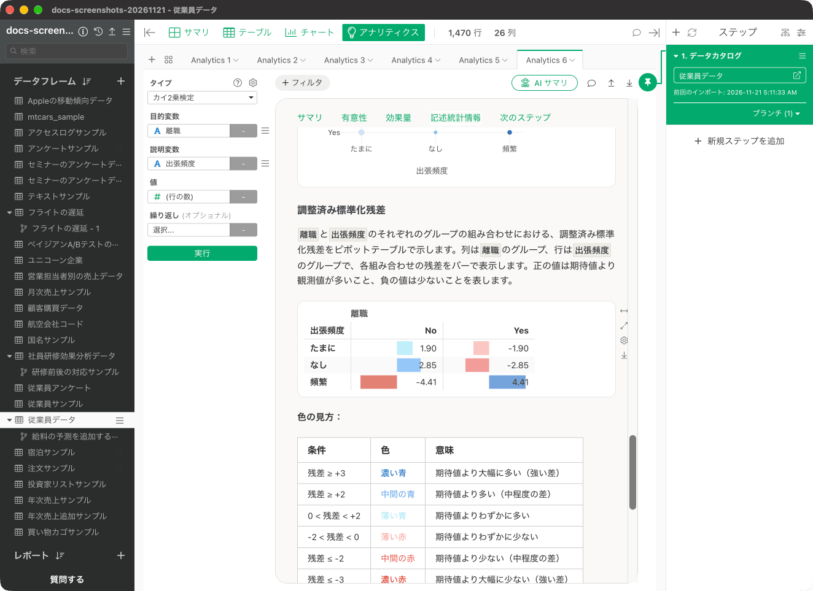
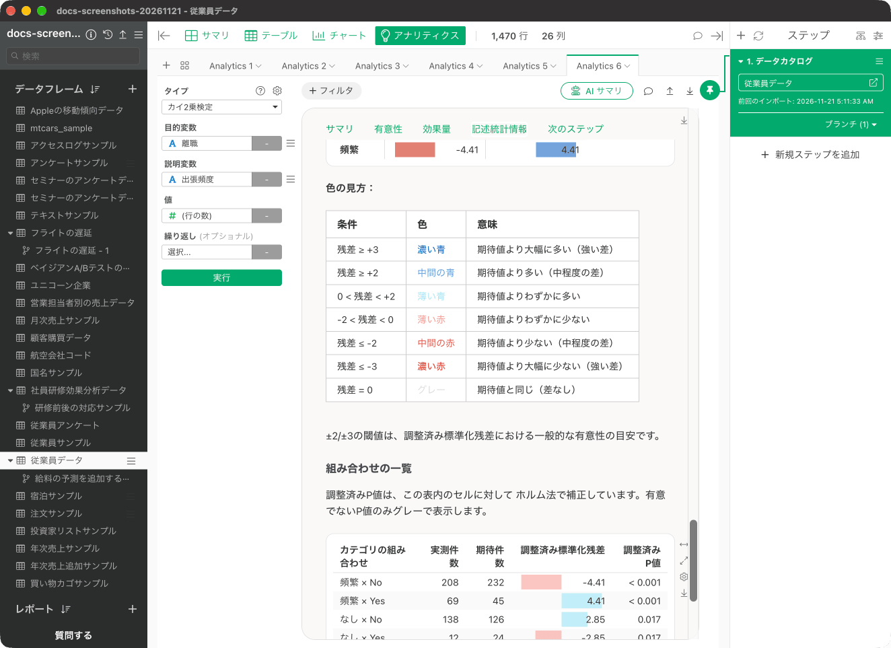
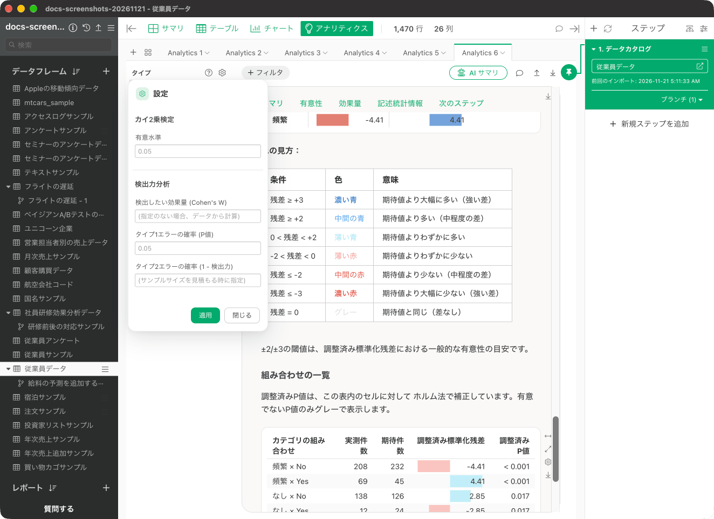

カイ2乗検定は統計的検定の手法の一つで、カテゴリ型の変数 2 つの間に関係があるかどうかを検定するアナリティクスです。

## 使い方

このページの例では、従業員データ（1,470 行・26 列）を使い、「離職」と「出張頻度」の間に関係があるかを調べます。

1. アナリティクス・ビューを開き、タイプの「統計的検定」の「カテゴリ変数の関係を調べる」から「カイ2乗検定」を選びます。

2. 目的変数に「離職」、説明変数に「出張頻度」を選びます。「値」は初期状態の「(行の数)」のままにします。「繰り返し」は任意の項目で、この例では選びません。

3. 「実行」ボタンをクリックします。結果がレポートとして表示されます。上部の「サマリ」「有意性」「効果量」「記述統計情報」「次のステップ」のリンクから、それぞれの節に移動できます。

   

## 結果の見方

### サマリ

検定の結果が有意かどうかを確認できます。帰無仮説は「離職と出張頻度は独立である（関係がない）」です。P 値は、独立を仮定したとき、観測したカイ2乗値（この例では 24.18）以上の値が得られる確率です。一般的には、0.05（5%）を下回ると有意とされます。

表には、カイ2乗値（24.18）、自由度（2）、P 値（0.001 未満）と、効果量の Phi 係数、Cramér の V、コーエンの W（どれも 0.13）が表示されます。P 値は有意水準 5%（0.05）より低いため、離職と出張頻度の関係は統計的に有意です。

### 有意性 - P値

使ったデータの自由度をもとにした、カイ2乗分布が表示されます。今回の結果であるカイ2乗値が、点線で示されます。カイ2乗分布は右側検定のため、右側の領域が（帰無仮説の）棄却域になります。

### 記述統計情報

「割合（表）」には、組み合わせごとの件数と割合が表で表示されます。説明変数と目的変数のカテゴリを掛け合わせた組み合わせです。「割合（チャート）」には、同じ割合が 100% 積み上げのバーチャートで表示されます。この例では、離職の「Yes」「No」の割合を、出張頻度（「たまに」「なし」「頻繁」）ごとに比べられます。

### カイ2乗値への寄与度

カイ2乗値に貢献している（期待値と実測値にずれがある）組み合わせを調べられます。カイ2乗値は、実測値と期待値のずれの度合いを表す指標です。組み合わせごとのずれが、全体のずれ（カイ2乗値）に占める割合を「寄与度」と呼びます。

横軸が出張頻度、縦軸が離職で、円の色の濃さが寄与度を表します。濃い青であるほど、その組み合わせは、ほかの組み合わせに比べて大きなずれがあります。円の大きさはデータ量を表し、大きい円ほど、その組み合わせに多くのデータがあります。

円にポインタを合わせると、行数、期待値、寄与度が表示されます。出張頻度が「頻繁」で離職が「Yes」の組み合わせは、行数が 69、期待値が 44.66 です。寄与度がいちばん高く、期待値と実測値のずれのうち 54.86% がこの組み合わせによるものです。

### 調整済み標準化残差

組み合わせごとに、実測値と期待値のずれを確認できます。列は離職のグループ、行は出張頻度のグループで、各組み合わせの調整済み標準化残差が、色の棒で表示されます。正の値は期待値より観測値が多いこと、負の値は少ないことを表します。この例では、「頻繁」×「Yes」が 4.41、「頻繁」×「No」が -4.41 です。

色の見方の表には、残差の目安が示されます。+2 以上は期待値より多い（中程度の差）、+3 以上は大幅に多い（強い差）です。-2 以下は期待値より少ない（中程度の差）、-3 以下は大幅に少ない（強い差）です。±2 と ±3 は、調整済み標準化残差における一般的な有意性の目安です。

### 組み合わせの一覧

「色の見方」の下にある「組み合わせの一覧」には、組み合わせごとの実測件数と期待件数が表示されます。あわせて、調整済み標準化残差と調整済み P 値も確認できます。調整済み P 値は、ホルム法で補正されています。

## 設定

タイプの右にある歯車の「設定」で、「カイ2乗検定」の有意水準（初期値 0.05）を変更できます。「検出力分析」の「検出したい効果量 (Cohen's W)」「タイプ1エラーの確率 (P値)」「タイプ2エラーの確率 (1 - 検出力)」も、ここで指定できます。

