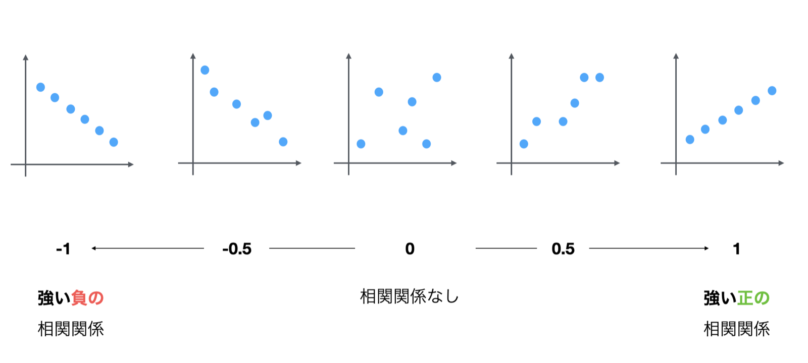
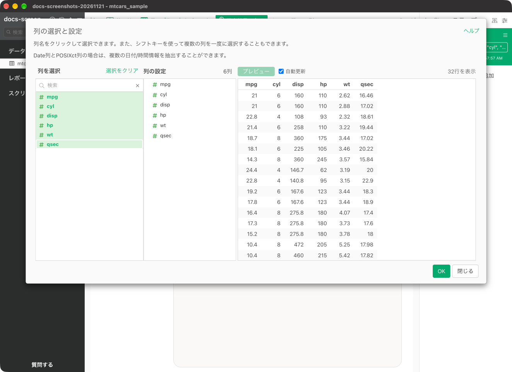
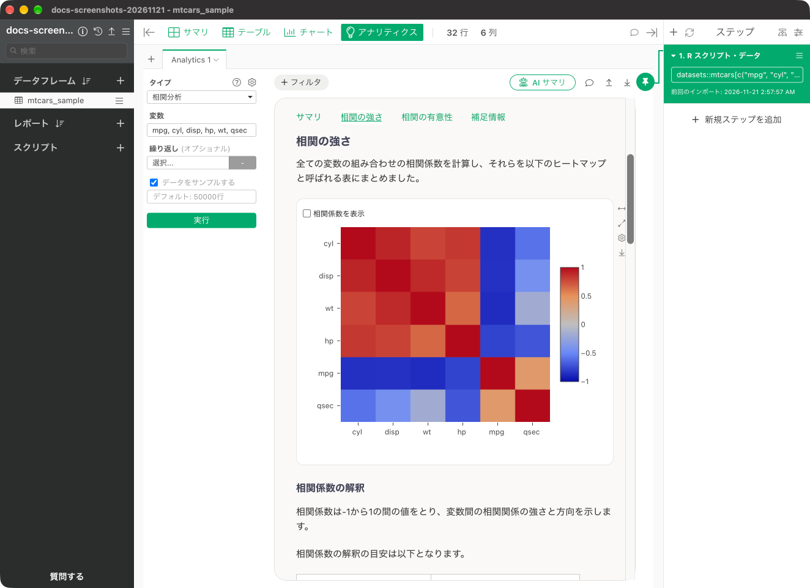
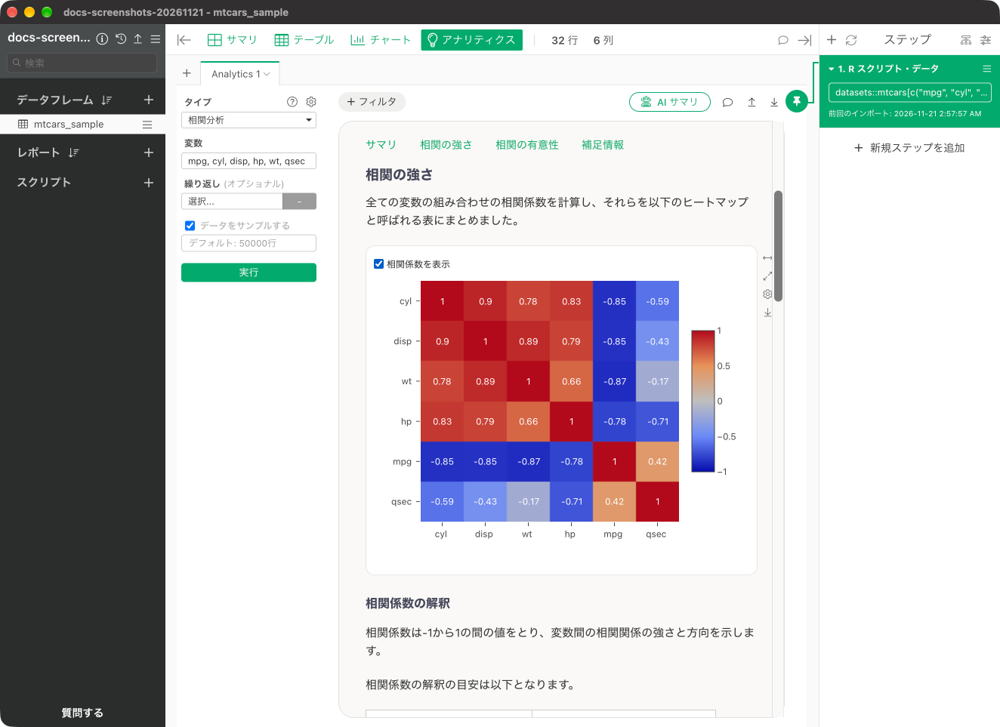
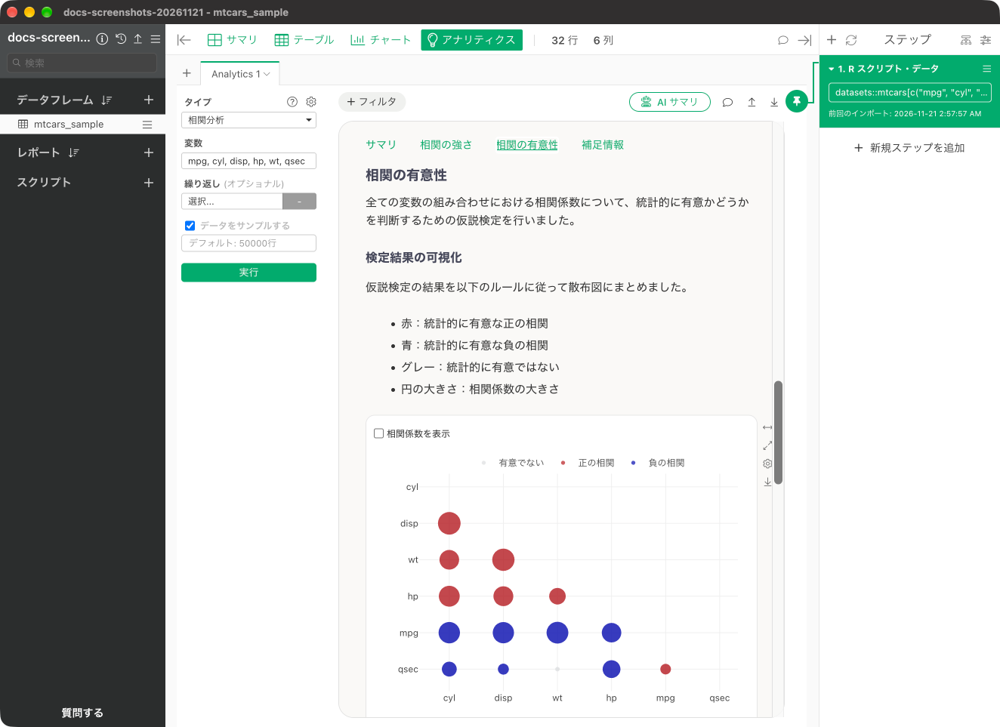
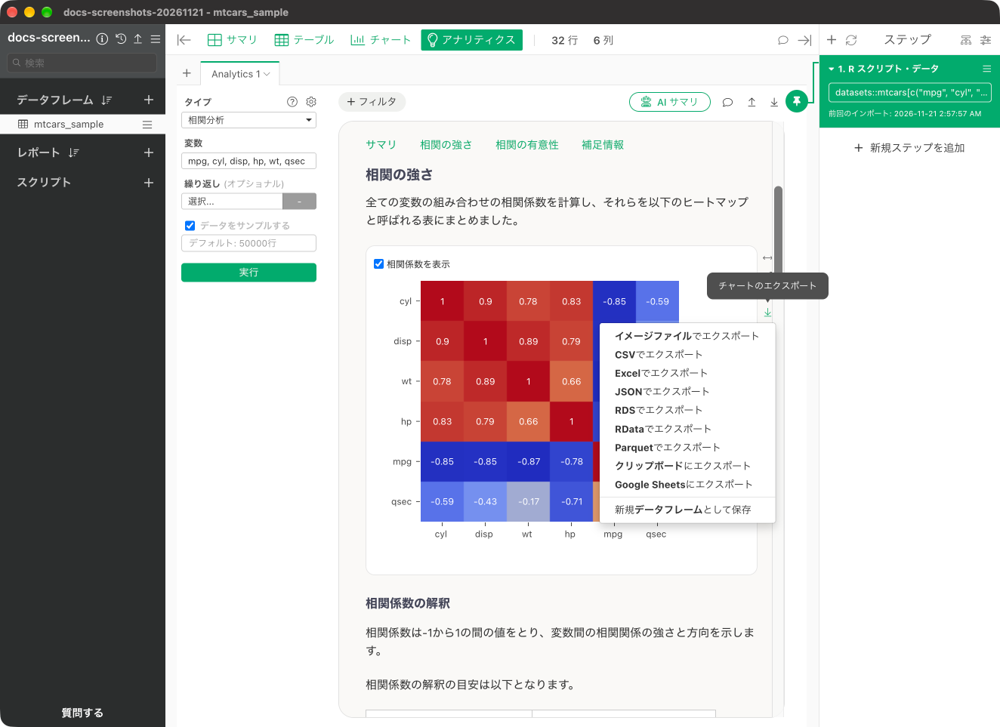
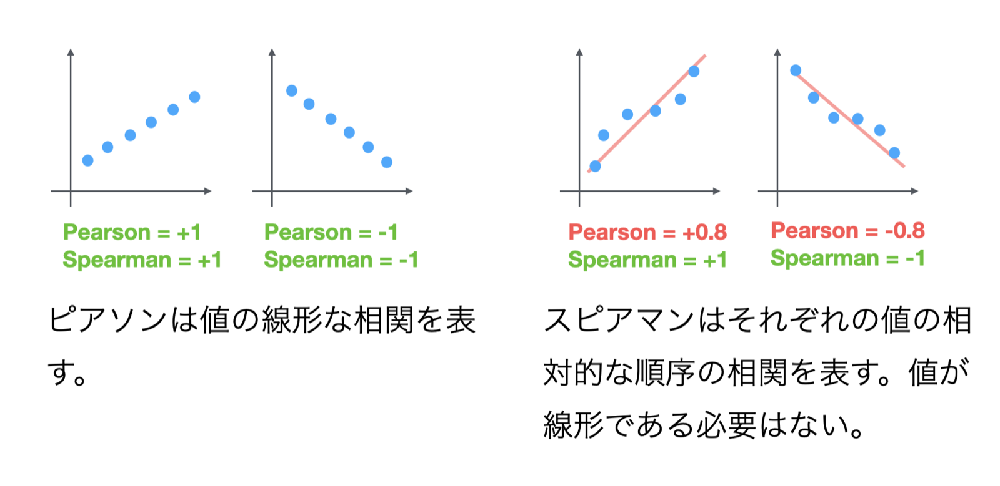

アナリティクス・ビューの「相関分析」は、列間の相関係数を総当たりで求めた「相関行列」を確認する機能です。

## 相関関係

相関関係とは、2つの変数のうち、1つの変数の値が変わるともう1つの変数の値も一定の規則を持って一緒に変わる関係のことを言います。

この相関関係を表す指標として、「相関係数」があります。

相関係数は-1から1の値を取り、１に近いほど正の相関関係があり、-1に近いほど負の相関があります。また、0に近ければ相関関係がないということになります。

## 相関を実行する

今回はサンプルデータとして、R の mtcars から mpg、cyl、disp、hp、wt、qsec の6列（32行）を取り出した「mtcars_sample」を使います。6列とも数値型です。

アナリティクス・ビューを開き、タイプに「相関分析」を選択します。左のパネルに「変数」が表示されます。

「変数」をクリックすると「列の選択と設定」のダイアログが表示されるため、相関関係をみたい列を選択します。Shiftキーを押しながら最後の列をクリックすると、複数の列をまとめて選択できます。この例では、mpg から qsec までの6列を選択しています。

「OK」で閉じると、変数に6列が入ります。「実行」ボタンをクリックします。

実行すると、レポートの「サマリ」が開きます。「分析条件とデータの確認」の表には、変数の数6、行数32、削除された行数0、相関係数「ピアソン相関」が表示されています。レポートの上にある「サマリ」「相関の強さ」「相関の有意性」「補足情報」のリンクで、各節に移動できます。

## 結果の解釈

### 相関

「相関の強さ」のセクションでは、列ごとの相関係数がヒートマップで可視化されます。

このチャートの見方としては、正の相関（1に近い）ほど赤色が濃くなり、負の相関（-1に近い）ほど青色が濃くなります。また、相関がない（0に近い）場合は、色がグレーになっていきます。チャートの下の「相関係数の解釈」には、相関係数の値の目安が示されます。

チャートの左上にある「相関係数を表示」にチェックをつけることで、それぞれの相関係数をチャート上に表示することもできます。

この例では、cyl、disp、wt、hp どうしは0.66から0.9の正の相関です。mpg はこの4列と、-0.78から-0.87の負の相関になっています。

### 有意性

「相関の有意性」のセクションでは、全ての変数の組み合わせについて、相関係数が統計的に有意かどうかを判断するための仮説検定を行い、結果を散布図にまとめます。色と円の大きさは次のとおりです。

- 赤：統計的に有意な正の相関
- 青：統計的に有意な負の相関
- グレー：統計的に有意ではない
- 円の大きさ：相関係数の大きさ

### 相関行列を求めたデータをエクスポートする

この相関行列をデータフレームとして保存したい場合は、ヒートマップの右側にある「チャートのエクスポート」をクリックし、メニューの「新規データフレームとして保存」を選びます。

これにより、相関行列をデータフレームとして作れます。

## ピアソン vs. スピアマン - 相関係数算出方法

相関係数の求め方は、「タイプ」の横にある歯車から「設定」を開き、「相関係数と有意性」の「相関係数」で選びます。選択肢は「自動」「ピアソン相関」「スピアマン相関」「ポリコリック相関」「混合相関」で、初期値は「自動」です。「自動」を選ぶと、すべての変数が連続値の場合はピアソン相関、すべてが順序カテゴリの場合はポリコリック相関、両方が混在する場合は混合相関が使われます。この例の変数はすべて数値型の連続変数のため、自動的にピアソン相関が選ばれました。

「相関係数のチャート」には、「変数の並び順」（初期値は「類似度をもとに」）、「下三角のみ表示」、「対角線を表示」の設定があります。

一般的にはピアソンが相関の強さを表す指標として使われますが、変数間の関係が線形（直線）でない場合、または変数の分布が正規分布でない場合にはスピアマンを使ったほうが2つの変数間の関係をより正確に捉えられます。

ピアソンとスピアマンの違いは下記となっています。

#### ピアソン

- 変数同士の線形な関係の強さを表す。
- 正規分布に従う変数間の相関を測るときに使う。

#### スピアマン

- 値の大きさではなく、順序関係による相関を表す
- データの分布に関係無く使用できる。

## よくある質問

#### Q: 相関分析で選択した列の結果が表示されません。

相関分析では、列の値が一つのパターンしか取らない場合、相関を求められないので表示されません。

値が一つのパターンしか取らないかどうかを確認するためには、サマリビューを使うと簡単に調べられます。

#### Q: 欠損値が含まれている列を使って相関を出した時は、欠損値はどのように扱われているのでしょうか？

列に欠損値（NA）が含まれている場合、欠損値を除いたうえで相関係数が求められるようになっています。
