決定木は、一連の質問とその答えによる分岐で結果を予測する、機械学習を代表するアルゴリズムの一つです。ランダムフォレストや XGBoost などのアンサンブル学習に比べて、決定木はツリーを一つしか作りません。そのため、結果に至るまでの条件を確認でき、解釈や説明がしやすい特徴があります。一方で、一般にアンサンブル学習より予測精度は低いと言われています。

## 何ができるか

決定木を使うと、次の質問に答えられます。

- 目的変数を予測するうえで、どういった条件があるか。
- 目的変数と関係の強い変数はどれか。
- 変数の値が変わると、目的変数の値はどのように変わるか。
- このモデルでは、目的変数の動きのどれくらいを説明できるのか。

## 必要なデータの形式

決定木を実行する際には、1行が1観測対象となっているデータを使う必要があります。

目的変数には数値型とロジカル型のほか、カテゴリの列も選べます。数値の場合は値を、カテゴリの場合はどのカテゴリに属するかを予測します。説明変数におけるデータタイプには特に縛りはありません。しかし、説明変数同士の相関が強い場合は影響度を取り合ってしまい、変数重要度の順番が低く見積もられることがあります。

## サンプルデータ

今回はサンプルデータとして、[従業員データ](https://exploratory.io/data/exploratory/CAj2fan5)を使用していきます。

このデータは1行が1従業員のデータで、列には年齢や給料、職種など従業員の属性を表す列があります。

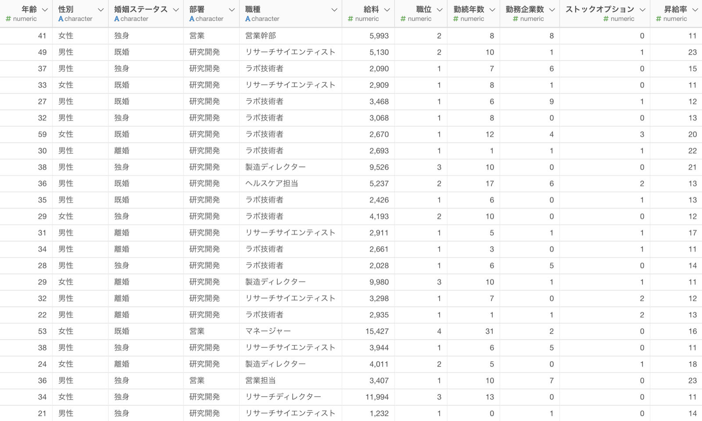

## 決定木を実行する

今回は、従業員の「給料」を予測する決定木のモデルを作成します。データは1,470行・26列で、年齢、性別、職位、職種、勤続年数などの列を説明変数に使います。

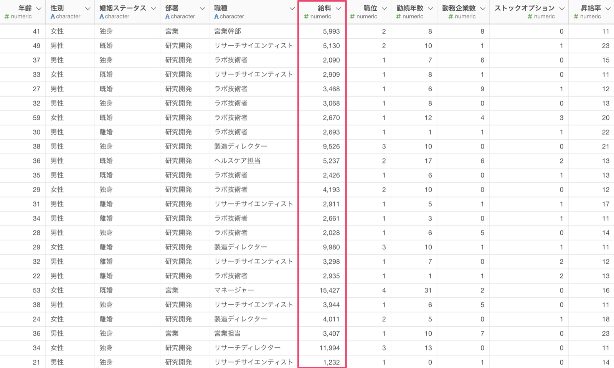

アナリティクスビューを開き、「タイプ」のメニューから「決定木」にマウスを合わせ、「CART / 分類 - 回帰」を選択します。同じメニューには「CHAID」もあります。

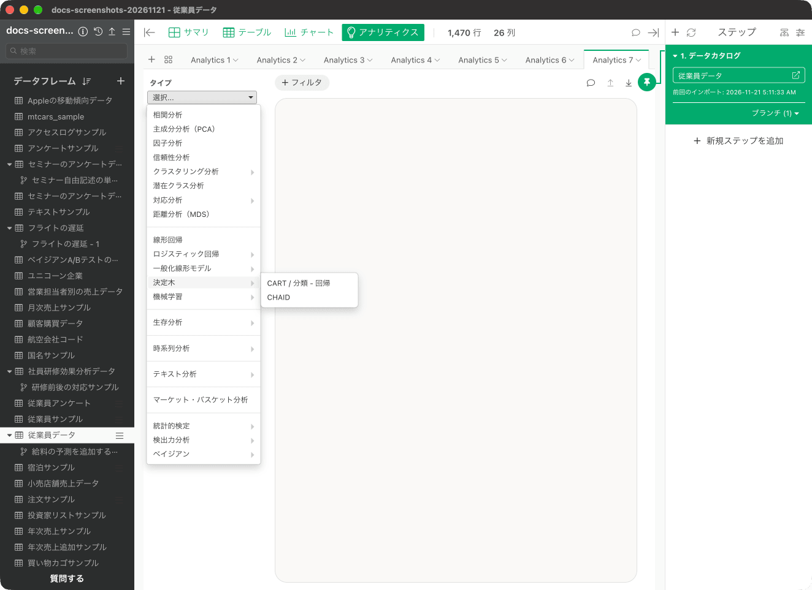

「目的変数」に「給料」を選択します。

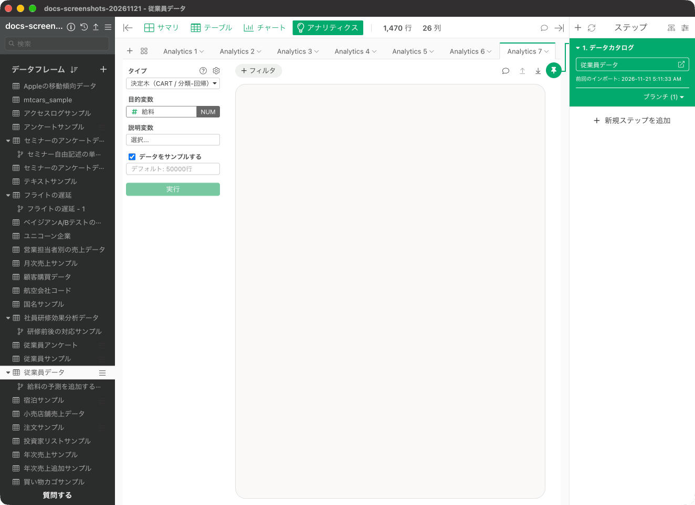

「説明変数」の入力欄をクリックすると「列の選択と設定」のダイアログが開きます。給料を予測する上で使用する列を選択します。シフトキーを押すことで、複数の列を一気に選択できます。今回は、給料・部署・入社日・退社日を除く22列を選びました。選び終えたら「OK」をクリックします。

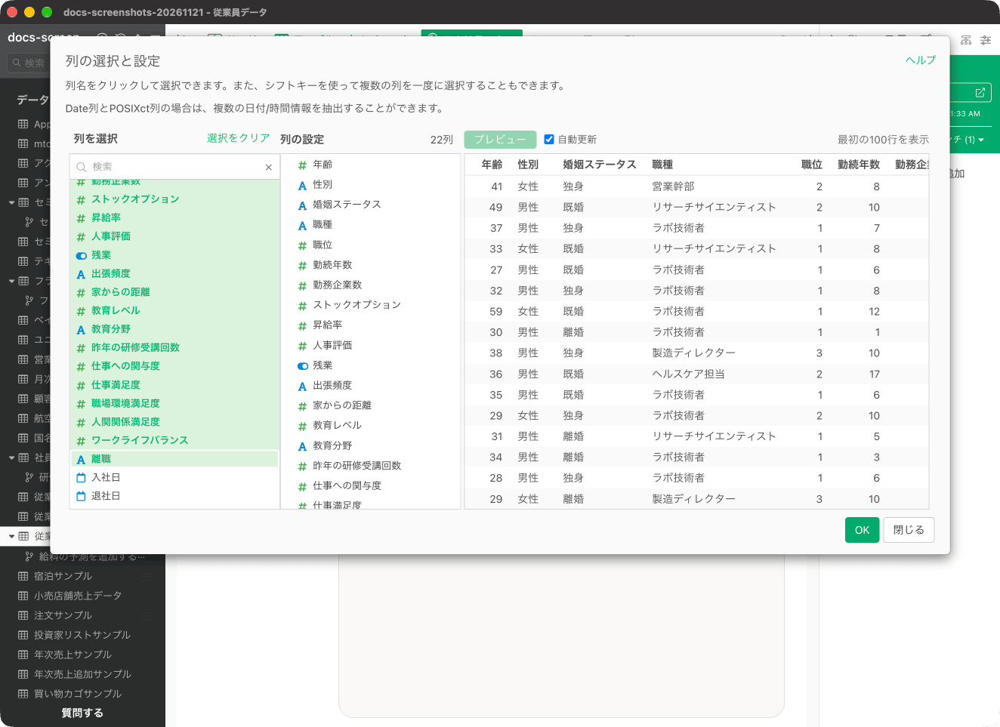

左のパネルの「データをサンプルする」は初期状態でオンになっていて、サンプリングする行数のデフォルトは50,000行です。目的変数と説明変数を割り当てることができたら、「実行」ボタンをクリックします。

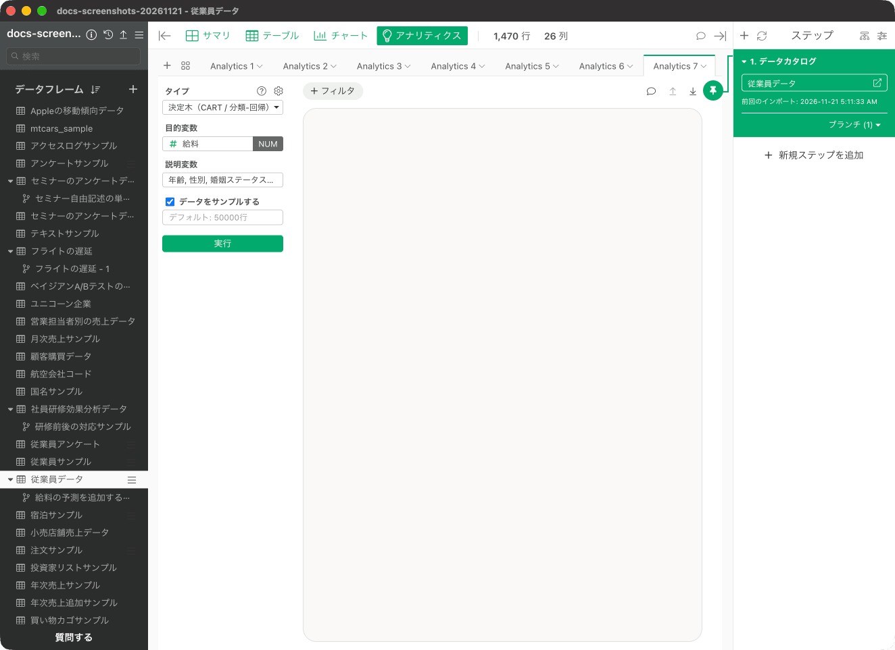

給料（数値）を予測する決定木のモデルが作成されました。結果は上のリンク（サマリ、決定木、予測に関係する変数、予測精度、予測結果、補足情報）の順に、ひとつながりのレポートとして表示されます。リンクをクリックすると、その節へ移動できます。

## 結果の解釈

### サマリ

「サマリ」の節では、選択した説明変数から数値型の目的変数「給料」を予測する決定木モデルを作成したことが説明されます。「データとモデルの基本情報」には、行数（1,470）、説明変数の数（22）、分岐に使われた変数の数（2）、分岐ノード数（5）、終端ノード数（6）などが表示されます。「目的変数の統計値」には、給料の平均値（6,502.93）、中央値（4,919.00）、標準偏差（4,707.96）が表示されます。

### 決定木

「決定木」の節では、目的変数を予測する際に作られた条件分岐を確認できます。上のノードから条件に従って枝を進み、最下部の終端ノードに到達すると、そのグループに対する予測値が決まります。

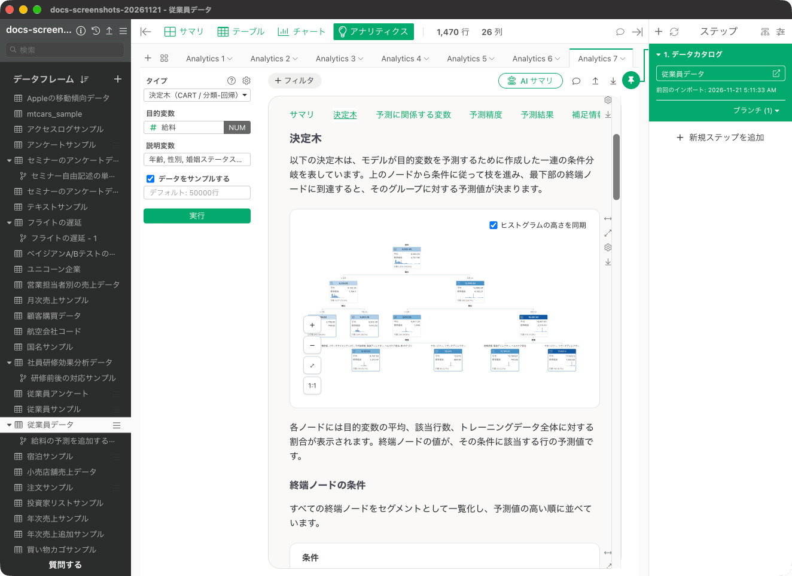

チャートを拡大表示すると、木全体を大きく確認できます。各ノードの上には、分岐に使われた変数（ここでは「職位」）と条件が表示されています。例えば、一つ目の条件は「職位」の「2.5」です。左の枝は「\< 2.5」（職位が2.5より小さい）、右の枝は「2.5 \<=」（職位が2.5以上）と読みます。「ヒストグラムの高さを同期」は初期状態でオンになっています。

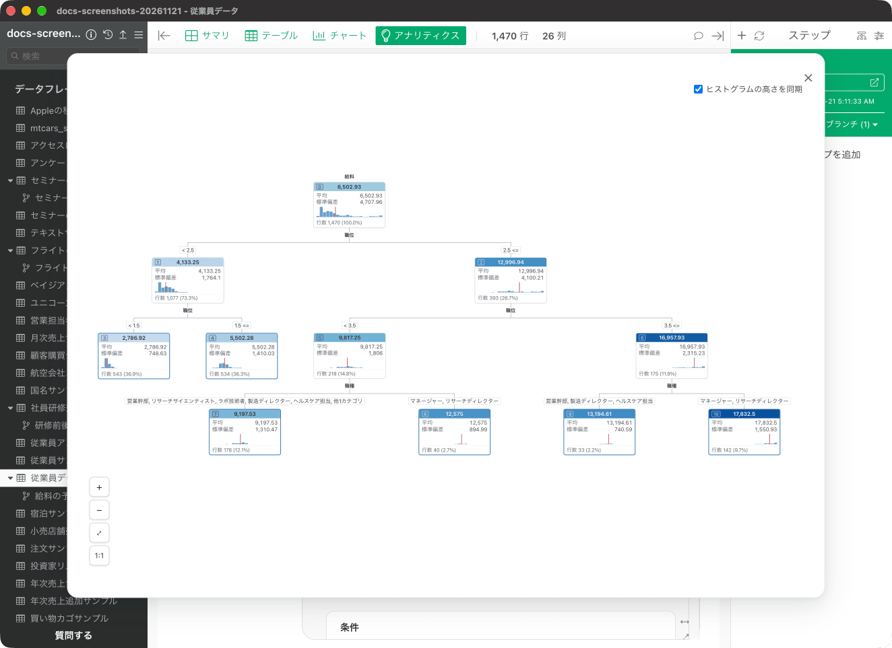

**数値の場合**

数値を目的とした場合、各ノードには、その条件に含まれるデータの目的変数の平均値、標準偏差、ヒストグラム、行数と全データに対する割合が表示されます。今回の例では、一番上のノードは給料の平均が6,502.93、標準偏差が4,707.96で、行数は1,470（100.0%）です。職位が2.5より小さいノードは平均が4,133.25で行数1,077（73.3%）、2.5以上のノードは平均が12,996.94で行数393（26.7%）です。

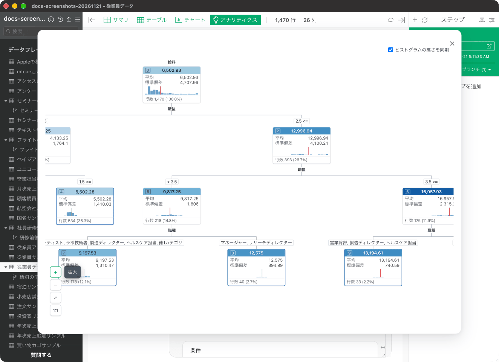

**ロジカルの場合**

ロジカルを目的とした場合は、その条件に含まれるデータの多数派（TRUEまたはFALSE）、TRUEとFALSEそれぞれの行数と割合、行数と全体に対する割合が表示されます。下の例は、目的変数に「残業」を指定した決定木です。

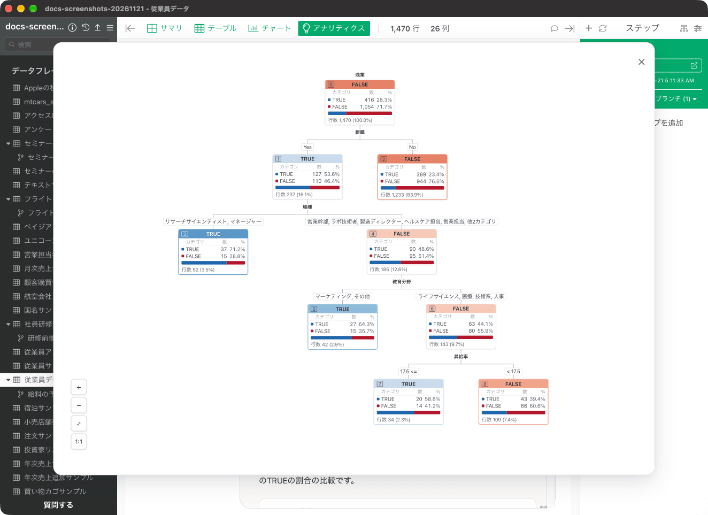

**カテゴリの場合**

カテゴリを目的とした場合は、その条件に含まれるデータの多数派（行数が最も多いカテゴリの値）、それぞれのカテゴリの行数と割合、行数と全体に対する割合が表示されます。下の例は、目的変数に「職種」を指定した決定木です。

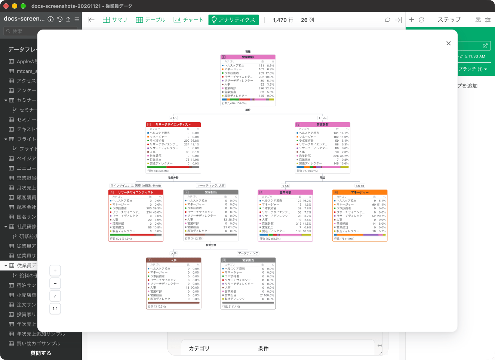

### 変数重要度

「予測に関係する変数」の節にある「変数重要度」では、どの変数が目的変数とより相関が強いのか、予測する時により重要なのかを調べることができます。今回の例では、「職位」が突出して大きく、次に「職種」が続いています。

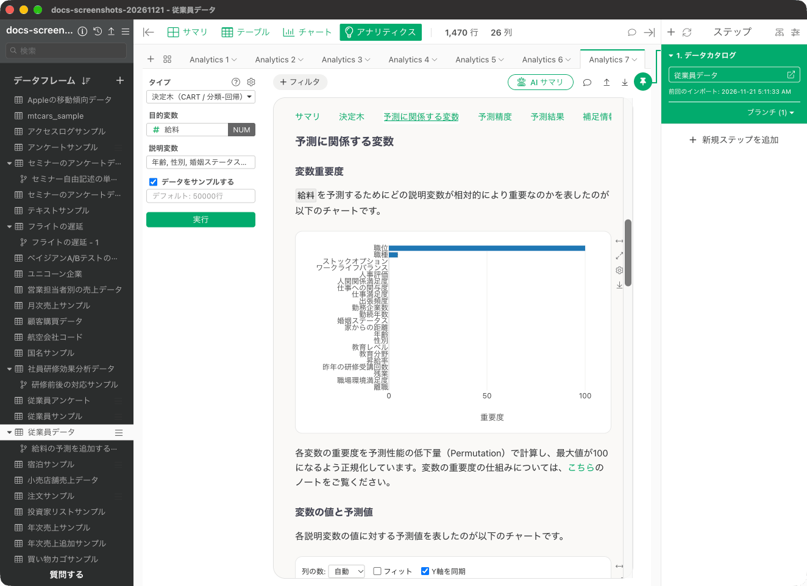

変数重要度の詳細については、[機械学習モデル - 変数重要度の仕組みと解釈](https://exploratory.io/note/kanaugust/56-Svv7VWV8tA)のノートをご覧ください。

### 変数の値と予測値

同じ「予測に関係する変数」の節にある「変数の値と予測値」では、それぞれの変数の値が変わると、目的変数の値はどのように変わるのかがわかります。

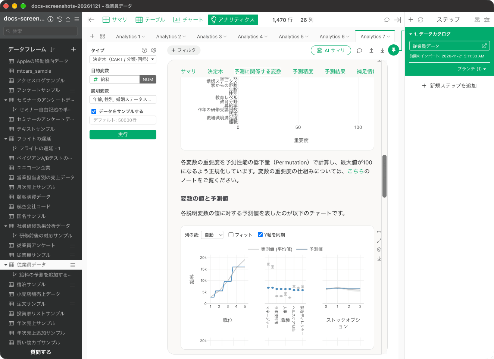

### 予測精度

「予測精度」の節の「モデルの評価指標」では、この予測モデルの評価を確認できます。R2乗はデータの平均からのばらつきをモデルが説明できている割合の指標で、0から1の間の値を取ります。1に近ければ近いほど、モデルがデータのばらつきをよく説明できていることを示します。今回の例では、R2乗は0.937、調整済みR2乗は0.936でした。

この指標はトレーニングデータに対する予測結果をもとに計算されています。未知のデータに対する予測精度を評価するには、「設定」から「テストモード」を有効にして、テストデータを使うことが推奨されています。

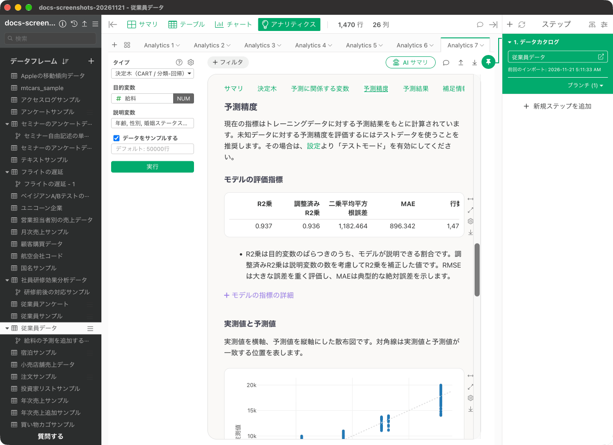

## 決定木に関するよくある質問

#### Q: 「変数の値と予測値」で表示されている実測値はどのように求められているのですか？
「変数の値と予測値」の実測値はそれぞれの説明変数のデータタイプによって表示が異なります。 詳しくは[こちら](https://exploratory.io/note/GMq1Qom5tS/csB2RRw5wl)のノートをご覧ください。

#### Q: 「変数の値と予測値」で表示されている予測値はどのように求められているのですか？

予測値のチャートはPartial Dependence Plot（PDP）と呼ばれるもので、注目している変数の値を変化させたときに、予測結果がどう変わるかを可視化したチャートとなります。詳しくは[こちら](https://exploratory.io/note/exploratory/Sbd0LDU6)のノートをご覧ください。

#### Q: 決定木の設定にある最小改善率は何を意味していますか？
「最小改善率」は、不純度の改善（減少）率のしきい値を設定するもので、デフォルトの0.01の場合、改善率が1%に満たない分岐は作られません。この設定は、チャート上部の歯車のアイコンから「設定」を開き、「モデルの複雑さ」の中にあります。

設定画面の説明のとおり、この値を小さくすると、より大きな木が作られます。改善率（減少率）が小さい分岐も組み込まれるため、作成される条件の数が増えるようになっています。

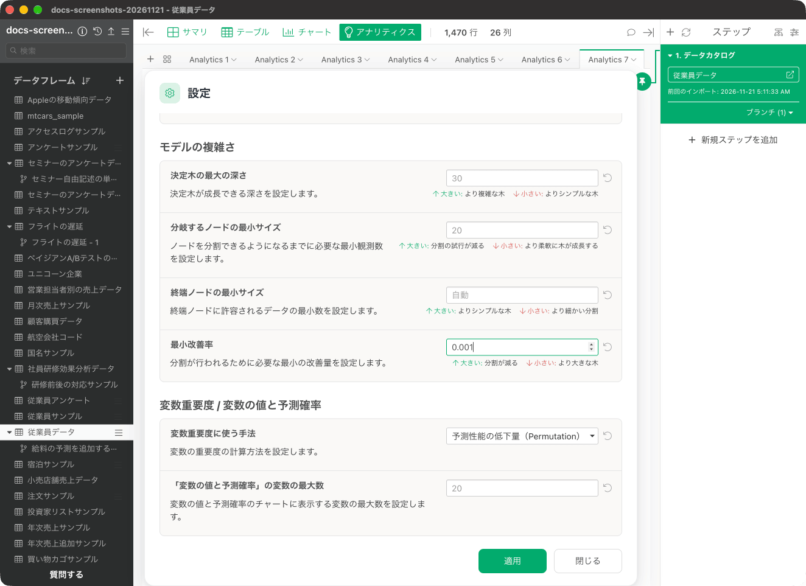

不純度については、[こちら](https://exploratory.io/note/kanaugust/80-Exploratory-HkQ5qoH8tk)のノートで紹介しております。
