因子分析は、多くの変数（質問項目）の背後にある、より少ない数の「潜在的な共通因子」を発見するアナリティクス手法です。たとえば、顧客満足度調査に10項目の評価があっても、実際には3〜4個の本質的な要因で説明できることがよくあります。

## 何ができるか

- 本質的な評価軸の発見：多数の評価項目から、顧客が本当に重視している要因を特定します。
- 変数間の関係性の理解：どの評価項目が同じ因子に属するかを把握します。
- データの次元削減：10個の変数を3〜4個の因子で要約して理解しやすくします。
- 各回答者の因子得点：個々の顧客がどの因子を重視しているかを数値化します。

## 必要なデータの形式

因子分析には、1行が1観測対象となっているデータが必要です。この例では数値型の列を使います。

そこで、今回はサンプルデータとして、「[ビールに求めるもの](https://exploratory.io/data/exploratory/SiP7GnG6)」に関するアンケートのデータを使用します。このデータは、1行が1人の回答者を表していて、列には値段やサイズに関する質問の回答スコアや、回答者の属性（年代、性別）があります。

なお、質問の回答スコアは100段階で、数値が大きくなるほど、重要度が高くなります。

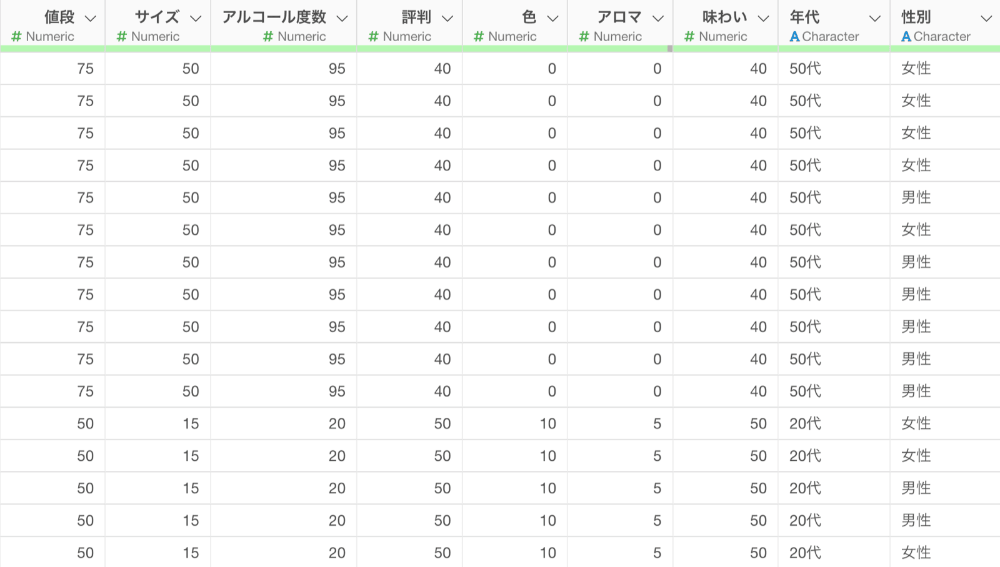

## 因子分析を実行する

アナリティクスビューを開き、「タイプ」のメニューから「因子分析」を選択します。

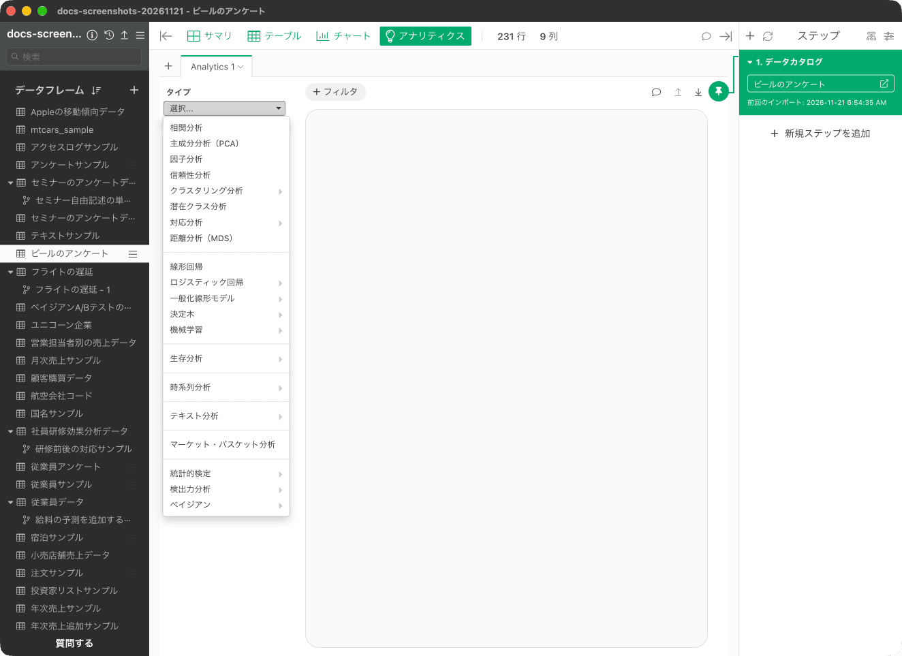

「変数」の入力欄をクリックすると「列の選択と設定」のダイアログが開きます。因子分析に使用する列を選択します。シフトキーを押すことで、複数の列を一気に選択できます。今回は数値型の7列（値段、サイズ、アルコール度数、評判、色、アロマ、味わい）を選び、「OK」をクリックします。

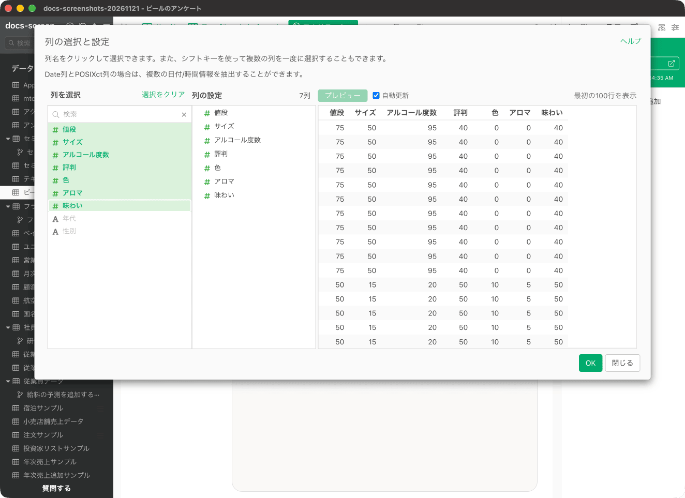

列の指定が完了したら「実行」をクリックすると、因子分析の結果が表示されます。結果は上のリンク（サマリ、因子数の検討、因子と変数の関係、各変数の説明度、各因子の寄与率、因子得点、モデルの適合度）の順に、ひとつながりのレポートとして表示されます。リンクをクリックすると、その節へ移動できます。

「サマリ」の節には、選択した7個の変数をもとに3個の潜在的な共通因子を特定し、これら3個の因子でデータ全体のばらつきの87%を説明できたことが表示されます。「分析条件とデータの確認」では、因子の数は3、相関係数はピアソン相関、因子抽出法は最小残差法、回転方法は Promax（斜交）、平行分析の方式は因子モデルと表示されます。このデータでは欠損値のある11行（4.8%）が除かれ、220行が分析に使われました。これらの条件は、「設定」から変更できます。

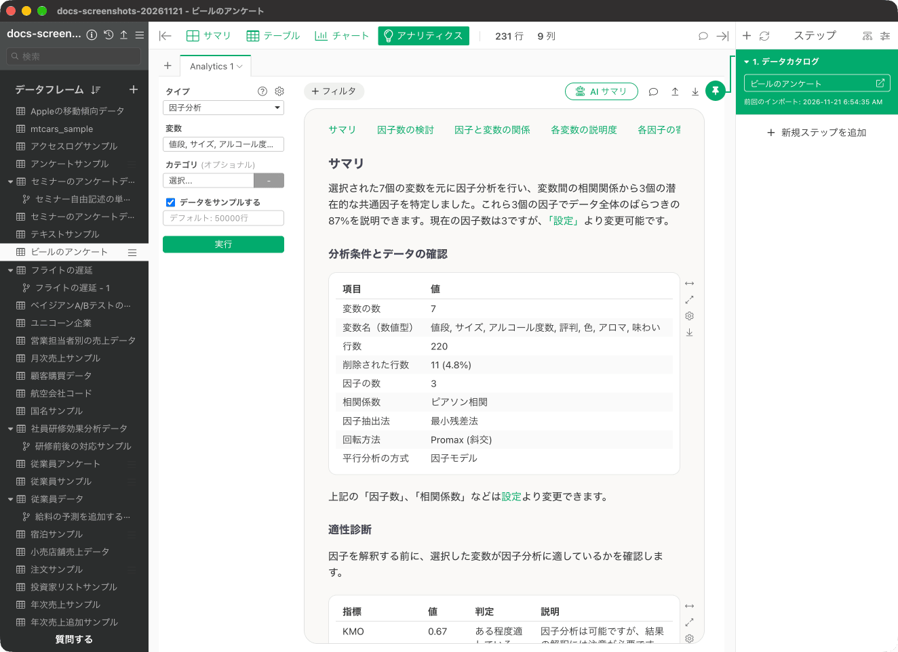

## 結果の解釈

### 因子と変数の関係

「因子と変数の関係」の節には、因子ごとの各変数の因子負荷量（因子が変数に与える影響の強さ）のテーブルが表示されます。セルの中のバーは因子負荷量の大きさを表し、赤は正の負荷量、青は負の負荷量です。因子負荷量は、符号と絶対値で読みます。0から離れるほど、各因子がそれぞれの変数に与える影響が強くなります。この表では、回転方法が Promax（斜交）のため、「色」の第1因子が1.04、「サイズ」の第2因子が1.06のように、1を少し超える値も表示されます。

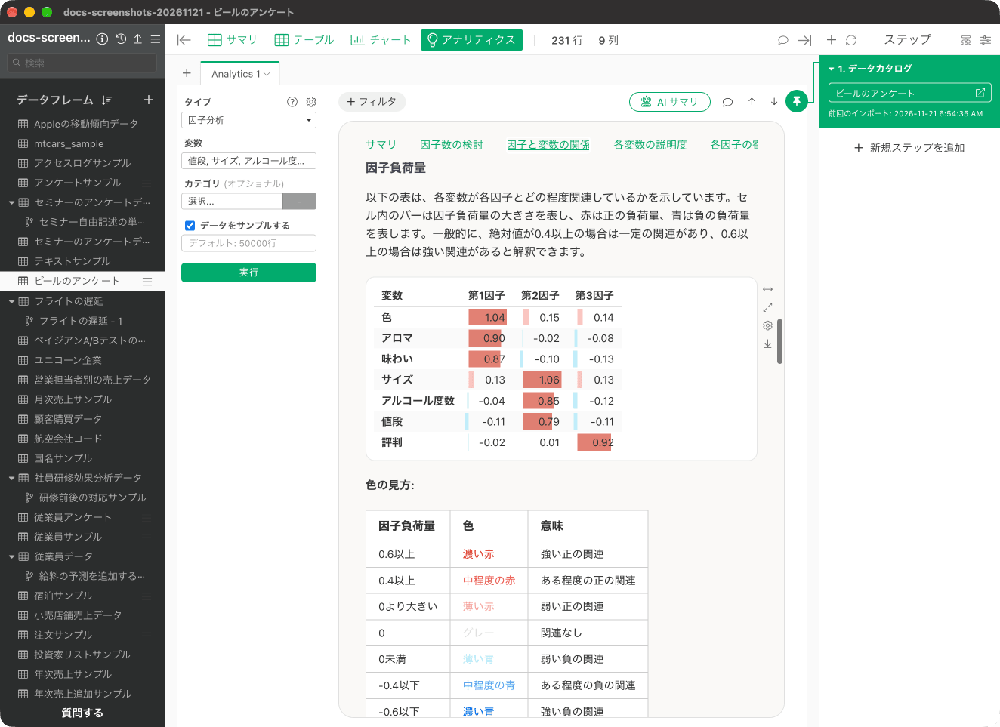

例えば、「色」「アロマ」「味わい」の因子負荷量の値が高いため、第1因子には「クオリティ」といった因子を見出せます。第2因子には、「サイズ」「アルコール度数」「値段」の因子負荷量が高いため、「コストパフォーマンス」といった因子が見出すことができます。

レーダーチャートによる因子負荷量の可視化でも同様の結果を確認できます。なお、レーダーチャートで表示される因子負荷量は、因子負荷量の絶対値です。

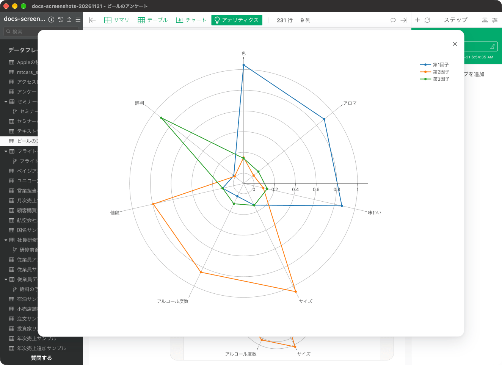

### 変数間の関係

「変数間の関係」の節では、バイプロットといったチャートで最初の2つの因子（第1因子、第2因子）によって、元の変数間の関係を可視化したチャートが表示されます。

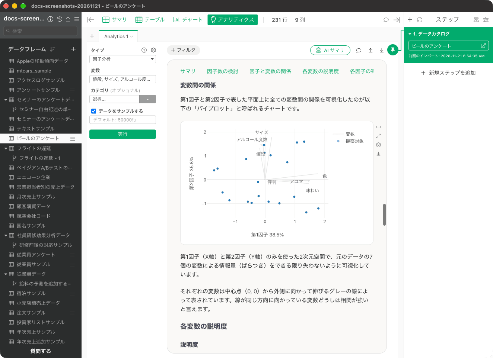

線はそれぞれの変数を、点はデータの1行（例: 一人の回答者）を表します。変数の線が同じ方向に向いている場合は、**相関の強い変数**であると考えることができます。

また、「カテゴリ」に列（ここでは「年代」）を割り当てて因子分析を実行すると、バイプロット上の点がカテゴリごとに色分けされ、凡例にカテゴリの値が表示されます。

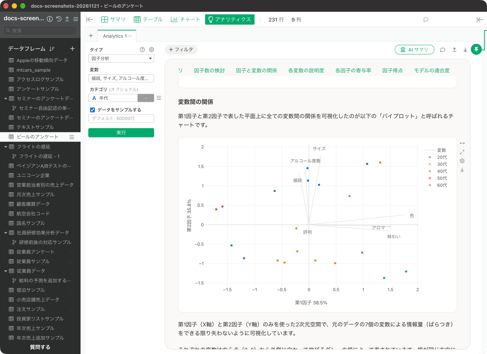

### 最適な因子数の探索

「因子数の検討」の節では、スクリープロットといった因子の数を増やしていったときの固有値を可視化しています。この例では、固有値が1を上回る因子数の目安（カイザー基準）や、実データの固有値とランダムデータの固有値を比較する平行分析のチャートも表示されます。

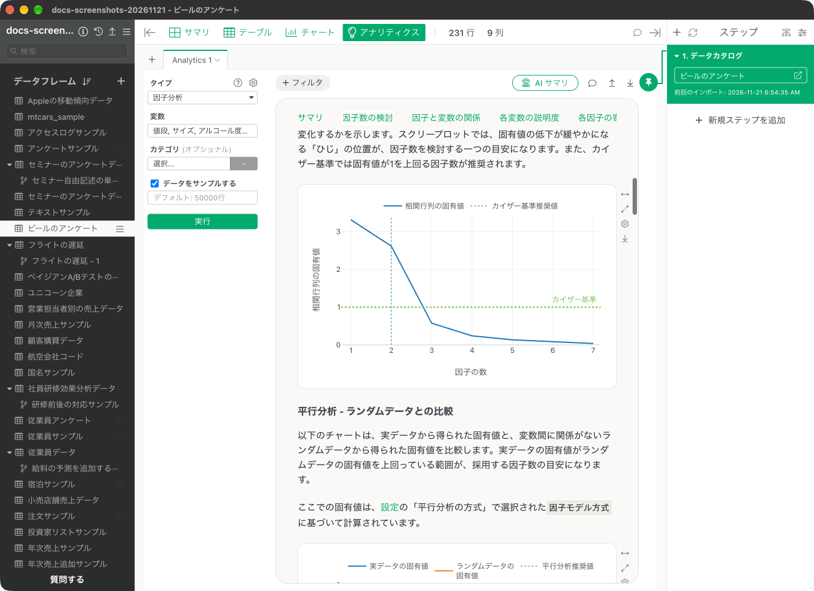

レポートの中にも、この最適な因子数を特定するための説明が記載されています。

なお、スクリープロットで探索した最適な因子の数を使って、因子の数を変更できます。歯車のアイコンから「設定」を開き、「因子構造」の「因子の数」に値を入力します。初期値は3です。

ここでは「2」を入力して「適用」をクリックしました。因子の数を指定すると、指定した因子数での実行結果が表示されます。「分析条件とデータの確認」の「因子の数」も2になります。ただし、レポート冒頭の説明は「3個」の因子のままでした。因子の数は「分析条件とデータの確認」で確かめてください。

確認したあとは、同じ手順で「因子の数」を3に戻して「適用」をクリックします。以降の「因子得点」は、3因子（Factor 1 ~ Factor 3）の結果です。

### 因子得点

「因子得点」の節では、元のデータとそれぞれの行（観察対象）に対する因子得点（Factor 1 ~ Factor 3）を確認できます。特定の因子得点が高い場合、その因子の影響が強くなっています。

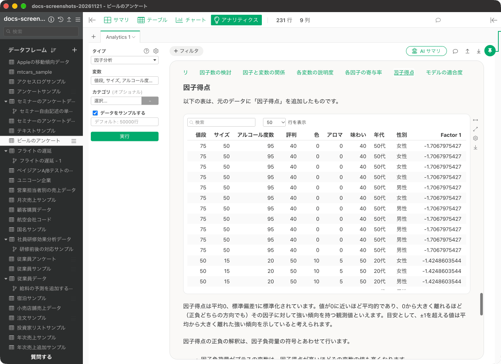

ここまで、「因子と変数の関係」をもとに因子負荷量のテーブルやレーダーチャートで各因子の特徴を把握していきましたが、以下のような課題があります。

- 因子の特徴を自分で判断しなければいけないために、見るのに時間がかかる。
- レポートの中で詳しく説明されているものの、初心者には解釈が難しい場合がある。

そこで、次に紹介する「AI サマリ」の機能を使うことで、この問題を解決できます！

## AI サマリを使って分析結果を要約

**AI サマリ**の機能では、複雑な因子分析の結果を自動的に要約してくれます。

因子分析を実行した後に、上部の「AI サマリ」のボタンをクリックします。

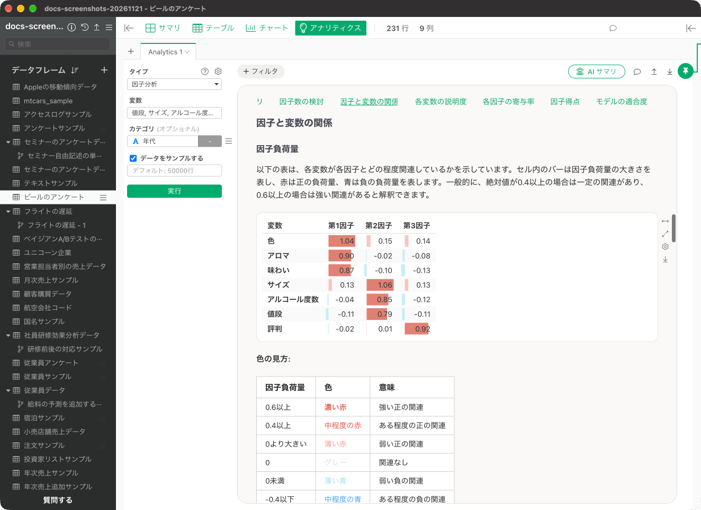

ダイアログで「ビジネス」（観点）と「日本語」（言語）を選んで「実行」をクリックすると、各因子の特徴を要約した結果が出力されます。

このAIサマリを見るだけで、因子負荷量のテーブルなどでそれぞれの因子の特徴を「自分」で解釈しなくても、どういった特徴があるのかをAIが判断して教えてくれます。

## 因子分析に関するよくある質問

因子分析について、よくある質問とその答えをこちらにまとめました。

#### Q: 因子分析を実行する時に、裏でデータは標準化はされていますか？
因子分析は常に内部で標準化を行っており、Exploratoryで使用している因子分析のパッケージでも標準化が実行されています。

#### Q: 「因子とカテゴリの関係」の節では、どういった値が可視化されているのでしょうか？
「カテゴリ」に列を割り当てることで、「因子とカテゴリの関係」の節が表示されるようになります。

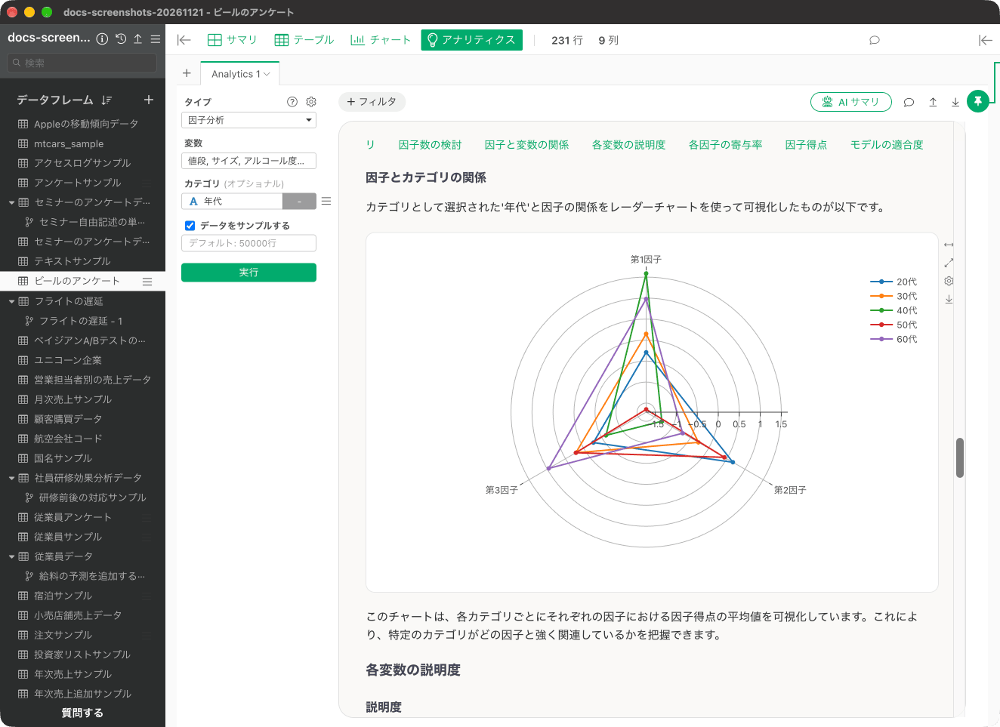

この節では、レーダーチャートで、カテゴリごとに因子スコア（因子得点）の平均値が表示されるようになっています。

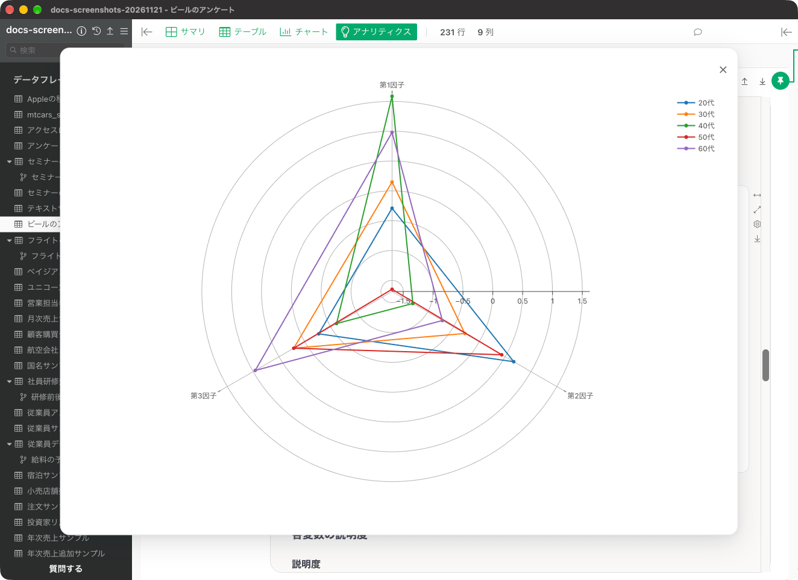

#### Q: データのセクションにある「Factor 1 ~ Factor 3」の列はどのように解釈しますか？
因子分析の「因子得点」の節にある「Factor 1 ~ Factor 3」はそれぞれのデータに対する因子得点の値となっています。

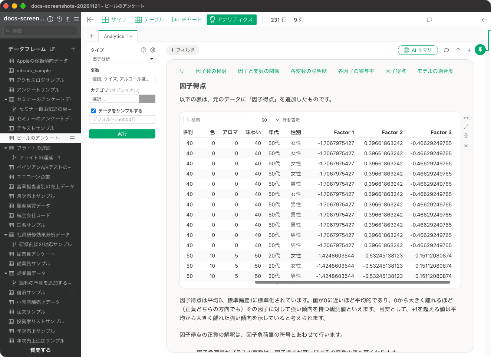

因子得点は平均0、標準偏差1に標準化されています。値が0に近いほど平均的であり、0から大きく離れるほど（正負どちらの方向でも）その因子に対して強い傾向を持つ観測値といえます。目安として、±1を超える値は平均から大きく離れた強い傾向を示していると考えられます。

また、因子得点の正負の解釈は、因子負荷量の符号によって変わります。

- 因子負荷量がプラスの変数は、因子得点が高いほどその変数の値も高くなり、因子得点が低いほどその変数の値も低くなります。

- 一方、因子負荷量がマイナスの変数は、因子得点が高いほどその変数の値は低くなり、因子得点が低いほどその変数の値は高くなります。

例えば、今回の「因子と変数の関係」の表では、第1因子の「色」「アロマ」「味わい」の因子負荷量はプラスです。そのため、Factor 1の因子得点が高い行ほど、これらの変数の値が高くなる傾向があります。第3因子では「評判」の因子負荷量が0.92とプラスなので、Factor 3の因子得点が高い行ほど「評判」の値も高くなる傾向があります。

#### Q: 因子分析で観察対象（行）ごとの因子得点のデータをダウンロードしたい
観察対象（行）ごとの因子得点についてですが、以下のように「因子得点」の節のテーブル右側のダウンロードのアイコン（「チャートのエクスポート」）のメニューからデータをエクスポートしていただくことで、因子得点を含めたデータをダウンロードすることが可能となっています。

メニューには、CSV、Excel、JSON、RDS、RData、Parquet、クリップボード、Google Sheets、新規データフレームといった保存先が表示されます。

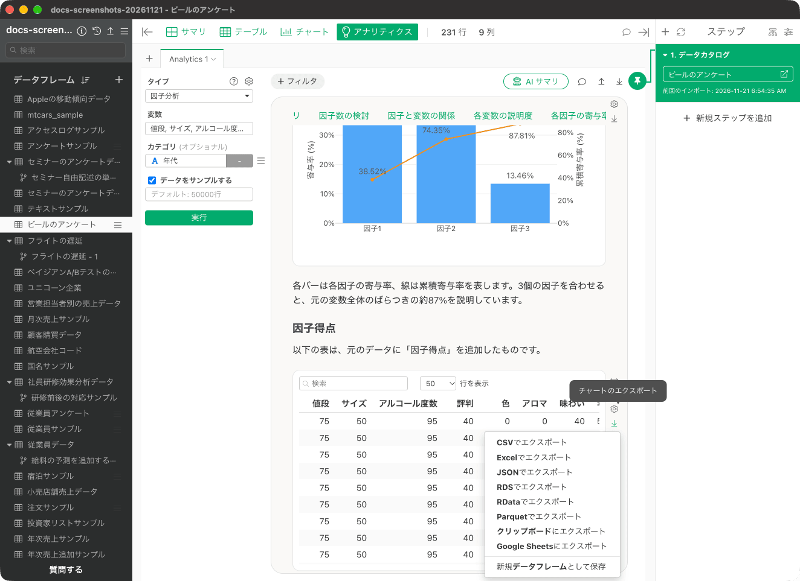

#### Q: 因子分析を実行した際にデータの全行での結果ではなく一部の行しか使われていない
因子分析で使用している変数に欠損値が大量に含まれていた可能性があります。欠損値がある行は因子分析の計算から除外されるため、結果として全ての行を使って実行されなかったと考えられます。

そのため、因子分析で使用する変数を見直すか、欠損値を補完する必要があります。

欠損値を補完する方法については、[こちら](https://exploratory.io/note/exploratory/uxk4CLk0)のノートをご覧下さい。
