K-Means クラスタリングは、データの中にある共通な部分を持つグループに、データを分類する手法です。アナリティクス・ビューで、変数の列を選んで実行します。

## 何ができるか

たとえば、顧客一人当たりの年齢と購買額の関係をプロットした散布図があったとします。

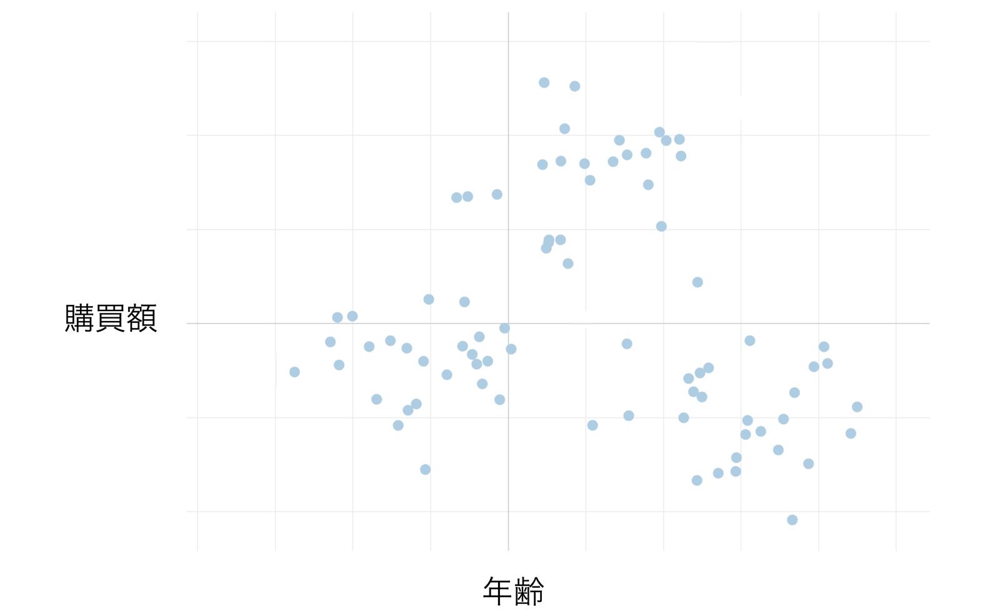

K-Means クラスタリングを使うと、年齢と購買額の値をもとにグループ分けできます。

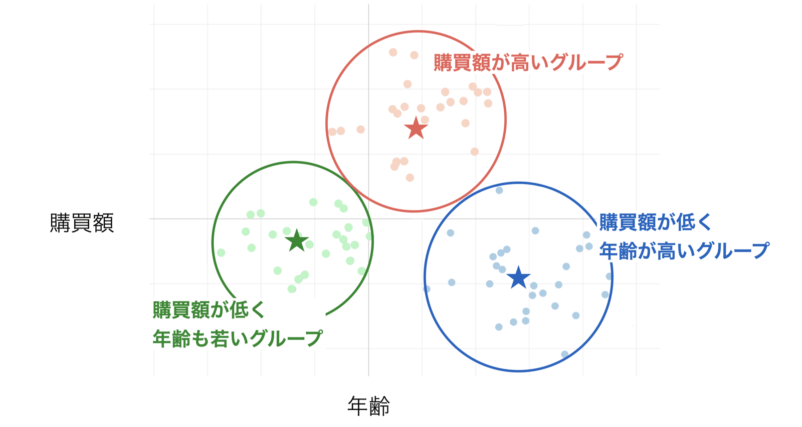

## 必要なデータの形式

K-Meansクラスタリングを実行する際には、1行が1観測対象となっているデータを使う必要があります。

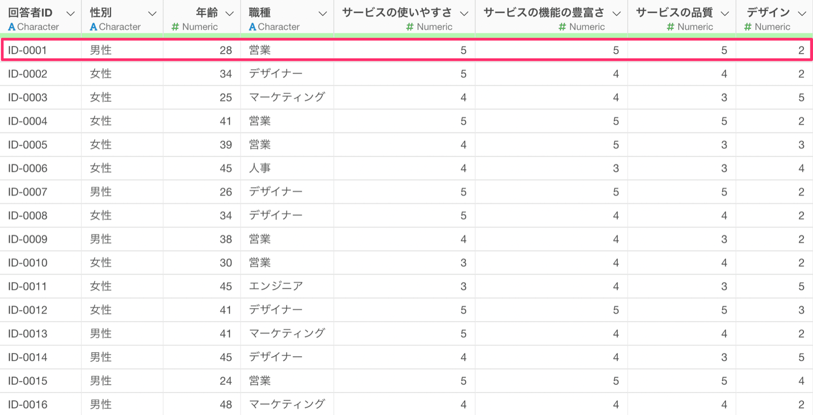

また、クラスタリングする元となる変数のデータ型は数値型になります。

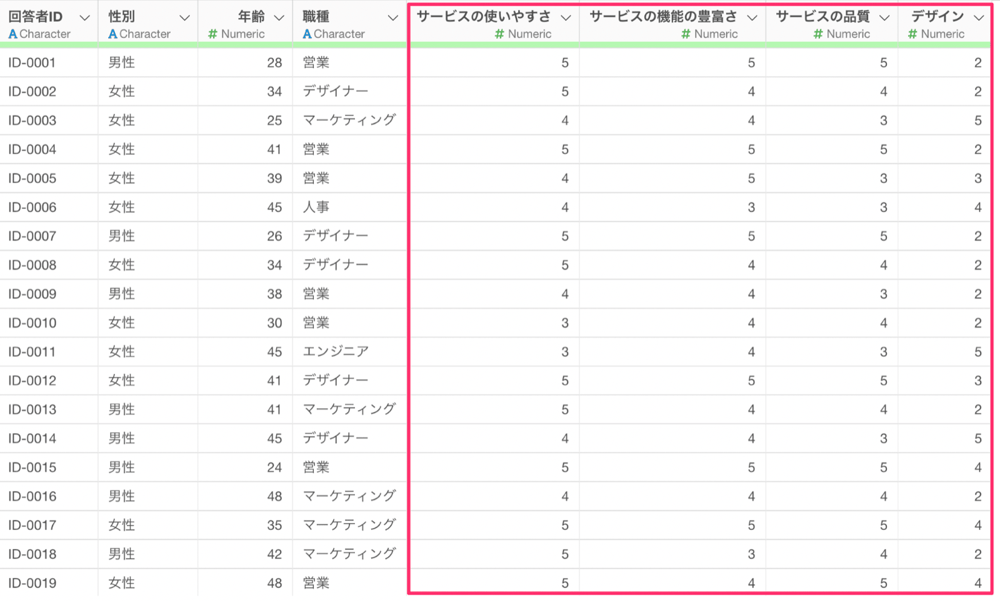

上の2つの図の列（回答者ID、性別、年齢、職種など）は、データの形式を示すための一般的な例です。今回使うデータには含まれません。

## サンプルデータ

今回使用するのは、サンプルデータ「Web会議サービスの満足度サンプル」です。この例のデータは説明用に作った架空のものです。1行が1回答者を表し、160行・11列です。列には、サービスの使いやすさ、サービスの機能の豊富さ、サービスの品質、デザイン、導入の簡単さ、アフターフォローの充実度、サポートの品質、サポートの応対速度、ブランドのイメージ、価格の10項目の評価（1から5の数値）と、「NPSカテゴリ」（デトラクター・中立者・プロモーター）があります。

## K-Meansクラスタリングを実行する

アナリティクスビューを開き、「タイプ」のメニューで「クラスタリング分析」にマウスを合わせ、「K-Means（数値）」を選択します。同じメニューには、K-Modes（カテゴリ）、K-Medoids（順序 / 数値）、階層クラスタリングもあります。

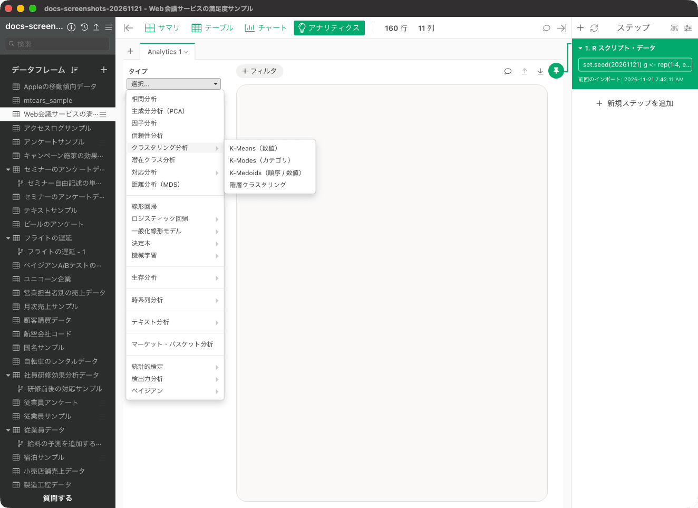

「変数」の入力欄をクリックすると「列の選択と設定」のダイアログが開きます。K-Meansに使用する列を選択します。シフトキーを押すことで、複数の列を一気に選択できます。今回は10項目の評価の列を選び、「OK」をクリックします。

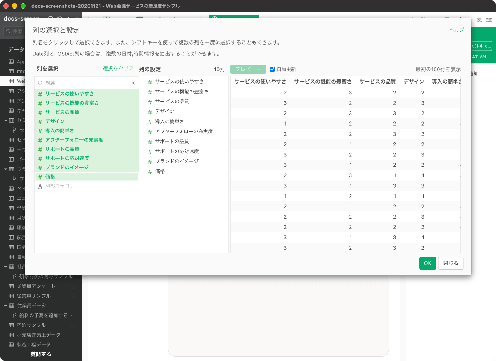

列の指定をした後に「実行」をクリックすると、K-Meansクラスタリングの結果が表示されます。結果は上のリンク（サマリ、クラスター数の選択、変数重要度、クラスターの特徴、出力データ）の順に、ひとつながりのレポートとして表示されます。リンクをクリックすると、その節へ移動できます。

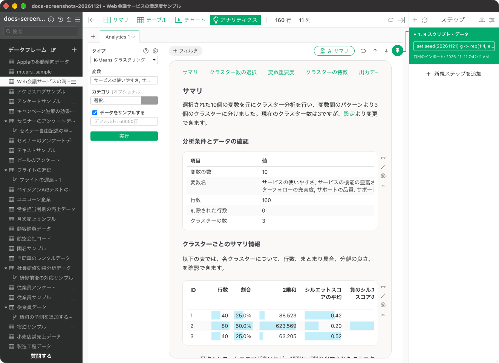

クラスターの数はデフォルトでは3となっています。「サマリ」の節には、選択した10個の変数をもとにクラスター分析を行い、3個のクラスターに分けたことが表示されます。「クラスターごとのサマリ情報」には、各クラスターの行数、割合、2乗和、シルエットスコアの平均が表示されます。

### クラスターの数を変更する

クラスターの数は、歯車のアイコンから「設定」を開き、「K-Means クラスタリング」の「クラスターの数」で変更できます。デフォルトは3で、今回はクラスターの数を「4」、「試行回数」を「25」に変更して「適用」をクリックします。同じ画面には、最大反復回数（デフォルト10）、試行回数（デフォルト1）、アルゴリズム（デフォルトは Hartigan-Wong）、ランダム・シード（デフォルト1）、最適なクラスターの数を探索する手法（デフォルトはシルエット法）があります。

クラスター数を4に変更してK-Means クラスタリングを実行できました。「サマリ」の節にも「現在のクラスター数は4」と表示されます。各クラスターは40行（25.0%）です。

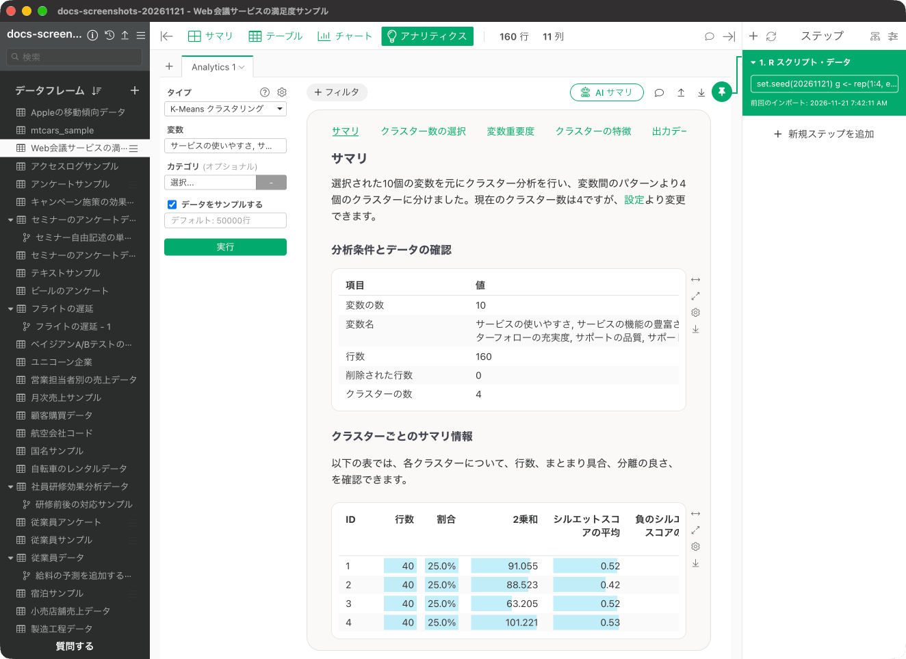

## 結果の解釈

### 変数の平均値（レーダー）

「クラスターの特徴」の節にある「変数の平均値」では、クラスター分析に使用した変数の平均値（標準化後）を、クラスターごとのレーダーチャートで確認できます。値は標準化されていて、0は全体の平均を表し、正の値は平均より高く、負の値は平均より低いことを示します。

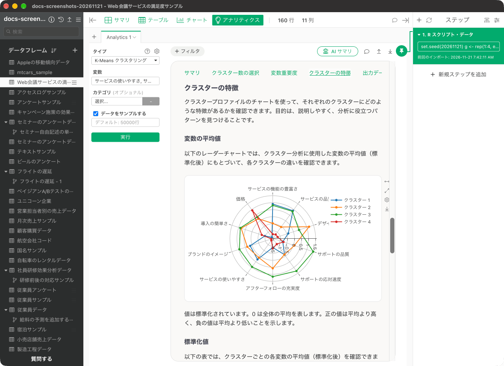

このチャートで、クラスター3（緑）は多くの項目で外側に位置し、全体的に評価が高いことが分かります。

一方、「サマリ」の節にある「クラスターごとの平均値」（標準化後）の表を見ると、クラスター1は「サービスの機能の豊富さ」や「サービスの品質」が高く、「導入の簡単さ」や「アフターフォローの充実度」、「サポートの品質」は低くなっています。クラスター2は「デザイン」と「導入の簡単さ」が高く、「サービスの機能の豊富さ」や「サービスの品質」は低くなっています。

### クラスターマップ（バイプロット）

同じ「クラスターの特徴」の節にある「クラスターマップ」では、それぞれのクラスター（グループ）ごとにどういった特徴があるのかを散布図上で確認できます。クラスターは色分けされ、凡例に表示されます。

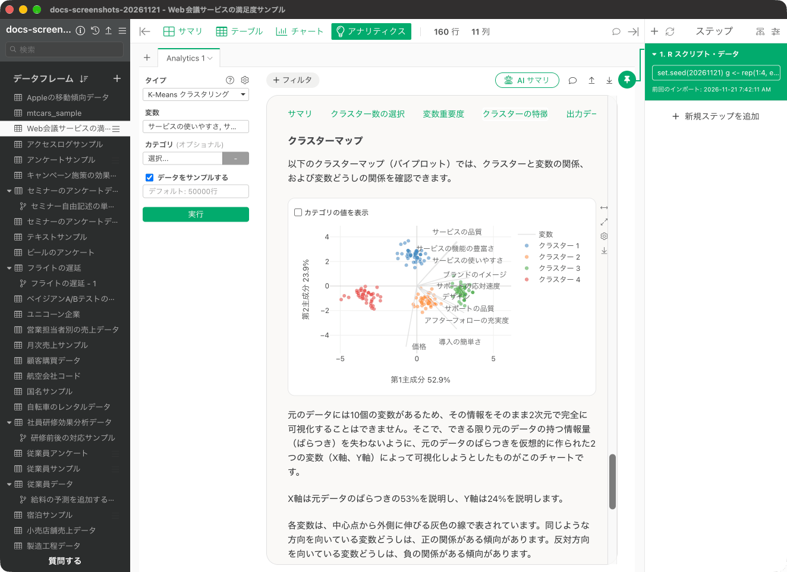

なお、この散布図で表示されている情報は、Exploratoryのアナリティクスのタイプの1つとしてサポートをしている「主成分分析」の結果となり、主成分分析の詳細は[こちら](https://exploratory.io/note/exploratory/MXN0qZU8)から確認いただけます。

散布図の点は回答者の主成分得点で、線は元の各変数がこの2つの主成分とどう関係するかを示します。軸線が伸びている方向にある点は、その変数の値が高い回答者の目安で、反対側にある点は低い回答者の目安です。

下の画像は、「カテゴリ」に「NPSカテゴリ」を指定して再実行した例で、散布図を拡大し、クラスター3の点にポインタを合わせたところです。カテゴリの指定方法は、後の「クラスターとカテゴリの関係性を見る」の節をご覧ください。「NPSカテゴリ: 中立者」「色: クラスター 3」「第1主成分: 2.7」「第2主成分: -0.28」と表示されています。

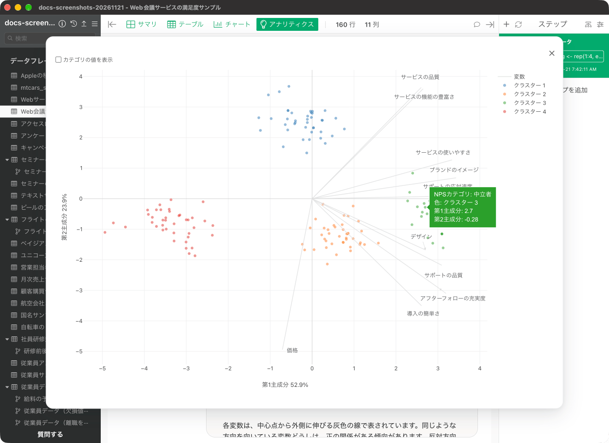

また、変数の線が近い向きに伸びている場合は、それらの変数に正の相関がある目安になります。下の画像では、軸線の先端にポインタを合わせると、その位置の座標（2.601883, 3.638535）が表示されています。上端にある「サービスの品質」と「サービスの機能の豊富さ」は、ほぼ同じ向きに伸びています。

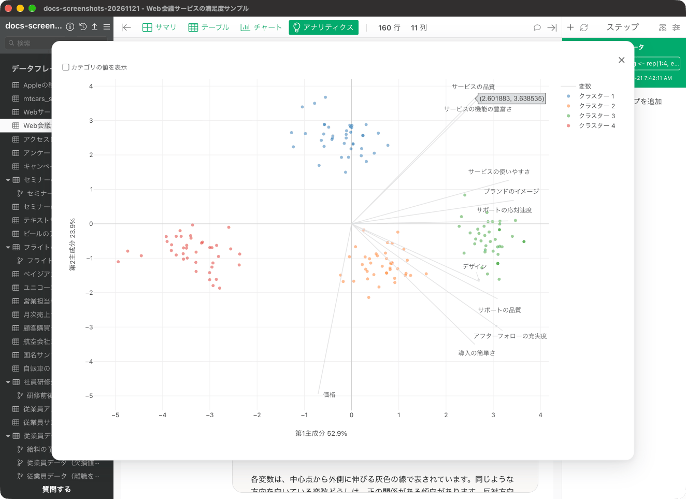

## AI サマリを使って分析結果を要約

**AI サマリ**の機能では、クラスタリング結果を自動的に要約してくれます。

使い方は驚くほど簡単で、K-Meansクラスタリングを実行した後に、上部の「AI サマリ」のボタンをクリックします。

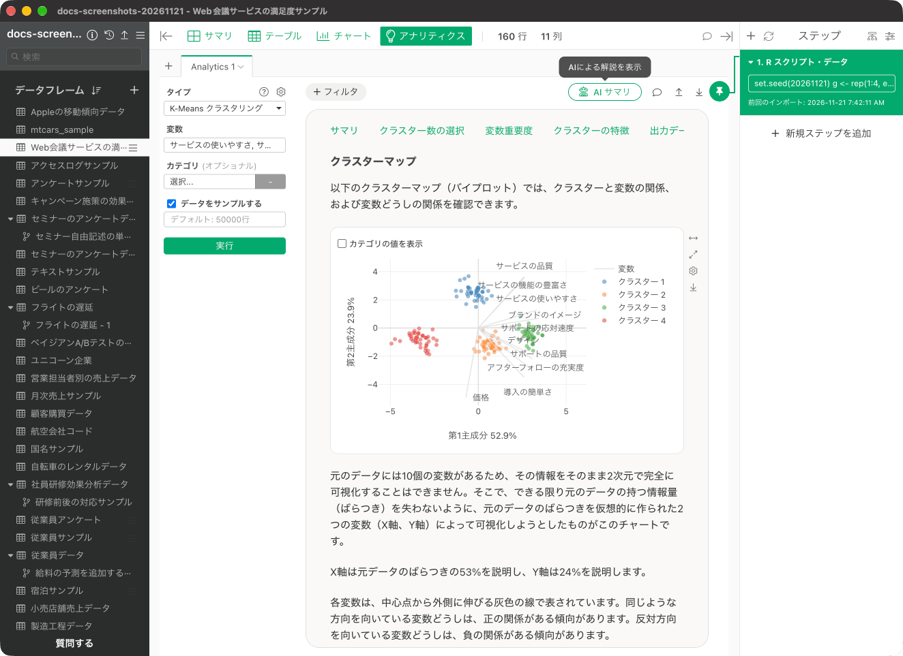

ダイアログで「ビジネス」（観点）と「日本語」（言語）を選んで「実行」をクリックすると、各クラスター（グループ）の特徴をまとめた情報が出力されます。

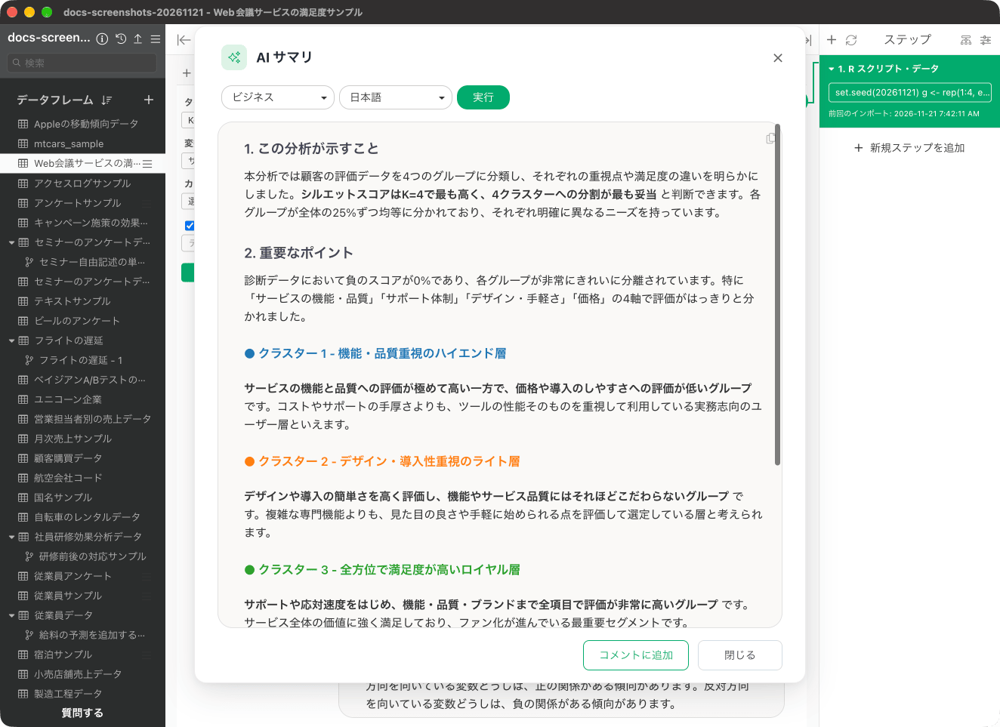

今回のクラスタリングでは、たとえば次のように、クラスターごとに名前と特徴を要約してくれています。

**各クラスターの特徴**

- クラスター1: **機能・品質重視のハイエンド層**
- クラスター2: **デザイン・導入性重視のライト層**
- クラスター3: **全方位で満足度が高いロイヤル層**

ほかのクラスターについても、同じ形式で名前と特徴が出力されます。AIによる要約のため、実行するたびに文面は変わることがあります。

このAIサマリを見るだけで、それぞれの分けられたグループにはどういった特徴を持っているのかをAIが判断して教えてくれるために、誰でも簡単にK-Means クラスタリングを使えるようになります。

## クラスターとカテゴリの関係性を見る

データの中に「NPSカテゴリ」の列があり、どのクラスターでプロモーター（推奨者）やデトラクター（非推奨者）が多いのかを知りたいとします。

K-Meansクラスタリングの「カテゴリ」に「NPSカテゴリ」の列を割り当てて実行します。

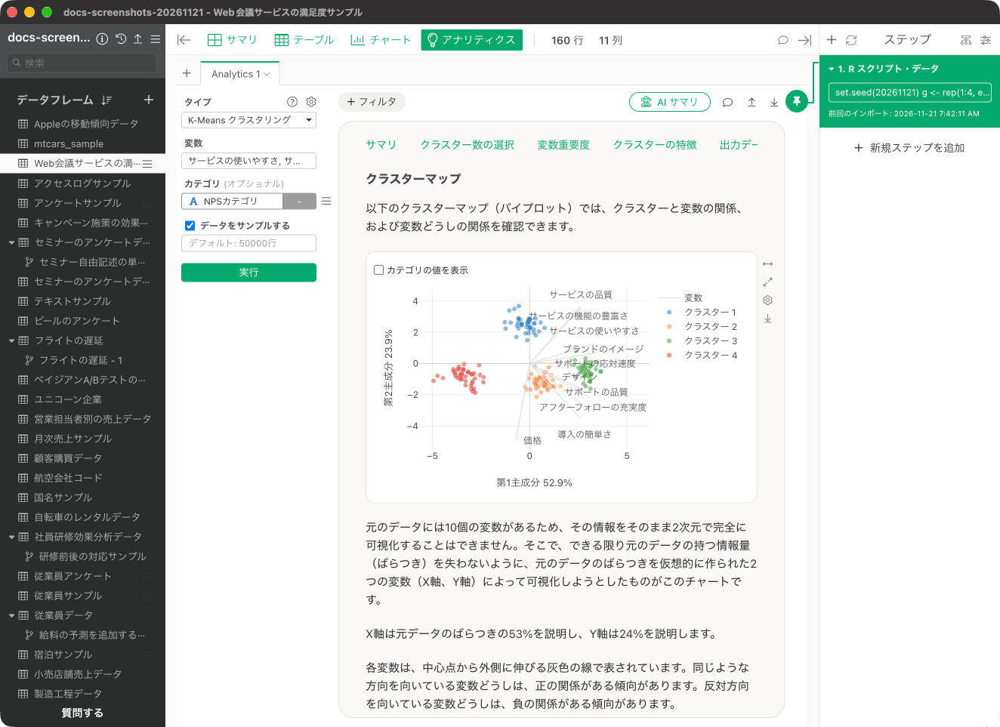

カテゴリ列を割り当てることで、「カテゴリ変数との関係」の節が追加され、各クラスターで割り当てたカテゴリの比率を確認できます。

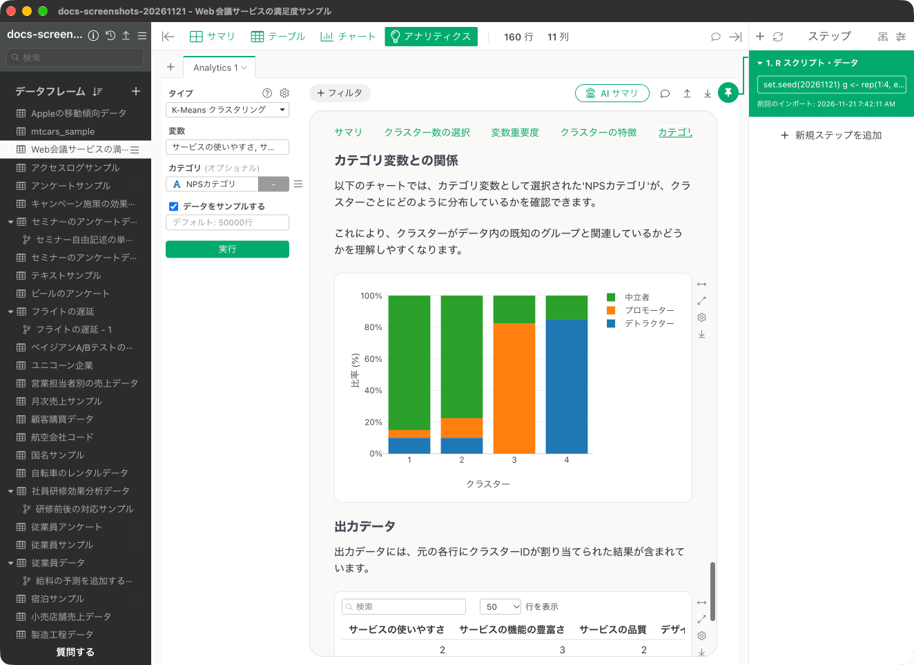

クラスター4では、デトラクターが34行（85.0%）を占めていることが確認できます。

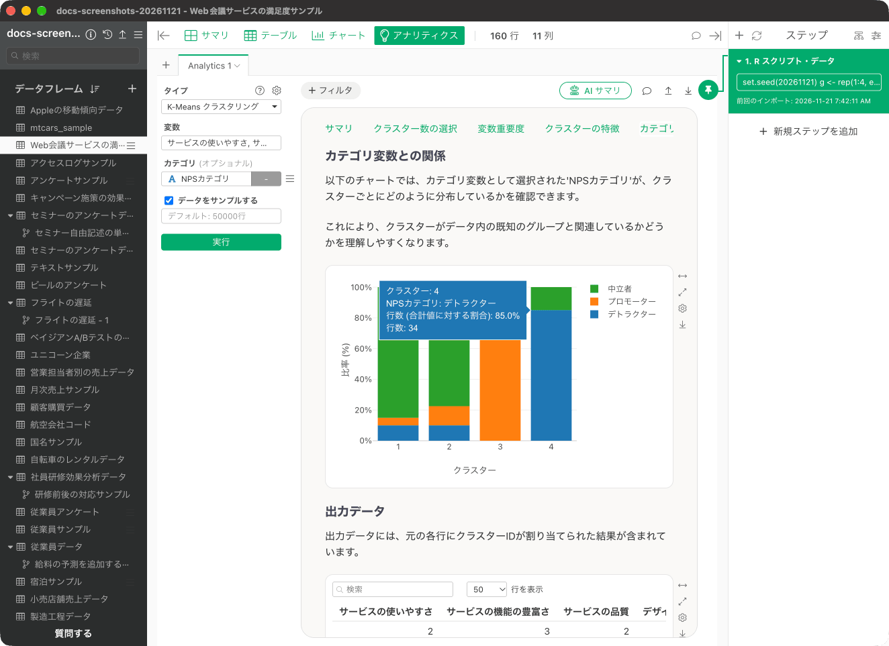

クラスター3では、プロモーターが33行（82.5%）を占めていることが確認できます。

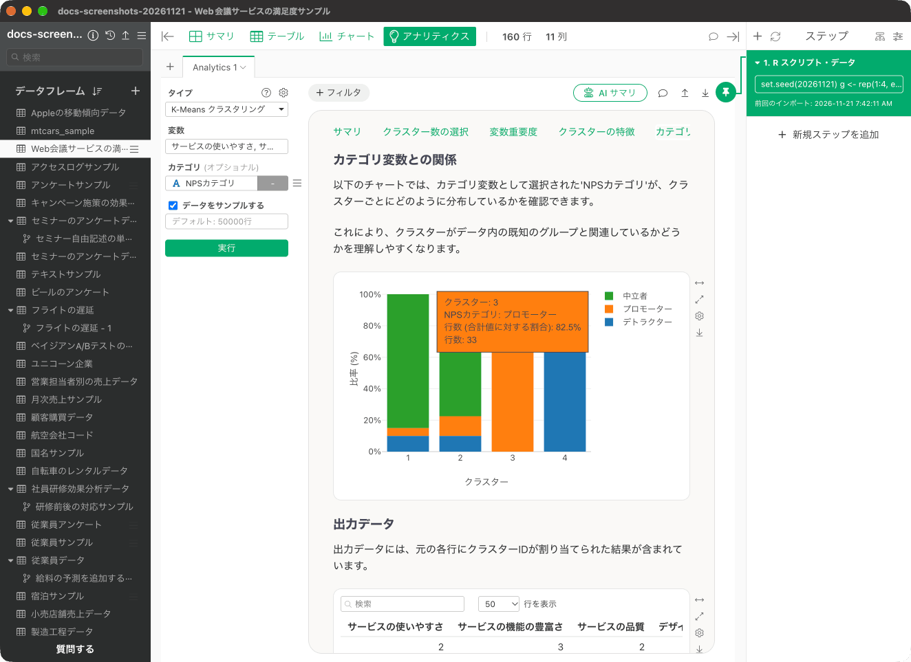

## クラスタリングしたデータをエクスポートする

「出力データ」の節にあるテーブルでは、K-Meansクラスタリングに使用されているデータとクラスター番号（`cluster` 列）を確認できます。

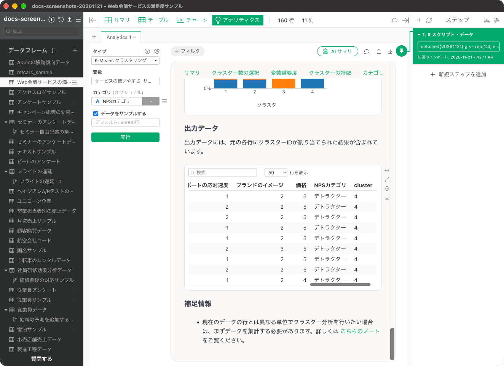

このデータをデータフレームとして保存したい場合は、テーブル右側のダウンロードのアイコン（「チャートのエクスポート」）から「新規データフレームとして保存」を実行します。同じメニューには、CSV、Excel、JSON、RDS、RData、Parquet、クリップボード、Google Sheets への保存先もあります。

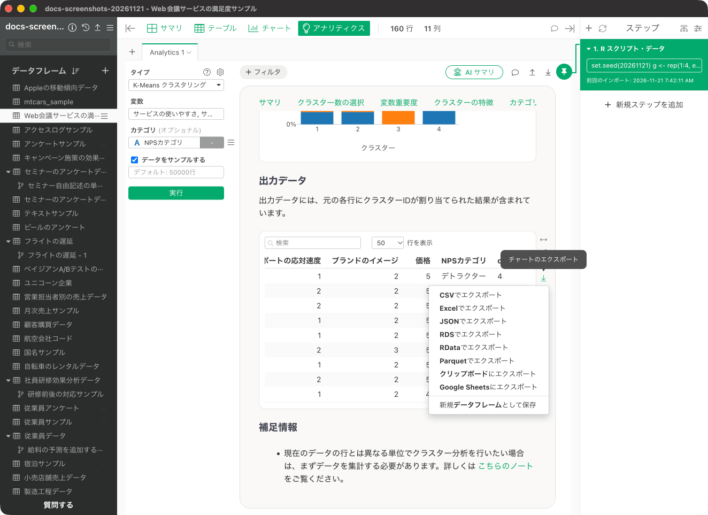

## K-Meansクラスタリングに関するよくある質問

#### Q: K-Meansクラスタリングを実行すると「クラスターの数は一意なデータの数より少なくする必要があります。」というエラーが表示される。

K-Meansクラスタリングを実行したときに、「クラスターの数は一意なデータの数より少なくする必要があります。クラスター数を減らすか、一意なデータの数を増やしてから再実行してください。」というエラーが表示され、K-Meansクラスタリングの結果が返らないことがあります。下の例は、160行のデータにクラスター数161を指定して実行したものです。

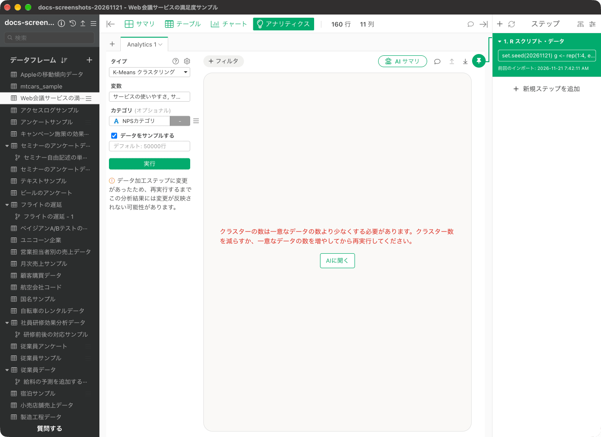

このエラーは、クラスタリングに利用している各行の列の値の組み合わせの数が、設定しているクラスター数（デフォルトは3）より少ない場合に生じます。

そのため、クラスターの数を、前述した値の組み合わせの数より少なくなるように、減らすことで、エラーを回避することが可能です。

#### Q: K-Meansクラスタリングにおけるランダム・シードとはどのような設定ですか？

K-Meansクラスタリングは、クラスタリングを始めるときに、ランダムにクスラターの中心を決めるところから処理を始め、観察対象をクラスターに分けていきます。

ランダム・シードはそのときの初期中心の位置を決めるための「番号」のようなものです。「設定」の「K-Means クラスタリング」にあり、デフォルトは1です。

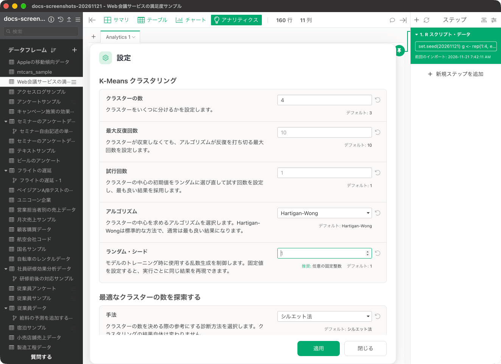

Exploratoryでは、デフォルトで同じシードを利用しているため、データとデータの順番が同じ場合、毎回同じ結果を得られことに役立っています。

ただし、MacとWindows間では文字エンコードの違いにより、シードが同じ場合でも、割り当てられる、クラスター番号が異なるなど、わずかな差異が生じることもあります。

#### Q: K-Meansクラスタリングを実行した際、データの並び順によって結果にばらつきが生じます。結果のばらつきを減らすために、できることはありますか？

K-Meansクラスタリングは、クラスタリングを始めるときに、ランダムにクスラターの中心を決めるところから処理を始め、観察対象をクラスターに分けていきます。

そのため、データの並び順が変わることで、最初に設定されるランダムな中心が変わってしまい、得られる結果が変わることは想定されることになります。

一方でデータの並び順による結果のばらつきを減らすためには、「試行回数」や「最大反復回数」、特に「試行回数」を増やすことが有効です。

#### Q: 「サマリ」に表示されるクラスター内平方和とはなんでしょうか？

クラスター内平方和は各クラスターの中心地からのそれぞれのデータのずれの合計だと捉えていただければと思います。この値が小さければ小さいほどずれが少なくなり、K-Meansではこのクラスター内平方和を少なくするために、クラスターの中心となる点をずらしていくという手法となっています。「サマリ」の節の「クラスターごとのサマリ情報」にある「2乗和」の列が、この値にあたります。

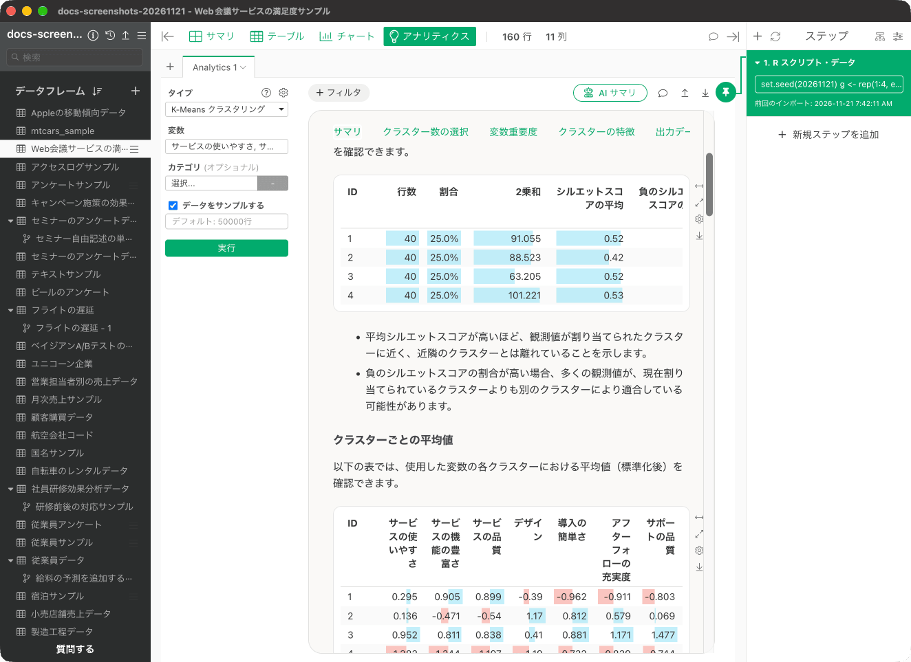

#### Q: クラスター間平方和とはなんでしょうか？

クラスター間平方和はクラスターの中心が、全データの中心からどれだけ離れているかを示す指標となり、各クラスターがどれだけ綺麗に分かれているかを測る相対的な指標となり、Between-Cluster Sum of Squares(BCSS)と呼ばれることがある指標です。

#### Q: 設定メニューに表示される「反復回数」や「試行回数」は何を表していますか？

K-Means クラスタリングでは最初にランダムにクラスターの中心点の位置を決め、観察対象をクラスターに分けることになります。

Exploratoryではシードがセットされているため、同じマシンで実行している限りは結果が変わることはありませんが、最初に決められたクラスターの中心点が変わることによって結果が変わってしまうことがあります。

そこで試行回数ではK-Meansクラスタリングがグループ分けをする処理を試行する回数、言い換えれば、クラスターの中心点の位置を決め、観察対象をクラスターに分ける処理を繰り返す回数を決められるようになっています。

なお、反復回数は1回の試行の中で、クラスターに分けるための処理の実行回数を表しています。

#### Q: 設定メニューに表示される「反復回数」や「試行回数」を減らすことでどのような効果を期待できますか？

一般的に試行回数や反復回数を増やすことで、ランダム性を減らすことができ、安定した結果が得られる可能性が高まることになります。

一方で試行回数や反復回数には答えがあるわけではないため、得られた結果（例: それぞれの設定を変更しても結果があまり変わらない）をもとに最適なな設定を判断していくことになります。

#### Q: クラスターマップに表示されている第1主成分、第2主成分は何を表しているのでしょうか？

クラスターマップ（バイプロット）では次元削減のアルゴリズムである主成分分析（PCA）というものを使っており、複数の変数を2つの次元で表した時にどれだけの情報量（ばらつき）を表現できているかが第1主成分と第2主成分からわかります。

例えば、下記は10列使用してK-meansクラスタリングを実行したものとなりますが、第1主成分で52.9%、第2主成分で23.9%と2つ合わせて全ての変数のばらつきの**76.8%** を表現できていると捉えることができます。

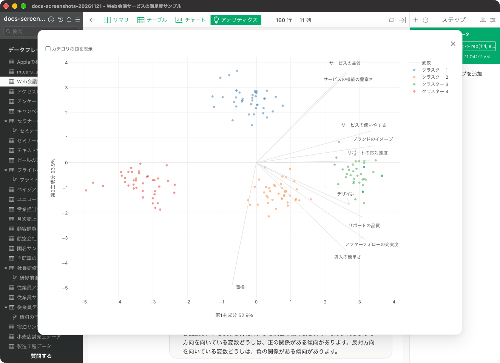

残りの23.2%のデータのばらつきについては、第3主成分以降で説明がつくばらつきになっています。

ちなみに、K-Meansクラスタリングの中で主成分分析を行っているのは、あくまで「クラスターマップ」を表示するためだけに行っているものであり、クラスタリングする際のアルゴリズムとは別の処理となります。

バイプロットの詳細については、[こちら](https://exploratory.io/note/kanaugust/18-PCA-tWA7mRe3HR)の「主成分分析（PCA）の紹介」のノートで紹介していますので、そちらをご覧ください。

#### Q: クラスターマップに表示される変数の軸線はどのように決まっていますか？

前述の「クラスターマップに表示されている第1主成分、第2主成分は何を表しているのでしょうか？」と関連していますが、それぞれの変数の軸線は、主成分分析で求めた、その変数と第1主成分・第2主成分との関係をもとに位置が決まっています。

下の画像は、レポートの「クラスターマップ」とその説明文です。画面には、元のデータにあるばらつきのうち、第1主成分が53%、第2主成分が24%を説明すると表示されています。

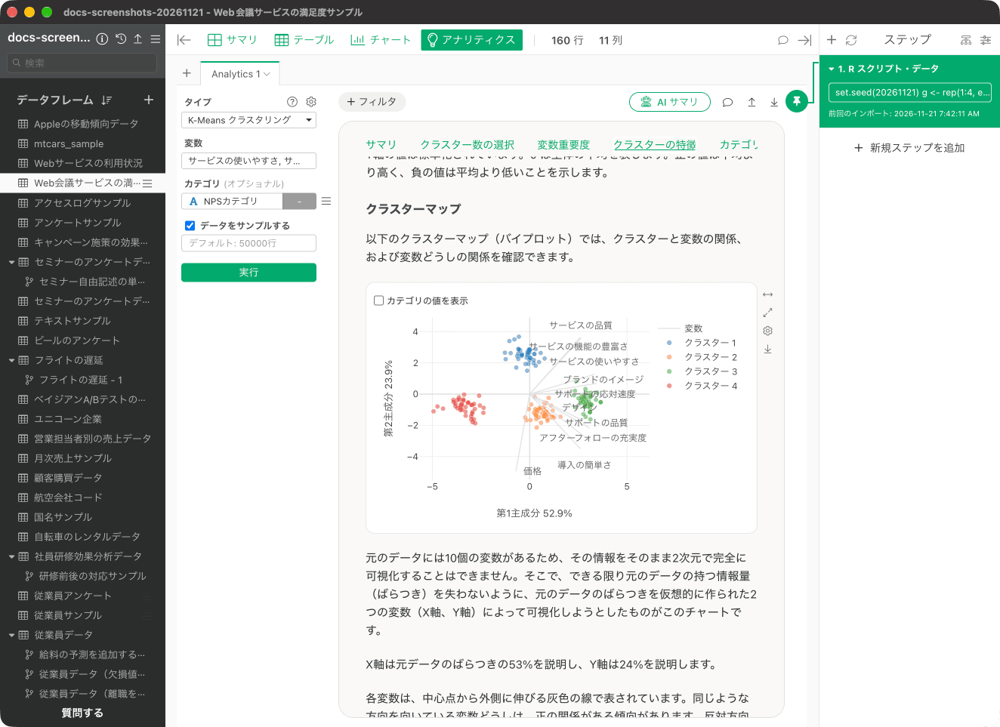

#### Q: クラスターマップのデータをエクスポートしたときの、それぞれのデータは何を表すのでしょうか？

「チャートのエクスポート」から「新規データフレームとして保存」でクラスターマップのデータを保存すると、次のような180行・6列のテーブルになります。回答160行に、軸線の起点・終点にあたる20行が加わっています。

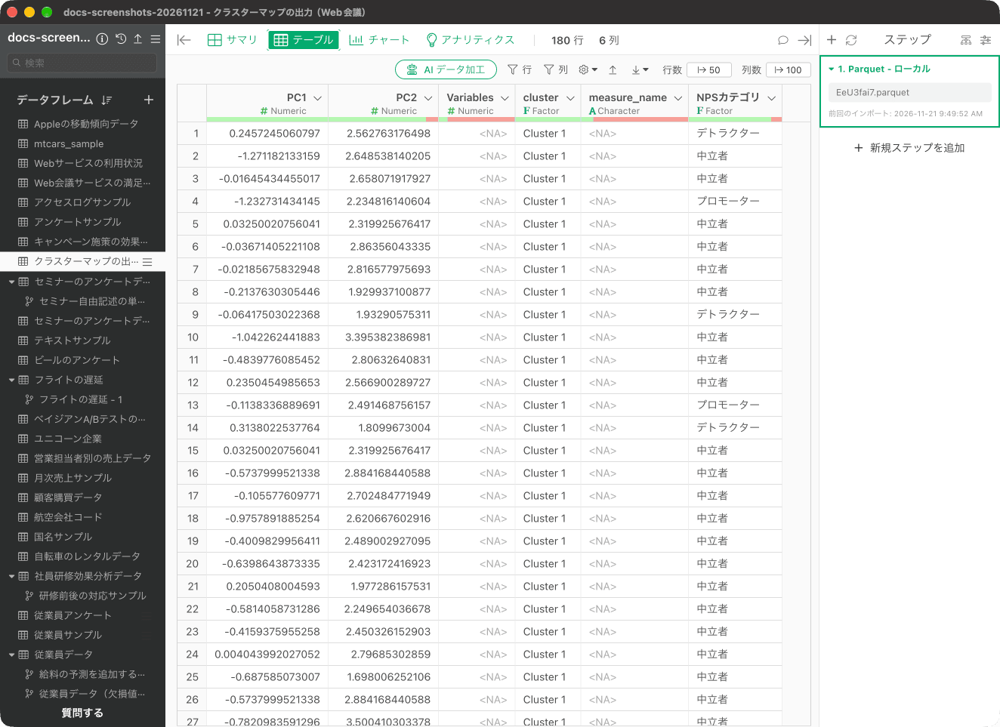

PC1（第1主成分）はそのままの列名で、PC2は回答者の第2主成分の値です。clusterは回答者が属するクラスター、NPSカテゴリは「カテゴリ」に設定した列です。

measure_nameはクラスタリングに使用した変数（数値列）を表しており、Variablesはバイプロットでそれぞれの変数の軸を表現する時に使われている値です。下の画像は、`dplyr::filter(!is.na(measure_name), PC1 != 0 | Variables != 0)` のステップで、軸線の終点にあたる10行だけを表示したものです。

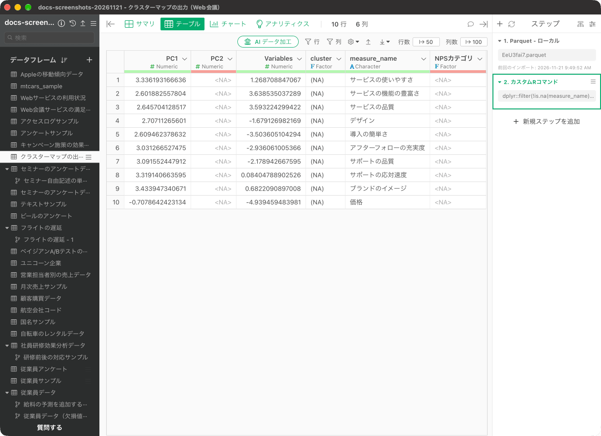

