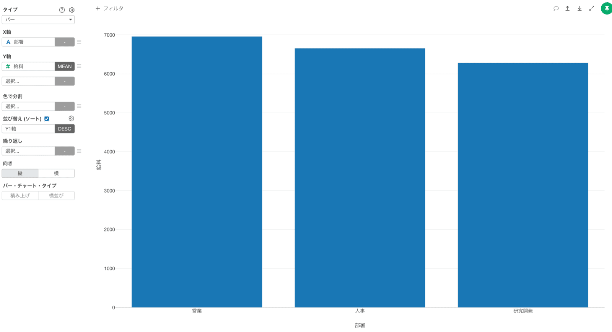
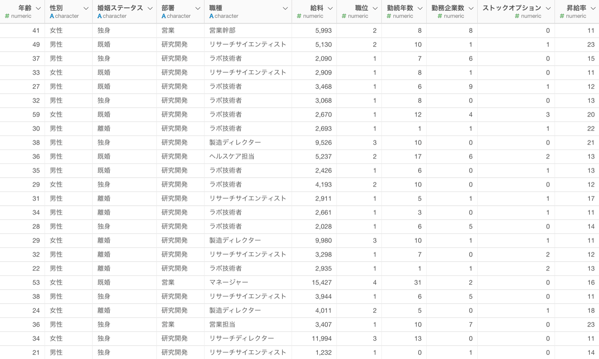
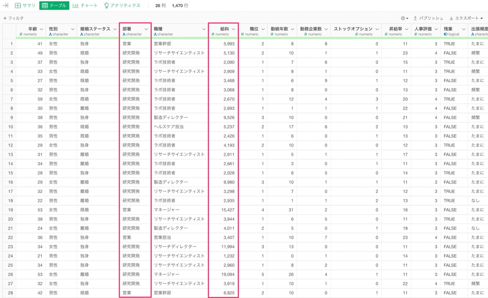
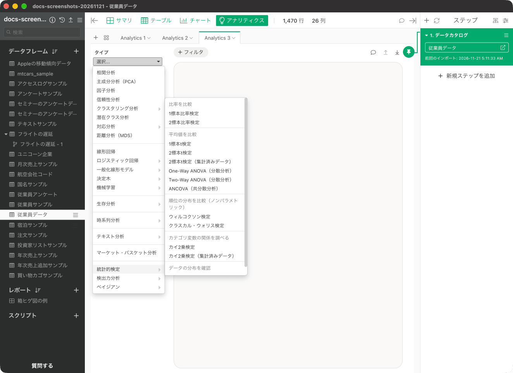
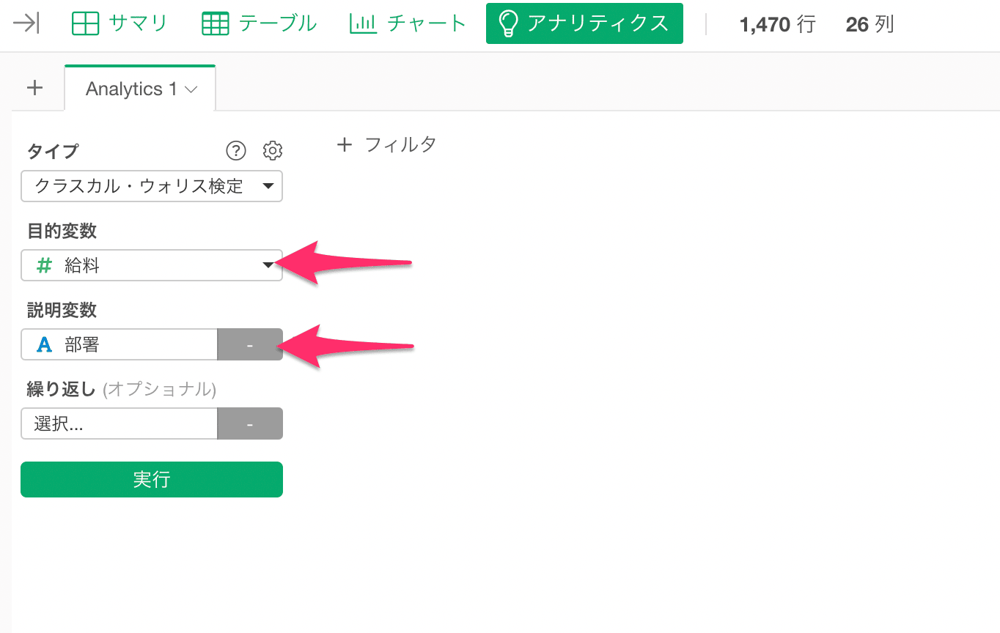
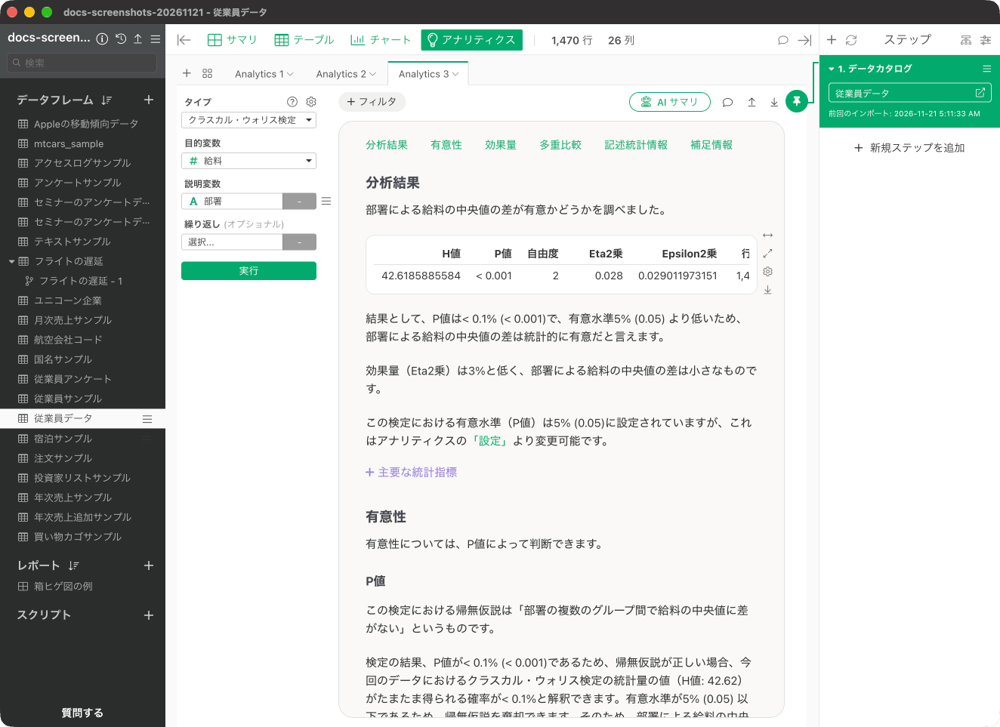
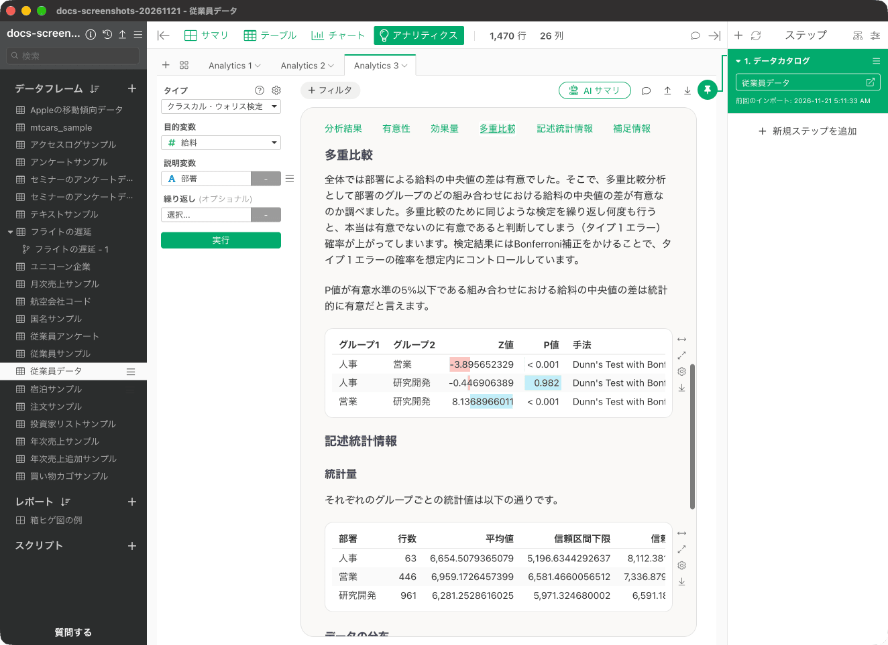

クラスカル・ウォリス検定は、元のデータの分布が正規分布であるという前提がなくても使えるノンパラメトリック検定です。t検定のように 2 つのグループだけでなく、2 つ以上のグループを対象にできるのも特徴です。

## 何ができるか

たとえば、部署ごとの給料の平均値を可視化したバーチャートがあるとします。部署の間で平均値に違いはありますが、それが意味のある違いかどうかは、バーチャートだけでは判断できません。クラスカル・ウォリス検定を使うと、部署間の給料の差に意味のある違いがあるかどうかを検証できます。

## 使い方

このページの例では、[従業員データ](https://exploratory.io/data/exploratory/CAj2fan5)を使います。1 行が 1 従業員で、年齢、給料、職種など従業員の属性を表す列があります。

「部署」によって「給料」に違いがあるかを調べます。部署の一意な値は、「営業」「研究開発」「人事」の 3 つです。

1. アナリティクス・ビューを開き、タイプの「統計的検定」の「順位の分布を比較（ノンパラメトリック）」から「クラスカル・ウォリス検定」を選びます。

   

2. 目的変数に「給料」、説明変数に「部署」を選び、「実行」ボタンをクリックします。

   

   部署によって給料の差が有意かどうかを調べる、クラスカル・ウォリス検定が実行され、結果がレポートとして表示されます。上部の「分析結果」「有意性」「効果量」「多重比較」「記述統計情報」「補足情報」のリンクから、それぞれの節に移動できます。

## 結果の見方

### 分析結果

検定の結果が有意かどうかを確認できます。帰無仮説は「部署の複数のグループ間で給料の中央値に差がない」です。P 値は、帰無仮説のもとで、観測した検定統計量（この検定では H 値）と同じか、それ以上に極端な値が得られる確率です。一般的には、0.05（5%）を下回ると有意とされます。

表には、H 値（42.62）、自由度（2）、P 値（0.001 未満）などが表示されます。P 値は有意水準 5%（0.05）より低いため、部署による給料の中央値の差は統計的に有意です。効果量（Eta2 乗）は 0.028（約 3%）と低く、差は小さなものです。

### 多重比較

クラスカル・ウォリス検定では、「部署」によって「給料」に差があるかを検定しますが、それだけでは、どの組み合わせ（例: 営業と研究開発）で有意な違いがあるかは分かりません。「多重比較」では、どの組み合わせで差が有意になるかを調べられます。

この例では、「人事と営業」「営業と研究開発」の組み合わせの P 値が 0.001 未満で有意です。「人事と研究開発」の P 値は 0.982 で、有意ではありません。

多重比較の手法には、「Dunn's Test with Bonferroni Correction」が使われています。変更したいときは、「設定」から変更できます。ダン検定（Dunn Test）では、2 つのグループで平均順位がどれだけ違うかを、標準誤差で割って Z 値を計算します。表には、多重比較で補正した P 値が表示されます。

### 記述統計情報

部署ごとの行数、平均値、平均値の信頼区間などの統計量を確認できます。この例では、人事が 63 行、営業が 446 行、研究開発が 961 行です。
