LightGBM は、複数のモデルに学習させ、それぞれの予測結果を一つの予測にまとめるアンサンブル学習の代表的なアルゴリズムの一つです。[XGBoost](/ja/analytics/xgboost) と同じ勾配ブースティングのファミリーに属し、決定木を一つずつ順に作り、前の決定木の予測で間違ったデータに重みをかけて、次の決定木ではその間違いをカバーするように学習を進めます。

Microsoft が開発したフレームワークで、XGBoost に対していくつかの独自技術を導入することで、より高速でメモリ効率の良い学習を実現しています。

## XGBoost との違い

主な違いの一つが、木の「育て方」です。XGBoost はデフォルトでは、木の各階層をまんべんなく広げていく「Level-wise（レベル単位）」という方法をとります。一方、LightGBM は「Leaf-wise（葉単位）」という方法をとり、「ここを分割すれば一番予測が改善する」という葉だけを優先的に分割します。必要なところだけを重点的に分割するため、同じ数の葉でも、より予測精度の高い木を作れます。

学習をさらに高速化するための工夫もあります。

- GOSS（Gradient-based One-Side Sampling）：すでに予測がうまくいっているデータの一部をスキップし、予測を大きく外しているデータに集中して学習します。
- EFB（Exclusive Feature Bundling）：同時に値を持たない特徴量（たとえば「Aが1のときBは必ず0」のような関係）をまとめて一つの特徴量として扱い、計算量を減らします。
- ヒストグラムベースアルゴリズム：連続的な数値をあらかじめいくつかのグループ（ビン）に分けておき、分割点の探索を高速化します。

## 必要なデータの形式

LightGBMを実行する際には、1行が1観測対象となっているデータを使う必要があります。目的変数には数値型、ロジカル型のどちらも扱うことができます。説明変数におけるデータタイプには特に縛りはありません。しかし、説明変数同士の相関が強い場合は影響度を取り合ってしまい、変数重要度の順番が低く見積もられることがあります。

## サンプルデータ

今回はサンプルデータとして、[従業員データ](https://exploratory.io/data/exploratory/CAj2fan5)を使用していきます。

このデータは1行が1従業員のデータで、1,470行・26列です。列には年齢や給料、職種など従業員の属性を表す列があります。

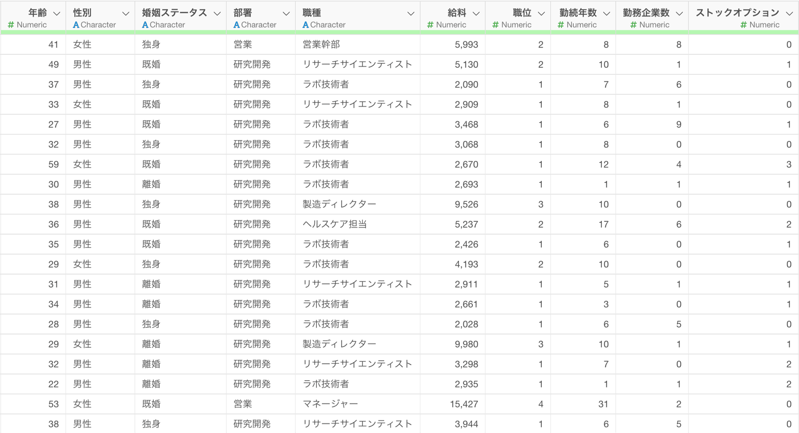

## LightGBMを実行する

今回は、従業員の「給料」を予測するLightGBMのモデルを作成します。

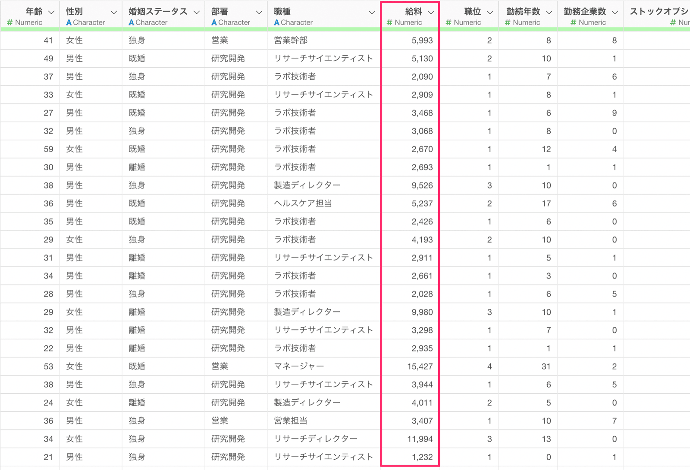

アナリティクスビューを開き、「タイプ」のメニューで「機械学習」にマウスを合わせ、「LightGBM」を選択します。同じメニューには、ランダムフォレスト、XGBoost、CatBoost もあります。

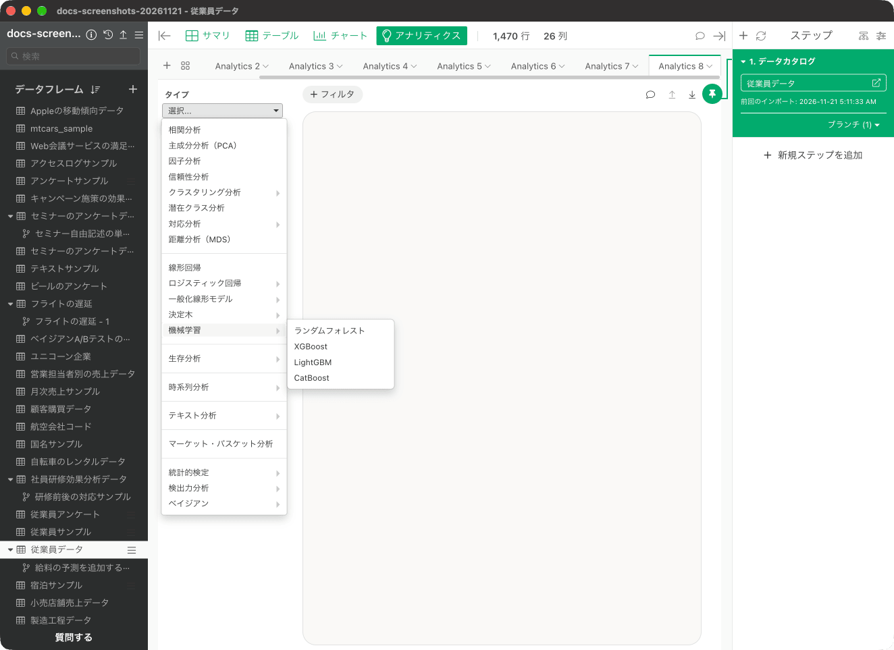

目的変数に「給料」を選択します。

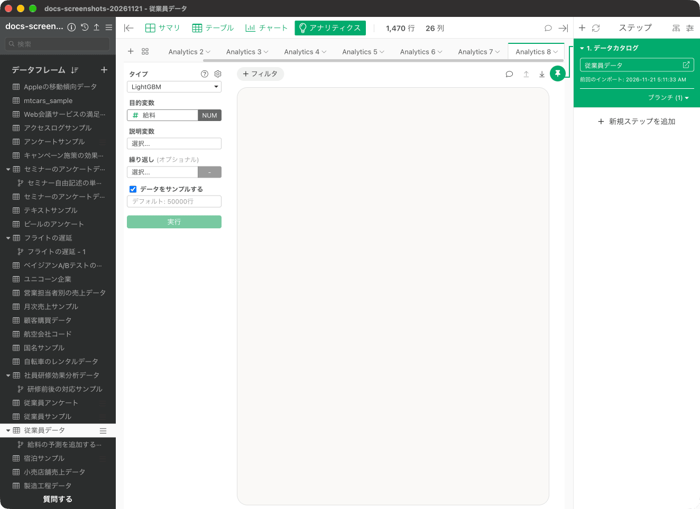

「説明変数」の入力欄をクリックすると「列の選択と設定」のダイアログが開きます。給料を予測する上で使用する列を選択します。シフトキーを押すことで、複数の列を一気に選択できます。今回は、給料・部署・入社日・退社日を除く22列を選びました。

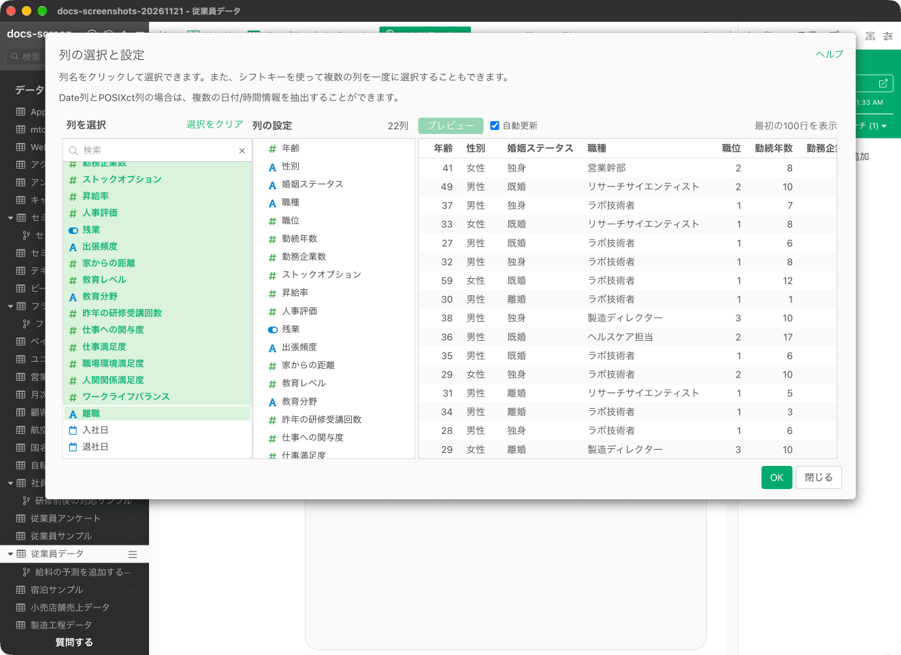

説明変数を設定したら、「実行」ボタンをクリックします。

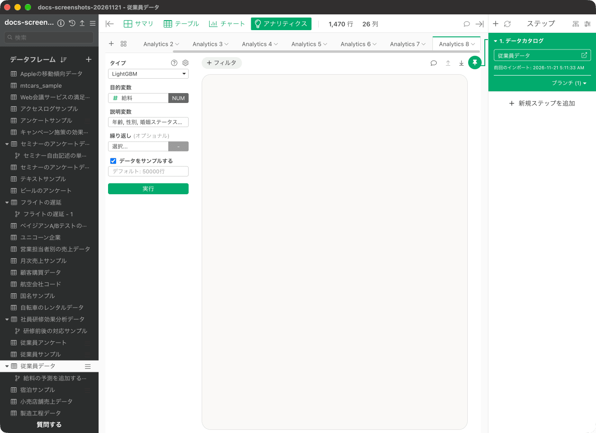

これによってLightGBMを作成でき、各チャートには解釈のための説明が表示されています。結果は上のリンク（サマリ、予測に関係する変数、予測精度、予測結果、補足情報）の順に、ひとつながりのレポートとして表示されます。リンクをクリックすると、その節へ移動できます。

「サマリ」の節には、選択した説明変数から数値型の目的変数「給料」を予測するLightGBMのモデルを作成したことが表示されます。「データとモデルの基本情報」には行数（1,470）と説明変数の数（22）が、「目的変数の統計値」には給料の平均値（6,502.931）、中央値（4,919）、標準偏差（4,707.957）が表示されます。

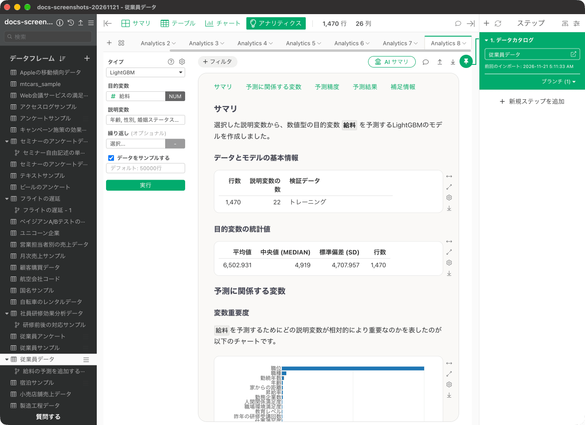

## 結果の解釈

### 変数重要度

「予測に関係する変数」の節の「変数重要度」では、どの変数が目的変数とより相関が強いのか、予測する時により重要なのかを調べることができます。

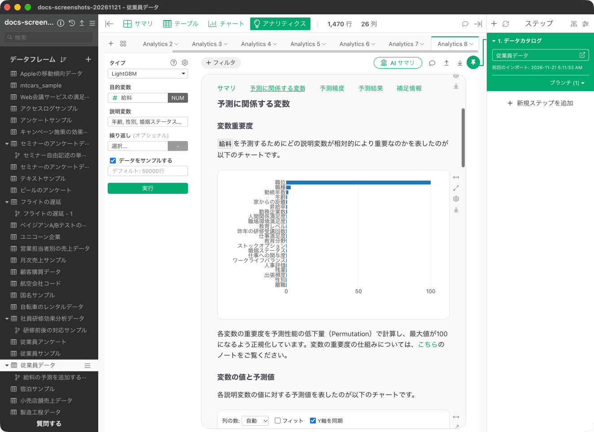

重要度は、各変数の予測性能の低下量（Permutation）で計算し、最大値が100になるよう正規化されています。重要度が高い変数ほど、給料を予測する上で重要であることを意味します。今回の例では、職位が最大の100で、給料を予測する上で圧倒的に重要であることがわかります。次に職種、勤続年数が続いています。

### 変数の値と予測値

同じ節の「変数の値と予測値」では、それぞれの変数の値が変わると、目的変数の値はどのように変わるのかがわかります。これはPartial Dependence Plot（PDP）と呼ばれる手法で可視化されています。

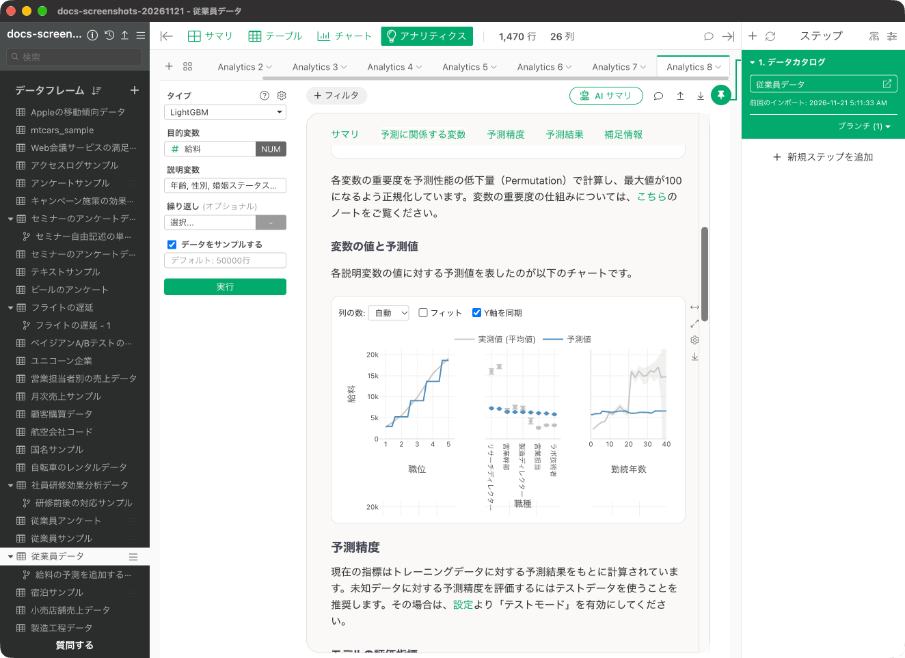

グレーの線は実測値（平均値）を、青い線は予測値（モデルが推定した値）を示しています。例えば、職位ごとの給料の変化を見ると、職位が上がるにつれて給料が上昇する傾向が確認できます。文字列型の変数（職種）は、カテゴリごとの予測値が点で表示され、数値型の変数（勤続年数）は線で表示されます。

### 学習回数と精度の向上

「予測精度」の節の「学習回数と精度の向上」では、学習回数（作成された決定木の数）によって、予測精度がどれだけ向上したかが確認できます。「チャート」をクリックすると、学習回数ごとのRMSEが表示されます。今回の例では、学習回数が増えるにつれてRMSEが下がり、最初の50回ほどで大きく下がったあとは緩やかになっています。

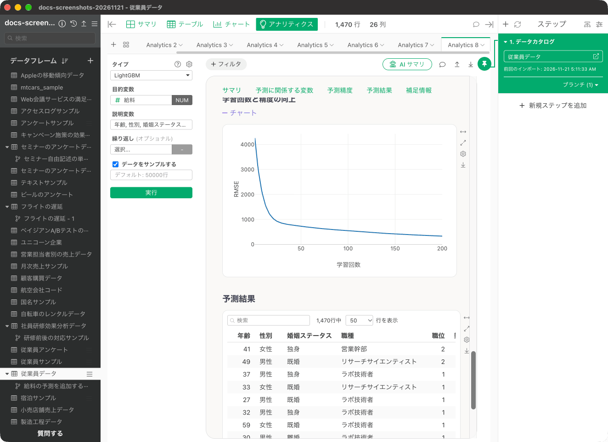

「学習回数 (木の数)」の初期値は200で、歯車のアイコンから「設定」を開き、「学習戦略」で変更できます。同じ「学習戦略」には「学習率」（初期値0.1）があります。また、「検証と早期停止」には「検証（バリデーション）データを使用する」（初期状態はFALSE）と「早期停止の反復回数」（学習した結果、予測精度が向上しない時に打ち切る回数。初期状態は早期停止なし）があります。

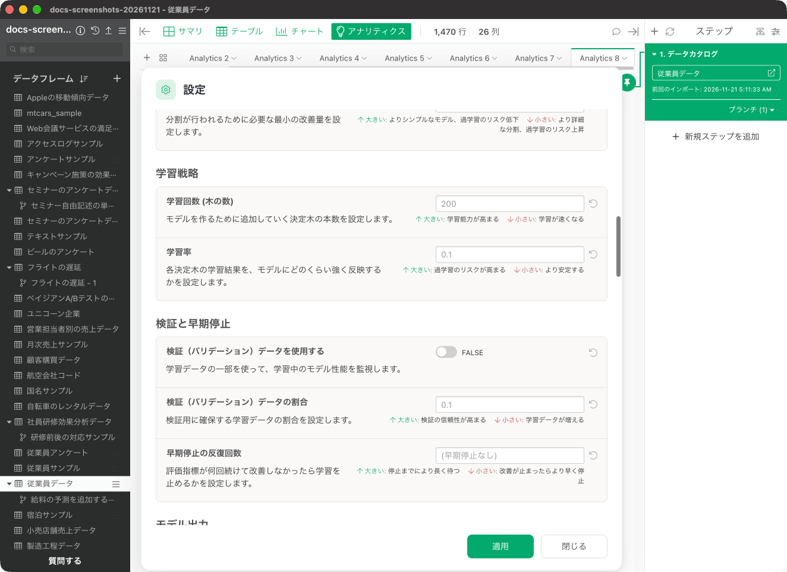

### モデルの評価指標

「予測精度」の節の「モデルの評価指標」では、この予測モデルの予測精度を確認できます。ここでは、「設定」で「学習回数 (木の数)」を10にして実行した結果を示します。

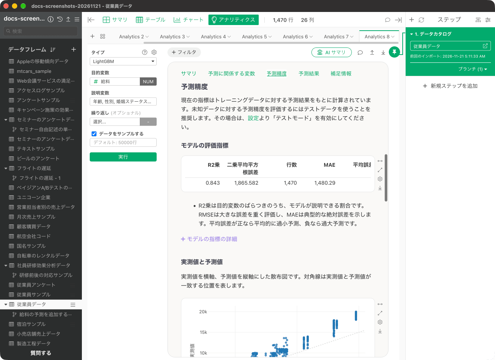

R2乗はデータの平均からのばらつきをモデルが説明できている割合の指標で、0から1の間の値を取ります。1に近ければ近いほど、モデルがデータのばらつきをよく説明できていることを示します。

学習回数が10回の今回は、R2乗が0.843（二乗平均平方根誤差は1,865.582）のため、データのばらつきの約84%をこのモデルで説明できていることになります。

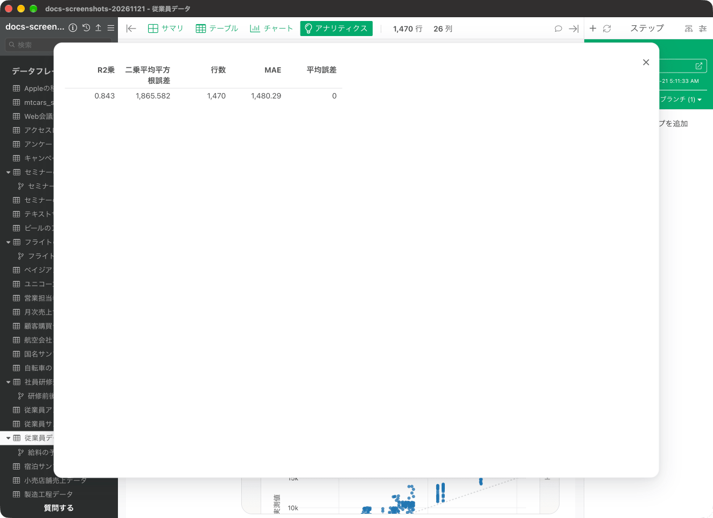

学習回数を10回から20回に増やして、予測精度がどう変わるかを確認します。「設定」の「学習回数 (木の数)」に「20」を入力して「適用」をクリックします。

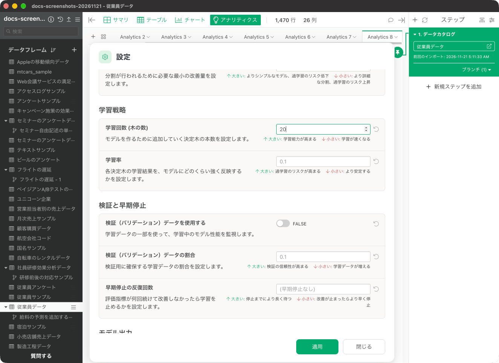

適用すると、「モデルの評価指標」が更新されます。RMSE（予測と実測値の誤差の大きさ）は1,865.582から1,055.114に減少しています。

R2乗も「0.843」から「0.95」に上がっています。この例では、学習回数を10回から20回に増やすと評価指標が良くなりました。学習回数は最適な値がデータによって異なるため、値を変えて「モデルの評価指標」を比べながら決めてください。

### 予測結果

「予測結果」の節では、モデルに使用したデータと予測値をテーブル形式で確認できます。表を右へスクロールすると、目的変数である給料と、このモデルで算出された予測値（Predicted Value）、テストデータかどうか（Test Data）が並んでいます。給料と予測値を並べて確認することで、モデルの予測がどの程度正確かを個別のデータレベルで把握できます。

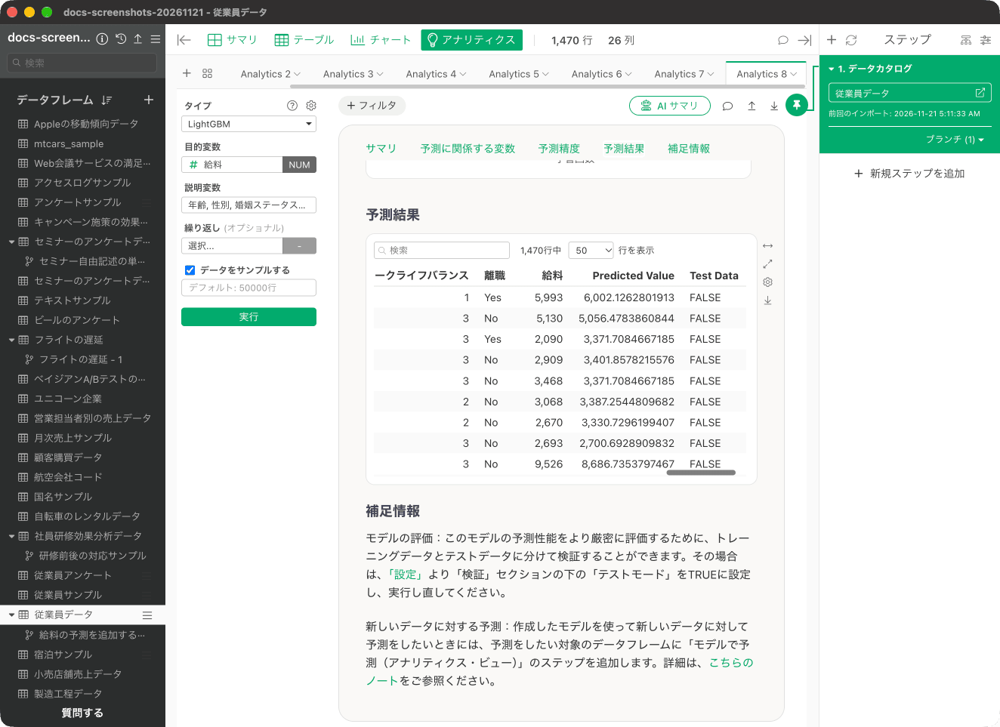

## LightGBMに関するよくある質問

#### Q: 「変数の値と予測値」で表示されている実測値はどのように求められているのですか？

「変数の値と予測値」の実測値はそれぞれの説明変数のデータタイプによって表示が異なります。 詳しくは[こちら](https://exploratory.io/note/GMq1Qom5tS/csB2RRw5wl)のノートをご覧ください。

#### Q: 「変数の値と予測値」で表示されている予測値はどのように求められているのですか？

予測値のチャートはPartial Dependence Plot（PDP）と呼ばれるもので、注目している変数の値を変化させたときに、予測結果がどう変わるかを可視化したチャートとなります。詳しくは[こちら](https://exploratory.io/note/exploratory/Sbd0LDU6)のノートをご覧ください。
