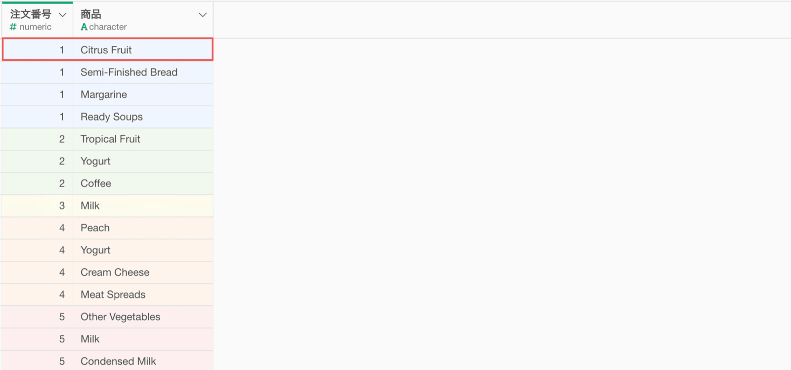
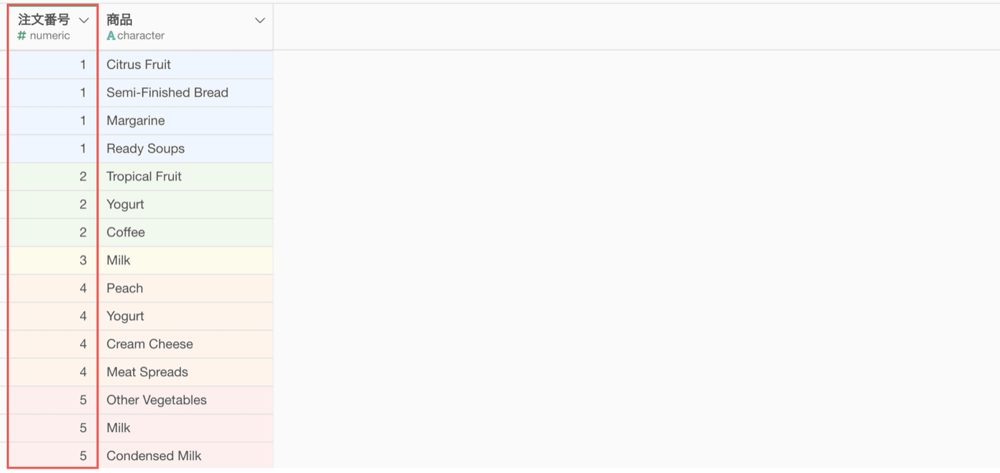
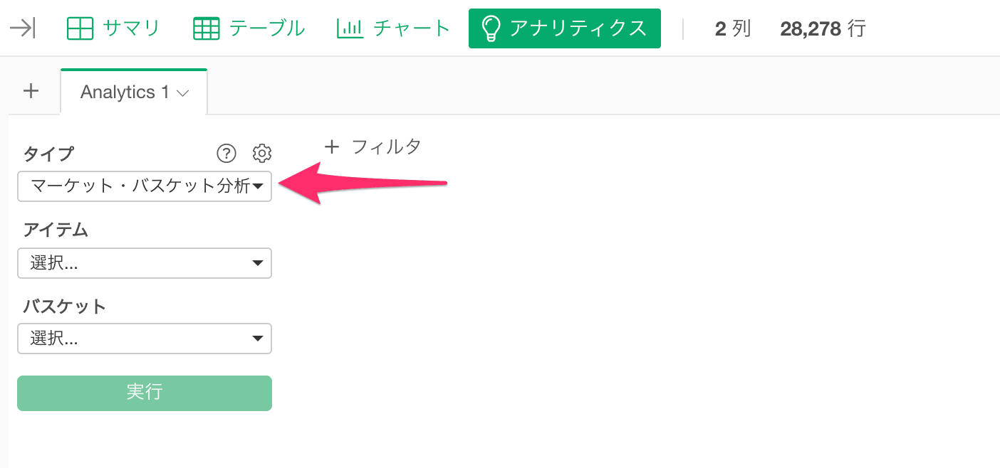
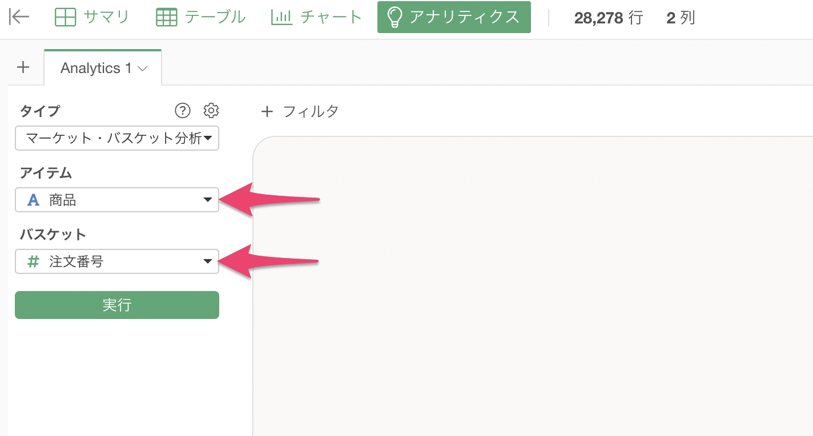
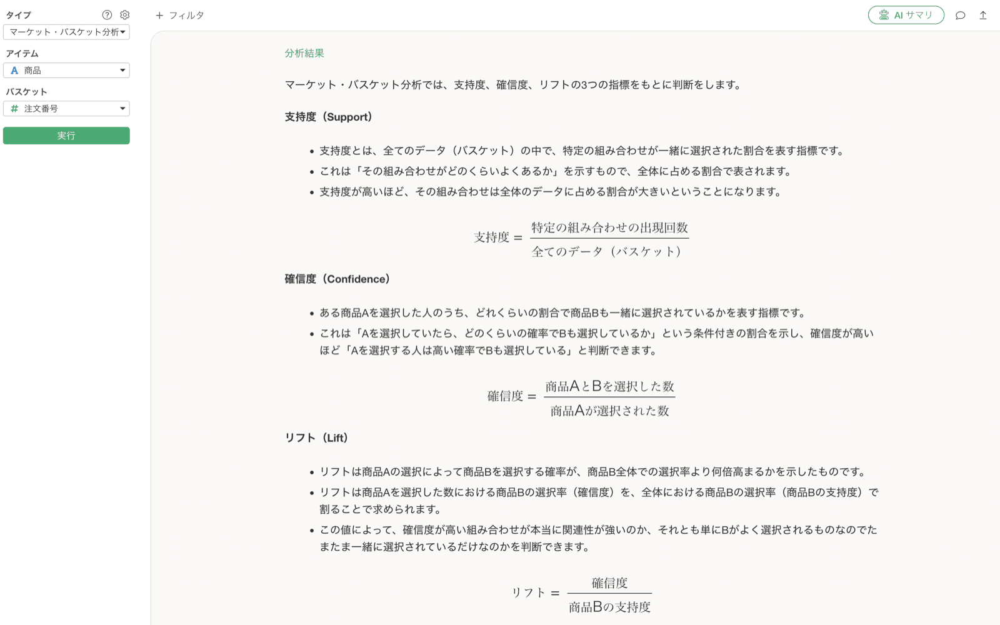
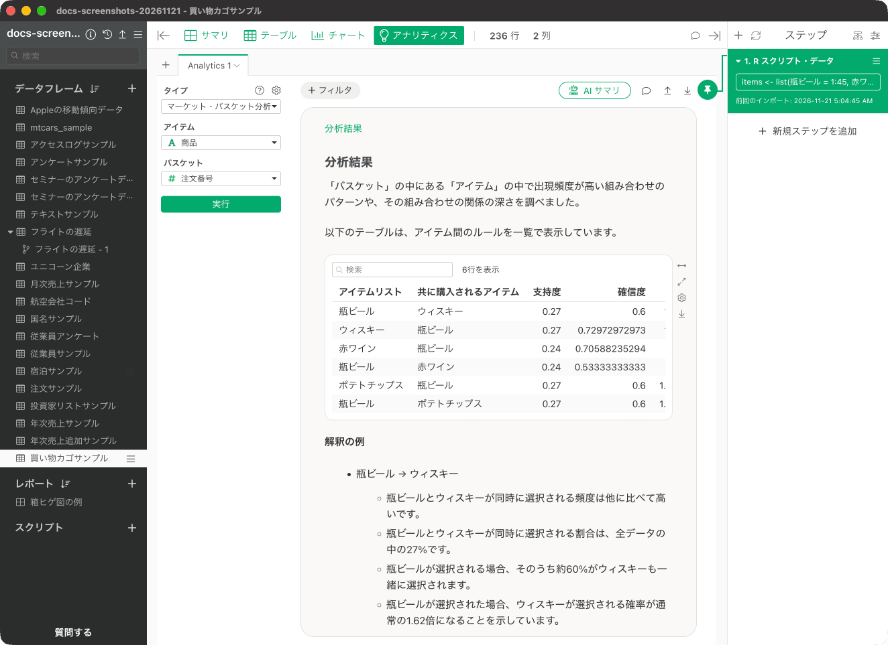
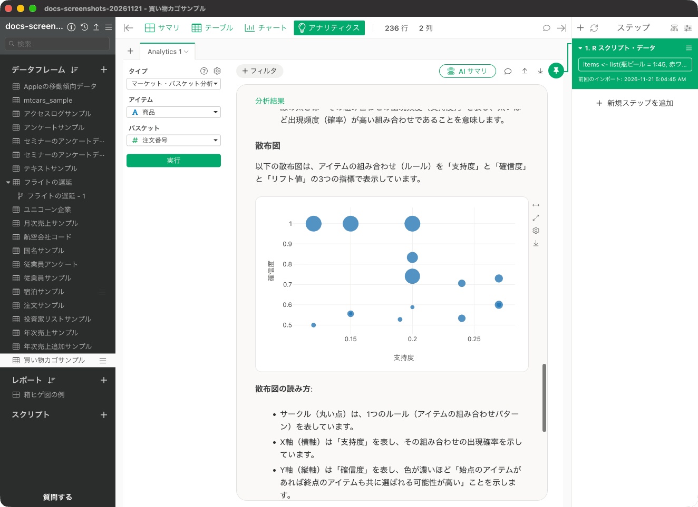
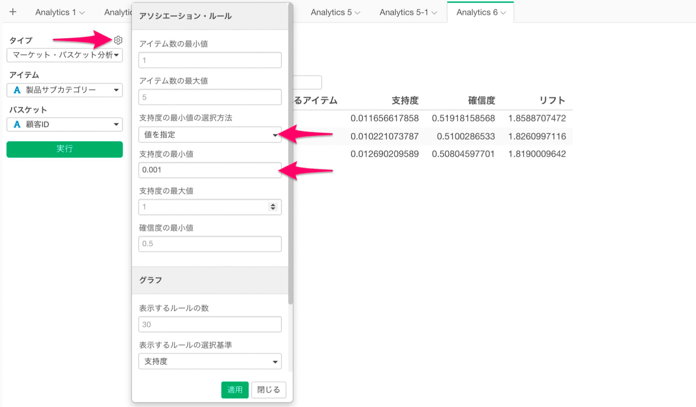
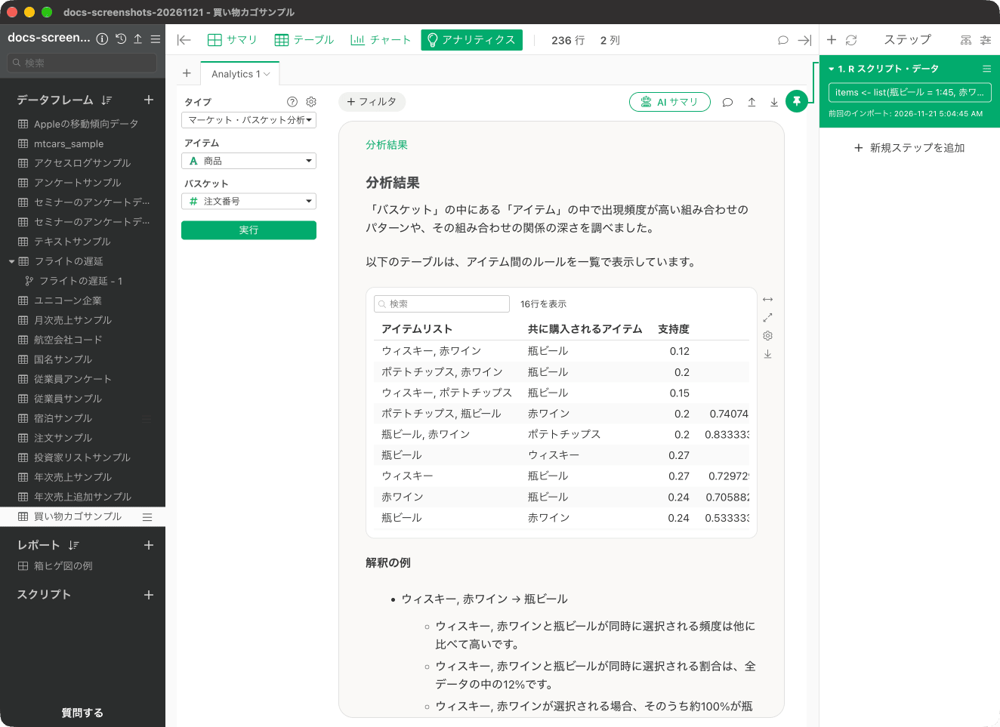
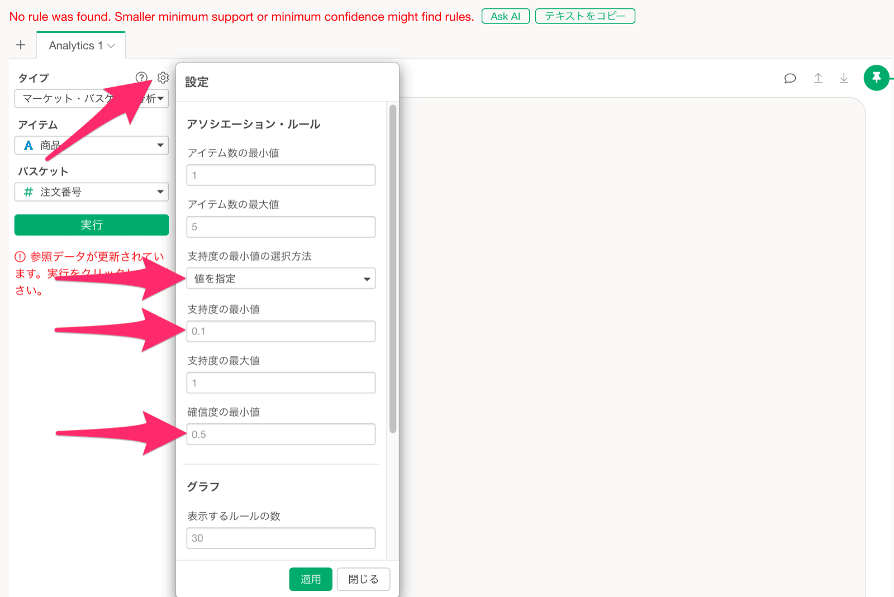

マーケット・バスケット分析は、一緒に購買されやすい商品の組み合わせを分析するアナリティクスです。たとえば「おむつを買った人はビールを買う傾向がある」といったことが分かります。

## 必要なデータ

1 行が、1 つのバスケット（買い物かご）の中にある 1 つの商品を表すデータが必要です。

上の 2 枚の画面は、データの形式を示す例です。このページの例とは別のデータです。

商品の列に加えて、その商品がどのバスケットに含まれていたかを識別する列（例: 注文番号、決済番号）も必要です。

このページの例では、買い物かごのサンプルデータを使います。100 個のバスケット、236 行のデータで、列は「注文番号」と「商品」です。

## 使い方

1. アナリティクス・ビューを開き、タイプに「マーケット・バスケット分析」を選びます。

   

2. 「アイテム」にかごの中身を表す「商品」を、「バスケット」にバスケットを識別する「注文番号」を選びます。

   

3. 「実行」ボタンをクリックします。マーケット・バスケット分析の結果が表示されます。このページのルールの表は、歯車の「設定」で支持度の最小値を 0.23、確信度の最小値を 0.5 にして実行した結果です。設定のしかたは、よくある質問の「表示されるルールが少ないときに、増やせるか」で説明します。

## 結果の見方

マーケット・バスケット分析では、支持度・確信度・リフトの 3 つの指標をもとに判断します。

- 支持度: すべてのデータ（バスケット）のうち、特定の組み合わせが一緒に選ばれた割合を表します。
- 確信度: ある商品 A を選んだ人のうち、どれくらいの割合で商品 B も一緒に選ばれているかを表します。
- リフト: 商品 A を選ぶことで、商品 B を選ぶ確率が、商品 B 全体の選択率より何倍高まるかを表します。

それぞれの詳しい説明は、計算式付きのガイドとして画面に表示されます。

### ルールの表

「分析結果」には、アイテム間のルールの一覧が表で表示されます。テーブルの 1 行が 1 つのルールを表し、「アイテムリスト」が前提、「共に購入されるアイテム」が結果です。支持度・確信度・リフトの列で、そのルールの強さを確認します。

表の下には「解釈の例」が表示されるので、それをもとに結果を読み取れます。この例の 1 行目は、「瓶ビール → ウィスキー」のルールです。瓶ビールとウィスキーが同時に選ばれる割合は、全データの 27% です。瓶ビールが選ばれたバスケットのうち約 60% で、ウィスキーも一緒に選ばれます。また、ウィスキーが選ばれる確率は通常の 1.62 倍になる、と表示されています。

この例では、瓶ビールを含むかごでのウィスキーの購入率を、全かごでのウィスキーの購入率で割ると 1.62 です。1 未満なら、前提の商品を含むかごでの購入率が、全体より低いことを示します。

### グラフ

「グラフ」には、アイテムの組み合わせのパターンと、その関係の深さがネットワーク図で表示されます。商品名を矢印でたどると、どの商品からどの商品へのルールかを確認できます。丸の大きさは支持度、色は確信度を表します。

### 散布図

「散布図」では、ルールを「支持度」「確信度」「リフト値」の 3 つの指標で表示します。丸 1 つが 1 つのルールで、横軸が支持度、縦軸が確信度です。

## よくある質問

### リフトはどういった指標か

ある商品が全体で買われる率に比べて、ほかの商品と一緒に買われたときに購買率が上がるか（または下がるか）を表す指標です。

たとえば、全バスケットのうちワイン入りが 25%、肉入りのバスケットのうちワイン入りが 33% なら、リフトは 33% ÷ 25% で 1.32 です。1 より大きければ、肉が入っているバスケットではワインが買われやすくなります。1 未満なら、肉入りでのワイン購入率は全体より低いと読みます。

### 表示されるルールが少ないときに、増やせるか

行数が多く、アイテム（例: 商品）がたくさんあるときは、それぞれの組み合わせの件数が全体に占める割合（支持度）が低くなり、表示されるルールが少なくなることがあります。たとえば、このページの例で支持度の最小値を 0.23、確信度の最小値を 0.5 にすると、ルールは 6 つです（上のルールの表）。

Exploratory は支持度を基準にルールを表示していて、初期設定では「自動的に探索」です。この基準値を変えると、表示するルールを増やせます。タイプの右にある歯車の「設定」で、支持度の最小値の選択方法に「値を指定」を選び、支持度の最小値に任意の値を入力します。支持度の最小値を低くするほど、表示されるルールが増えます。

適用すると、表示されるルールが増えます。支持度の最小値を 0.1 に下げると、ルールの表は 6 行から 16 行になります。確信度の最小値は 0.5 のままです。

### 「No rule was found. Smaller minimum support or minimum confidence might find rules.」と表示される

多くの場合、現在の支持度の最小値または確信度の最小値では、抽出できるルールが見つからなかったときに出るエラーです。

アナリティクスの設定で、支持度の最小値の選択方法を「値を指定」に変え、支持度（support）や確信度（confidence）の最小値を小さくすると、解消することがあります。

最小値を下げてもエラーが解消されない場合は、お手持ちのデータの中に、抽出できるルール自体がないと考えられます。
