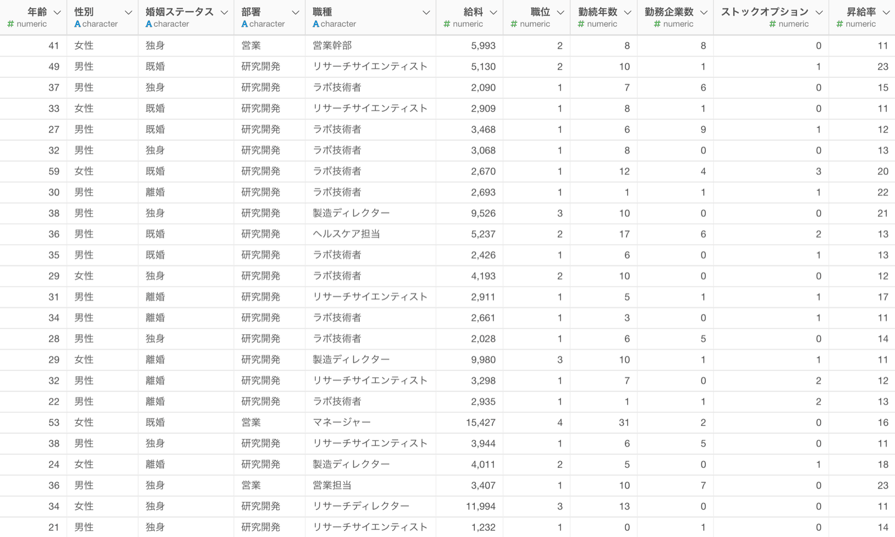
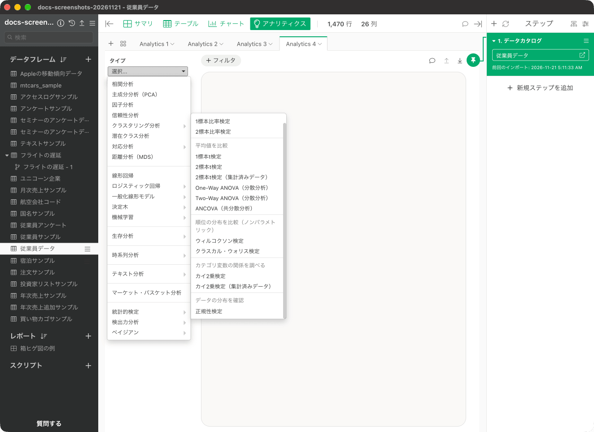
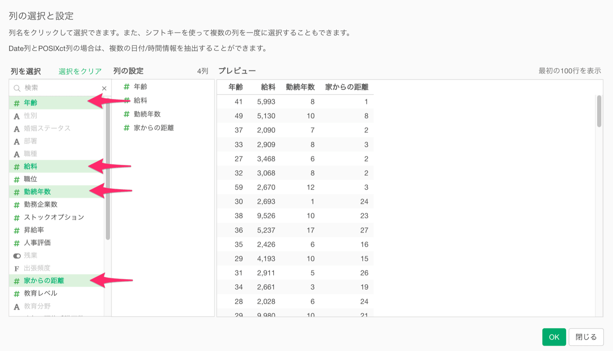
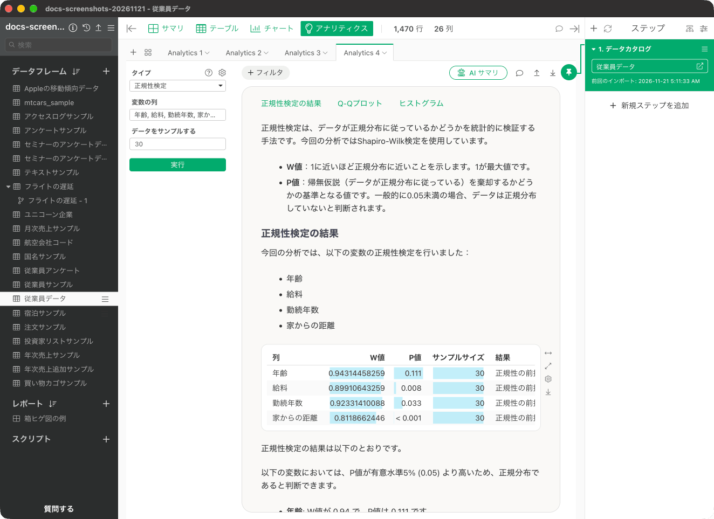
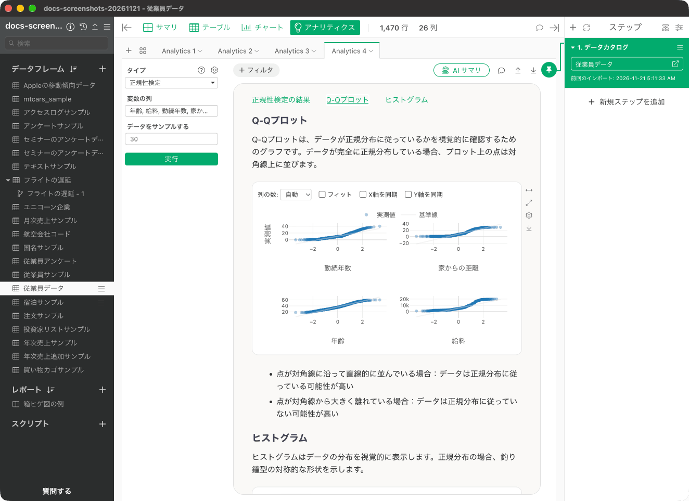
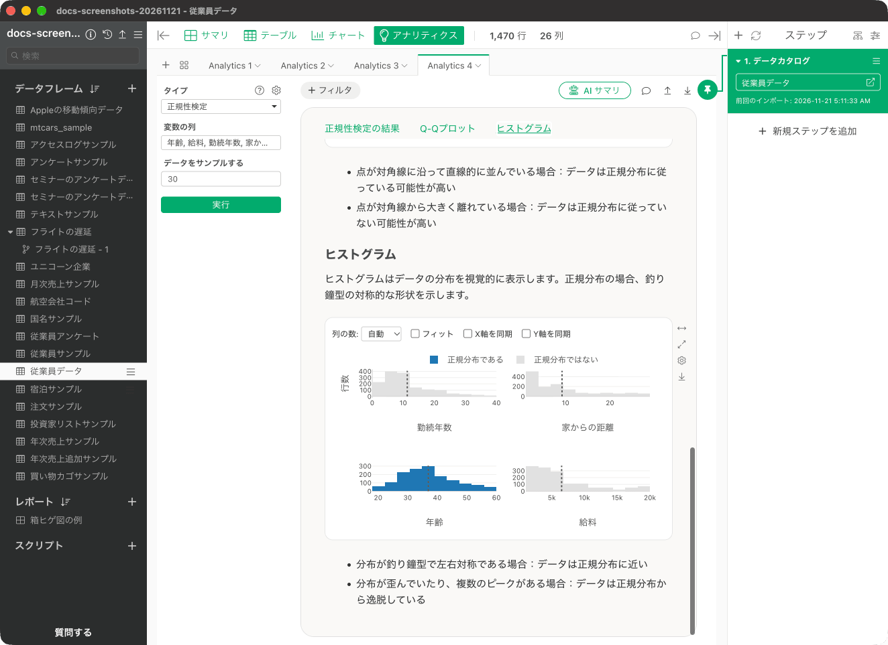

正規性検定は、データの母集団が正規分布に従っているかどうかを調べるアナリティクスです。

## 何ができるか

統計的仮説検定には、t検定や分散分析（ANOVA）のように、「母集団が正規分布に従う」ことを前提にした手法があります。正規性検定を使うと、その前提を確認できます。

## 使い方

このページの例では、[従業員データ](https://exploratory.io/data/exploratory/CAj2fan5)を使います。1 行が 1 従業員で、年齢、給料、職種など従業員の属性を表す列があります。

「年齢」「給料」「勤続年数」「家からの距離」の母集団の分布が、正規分布に従っているかを確認します。

1. アナリティクス・ビューを開き、タイプの「統計的検定」の「データの分布を確認」から「正規性検定」を選びます。

   

2. 「変数」の列を選びます。

   

3. 「年齢」「給料」「勤続年数」「家からの距離」を選びます。

   

4. データをサンプルしたいときは、「データをサンプルする」で行数を指定します。この例では「30」と入力し、「実行」ボタンをクリックします。

   

   4 つの変数の母集団が正規分布に従っているかを調べる、正規性検定が実行され、結果がレポートとして表示されます。上部の「正規性検定の結果」「Q-Qプロット」「ヒストグラム」のリンクから、それぞれの節に移動できます。

   

## 結果の見方

### 正規性検定の結果

この例では、Shapiro-Wilk 検定が使われています。表には、変数ごとに W 値、P 値、サンプルサイズ、結果が表示されます。W 値は 1 に近いほど正規分布に近いことを示し、1 が最大値です。P 値は、帰無仮説（データが正規分布に従っている）を棄却するかどうかの基準となる値で、一般的に 0.05 未満の場合、データは正規分布に従っていないと判断されます。

30 行の年齢のデータでは、P 値が 0.111 で有意水準 5%（0.05）を上回り、正規分布からの有意なずれは検出されませんでした。「給料」（0.008）と「勤続年数」（0.033）は 0.05 を下回り、「家からの距離」は 0.001 未満なので、いずれも正規分布に従っていないと判断されます。

### Q-Qプロット

データが正規分布に従っているかを、視覚的に確認するグラフです。凡例は「実測値」と「基準線」で、変数ごとにプロットが表示されます。

点が基準線に沿って直線的に並んでいるほど、データが正規分布に従っている可能性が高いと解釈できます。点が基準線から大きく離れているときは、正規分布に従っていない可能性が高くなります。

### ヒストグラム

変数ごとの分布を表示します。正規分布の場合は、釣り鐘型の左右対称な形になります。凡例の青色は「正規分布である」、グレーは「正規分布ではない」で、この例の年齢の結果は青色で表示されます。

分布が歪んでいたり、複数のピークがあったりするときは、正規分布から外れていると考えられます。
