主成分分析は、次元削減の手法としてよく使われるアルゴリズムの一つです。元のデータに含まれる情報量を極力失わないようにしながら、少ない数の「次元（変数）」で表現できます。

複数の変数間の関係や、元のデータの中にあるパターンや特徴を可視化するためにも使われます。

## 必要なデータの形式

主成分分析を実行する際には、1行が1観測対象となっているデータを使う必要があります。この例では数値型の列を使います。

そこで、今回はサンプルデータとして、[都道府県ごとの時間の使い方](https://exploratory.io/data/exploratory/BTt9hJI5)のデータを使用します。

このデータは、1行が1都道府県となっていて、列には仕事や家事、学業などにどれだけの時間を使っているかの列が性別ごとにあります。

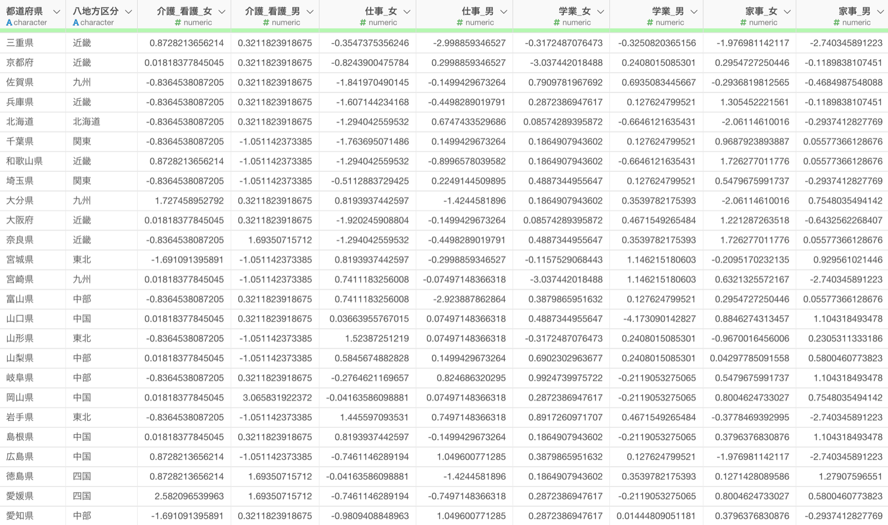

## 主成分分析を実行する

アナリティクスビューを開き、「タイプ」のメニューから「主成分分析（PCA）」を選択します。

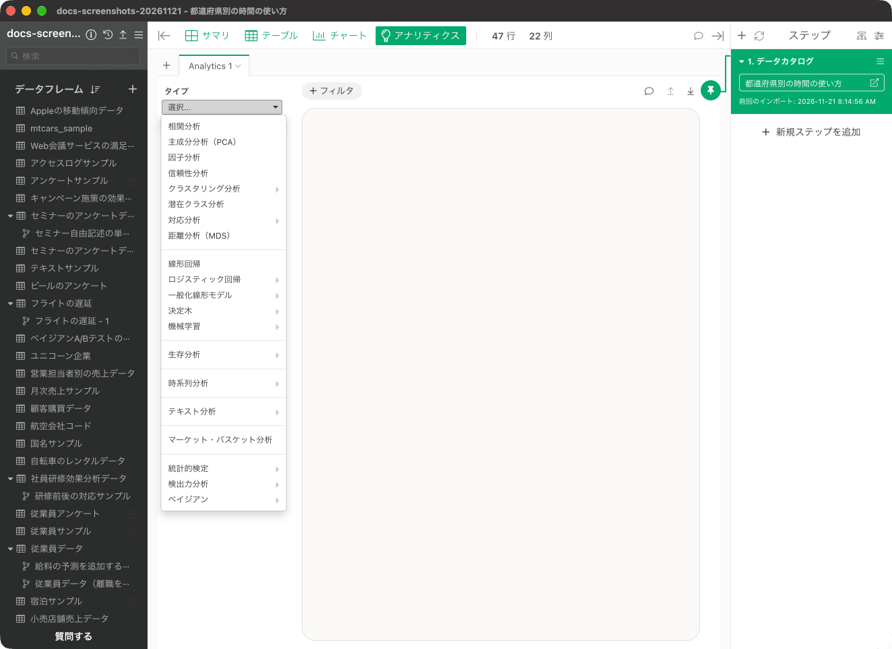

「変数」の列をクリックすると、「列の選択と設定」ダイアログが開きます。主成分分析に使用する列を選択します。シフトキーを押すことで、複数の列を一気に選択できます。今回は性別ごとの時間の使い方を表す20列を選び、「OK」をクリックします。

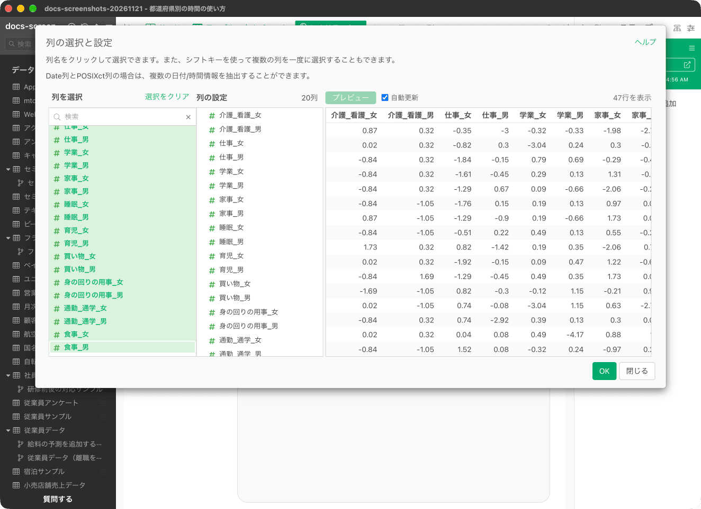

列の指定が完了したら「実行」をクリックすることで、主成分分析の結果が表示されます。「サマリ」には、選択された20個の変数、47行を対象に主成分分析を行ったこと、最初の2つの主成分で元のばらつきの25.7%を保持していることが表示されます。「分析条件とデータの確認」では、標準化がTRUEであることなども確認できます。

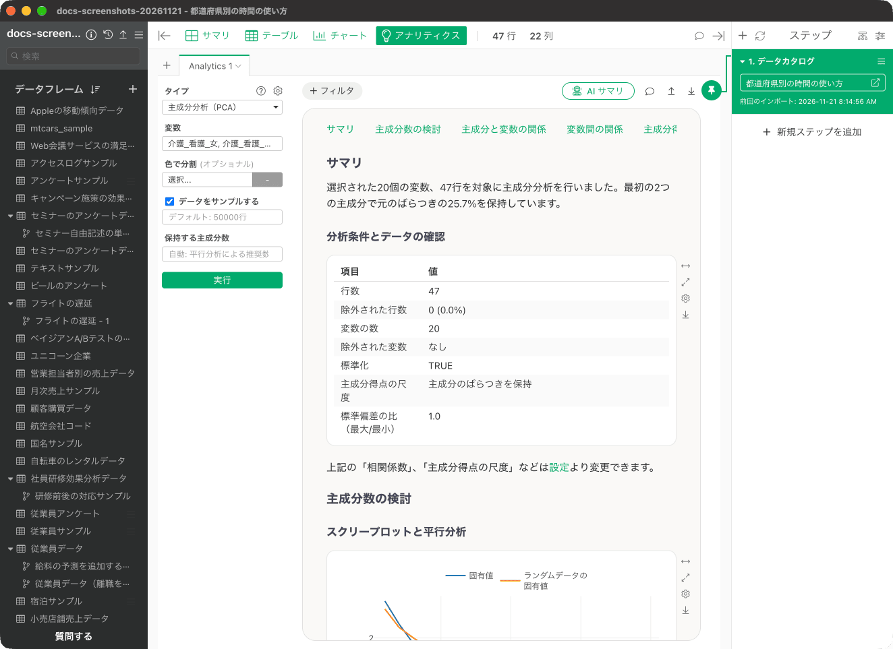

## 結果の解釈

結果はレポートとして縦に並び、上部の「サマリ」「主成分数の検討」「主成分と変数の関係」「変数間の関係」などのリンクから各節へ移動できます。

### 変数と観測値の関係の可視化

「変数間の関係」にある「変数と観測値の関係の可視化」では、それぞれの変数と観測値（データの1行）を2つの軸（第1主成分、第2主成分）で表現しています。点がそれぞれの観測値を表し、点が近いほど元の変数における特徴が似ており、離れているほど異なる特徴を持つ傾向があります。

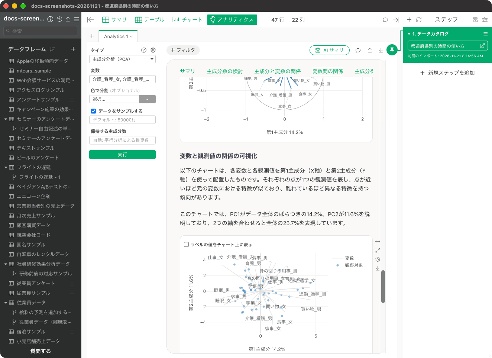

チャートを拡大すると、線がそれぞれの変数を、点がデータの1行を表していることがわかります。変数の線が同じ方向に向いている場合は、それらの変数で相関関係があると判断できます。

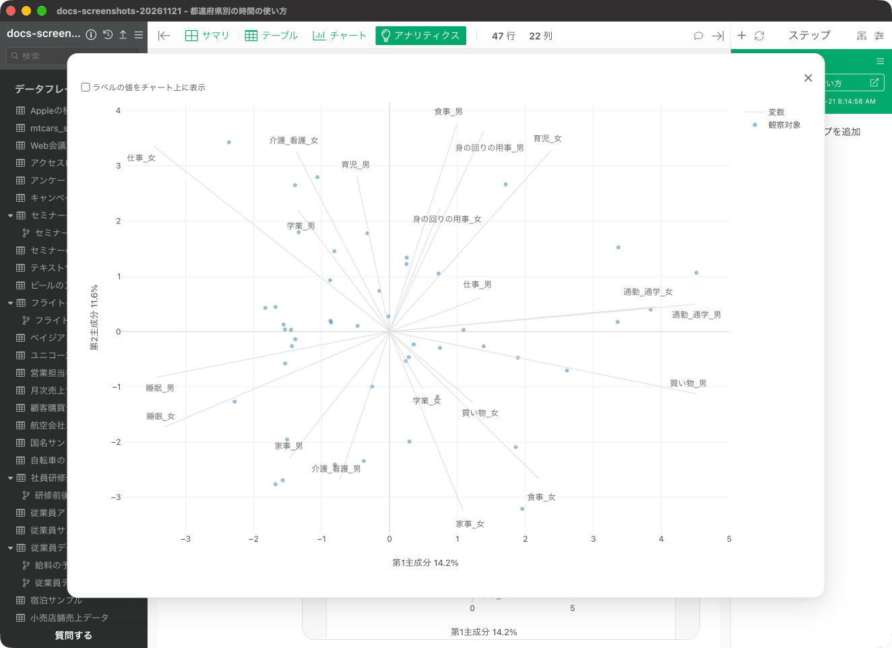

バイプロット上にラベルを表示したい場合は、「色で分割」に列を割り当て、「ラベルの値をチャート上に表示」にチェックをつけることで可能です。下記は「色で分割」に「都道府県」を割り当てたものです。

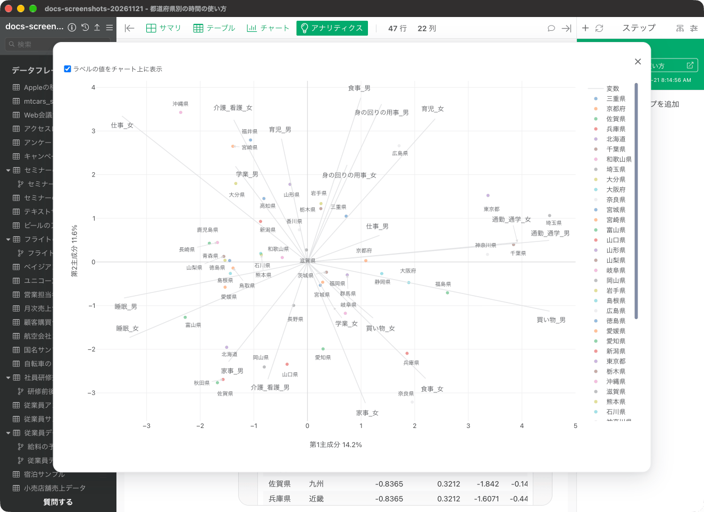

下記は20列使用して主成分分析を実行したものとなりますが、第1主成分で14.2%、第2主成分で11.6%と2つ合わせて全ての変数のばらつきの**25.7%** を表現できていると捉えることができます。

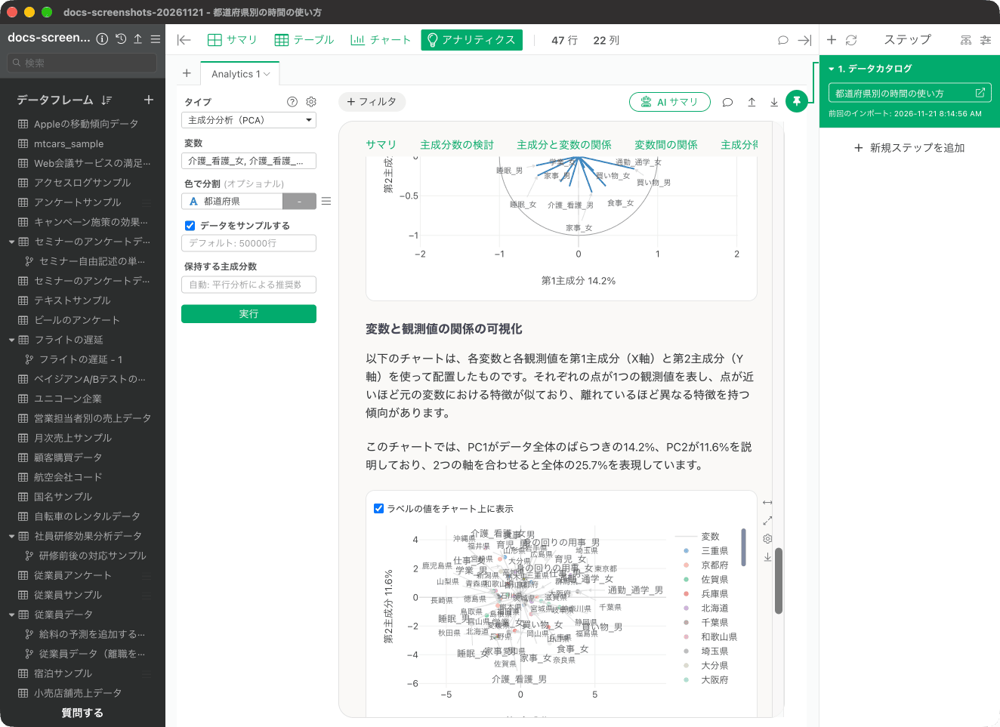

残りの約74.3%のデータのばらつきについては、第3主成分以降で説明がつくばらつきになっています。

バイプロットの詳細については、[こちら](https://exploratory.io/note/kanaugust/18-PCA-tWA7mRe3HR)の「主成分分析（PCA）の紹介」のノートをご覧ください。

### 主成分の寄与率

「主成分数の検討」にある「主成分の寄与率」では、主成分分析で作られた軸である第1主成分、第2主成分などによって元データの情報量（ばらつき）をどれだけ表現できるかを確認できます。

寄与率はそれぞれの主成分での情報量の表現できている割合で、累積寄与率はそれらの寄与率を足し上げて行った時にどれだけ表現できているのかがわかります。この例では、第1主成分の寄与率は14.15%、第2主成分は11.59%で、第2主成分までの累積寄与率は25.74%です。

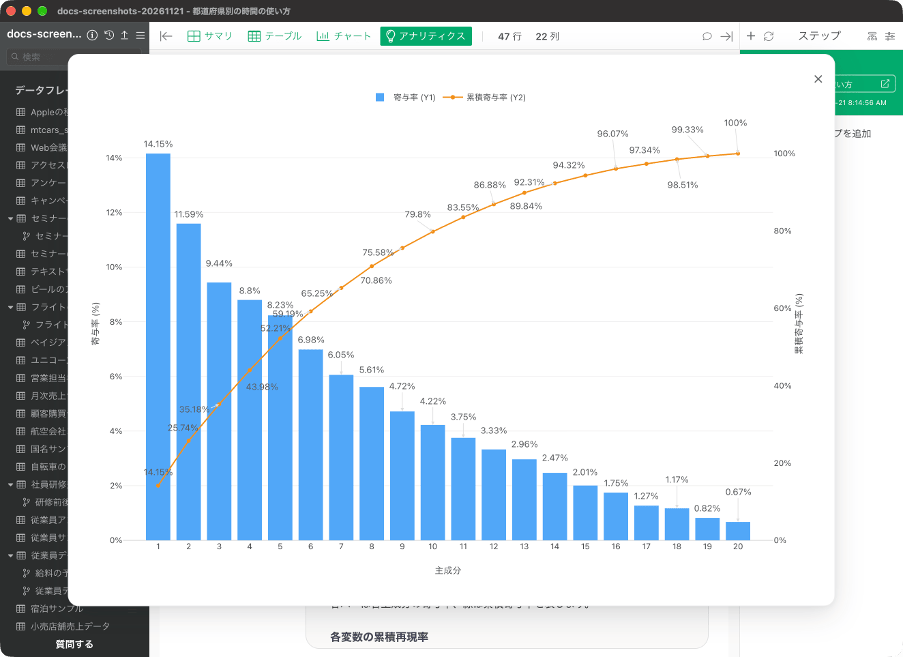

## 主成分分析に関するよくある質問

#### Q: 元のデータに対して主成分スコアをくっつけたデータを作ることはできますか？

主成分分析の結果の「主成分得点」の表には、元のデータに対して主成分得点としてPC1, PC2...が含まれています。

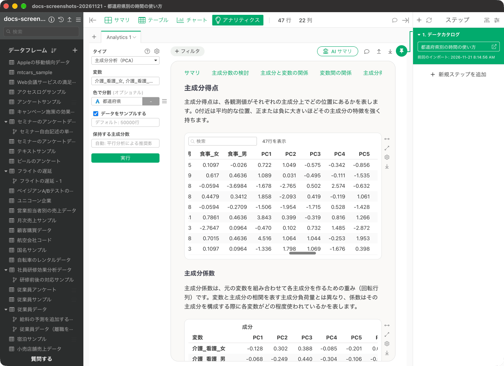

そのため、表の右上の「チャートのエクスポート」から「新規データフレームとして保存」を選ぶことで、データフレームとして保存できます。

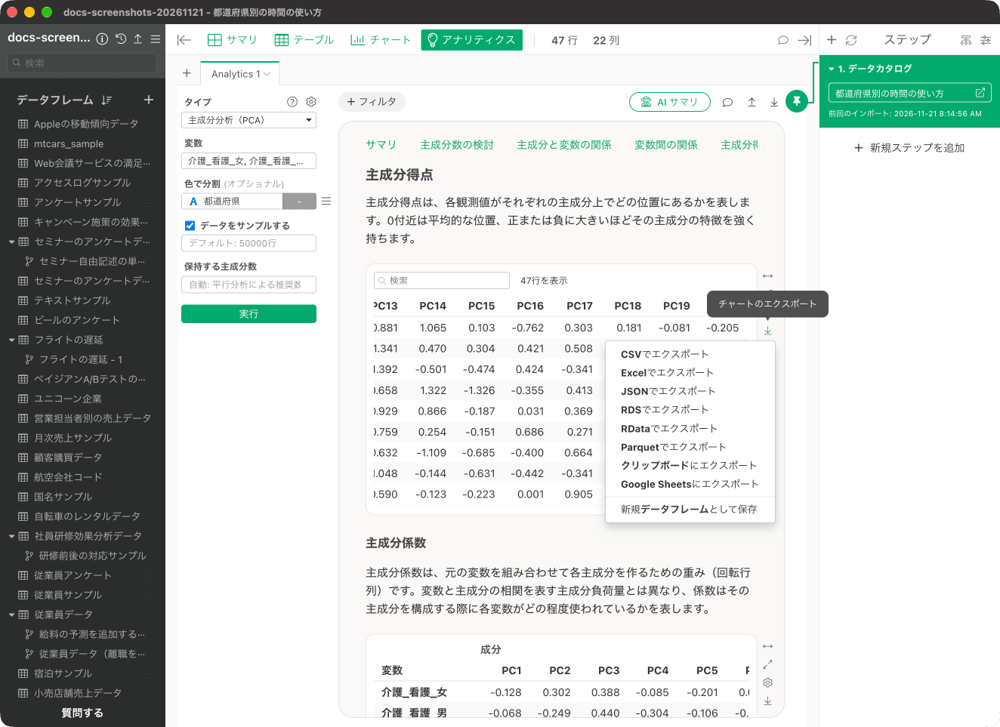
