生存曲線は、カプラン・マイヤー法を使って、生存率を計算して可視化する機能です。

## 何ができるか

生存曲線を使うと、次のような時間に関する分析ができます。

- ユーザーがサービスからチャーン（解約）するまでの時間
- 従業員が転職・退職するまでの時間
- 製品が故障するまでの時間（例：車を使い始めてから故障するまでの時間）
- ある病気にかかった人の余命（「生存分析」という名前の由来）

## 必要なデータ

生存曲線を描くためには、**1行が1観察対象（例：1行が1顧客）**のデータが必要です。

また、以下の情報も列に必要です。

- 開始時期：観察対象の観察の開始時期を表す、Data（日付）型、またはPOSIXct（日付時間）型の列
- 終了時期：観察対象の観察の終了時期を表す、Data（日付）型、またはPOSIXct（日付時間）型の列
- 生存状態：観察対象のイベントのステータスを表す、ロジカル型の列（例：死亡、キャンセル、など）
- 色で分割（オプショナル）：観察対象をグループ化する他の列があれば、グループごとに、生存曲線を描いて、比較できます。

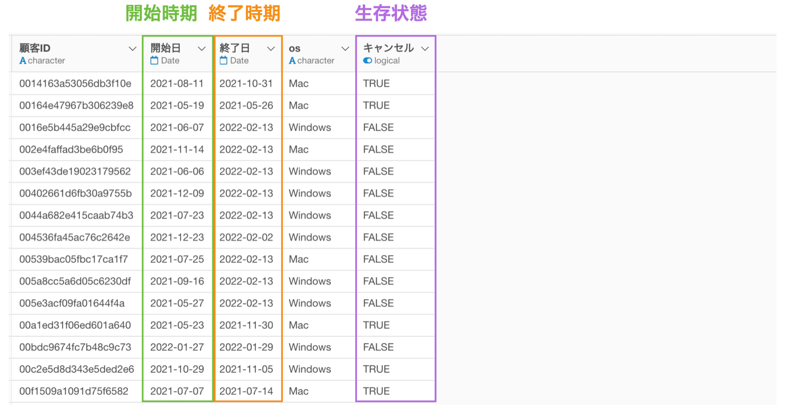

## サンプルデータ

今回はサンプルデータとして、[Webサービスの利用状況](https://exploratory.io/data/exploratory/Web-yJd7Gbl5)のデータを使用します。

このデータは、1行が1顧客を表していて、列にはサービス利用開始日や終了日、利用しているOS、生存状態（サービスをキャンセルしているかどうか）の情報があります。

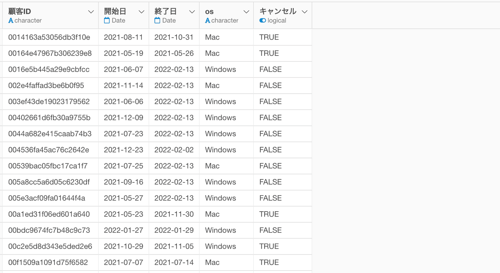

なお生存分析用のデータの作成方法は以下のリンクにて詳しく紹介していますので、よろしければ、ご参考ください。

- 生存分析用のデータの作成方法 - [リンク](https://exploratory.io/note/BWz1Bar4JF/Vzi7ahB2VN)

## 生存分析を実行する

アナリティクスビューを開き、「タイプ」のメニューから「生存分析」を選ぶと、「生存曲線」「コックス回帰」「サバイバル・フォレスト」が表示されます。ここでは「生存曲線」を選択します。

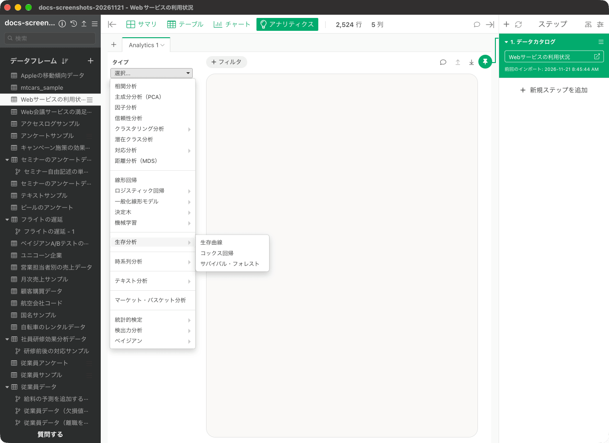

「開始時期」に「開始日」を選択します。

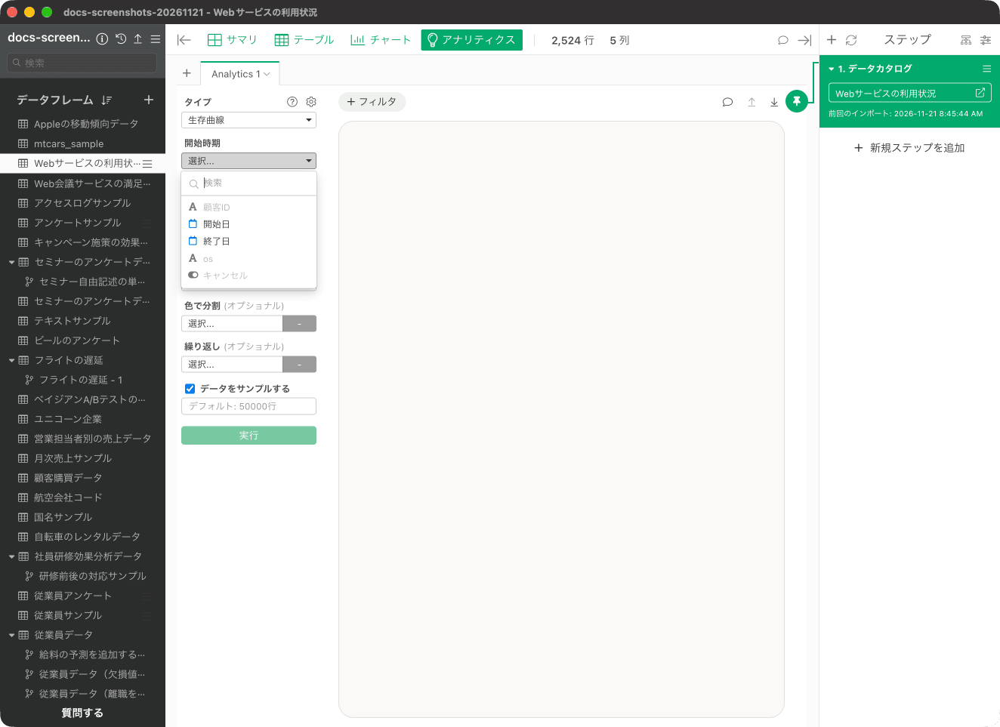

「終了時期」に、「終了日」を選択します。


「期間の単位」では生存期間の単位（自動、日、週、月、四半期、年）を設定できます。デフォルトは「自動」になっており、自動で最適な「期間の単位」が設定されます。このデータでは、自動で「週」になりました。

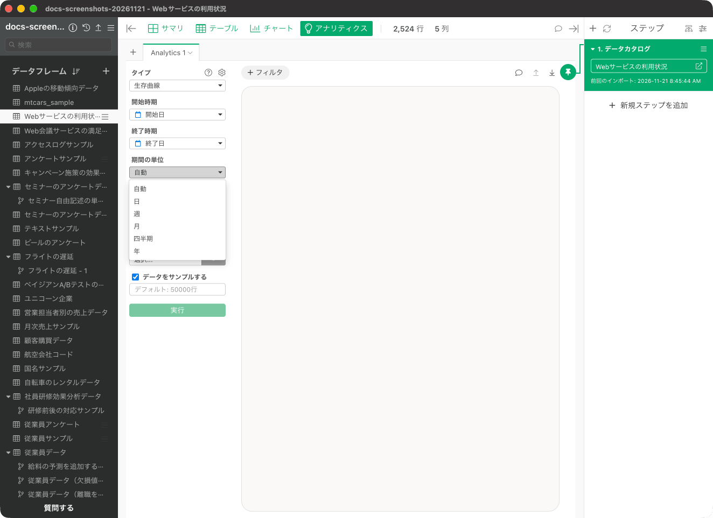

「生存状態（イベント）」に「キャンセル」を選択します。

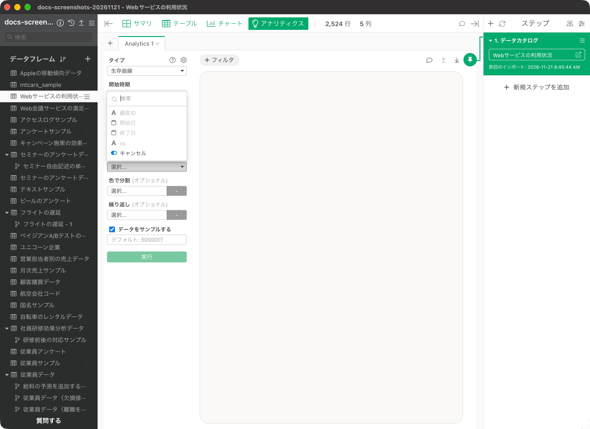

観察対象をグループに分けて、生存曲線を比較したいときは、「色で分割」にグループの列を選択します。

今回は「os」を選択し、実行します。

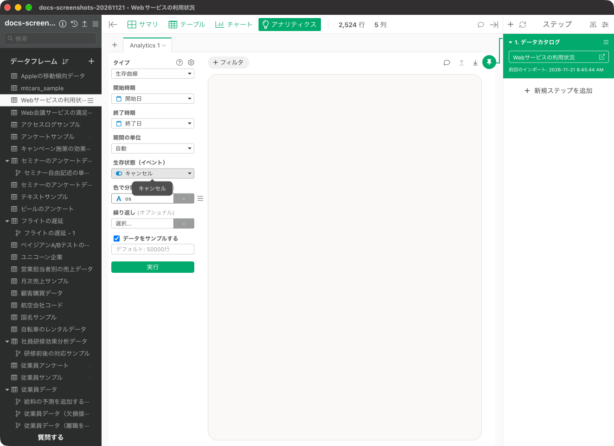

「色で分割」を指定しない場合は、全体の生存曲線が描かれます。レポートの上部には「生存曲線」「データ」「サマリ情報」「補足情報」のリンクが並びます。

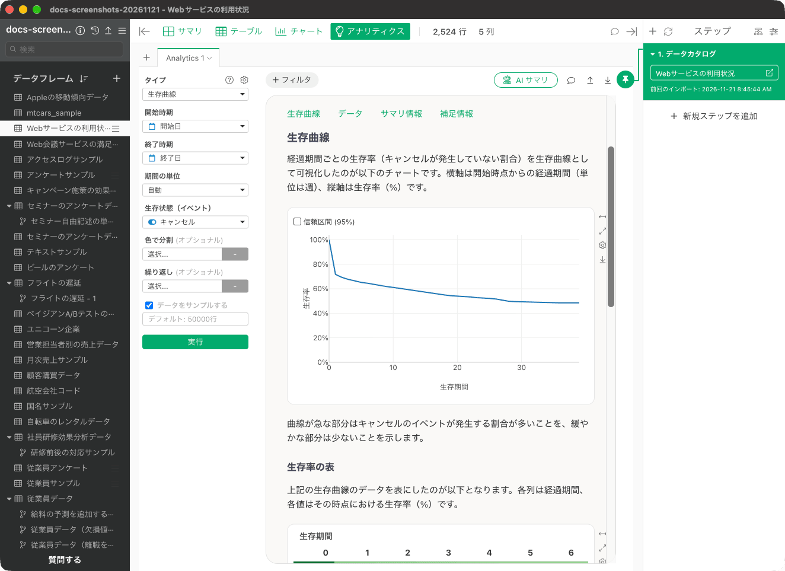

## 結果の解釈

### サマリ情報

「サマリ情報」の「生存曲線の有意性の検定」は、「色で分割」に列を選択したときにのみ、内容が表示されます。「色で分割」したグループ間の生存曲線の違いの有意性を調べるために、ログランク検定を行った結果が表示されます。

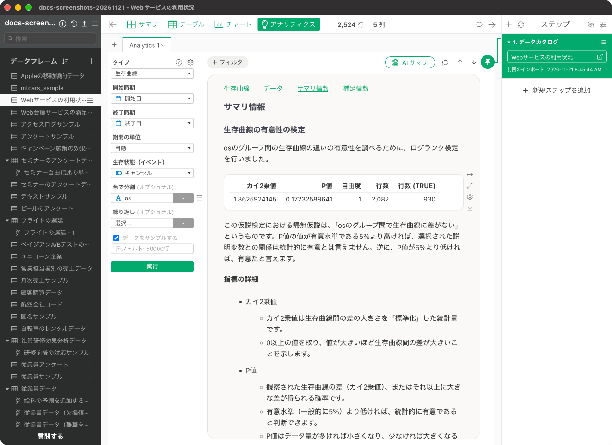

ログランク検定のP値は、「色で分割」したグループと生存曲線の間に関係がなかったと仮定したときに、「生存曲線」で見えている差と同じか、それ以上に極端な差が得られる確率となります。

仮に有意水準のしきい値を0.05(5%)としたときに、ログランク検定のP値が0.05(5%)以下の場合、「色で分割」したグループ間の生存曲線には有意な差があります。

今回の例では、ログランク検定のP値が0.17（0.1723）となるため、「色で分割」に選択している「os」と生存曲線の間には、有意な差があるとは言えません。

### 生存曲線

「生存曲線」では、どれだけの観察対象が、観察を始めてからキャンセルや退職などをせずに生き残っているのかを、経過時間ごとにラインチャートで可視化しています。

「色で分割」に列を選択したときにはカテゴリごとの生存曲線が描かれます。


「信頼区間（95%）」にチェックを付けると、生存曲線の信頼区間を表示されます。

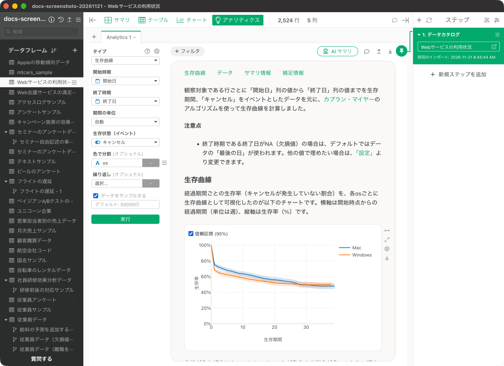

この信頼区間は、各時点の生存率の推定の不確かさを読むための図です。グループ間に差があるかどうかは、「サマリ情報」の「生存曲線の有意性の検定」（ログランク検定）のP値で判断します。今回の例（期間の単位は自動で、週）では、P値は0.1723のため、「os」の違いによる生存曲線の差は確認できませんでした。

### 生存率の表

「生存曲線」の下にある「生存率の表」では、どれだけの観察対象が、観察を始めてから解約や退職などのイベントを経験せずに生き残ったかを、色付きの表で可視化しています。

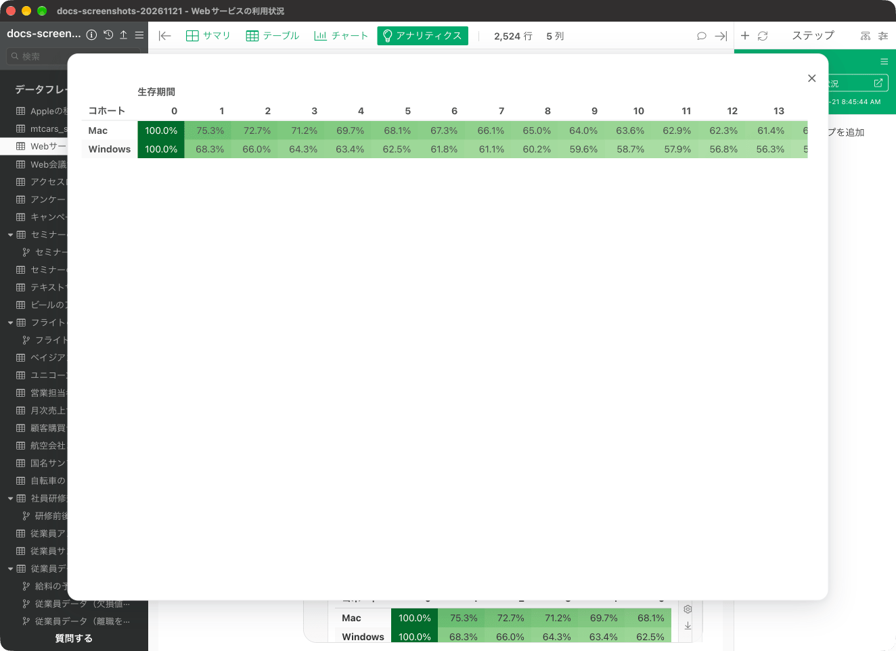

### データ

「データ」では、生存曲線で描かれているデータを確認できます。


各列は以下の情報を表しています。

- コホート - （オプション）色で分割に選択した列のグループの値
- 生存期間 - （例 ：サインアップしてからの日付）1行が1つの時間を示す
- 観察対象 - その行の時間が始まるまでにイベントがまだ起こっていない観察対象の数
- イベント - その行の時間内にイベントが発生した件数
- 打ち切り - その行の時間内に打ち切りになった件数
- 生存率 - その行の時間の終わりまでの生存率。このデータが生存曲線の可視化で使われる
- 標準誤差 - 生存率の標準誤差
- 信頼区間上限 - 生存率の信頼区間の上限
- 信頼区間下限 - 生存率の信頼区間の下限

## 生存曲線に関するよくある質問

Exploratoryが「生存曲線」に利用しているカプラン・マイヤー法について、よく聞かれる質問と、その答えをこちらにまとめました。

#### Q: 生存期間の単位の「月」や「年」はどのように計算されていますか？

Exploratoryの生存曲線では、「期間の単位」から、生存曲線を描く期間の単位（自動、日、週、月、四半期、年）の指定が可能です。

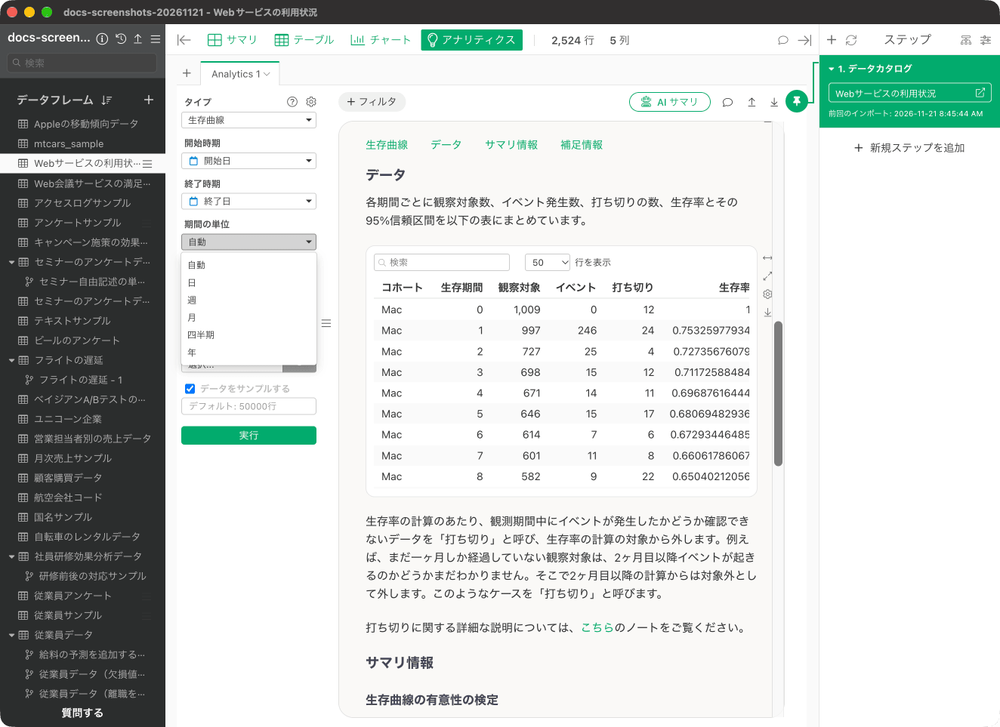

この「期間の単位」は、「終了時期」から「開始時期」を引いた生存期間の日数から計算されています。

例えば、1ヶ月あたりの日数は、うるう年を考慮した平均的な月の日数である`365.25`を`12ヶ月`で割った以下にて計算されます。

``` text
30.4375 = 365.25（日）/12（ヶ月）
```

仮に生存期間が90日だった場合、以下の計算により生存期間は約2.96ヶ月となるため、3ヶ月目までは生存ができなかったことになります。

``` text
2.95687885（ヶ月）  = 90 / 30.4375
```

また、期間の単位に「年」を選択したときは、「生存期間の日数」を`365.25`で割った値が生存「年」となります。

#### Q: 「打ち切り」とは何ですか？

「データ」の表の下には、画面上でも「打ち切り」の説明が表示されます。

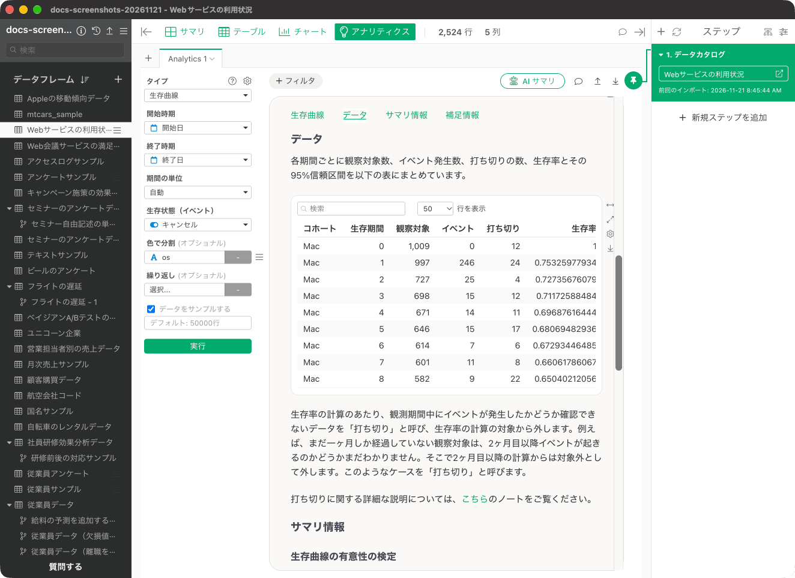

とあるサブスクリプション型のビジネスを例に考えてみます。

仮に今月が2024年の4月だったとすると、2024年の1月にサービスの利用を開始した人は、1、2、3月の3ヶ月間しかサービスを利用していないため、4ヶ月目にサービスを継続するかどうかがわかりません。

このように、注目している生存期間までのデータが存在しない観察対象のことを「打ち切り」と呼び、当該期間の生存率の計算対象から省くことになります。なお、打ち切りや生存率の計算方法の詳細は[こちら](https://youtu.be/vGkFN-yp2Zc?si=UNEAsdEyZGOGEop0&t=1110)の動画で紹介していますので、ご参考ください。

#### Q: 想定よりも一区間早く打ち切りやイベントが発生する

多くの場合、これらの疑問は前の項目で説明している生存期間の単位の計算方法を理解することで、解消されます。

例えば、以下のようなデータがあったとします。

| userid | 開始時期 | 終了時期   | イベント | 生存期間（日） |
|--------|----------|------------|----------|----------------|
| a      | 2020/1/1 | 2020/6/30  | TRUE     | 181            |
| b      | 2020/7/1 | 2020/12/31 | FALSE    | 183            |
| c      | 2020/1/1 | 2020/12/31 | FALSE    | 365            |
| d      | 2020/1/1 | 2020/12/31 | TRUE     | 365            |

開始時期と終了時期を見ると、useridが`a`の人は6ヶ月間生存しているように見えるため、イベントは7ヶ月目に発生するように感じますが、この人の生存日数は「181」日です。

生存期間の単位の「月」は、生存期間の日数をうるう年を考慮した平均的な月の日数である、`30.4375`で割るため、生存期間は`5.94ヶ月`となり、6ヶ月目にイベントが発生することになるわけです。

下記は、Webサービスの利用状況のデータで「期間の単位」を「月」にした「データ」の表です。生存期間が月ごとの行になります。


同様の理由でuseridが`d`の人は1年間生存しているように見えるため、イベントは1年と1ヶ月目に発生するように感じますが、この人の生存日数は「365」日です。

生存期間の単位の「年」は、生存期間の日数をうるう年を考慮した平均的な年間の日数である、`365.25`で割るため、生存期間は約`0.999`年となる1年間生存できていないことになるわけです。

下記は、同じデータで「期間の単位」を「年」にした「データ」の表です。生存期間が年ごとの行になります。

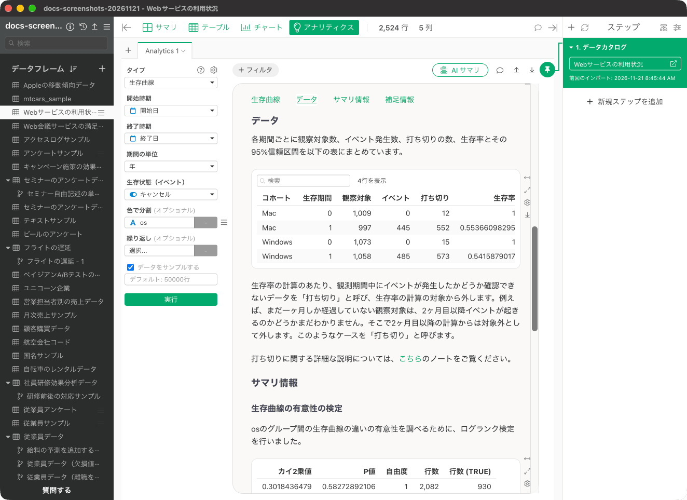

#### Q: 打ち切りが「0」になってしまう

生存分析を実行した際、打ち切り対象の観察対象がいるにも関わらず、「データ」の表で打ち切りが「0」になってしまうことがあります。

このようなときには、終了時期の欠損値の扱いの設定を確認してください。歯車の「設定」の「データの前処理」にある「終了時期の欠損値 (NA) を埋める」では、「データの中の最新の日時」（デフォルト）、「今日」、「日時を指定」の3つから選べます。設定を変えて実行し直し、「データ」の表で打ち切りの数が変わるかを確かめます。

詳しいやり方は[こちら](https://exploratory.io/note/exploratory/QgS3GCm3Cx)で紹介していますので、ご参考ください。

#### Q: 終了日の欠損値には何を指定すると良いですか？

設定ボタンをクリックすると、「データの前処理」に「終了時期の欠損値 (NA) を埋める」というオプションがあり、「データの中の最新の日時」（デフォルト）、「今日」、「日時を指定」の3つのタイプがサポートされています。

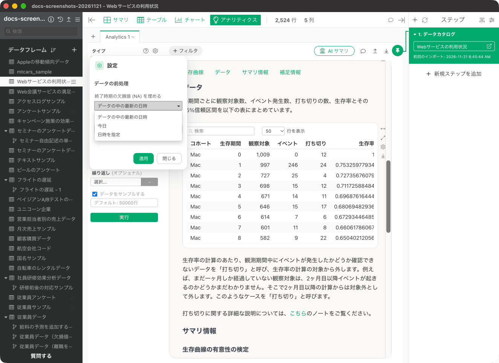

もし、使用されているデータが定期的に更新される場合、終了時期の欠損値を「今日の日付」で埋めると良いかと思います。

一方で、データが定期的に更新されるわけではなく、都度気になった時に見ていくのであれば、「データの中の最新の日時」や「日時を指定」をすると良いのではないかと思います。

データの中の最新の日時については、終了日の最後の日付で埋められることになり、例えば2023-12-31が最後の日付であればその日で埋めることができます。
