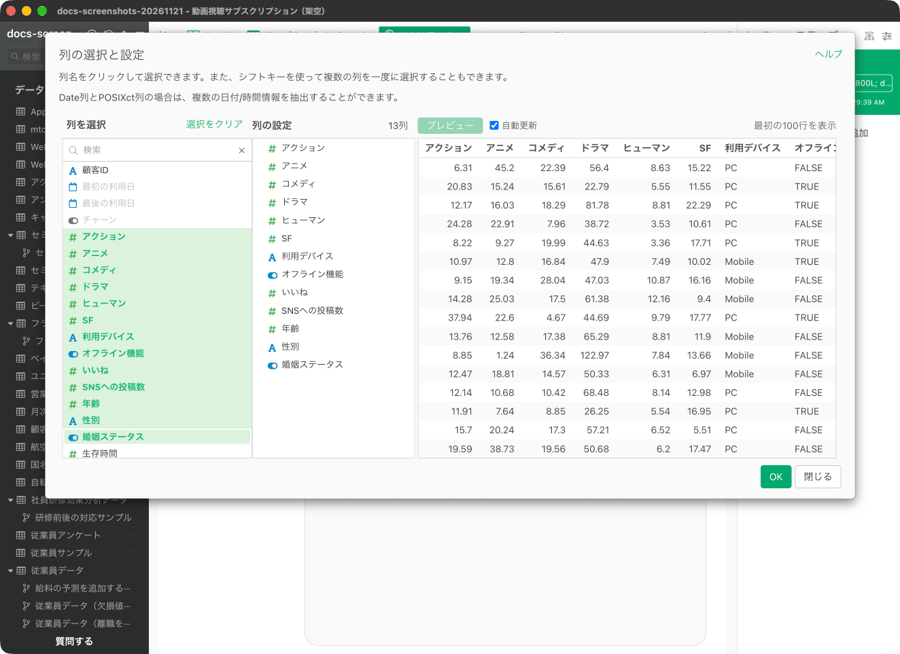
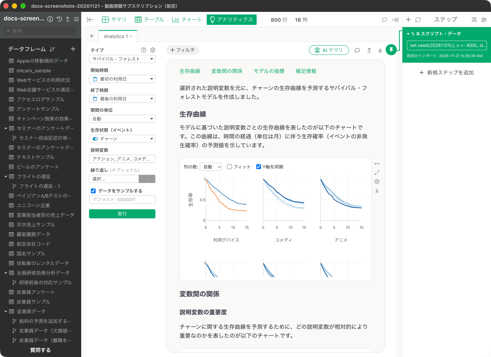
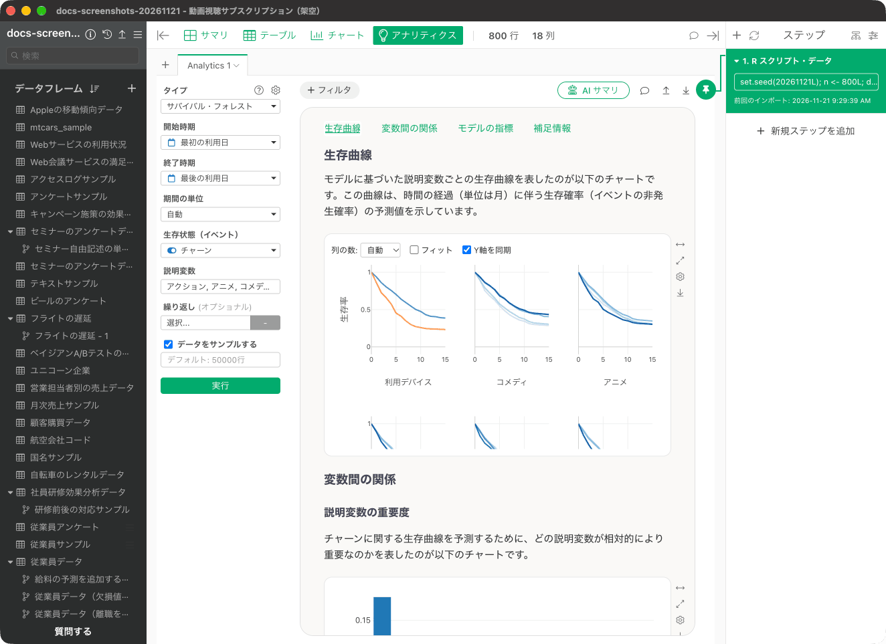
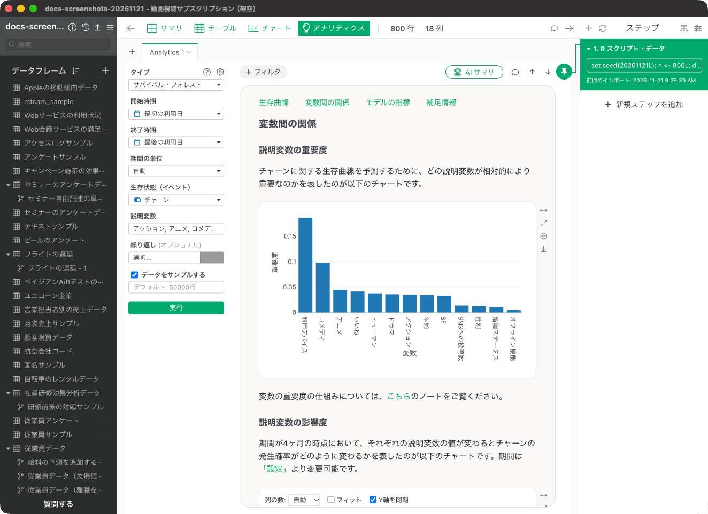
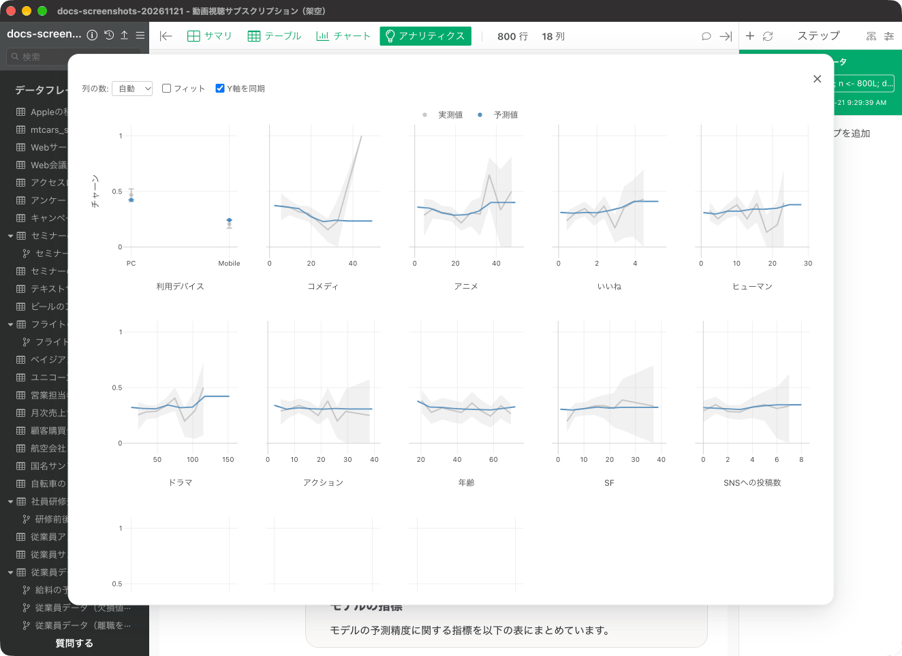
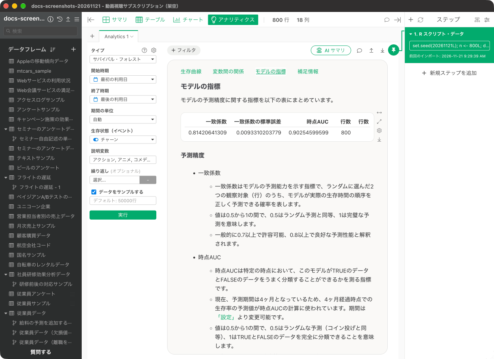
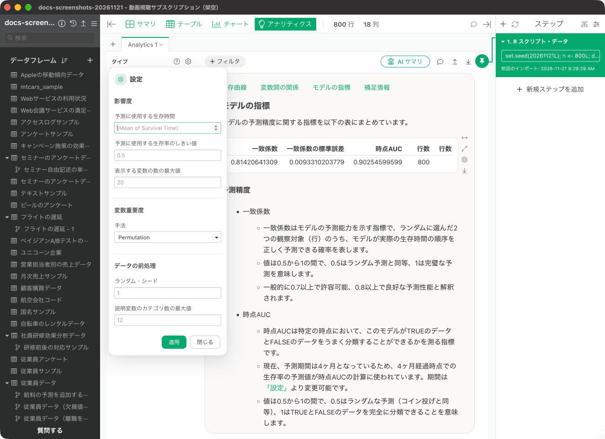

サバイバル・フォレストは、生存分析のアルゴリズムの一つです。たとえばサブスクリプション型のビジネスで顧客のキャンセルを考えるときは、「サービスをキャンセルするかどうか」ではなく、「どれくらいの期間でキャンセルが発生したのか」が重要です。

## 何ができるか

サバイバル・フォレストを使うと、次の質問に答えられます。

- このデータ（説明変数）を使うことで、あるタイミング（例：サービスの利用開始から1年後）における生存状態（例：サービスのキャンセル）のTRUE/FALSEをどれだけうまく分けられているか。
- どの変数が、あるタイミングにおける生存状態を予測するうえで重要か。
- 説明変数の値が変わると、生存曲線はどのように変わるか。

## 必要なデータ

サバイバル・フォレストのモデルを作成するためには、**1行が1観察対象（例：1行が1顧客）**となっているデータが必要です。

また、以下の情報も列に必要です。

- 開始時期：観察対象の観察の開始時期を表す、Date（日付）型、またはPOSIXct（日付時間）型の列
- 終了時期：観察対象の観察の終了時期を表す、Date（日付）型、またはPOSIXct（日付時間）型の列
- 生存状態：観察対象のイベントのステータスを表す、ロジカル型の列（例：チャーン、解約、離職、死亡など）
- 説明変数：生存状態を予測するための列（データタイプには特に縛りはありません）

## サンプルデータ

今回は、動画視聴のサブスクリプション・サービスを想定したサンプルデータを使います。この例のデータは説明用に作った架空のものです。

データは800行・18列で、1行が1顧客です。列は次のとおりです。

- 顧客ID、最初の利用日、最後の利用日、チャーン
- 視聴時間を表す、アクション、アニメ、コメディ、ドラマ、ヒューマン、SF
- 利用デバイス（Mobile または PC）、オフライン機能、いいね、SNSへの投稿数
- 年齢、性別、婚姻ステータス
- 生存時間（日数）

## サバイバル・フォレストのモデルを作成する

アナリティクス・ビューでタイプの「生存分析」から「サバイバル・フォレスト」を選び、以下の項目を指定して「実行」します。

- 開始時期：「最初の利用日」
- 終了時期：「最後の利用日」
- 期間の単位：「自動」（今回の結果は月単位で表示されます）
- 生存状態（イベント）：「チャーン」
- 説明変数：アクションから婚姻ステータスまでの13列

説明変数の「列の選択と設定」では、列名をクリックして選択します。Shiftキーを押しながら選ぶと、複数の列を一度に選択できます。今回は「顧客ID」と「生存時間」を除いた13列を選び、右下の「OK」で確定してから「実行」をクリックします。

実行すると、「生存曲線」「変数間の関係」「モデルの指標」「補足情報」のリンクが並ぶ結果が表示されます。

## 結果の解釈

### 生存曲線

「生存曲線」では、モデルに基づいた説明変数ごとの生存曲線が表示されます。この曲線は、時間の経過（単位は月）に伴う生存確率（イベントの非発生確率）の予測値を示しています。

### 説明変数の重要度

「変数間の関係」の「説明変数の重要度」では、チャーンに関する生存曲線を予測するために、どの説明変数が相対的により重要なのかがチャートで表示されます。重要度の値が大きいほど、予測するうえで重要な変数です。今回のデータでは「利用デバイス」が最も大きく、次に「コメディ」が続きます。

重要度の算出方法は、設定の「変数重要度」にある「手法」で選びます。今回の表示は「Permutation」でした。Permutation Importanceは、学習済みモデルを固定し、評価用データで対象列の値を並べ替えた前後の予測誤差の差を重要度とする方法です。

変数重要度の詳しい説明については、[こちら](https://exploratory.io/note/kanaugust/56-Svv7VWV8tA)の「機械学習モデル - 変数重要度の仕組みと解釈」のノートをご覧下さい。

### 説明変数の影響度

「説明変数の影響度」では、期間が4か月の時点において、それぞれの説明変数の値が変わるとチャーンの発生確率がどのように変わるかが表示されます。実測値はグレー、予測値は青で表示されます。

このとき使われる生存時間は、設定の「予測に使用する生存時間」の初期値である「Mean of Survival Time」（生存期間の平均）です。今回のデータでは4か月でした。

### モデルの指標

「モデルの指標」では、この予測モデルの評価を確認できます。今回のデータでは、一致係数が0.814、時点AUCが0.903でした。

時点AUCは、ある時点におけるチャーンのTRUE/FALSEをこのモデルでどれだけ上手く分けられているかの指標で、0から1の間の値を取ります。0.5はランダムに順位を付けた場合の目安で、1に近ければ近いほど、モデルがデータのTRUE/FALSEを上手く分けられていることを示します。画面では、予測期間が4か月のため、4か月経過時点での生存率の予測値が時点AUCの計算に使われると説明されています。

今回のトレーニングデータ800行では、4か月時点の時点AUCが0.903と1に近く、チャーンのTRUE/FALSEをよく分けられています。新しい顧客に対する性能は、別のデータで確かめる必要があります。

## サバイバル・フォレストに関するよくある質問

#### Q: 「説明変数の影響度」で表示されている実測値はどのように求められているのですか？

実測値はそれぞれの説明変数のデータタイプによって表示が異なります。 詳しくは[こちら](https://exploratory.io/note/GMq1Qom5tS/csB2RRw5wl)のノートをご覧ください。

#### Q: 「説明変数の影響度」で表示されている予測値はどのように求められているのですか？

予測値のチャートはPartial Dependence Plot（PDP）と呼ばれるもので、注目している変数の値を変化させたときに、予測結果がどう変わるかを可視化したチャートとなります。詳しくは[こちら](https://exploratory.io/note/exploratory/Sbd0LDU6)のノートをご覧ください。

#### Q: 予測に使用する生存期間はどのように変更できますか？

「予測に使用する生存時間」の初期値は「Mean of Survival Time」（生存期間の平均）ですが、「タイプ」の右にある歯車の設定の「影響度」にある「予測に使用する生存時間」から変更できます。

#### Q: 予測に使用する生存率のしきい値はどのように変更できますか？

設定の「影響度」にある「予測に使用する生存率のしきい値」から変更できます。しきい値の初期値は0.5です。

#### Q: 時点AUCと一致係数はどちらを優先してみればいいでしょうか？

決まりのようなものはないのですが、予測において、何を重視したいかによってどの指標を重視するかを決めていただければよいかと思います。

例えば、**一年後**のように、特定の時点までにイベントが発生するのかどうかを予測することが重要であれば、1年後の「時点AUC」を見ていただくのがよいと思います。

どの時点ということに関係なく、イベントが発生しやすそうなほうから観察対象（例：顧客、従業員、など）にランク付けすることが重要なのであれば、「一致係数」をみていただくのがよいと思います。
