2標本t検定（旧称: t検定）は統計的検定の手法の一つで、2 つのグループ間で、数値の平均値の差が有意かどうかを検定するアナリティクスです。

## 何ができるか

たとえば、営業部と研究開発部の給料の平均値を可視化したバーチャートがあり、2 つの部署の平均値が 700 ドルほど違うとします。この違いが意味のあるものかどうかは、バーチャートだけでは判断できません。それぞれの部署の人数（行の数）や給料のばらつきが大きく違うかもしれないからです。t検定を使うと、意味のある違いがあるかどうかを検証できます。

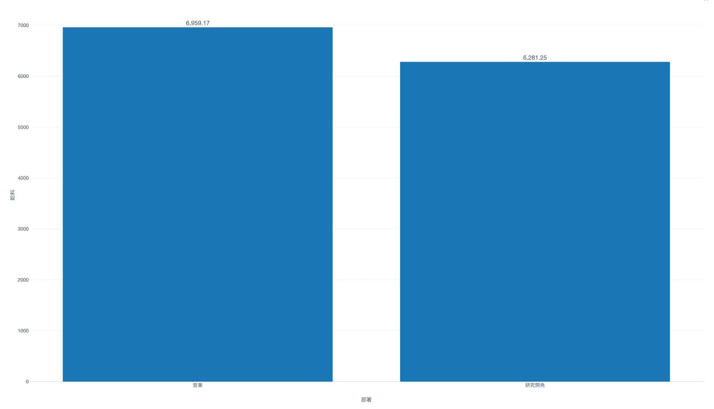

## 必要なデータ

1 行が 1 つの観察を表し、比較する 2 つのグループを表す列があるデータが必要です。

このページの例では、[従業員データ](https://exploratory.io/data/exploratory/CAj2fan5)を使います。1 行が 1 従業員で、年齢、給料、職種など従業員の属性を表す列があります。

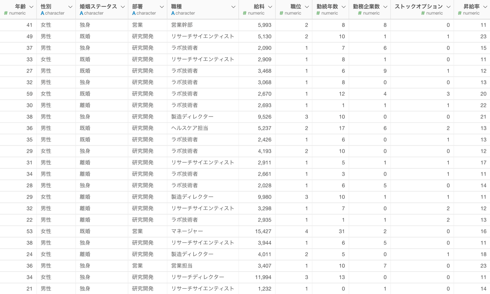

## 使い方

この例では、部署が「営業」と「研究開発」の間で、「給料」の平均値に統計的に有意な差があるかを調べます。部署には、「営業」「研究開発」のほかに「人事」があり、一意な値は 3 つです。

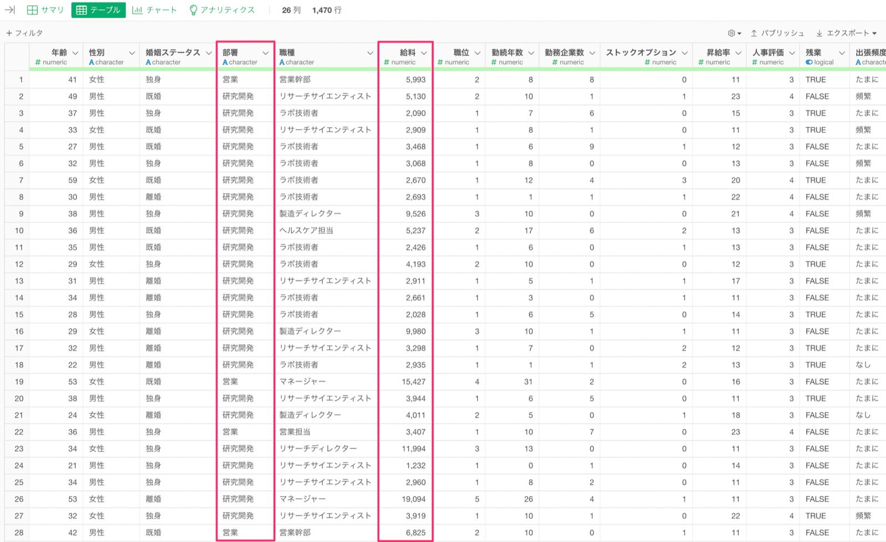

1. アナリティクス・ビューを開き、タイプの「統計的検定」の「平均値を比較」から「2標本t検定」を選びます。

   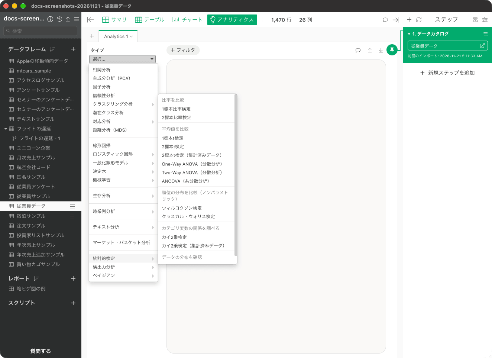

2. 目的変数に「給料」、説明変数に「部署」を選びます。「対応キー」と「繰り返し」は任意の項目で、この例では選びません（対応キーは、後の「対応のあるデータで使う」で使います）。

   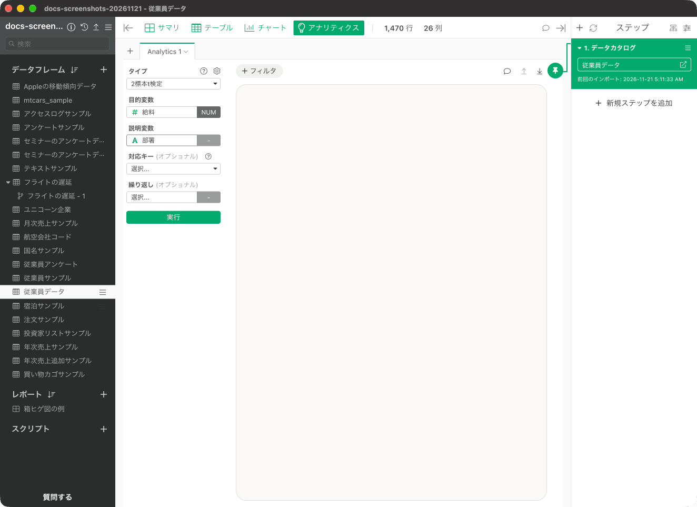

   このまま実行すると、「t検定の説明変数は2つのカテゴリのみに対応していますが、現在3つあります。データをフィルターして2つに絞り込むか、3つのカテゴリをまとめて比較できるOne-way ANOVA（分散分析）を利用してください。」というエラーが表示されます。2標本t検定は、2 つのグループ間で平均値の差を検定する手法だからです。

   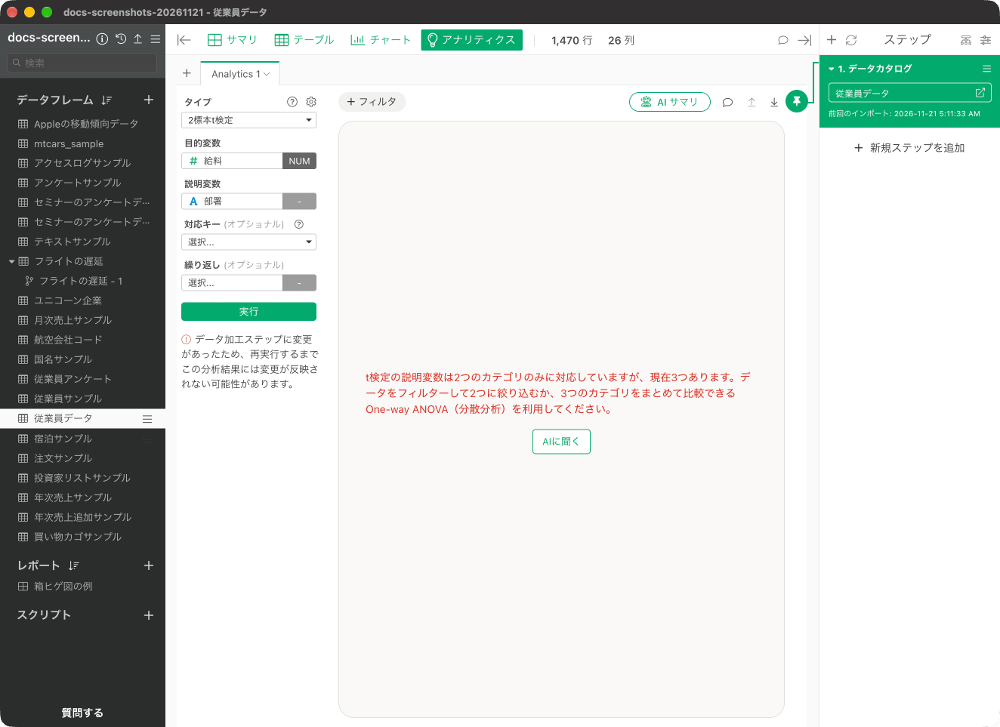

3. 部署が「営業」と「研究開発」のデータだけに絞り込みます。アナリティクスの上部にある「フィルタ」を選びます。説明変数に割り当てた列の一意な値の数がすでに 2 の場合は、この手順は不要です。

   

4. 列に「部署」、演算子に「どれかに等しい (複数の値)」を選びます。値には「営業」と「研究開発」を選び、「実行」ボタンをクリックします。

   

   部署が「営業」と「研究開発」の間で、給料の平均値の差が有意かどうかを調べるt検定が実行され、結果がレポートとして表示されます。上部の「サマリ」「有意性」「効果量」「検出力」「記述統計情報」「前提条件と注意点」のリンクから、それぞれの節に移動できます。

   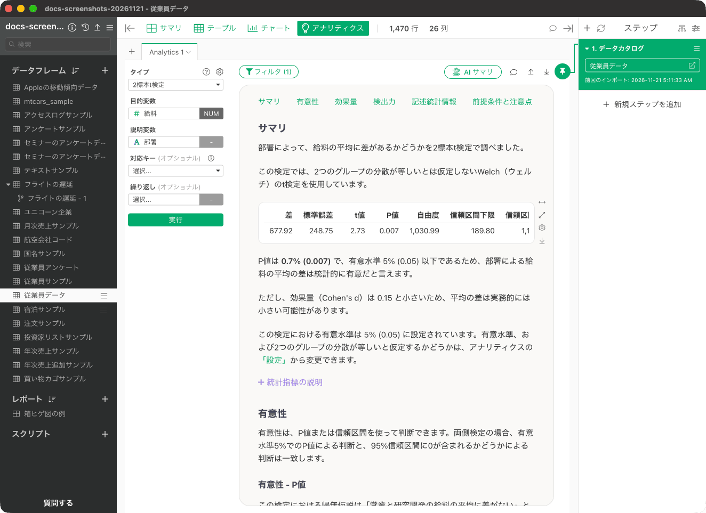

## 結果の見方

### サマリ

検定の結果が有意かどうかを確認できます。2 つのグループの分散が等しいとは仮定しないWelch（ウェルチ）のt検定が使われています。表には、平均値の差（677.92）、t 値（2.73）、P 値（0.007）、自由度（1,030.99）などが表示されます。

帰無仮説は「2 つのグループの平均値に差がない」です。P 値は、帰無仮説のもとで、観測した検定統計量と同じか、それ以上に極端な値が得られる確率です。一般的には、0.05（5%）を下回ると有意とされます。P 値は 0.7%（0.007）で有意水準 5% 以下なので、部署による給料の平均の差は統計的に有意です。ただし、効果量（Cohen's d）は 0.15 と小さいため、平均の差は実務的には小さい可能性があります。

有意水準と、2 つのグループの分散が等しいと仮定するかどうかは、アナリティクスの「設定」から変更できます。

### 有意性 - P値

検定には、使ったデータの自由度をもとにした t 分布を使います。今回の結果である t 値が t 分布のどこにあるかが、青い点線で表示されます。薄い青の領域は、有意水準 5% に対応する棄却域です。点線が棄却域に入っていれば、平均値の差は統計的に有意です。

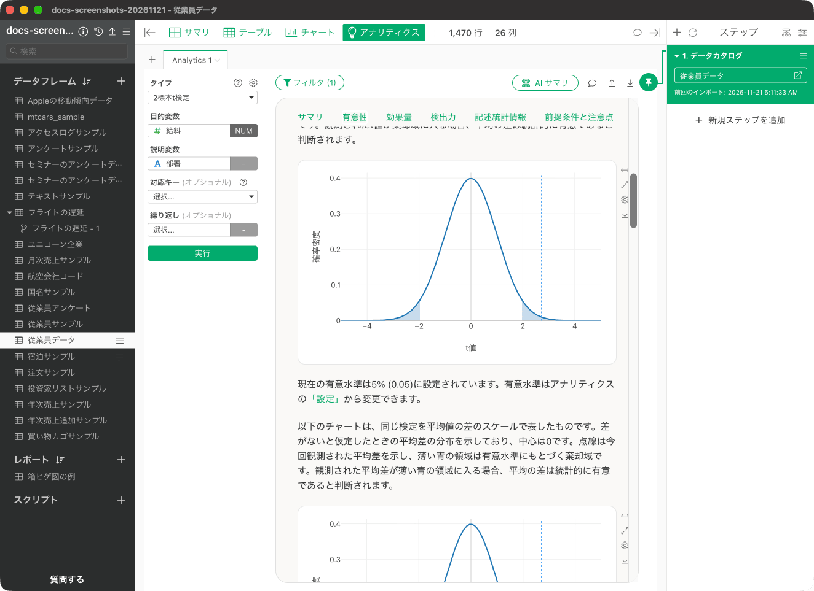

### 有意性 - 信頼区間

グループ間の平均値の差とその 95% 信頼区間が、エラーバーで表示されます。差は、ベースレベル（行数が最も多いカテゴリの値）と比べた差です。信頼区間が 0 を含んでいれば、平均値の差が 0 かもしれないため、統計的に有意とは言えません。0 を含んでいなければ、有意です。両側検定では、P 値による判断と、信頼区間に 0 が含まれるかどうかによる判断は一致します。

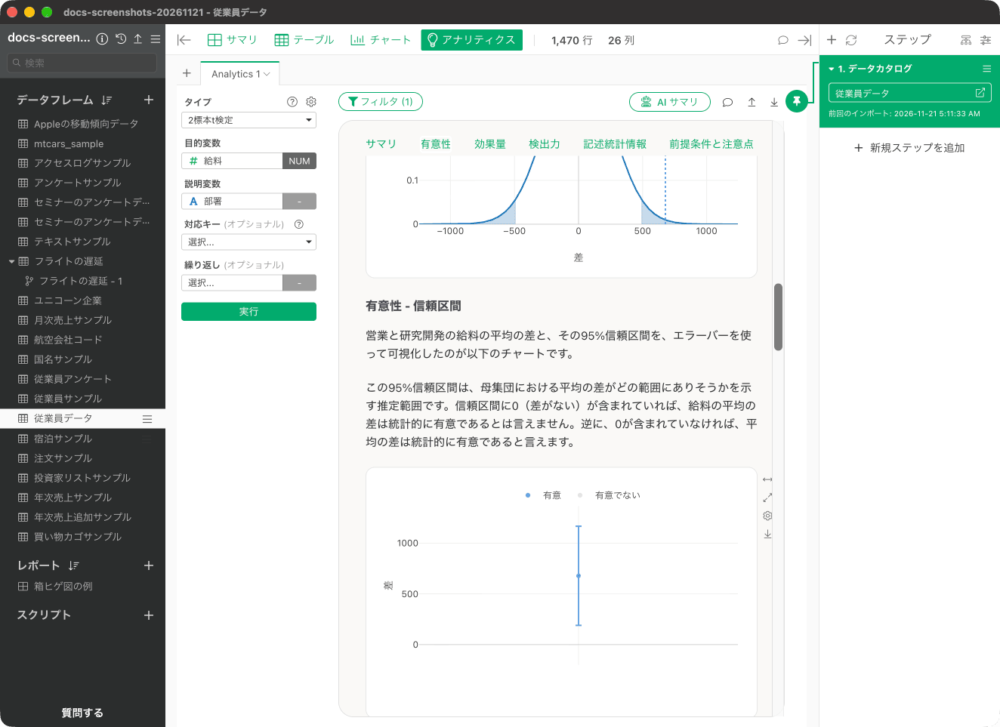

### 効果量

P 値は、サンプルサイズの影響を受けます。サンプルサイズが大きいと、小さな差でも統計的に有意と判定されることがあります。そのため、P 値だけでなく、効果量で差の大きさを確認することが重要です。この検定では、効果量として Cohen's d を計算しています。大きさの目安は、0.2 が小さい効果、0.5 が中程度の効果、0.8 が大きい効果です。Cohen's d は 0.15 で、小さい効果と考えられます。

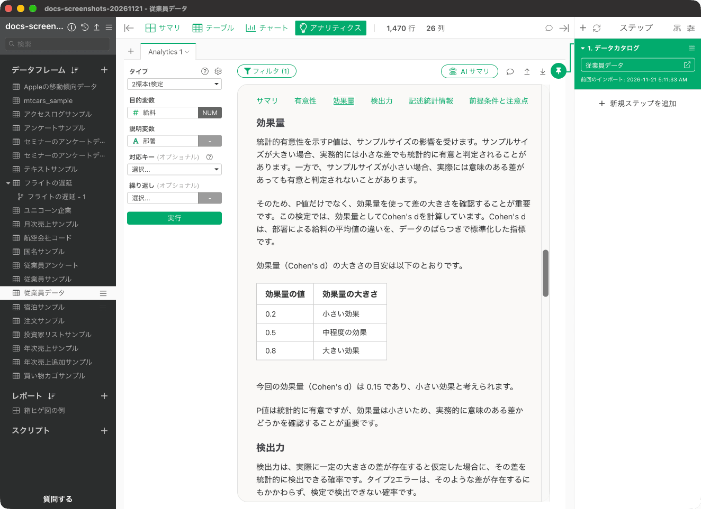

### 検出力

検出力は、実際に一定の大きさの差が存在すると仮定した場合に、その差を統計的に検出できる確率です。一般的には、80%（0.8）以上あることが望ましいとされています。今回の結果は統計的に有意と判断されているため、主に効果量と信頼区間を確認して、差の大きさや実務的な意味を評価します。

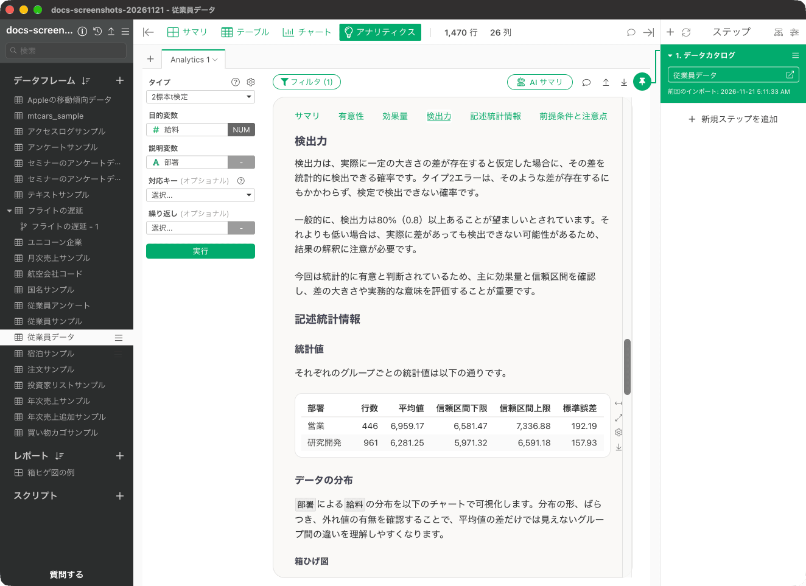

### 記述統計情報

グループごとの行数、平均値、平均値の信頼区間、標準誤差が、上の画面の表で確認できます。営業は 446 人、研究開発は 961 人で、平均の差の検定結果はサマリで確認します。

## 対応のあるデータで使う

同じ人の研修の前と後など、2 つのグループのデータが対応している場合は、「対応キー」を指定します。対応キーには、同じ人や同じ対象を識別する列を選びます。

ここでは、これまでの従業員データとは別に、社員研修効果分析データ（1,000 人）を使います。1 行が 1 人で、研修前と研修後のスコアが別々の列に入っている（ワイド型の）データは、そのままでは使えません。「研修前スコア」と「研修後スコア」の列を選び、列ヘッダーメニューから「ワイド型からロング型へ」を実行します。すると、元の列名が入る列が「研修時点」、値の列が「スコア」になり、データは 2,000 行になります。

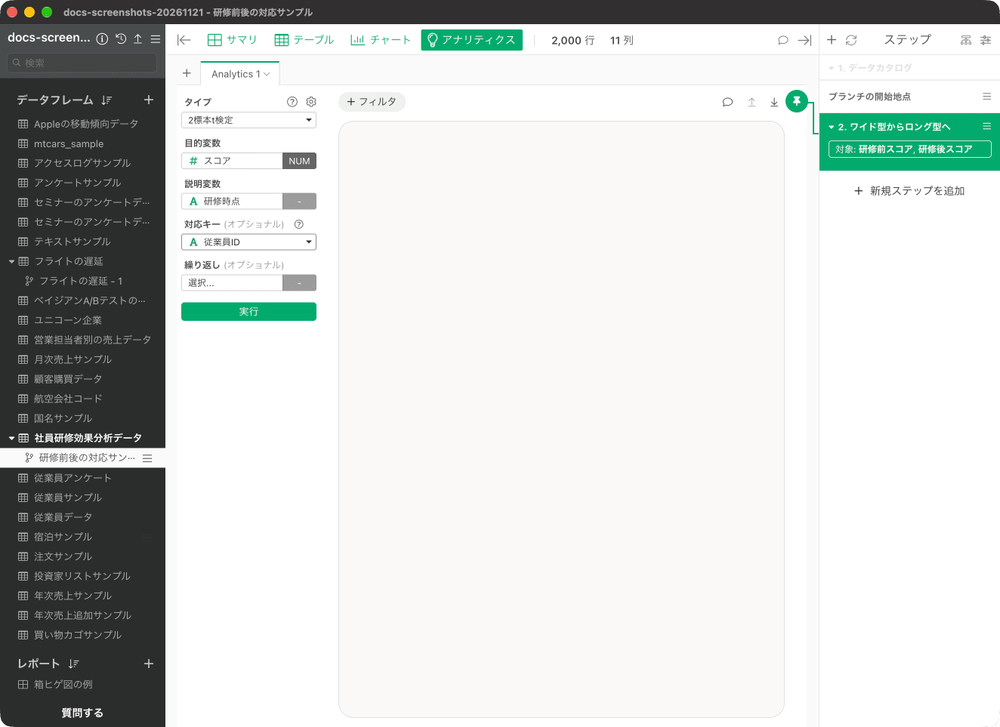

目的変数に「スコア」、説明変数に「研修時点」、対応キーに「従業員ID」を選んで実行します。

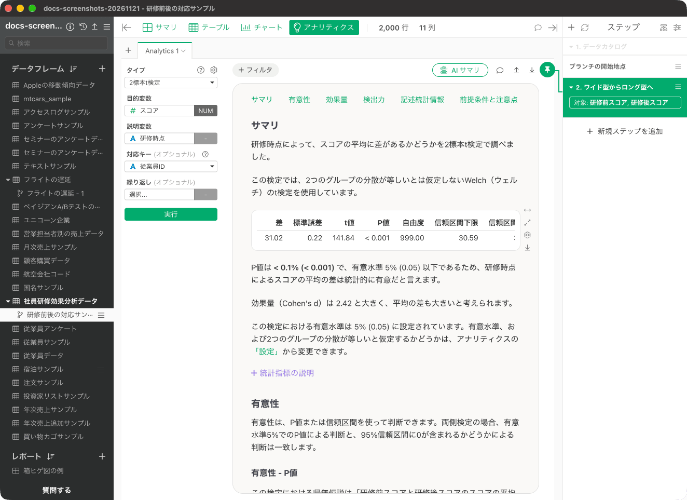

結果は、差が 31.02、t 値が 141.84、自由度が 999 で、P 値は 0.001 未満です。
