テキスト分析の「単語のカウント」は、自由記述のテキストを単語に分け、それぞれの単語が何回出てくるかを集計して、データの中にあるパターンや特徴をつかむアナリティクスです。

## 何ができるか

アンケートの自由記述は、回答者が持つ具体的な考えを引き出せる一方で、人によって解釈が分かれるため、全体の傾向を客観的にとらえにくいデータです。文章を単語に分けて出現回数を数えると、たとえば「時間」という単語がどれだけ使われているかを比べられます。

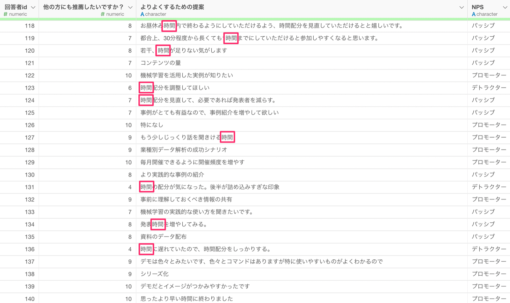

文章を単語に分けるイメージは次のとおりです。単語に分けることで、それぞれの単語の出現回数を集計できます。

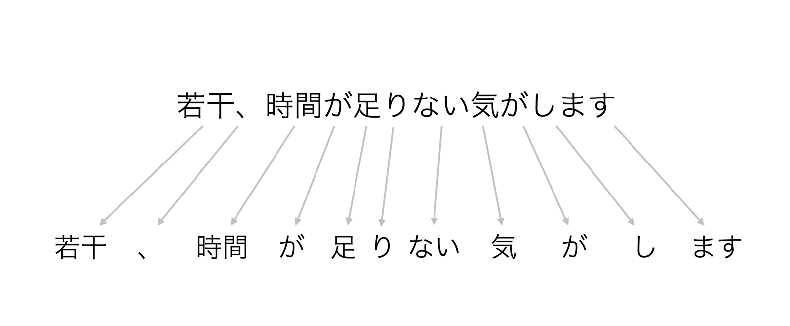

単語のカウントでは、次の問いに答えられます。

- どういった単語がよく使われているのか
- 一緒に使われる単語にはどういった特徴があるのか

## 必要なデータ

自由記述のテキストの列が必要です。一緒に使われる単語の組み合わせを調べたい場合は、1 行が 1 観察対象（例: 1 行が 1 回答者）のデータにします。

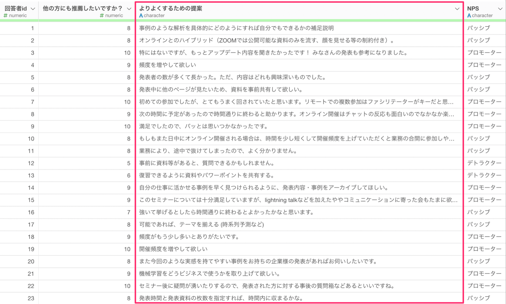

このページの例では、[セミナーのアンケートデータ](https://exploratory.io/data/exploratory/jfI9RBN3)を使います。1 行が 1 回答者で、「よりよくするための提案」の列に自由記述の回答が入っています。

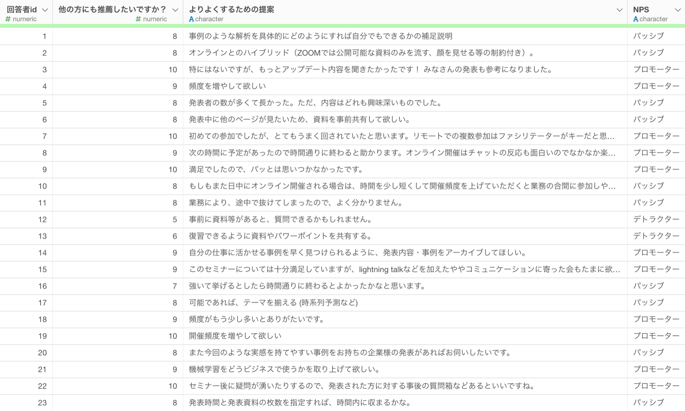

## 使い方

1. アナリティクス・ビューを開き、タイプの「テキスト分析」から「単語のカウント（文章データ）」を選びます。

   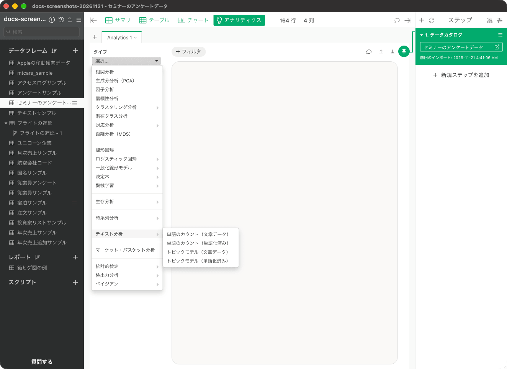

2. 「テキストの列」に「よりよくするための提案」を選びます。

   

3. 実行に時間がかかりすぎないよう、データは初期設定で 5000 行にサンプルされます。5000 行を超えるデータで全行を使うときは、「データをサンプルする」のチェックを外します。

   

4. 「実行」ボタンをクリックします。

   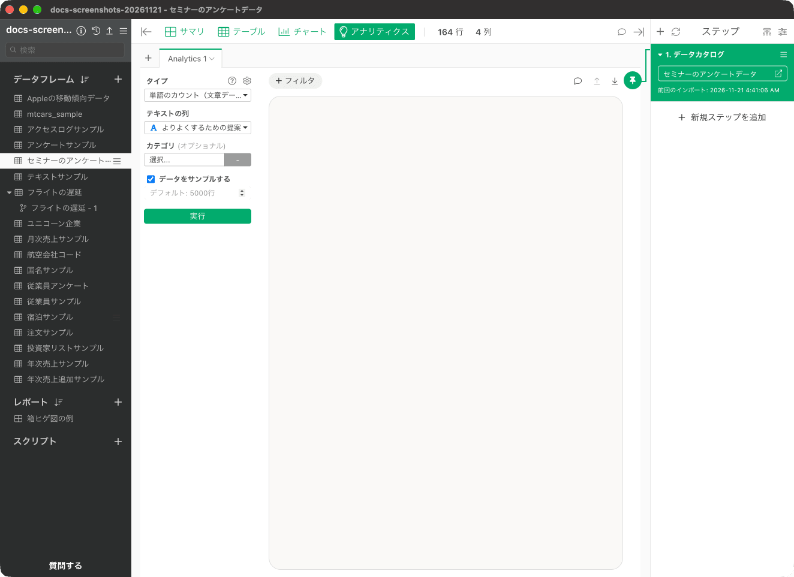

   単語のカウントが実行され、結果が表示されます。

   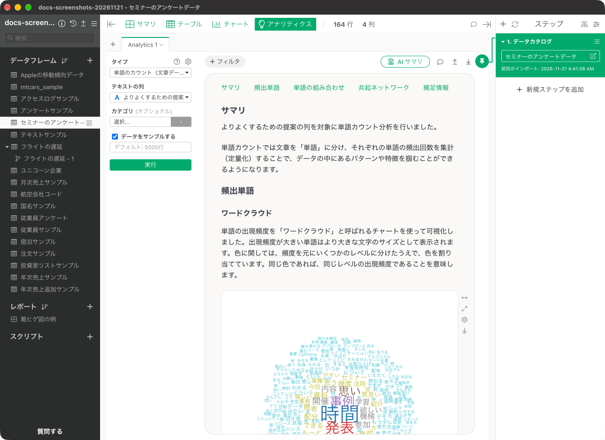

## 結果の見方

実行すると、結果がレポートとして表示されます。上部の「サマリ」「頻出単語」「単語の組み合わせ」「共起ネットワーク」「補足情報」のリンクから、それぞれの節に移動できます。

### ワードクラウド

「頻出単語」の最初に表示されます。出現頻度に応じて、単語の大きさと色が決まります。

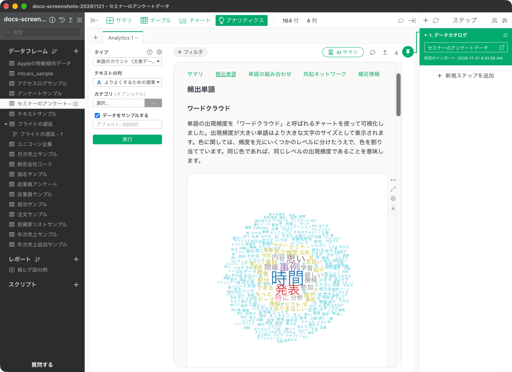

チャート右の拡大ボタンを押すと、大きく表示できます。この例では「時間」が最も多く表示され、「発表」「事例」が続きます。

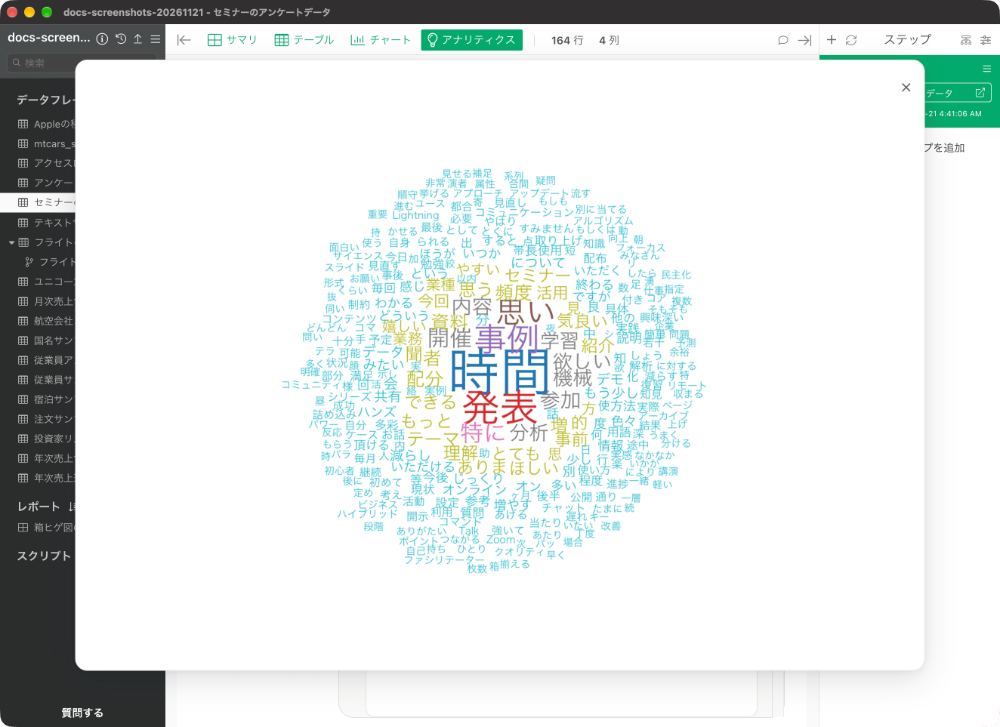

### 単語 - バー

ワードクラウドでは、それぞれの単語が何回出てきたのか、どの順番で多いのかまではわかりません。「頻出単語」の「単語 - バー」では、よく使われている単語とその出現回数をバーチャートで確認できるため、単語どうしの多い少ないを比べやすくなります。

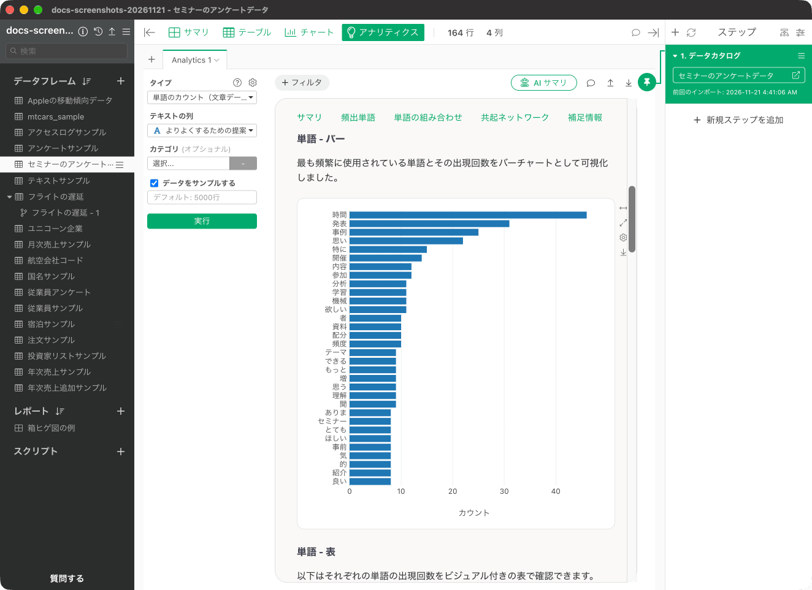

「時間」「発表」「事例」の順に多く使われています。

### 単語 - 表

「単語 - 表」では、それぞれの単語の出現回数を、棒つきの表で確認できます。検索欄に単語を入力すると、表を絞り込めます。「時間」は 46 回、「発表」は 31 回、「事例」は 25 回です。

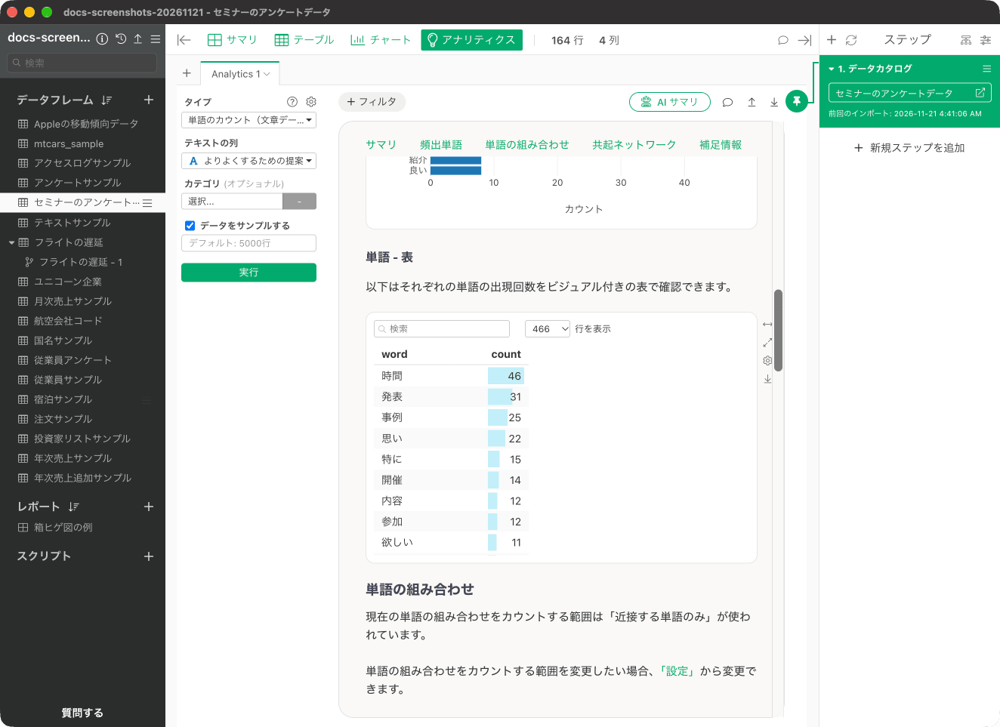

### 単語 - データ

単語に分けたあとの、1 行に 1 単語が入ったデータを見たいときは、元のデータフレームのブランチで「テキストの単語化」のステップを実行します。結果は 1128 行で、列は document_id、sentence_id、token です。document_id は文書番号（元のデータの行番号）、token が単語です。

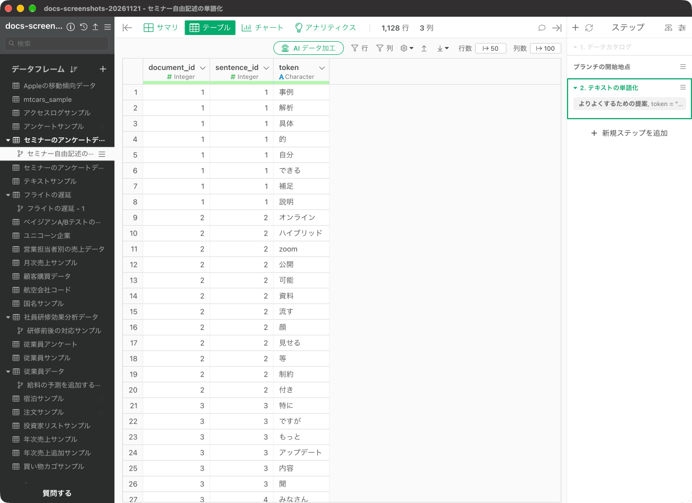

### 単語の組み合わせ

一緒に使われている単語の組み合わせを集計した節です。組み合わせを数える範囲は、「設定」の「組み合わせをカウントする範囲」で変えられます。「近接する前後の単語数」は、ストップワードなどを除いたあとに、何単語先までをペアとして数えるかを指定するオプションです。

「単語ペア - バー」では、単語の組み合わせの出現回数をバーチャートで確認できます。この例では「近接する単語のみ」で前後 1 語のペアを数えていて、「学習 / 機械」の組み合わせが最も多くなります。

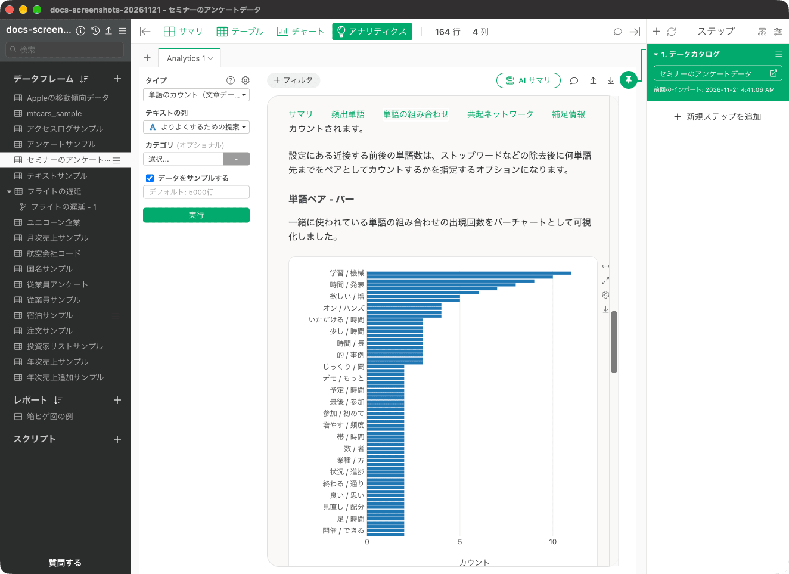

「単語ペア - 表」では、単語ペアごとの出現回数を、棒つきの表で確認できます。この例の表では、「学習 / 機械」が 11 回、「配分 / 時間」が 10 回です。列は word.1、word.2、count です。

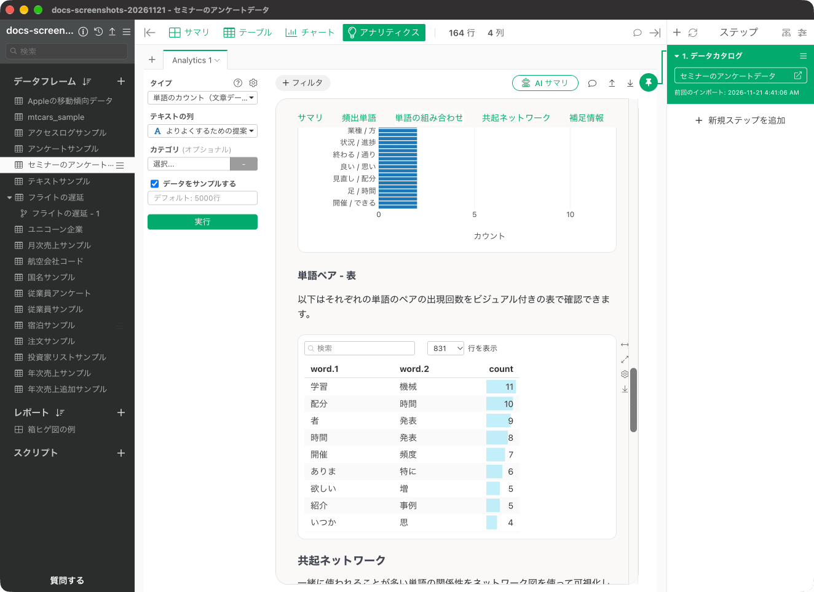

### 共起ネットワーク

「単語の組み合わせ」の表やバーでは、どの組み合わせが最もよく一緒に使われているかはわかりますが、3 つ以上の単語にまたがる関係まではわかりません。「共起ネットワーク」では、一緒に使われる単語どうしのつながりを、ネットワークとして見られます。一緒に使われる頻度をもとに単語がグループに分けられ、グループごとに色が付きます。

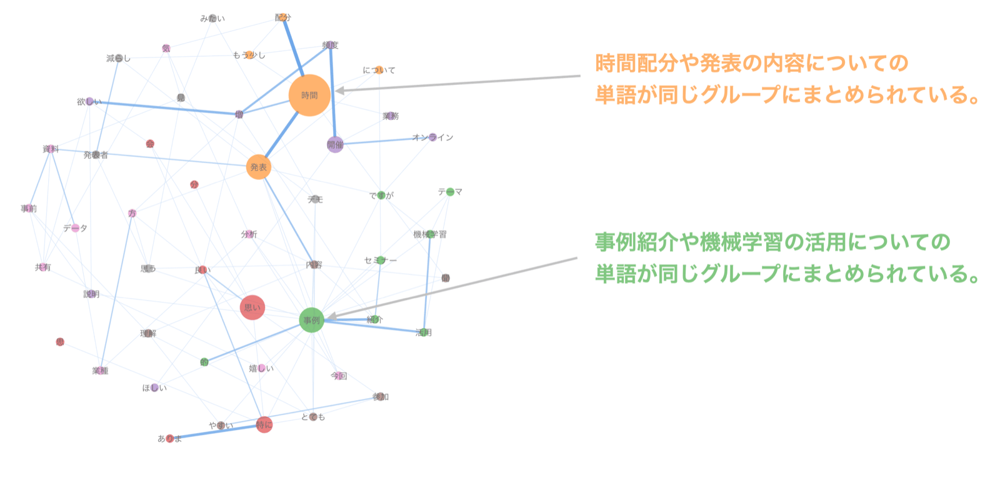

円の大きさは出現頻度を表します。頻度が高いほど大きくなります。

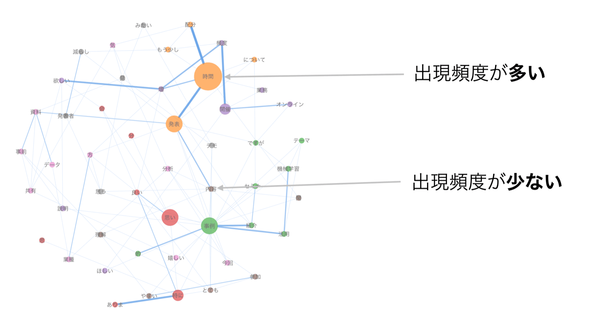

よく一緒に使われる単語の組み合わせは、より太い線で結ばれます。

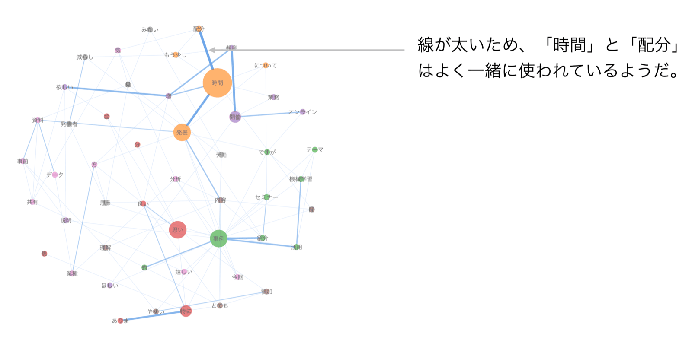

### グループと単語の関係

データに性別や年代などのカテゴリの列がある場合は、単語ごとにカテゴリの比率を見られます。このデータには、NPS（デトラクター、パッシブ、プロモーター）の列があります。「カテゴリ」に「NPS」を選んで実行すると、「グループと単語の関係」の節が加わり、単語ごとの NPS のグループの割合が 100% 積み上げのバーで表示されます。

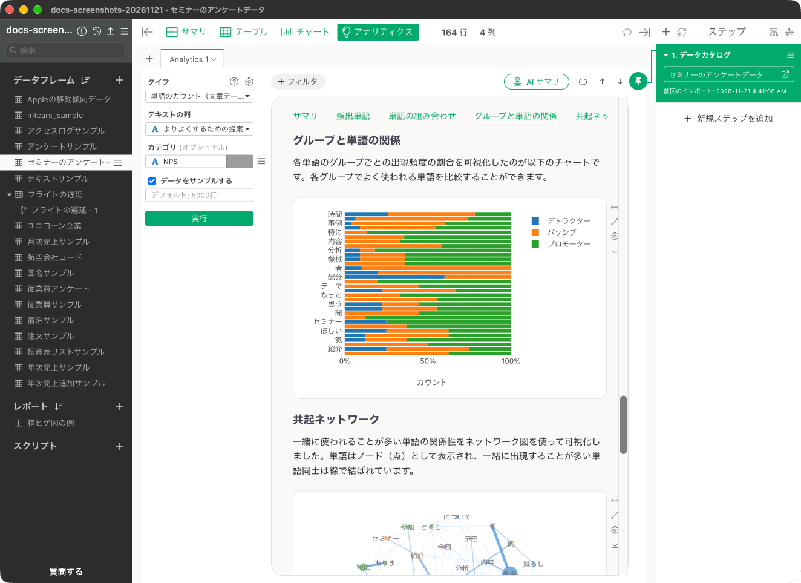

デトラクターは青、パッシブはオレンジ、プロモーターは緑です。この例では、「配分」でデトラクター（青）の割合が比較的大きく見えます。

## ストップワードと「つなぐ単語」の辞書

あまりに一般的で文章の特徴を表さない単語を除く「ストップワード」と、分かれてしまう単語を 1 つの単語として扱う「つなぐ単語」は、辞書として登録して使えます。タイプの右にある歯車の「設定」を開くと、「テキストの単語化」に「追加のストップワード辞書」と「つなぐ単語の辞書」の選択欄があります。辞書がないときの初期値は「(なし)」です。

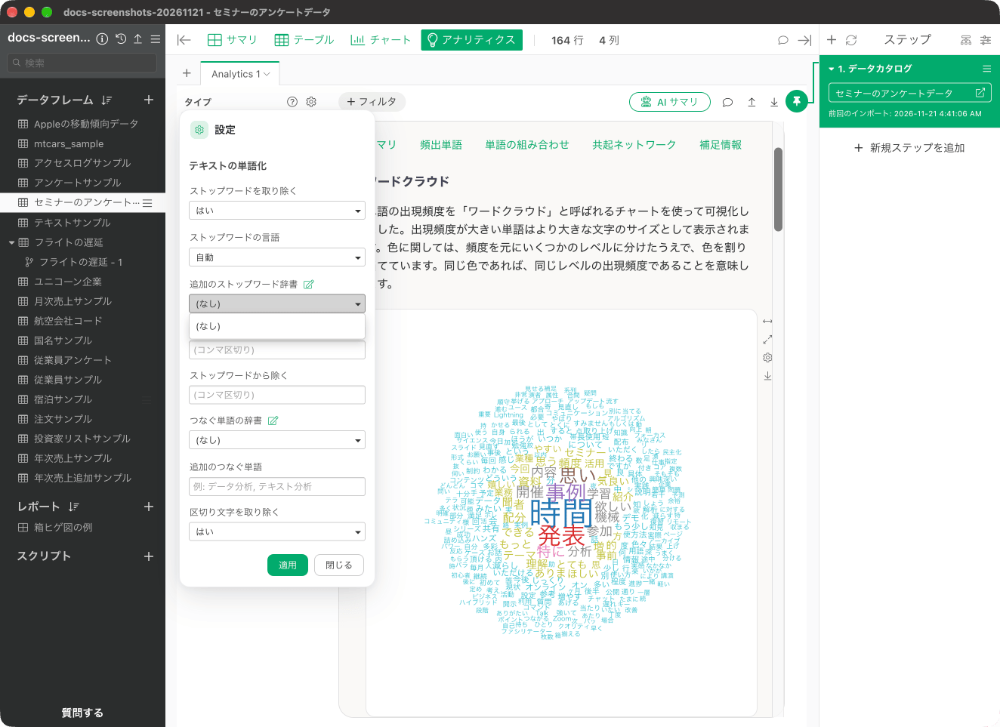

辞書には、1 行に 1 単語ずつ入力して登録します。

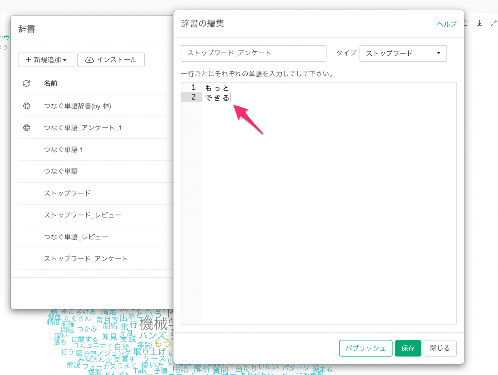

辞書は Exploratory サーバーにパブリッシュして、チームメンバーと共有できます。

## よくある質問

### ワードクラウドに表示される単語数を増やしたい

初期設定では 300 単語が表示されます。

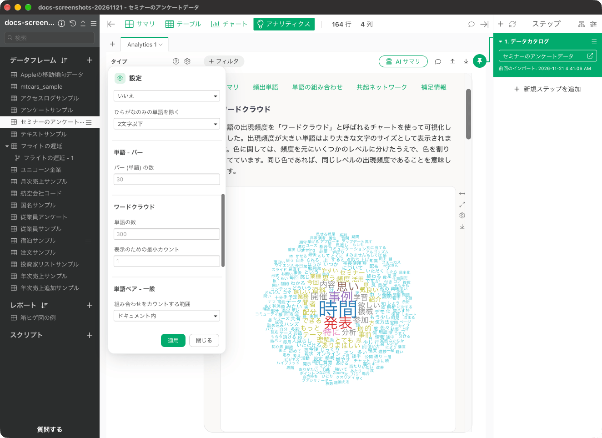

タイプの右にある歯車の「設定」で、「ワードクラウド」の「単語の数」を変更します。下の画面は、400 を入力した例です。

### 「表示のための最小カウント」は何をする設定か

「設定」の「ワードクラウド」にある、表示する単語を出現回数が指定した回数以上のものに絞る設定です。初期値は 1 なので、1 回以上出てきた単語が表示の候補になります。表示する単語の数は、初期設定で最大 300 語です。

2 回以上出てきた単語だけを表示したいときは、「表示のための最小カウント」を 2 にして実行します。

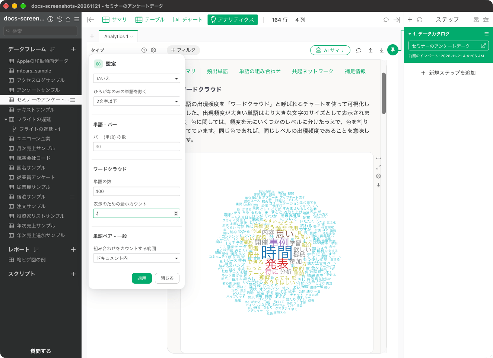

### 「共起ネットワーク」の文字の大きさ、円の大きさ、線の太さを変えたい

「共起ネットワーク」の節にあるチャートの設定（歯車）メニューで、「テキスト」「ライン」「サークル」に関する設定を調整できます。文字の大きさは「フォントサイズ (比率)」（初期値 1.2）で変えます。線の太さは「線の幅の最大値 (px)」（初期値 8）と「線の幅の最小値 (px)」（初期値 1）、円の大きさは「サークルの大きさの最大値 (px)」（初期値 20）などで変えます。

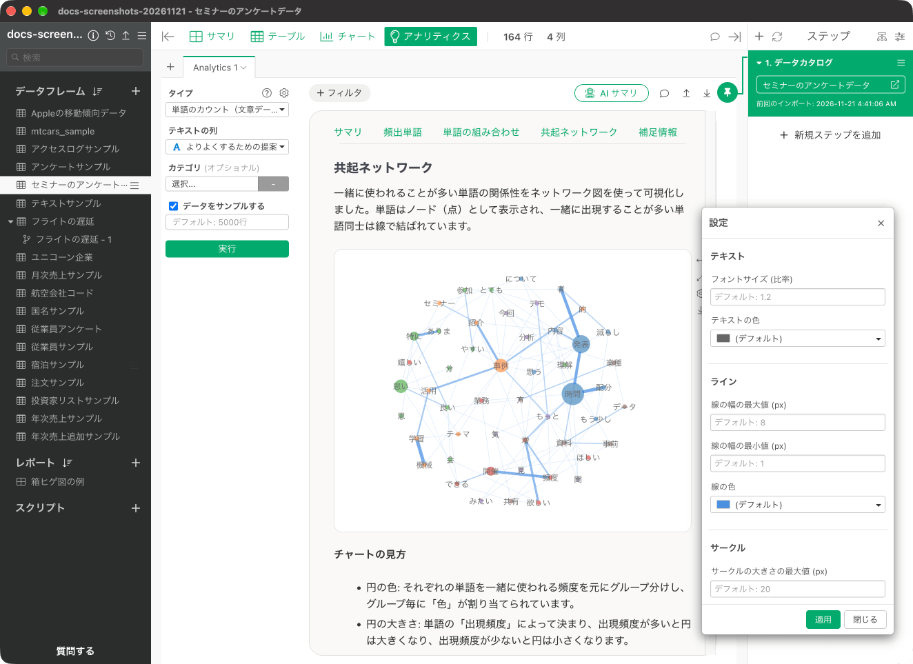

### ワードクラウドの表示幅や単語数を変えたい

ワードクラウドの大きさや表示される単語の数は、次の方法で変えられます。

- ステップのペインを閉じて「幅を広げて表示」にすると、結果の領域が広がります（下の画面）。

  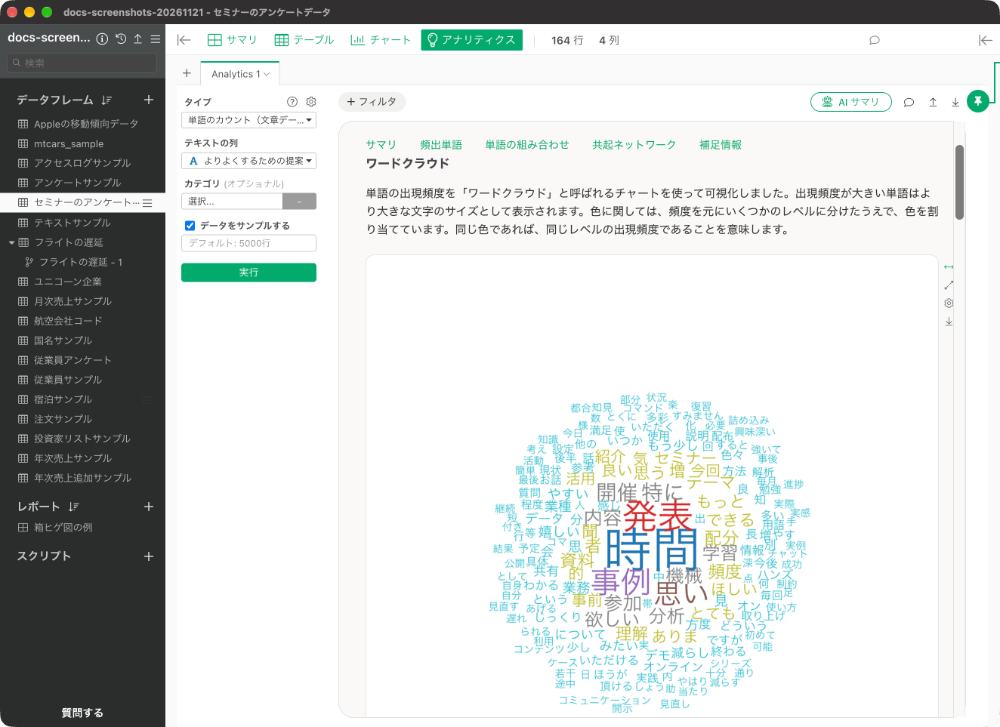

- 「設定」の「ワードクラウド」で、表示する単語の数を、初期値の 300 から変えます（下の画面は 150 にした例です）。

  

- 「表示のための最小カウント」の値を増やして、表示する単語を絞ります（下の画面は 3 にした例です）。

  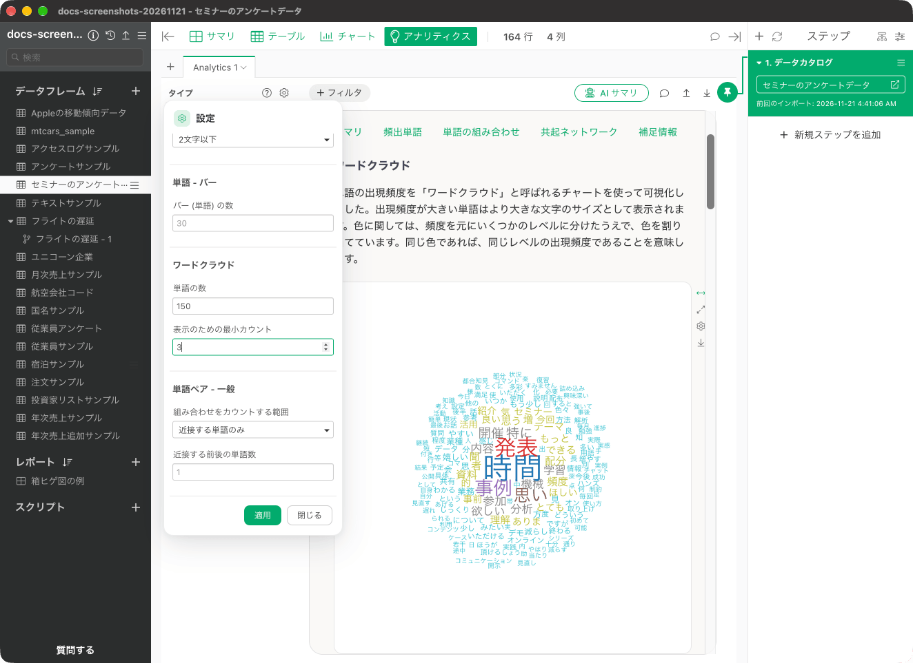

### 単語の組み合わせの回数が実際のデータより多く見える

たとえば、「学習してみたい」「機械学習を勉強する」「機械を学習する」「機械について学習する」という 4 つの文章があるとします。「機械学習」として使われているのは 1 つだけですが、「機械」と「学習」の組み合わせは 3 件あるように思えます。

この文章を単語に分けると、次のようになります。

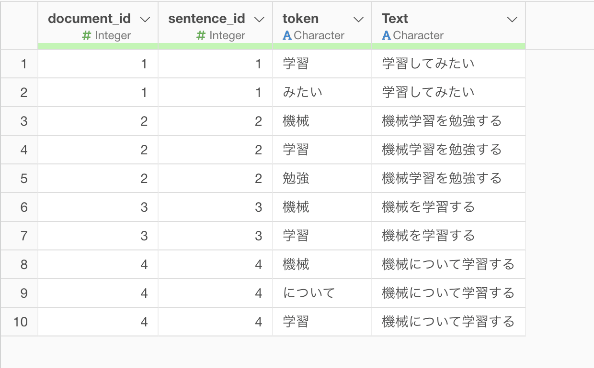

「設定」の「単語ペア - 一般」で「組み合わせをカウントする範囲」を「近接する単語のみ」にします。「近接する前後の単語数」が初期値の 1 のとき、「機械」と「学習」の組み合わせは 2 件と数えられます。

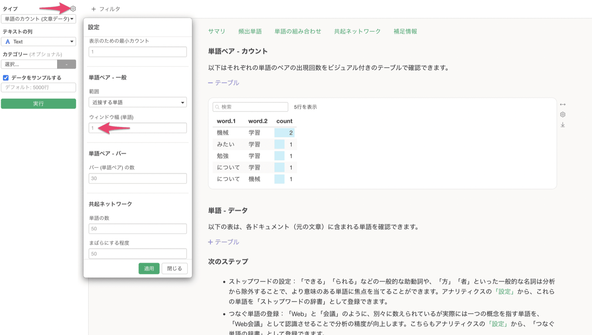

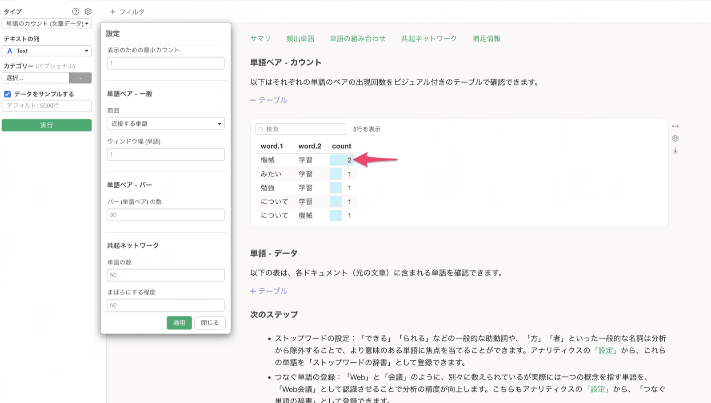

数えられるのは、単語に分けるときにストップワードと 2 文字以下のひらがなを除いた結果、「機械」と「学習」が隣り合う次の 2 つの文章です。

- 機械学習を勉強する → 機械, 学習, 勉強
- 機械を学習する → 機械, 学習

「機械について学習する」は、「機械, について, 学習」と分かれます。「近接する前後の単語数」が 1 のときは「機械」と「について」の組み合わせが数えられるため、「機械」と「学習」の組み合わせには入りません。「近接する前後の単語数」を 2 にすると、「機械について学習する」も「機械, 学習」の組み合わせとして数えられます。

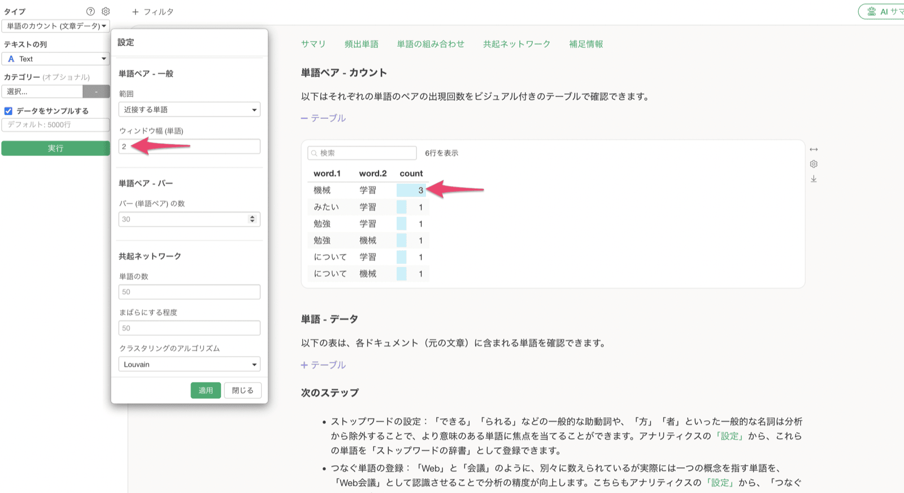

この例では、ストップワードと 2 文字以下のひらがな語を除いたあと、指定した前後の範囲でペアを数えます。

実際のデータを確かめるには、テーブルビューの行フィルタで「この文字列を含む」を使い、該当の単語で絞り込みます。「機械」と「学習」の 2 つのフィルタ条件を作って AND を指定すると、2 つの単語を両方含む文章を確認できます。

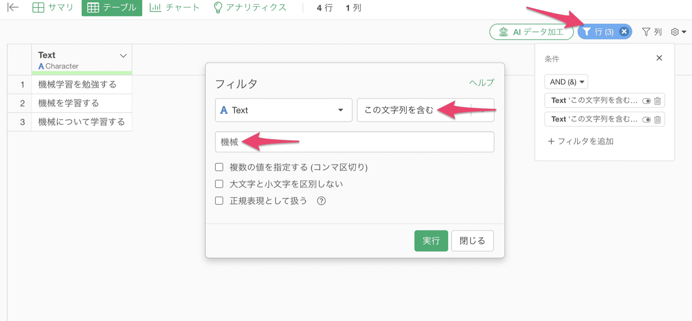

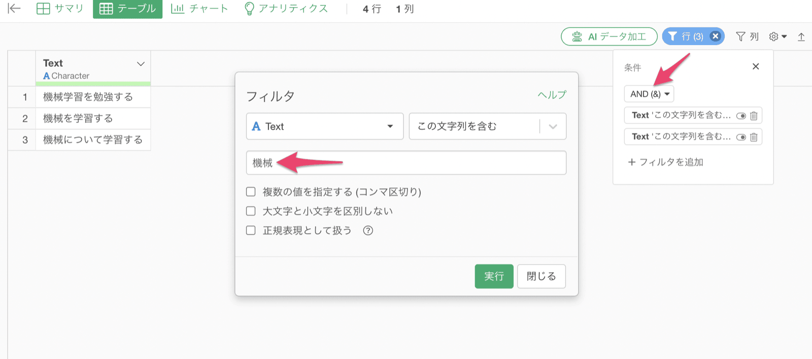

### 「近接する前後の単語数」は何を調整する設定か

「設定」の「単語ペア - 一般」にある「近接する前後の単語数」は、単語のペアを集計するとき、前後何単語までをペアとみなすかを決める設定です。初期値は 1 で、ある単語に注目したとき、その直前または直後の単語がペアとして扱われます。

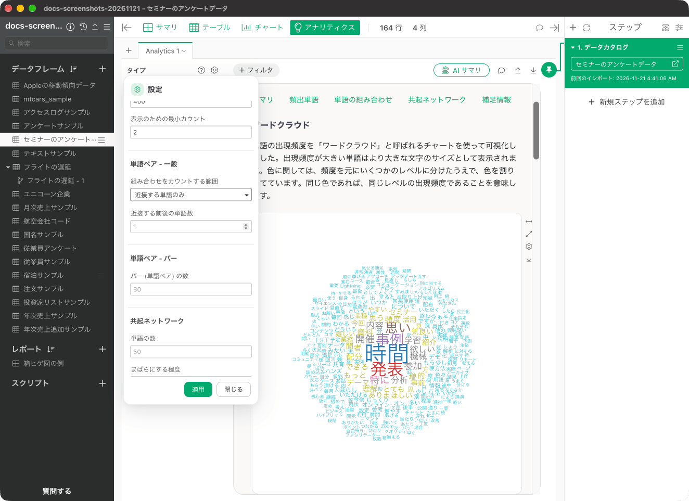

「組み合わせをカウントする範囲」の初期値は「ドキュメント内」で、上の画面ではこれを「近接する単語のみ」に変えています。「近接する前後の単語数」を使うのは、「近接する単語のみ」を選んだときです。ここで説明した回数の数え方は、この設定のときのものです。
