時系列クラスタリングは、時系列のトレンドが似たグループを分類するアナリティクスです。

## 何ができるか

下のように、時系列のトレンドをグループ別（例：都道府県、国）に可視化したチャートがあったとします。

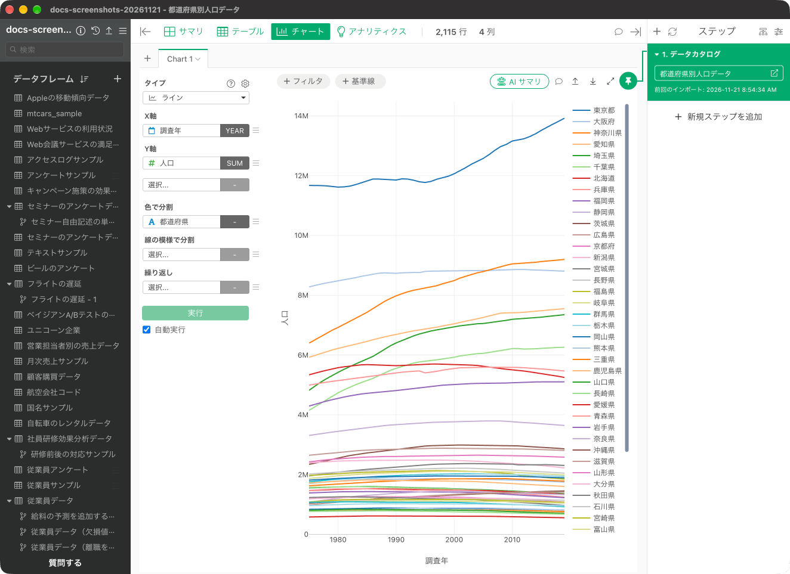

線の数（グループの数）が多すぎて、どういった特徴があるのかをすぐに判断するのは困難です。時系列クラスタリングを使うと、トレンドが似たグループをまとめられます。

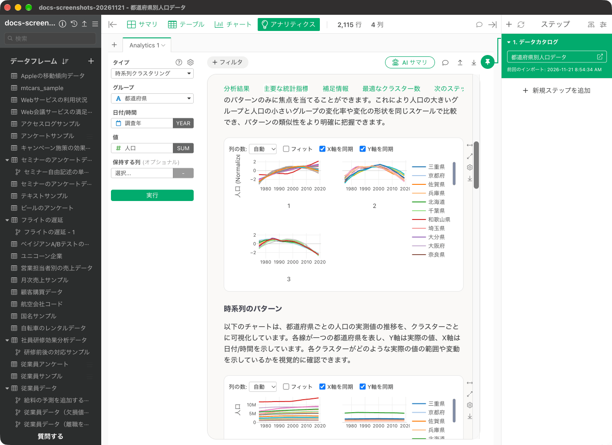

時系列クラスタリングを使うと、次の質問に答えられます。

- 同じようなトレンドの傾向があるグループは何か。
- そのグループの時系列のトレンドには、どういった特徴があるか。

## 時系列クラスタリングを実行する

今回はサンプルデータとして、[都道府県別の人口データ](https://exploratory.io/data/exploratory/vRt4XMq2)を使用していきます。

このデータは1行が都道府県別の1年単位のデータで、列には調査年、都道府県、人口などの列があります。

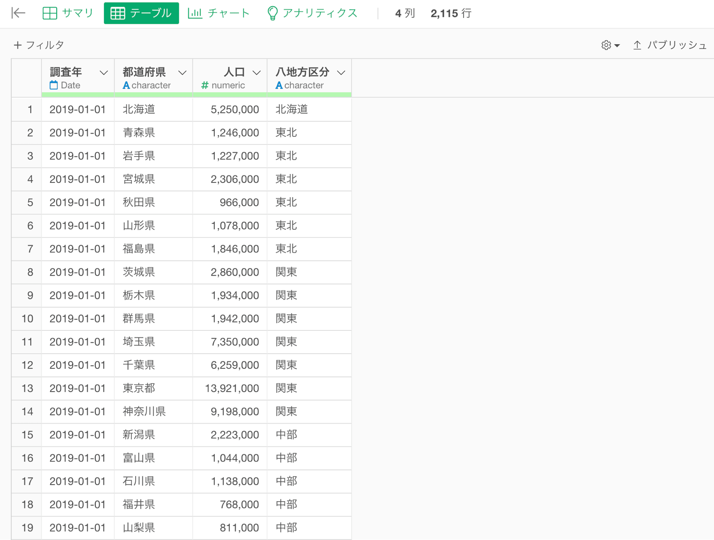

------------------------------------------------------------------------

アナリティクスビューを開き、「タイプ」のメニューから「時系列分析」を選ぶと、「時系列予測（Prophet）」「時系列予測（ARIMA/SARIMA）」「時系列クラスタリング」が表示されます。ここでは「時系列クラスタリング」を選択します。

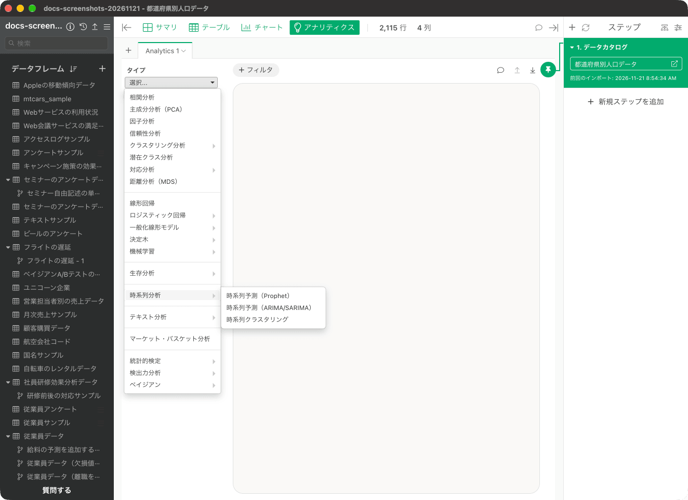

「グループ」に「都道府県」、「日付/時間」には「調査年」を選び、「丸め処理」から「年」を指定します（表示は「調査年」の横が YEAR になります）。「値」に「人口」（SUM）を選択します。最後に、実行ボタンをクリックします。

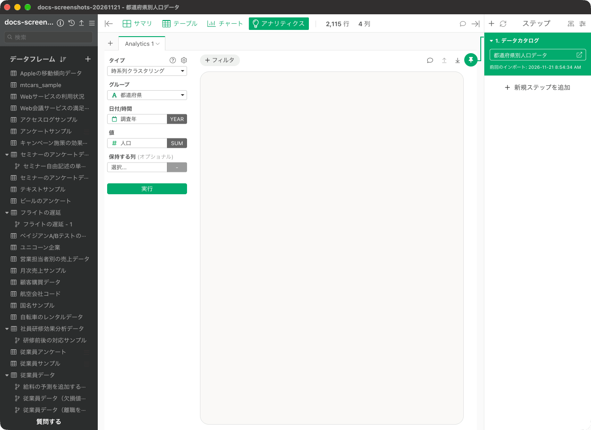

都道府県別の人口のデータを使って、時系列クラスタリングを実行できました。「分析結果」には、都道府県が3個のクラスター（グループ）に分類されたことと、クラスターごとのグループの数が表示されます。この例では、クラスター1が20、クラスター2が11、クラスター3が16都道府県です。

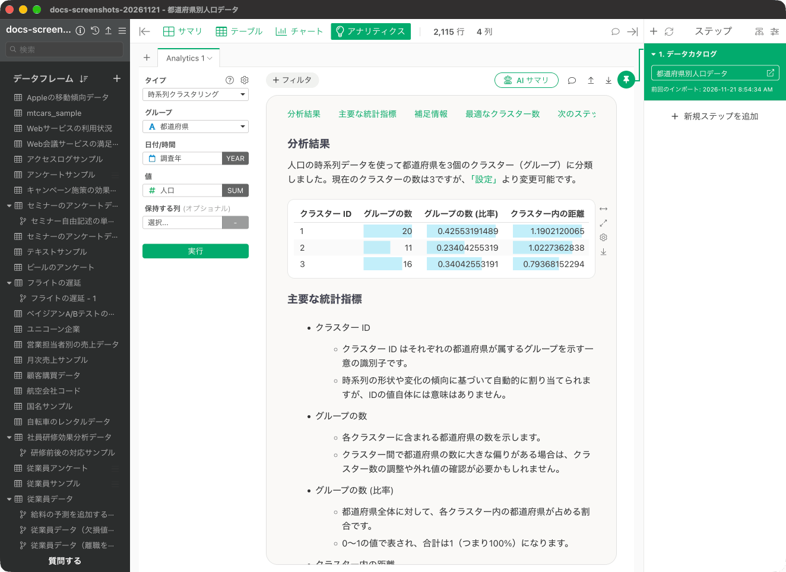

デフォルトのクラスターの数は3ですが、「設定」の「クラスタリング」からクラスターの数を変更できます。同じ画面で、クラスター中心の計算アルゴリズム（初期値は DTW Barycenter Averaging）、距離の計算アルゴリズム（初期値は DTW with L2 Norm）、ランダム・シードも変更できます。

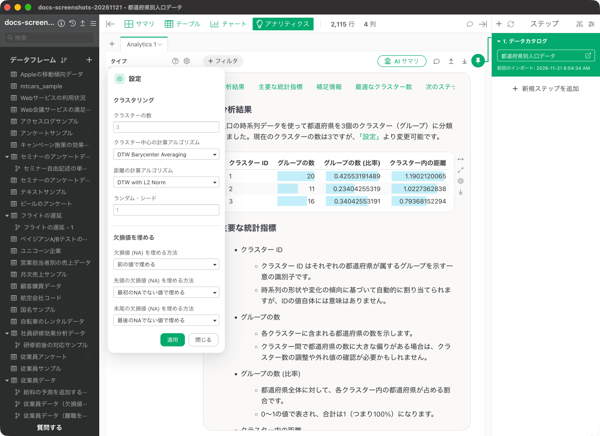

## 結果の解釈

結果はレポートとして縦に並び、上部の「分析結果」「主要な統計指標」「補足情報」「最適なクラスター数」「次のステップ」といったリンクから各節へ移動できます。

### 時系列のパターン

「時系列のパターン」では、都道府県ごとの人口の実測値の推移を、ラインチャートでクラスターごとに確認できます。

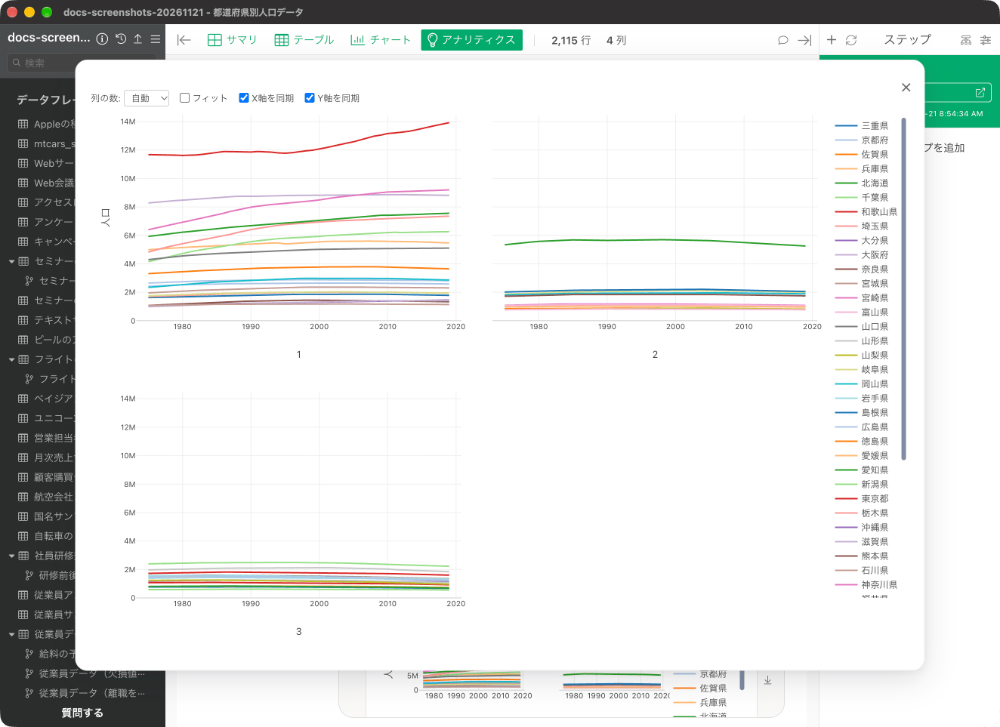

### 標準化された時系列のパターン

「標準化された時系列のパターン」では、先ほどの「時系列のパターン」と似ていますが、値はそれぞれのグループで標準化した値を可視化しています。

今回の都道府県ごとの人口のように、東京都と沖縄県では人口に大きな違いがあります。しかし、人口の大きさに違いがあるグループがあったとしても、その都道府県の時系列のトレンドが上がっているのか、下がっているのかを同じ基準で確認しやすくしたのが、標準化された時系列のパターンです。

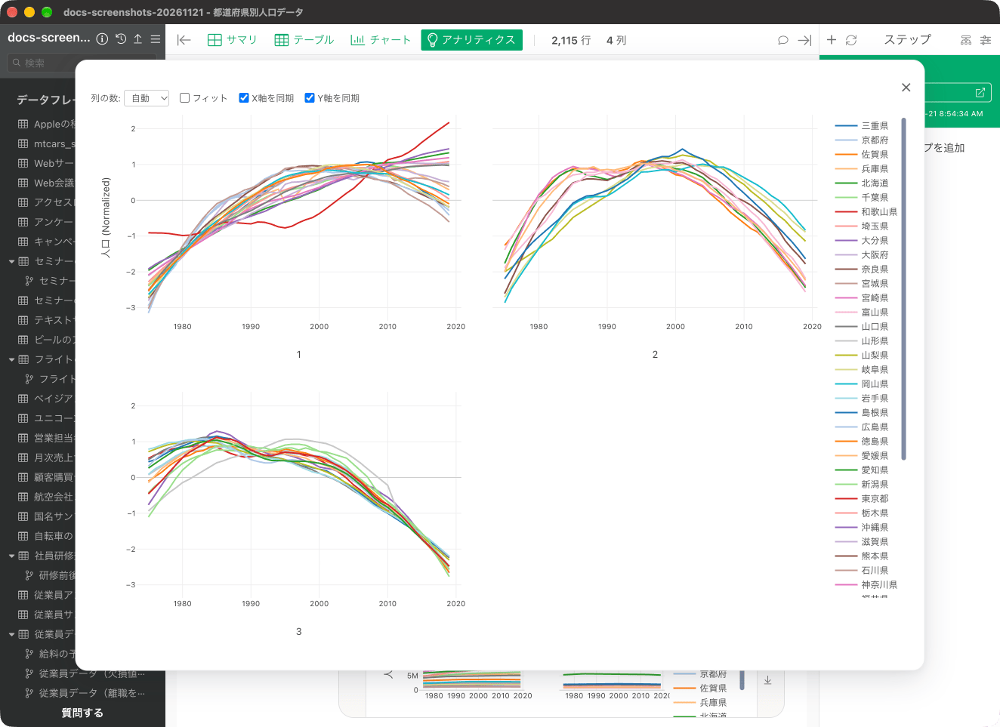

### クラスターの中心パターン

「クラスターの中心パターン」では、グループごとに描かれた線の中心となる線をクラスターごとに引いたものが「赤色」の線として確認できます。この中心線をみることで、そのクラスターでは時系列のトレンドが上がっているのか、下がっているのかを視認しやすくなります。

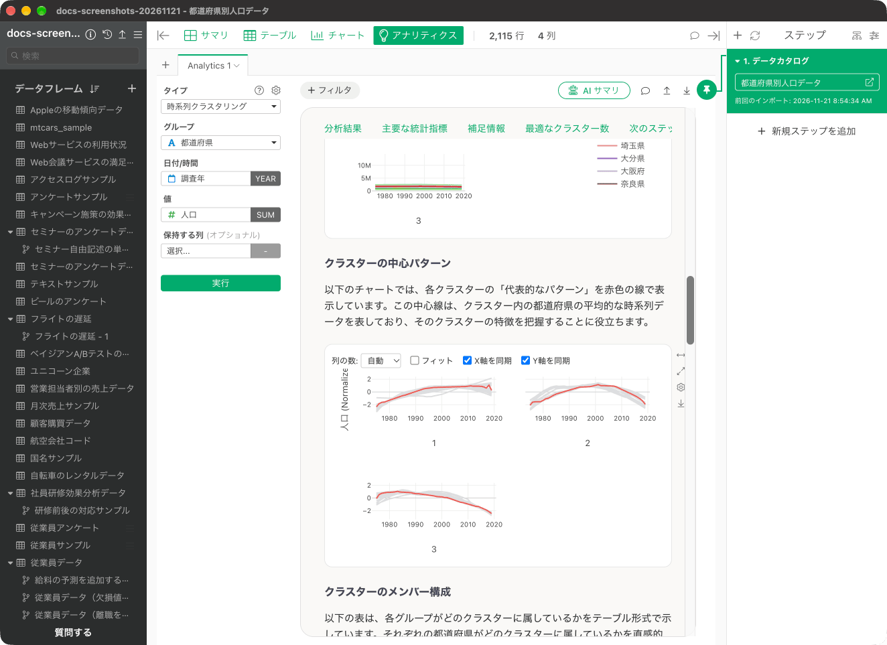

### クラスターのメンバー構成

「クラスターのメンバー構成」では、グループに設定したカテゴリが、どのクラスターに属しているかを表形式で確認できます。

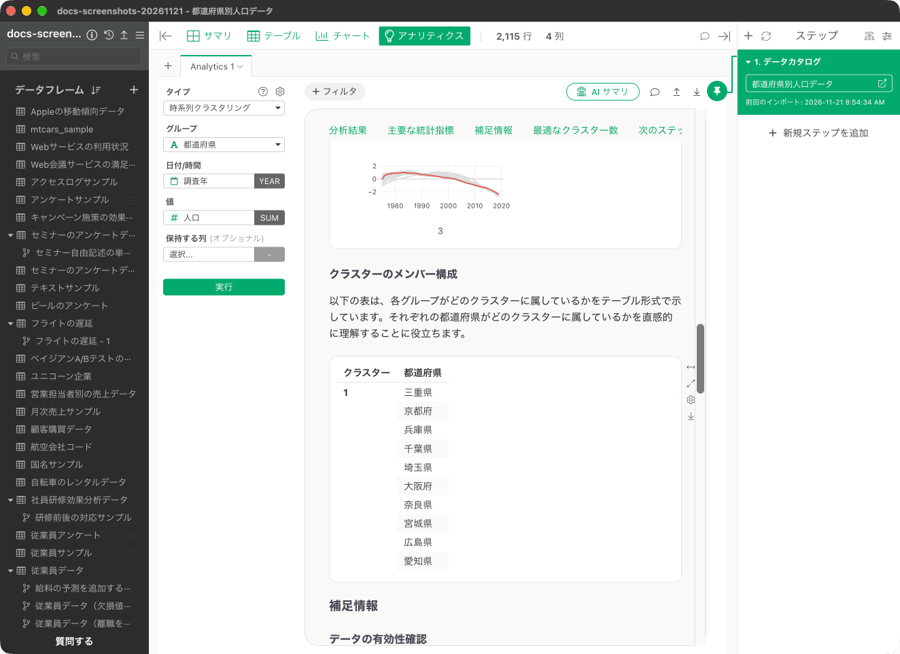

## 時系列クラスタリングに関するよくある質問

#### Q: グループ別にデータの不足を調べるには
「補足情報」の「データの有効性確認」では、分析に使用したそれぞれのグループのデータが十分にあるかを確認できます。緑色の点は十分なデータがあることを示しており、データが欠損している、あるいは足りない期間はグレーで表されます。

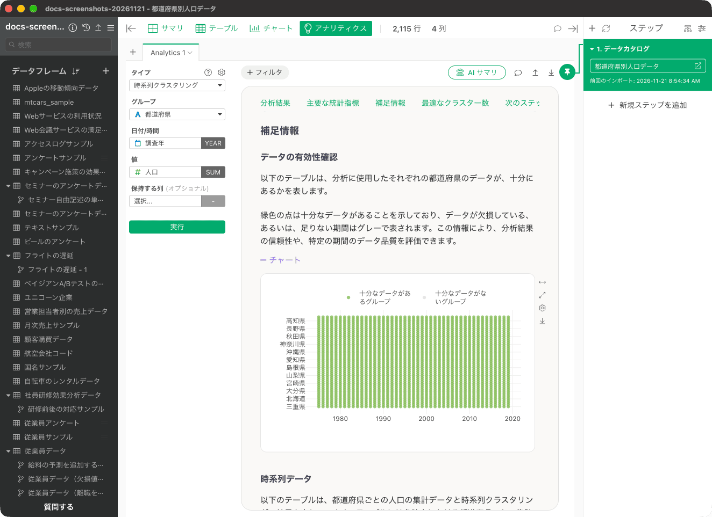

「設定」の「欠損値を埋める」にある「欠損値 (NA) を埋める方法」では、欠損値の埋め方を選べます。選択肢は「前の値で埋める」（初期値）、「0で埋める」、「線形補間」、「スプライン補間」です。

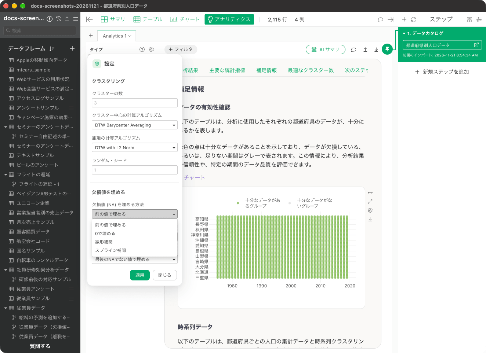
