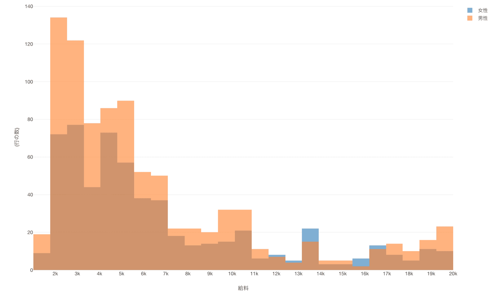
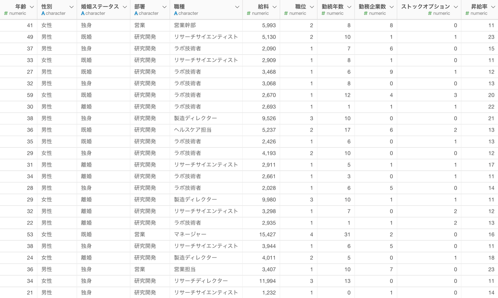
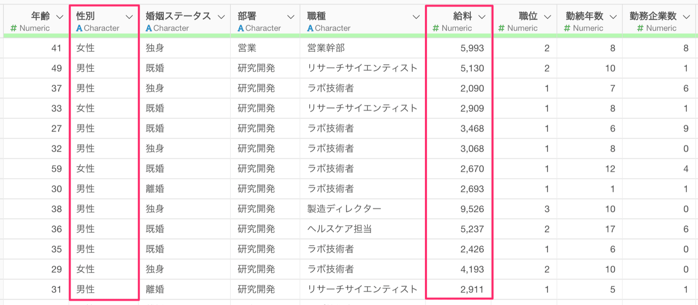
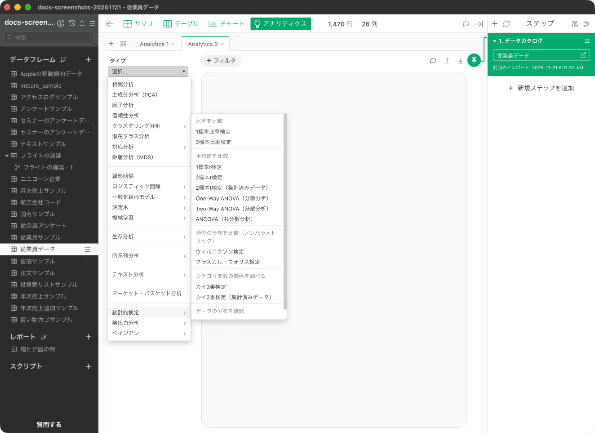
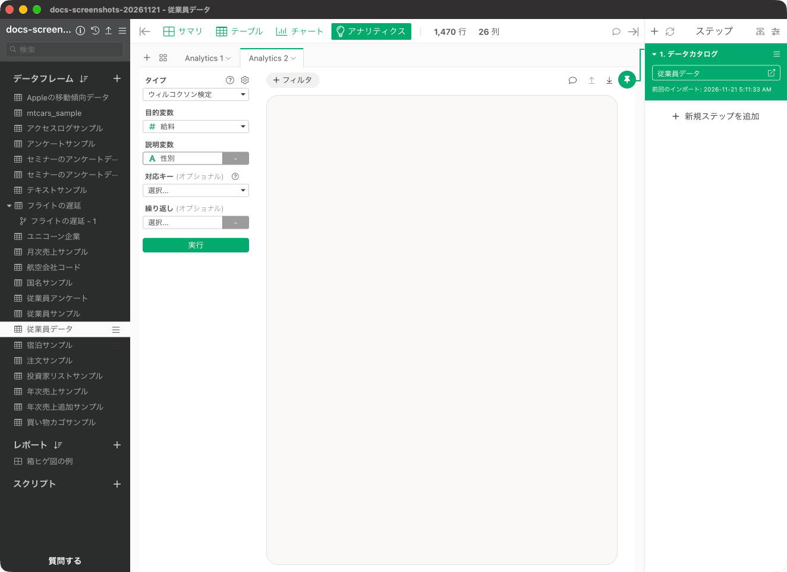
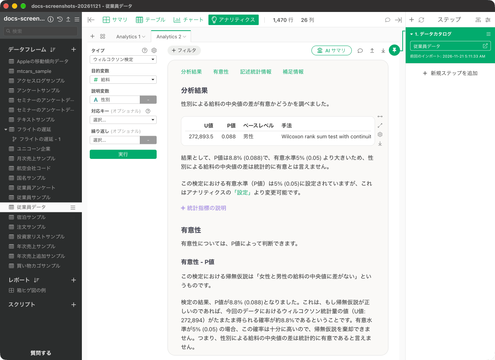

ウィルコクソン検定（ウィルコクソンの順位和検定）は、元のデータの分布が正規分布であるという前提がないノンパラメトリック検定の一つです。「2 つ」のグループ間で、分布に違いがあるかを検定するアナリティクスです。

## 何ができるか

たとえば、男性と女性の給料の分布を可視化したヒストグラムがあるとします。2 つの分布は完全には同じではありませんが、2,000 ドルから 3,000 ドルの給料をもらっている人が最も多いなど、似ているようにも見えます。この分布の差が意味のある違いかどうかは、ヒストグラムだけでは判断できません。ウィルコクソン検定を使うと、2 つのグループの分布に意味のある違いがあるかどうかを検証できます。

## 使い方

このページの例では、[従業員データ](https://exploratory.io/data/exploratory/CAj2fan5)を使います。1 行が 1 従業員で、年齢、給料、職種など従業員の属性を表す列があります。

「男性」と「女性」の間で、「給料」の分布に統計的に有意な差があるかを調べます。「性別」の一意な値は「男性」と「女性」の 2 つです。

1. アナリティクス・ビューを開き、タイプの「統計的検定」の「順位の分布を比較（ノンパラメトリック）」から「ウィルコクソン検定」を選びます。

   

2. 目的変数に「給料」、説明変数に「性別」を選び、「実行」ボタンをクリックします。

   

   性別が「男性」と「女性」の間で、給料の違いが有意かどうかを調べるウィルコクソン検定が実行され、結果がレポートとして表示されます。上部の「分析結果」「有意性」「記述統計情報」「補足情報」のリンクから、それぞれの節に移動できます。「対応キー」と「繰り返し」は任意の項目で、この例では選びません。

## 結果の見方

### 分析結果

検定の結果が有意かどうかを確認できます。この例では、U 値が 272,893.5、P 値が 0.088、ベースレベルが「男性」です。

帰無仮説は「女性と男性の給料の中央値に差がない」です。P 値は、帰無仮説のもとで、観測した検定統計量（この例では U 値）と同じか、それ以上に極端な値が得られる確率です。一般的には、0.05（5%）を下回ると有意とされます。この例の P 値は 8.8%（0.088）で、有意水準 5%（0.05）より大きいため、有意差は検出されませんでした。性別による給料の中央値の差は、統計的に有意ではありません。有意水準は、アナリティクスの「設定」から変更できます。
