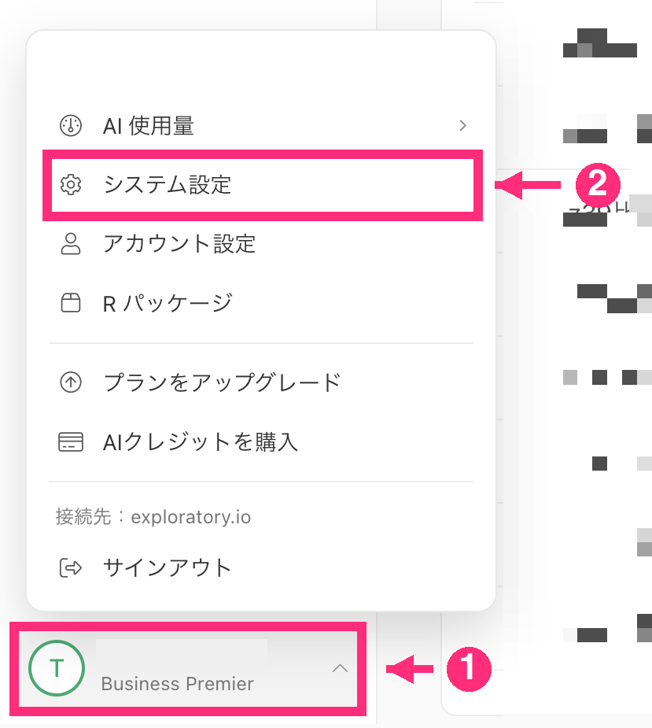
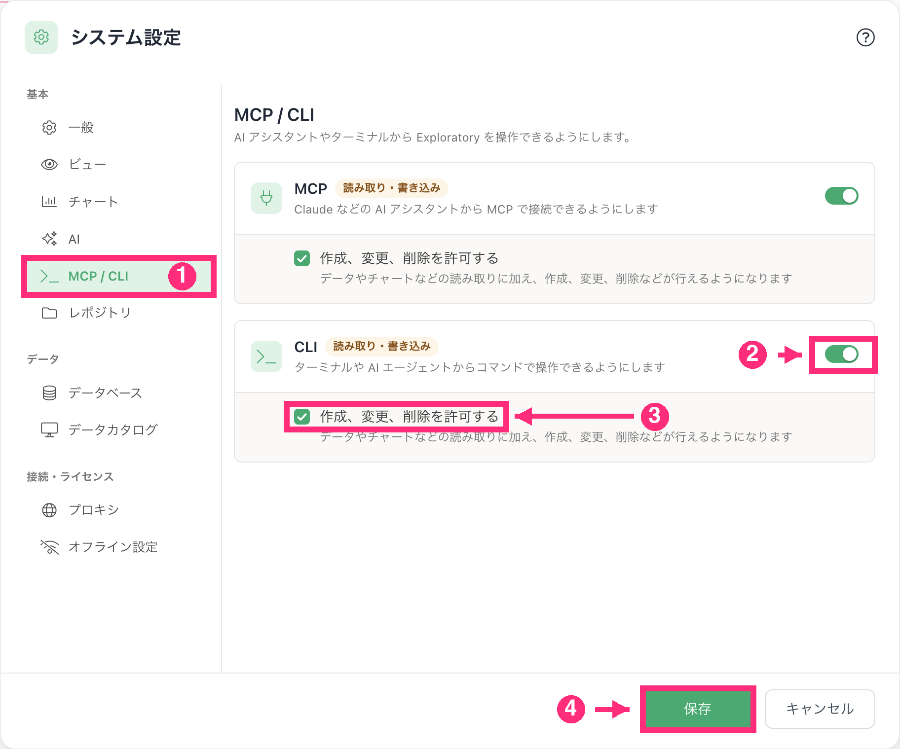

expl は Exploratory Desktop に同梱されています。別途インストールする必要はありません。

<a id="enable"></a>

## 最初に CLI をオンにする

Exploratory Desktop の CLI は、初期状態ではオフです。expl が使える状態でも、オンにするまで、Desktop は expl のコマンドを受け付けません。

1. Exploratory Desktop で、画面の左下にある自分の名前を選び、開いたメニューで「システム設定」を選びます（画面の画像 1 の ① と ②）。



2. システム設定の左のメニューで、MCP / CLI を選びます（画面の画像 2 の ①）。
3. 「CLI」のカードのスイッチをオンにします（画面の画像 2 の ②）。
4. expl でコンテンツの作成、変更、削除もしたいときだけ、「作成、変更、削除を許可する」にもチェックを入れます（画面の画像 2 の ③）。
5. 画面の下の「保存」を選びます（画面の画像 2 の ④）。



<a id="bundled"></a>

## Exploratory Desktop への同梱

Exploratory Desktop を起動すると、expl が PATH（コマンドを探すフォルダの一覧）に含まれていない場合は、自動的に追加されます。新しく開いたターミナルから使用できます。Node.js のインストールは必要ありません。

macOS では、アプリが /Applications または \~/Applications にある場合に限り、追加されます。

新しいターミナルを開いて、次を実行してください。

```sh
expl --version
```

<a id="where"></a>

## インストール先

| OS | インストール先 |
| --- | --- |
| macOS | /usr/local/bin/expl（管理者の許可を断ったときは \~/.local/bin/expl） |
| Windows | \<インストール先\>\\cli をユーザーの PATH に追加します。管理者の権限は必要ありません。 |

macOS で /usr/local/bin に置くときは、管理者の許可を求められることがあります。断ると、expl は \~/.local/bin に置かれます。必要なら、そのフォルダを PATH に追加してください。置かれた場所は、`which expl` で確かめられます。

同じコマンドが、別名 exploratory と、MCP 用の exploratory-mcp としても追加されます。その名前がすでにほかのコマンドで使用されている場合は、その名前のみ追加されません。

<a id="two"></a>

## npm でもインストールしている場合

npm でインストールした expl と Desktop の expl の両方がある場合は、どちらが実行されるかを確認します。

### macOS と Linux

```sh
which -a expl
```

インストールされているものを、実行される順にすべて表示します。

### Windows

```sh
where expl
```

<a id="update"></a>

## 更新する

Desktop に同梱されている expl は、Exploratory Desktop を更新すると更新されます。バージョンは `expl --version` で確認できます。npm でインストールした expl の更新は、[更新する](/ja/cli/server/install#update)を参照してください。

バージョンごとの変更点は、[リリースノート](/ja/release-notes_ja)で確認できます。

<a id="remove"></a>

## アンインストール

| OS | アンインストール方法 |
| --- | --- |
| macOS | /usr/local/bin/expl、/usr/local/bin/exploratory、/usr/local/bin/exploratory-mcp を ls -l で確認し、Exploratory が追加したものだけを削除します（rm \<パス\>。管理者の権限が必要な場合は sudo を付けます）。ほかの場所から入った同名のコマンド（npm でインストールしたものなど）は、削除しません。許可を断った場合は、\~/.local/bin にある同じ名前を確認して削除します。アプリを /Applications に置いたままにすると、次回の起動時に再び追加されます。 |
| Windows | 「システム環境変数の編集」を開き、ユーザー環境変数の Path から \<インストール先\>\\cli を削除します。次回の起動時に再び追加されます。 |

Desktop につなぎ、最初のコマンドを実行する手順は、[はじめる](/ja/cli/desktop/get-started#steps)を参照してください。
